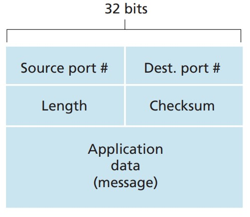

## UDP

UDP is a bare-bones, lightweight transport protocol that offers only the most basic communication services. UDP is defined in [RFC 768], and it does about as little as a transport protocol can do. Apart from the multiplexing/demultiplexing function and some light error checking, it adds nothing to IP. In other words, if an application developer chooses UDP rather than TCP as the transport protocol, that application can be thought of as talking to IP directly, with no other wrapping around it.

UDP is connectionless, so no handshake is needed before two processes start communicating. That is why a server dedicated to a particular application can usually support far more online clients when the application runs over UDP rather than TCP.

UDP provides an unreliable data transfer service, that is:

- When a process sends a message into a UDP socket, UDP has no way to guarantee that the message will arrive at the receiving process.
- Messages that do arrive at the receiving process may arrive out of order.

There is no congestion control mechanism in the UDP protocol, so in theory a UDP sender can push data down to the layer below (the network layer) at any rate it likes. But note: because the intermediate links have limited transmission capacity or are congested, the actual end-to-end throughput may be lower than that rate.

Use cases: DNS queries, streaming media, online games and other real-time applications that don't need exact data but do need transmission efficiency.

**UDP segment structure** (see the figure below):

**UDP checksum**:
The "UDP checksum" is generally used for error detection, to determine whether the bits travelling inside a UDP segment were altered in transit or while being stored inside a router. From the UDP segment structure diagram you can see that the checksum is normally placed in the header of the UDP segment and travels along with all the data. When a check is needed, you add up all the received 16-bit binary data and the checksum; if no error occurred in the packet, the total should be sixteen 1s, i.e. 111111111111111111; as soon as a 0 turns up, that indicates an error in the packet.

Constructing the checksum is fairly simple, but computing it is a bit of a pain: you add the 16-bit binary source data to be sent in pairs, keep the total to sixteen digits counting from right to left, and if there are extra digits you carry them round to the lowest bit and add again. Once all the data to be sent has been added up this way, you take its one's complement — that is, turn the 1s of those sixteen bits into 0s and the 0s into 1s. For the concrete calculation and verification method, see [this post](UDP校验和.md).

Although UDP does provide this check, it actually cannot repair the data that went wrong either. All it can generally do is either destroy the bad segment outright, or slap a warning on it and pass it up to the application.

---

::: important
This article was translated by Hermes Agent; the original text can be found at [here](../../../learningNote/Computer_Network/TCP与UDP与他们的关系.md). The translation is for reference only.
Translation time: 2026-11-05
:::
