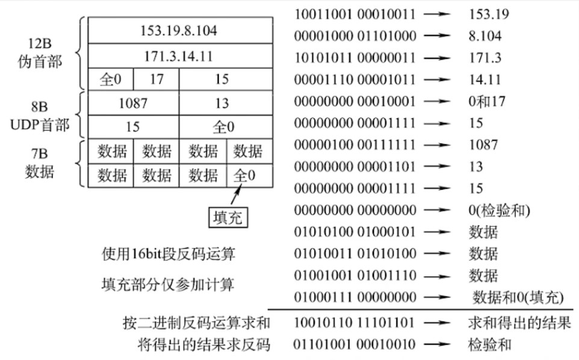

## How is the checksum constructed?

Constructing the checksum is fairly simple, but computing it is a bit of a pain: you add the 16-bit binary source data to be sent in pairs, keep the total to sixteen digits counting from right to left, and if there are extra digits you carry them round to the lowest bit and add again. Once all the data to be sent has been added up this way, you take its one's complement — that is, turn the 1s of those sixteen bits into 0s and the 0s into 1s.

The data we actually need is shown in the table below:

| | | | |
|--|--|--|--|
| Source IP address| | | |
| Destination IP address| | | |
| UDP protocol number (17)| | Total UDP segment length| |
| UDP source port| | UDP destination port| |
|Total UDP segment length| |**Checksum value (set to 0 here)**| |
|Data|Data|Data|Data|
|Data|Data|Data|Data|
|Data|Data|Data|Data|
|Data|Data|Data|Data|
|......| | | |
|Data|Data|Data|(pad with zeros at the end if needed, otherwise not)|

The calculation works roughly as in the figure below. In it the UDP length is 15, and since the Data length is **15-8=7**, we need to *pad with zeros at the end*:



The code is as follows: (compiled with javascript)

```javascript
function checksum(data) {
      let s = 0;
      for (let i = 0; i < data.length; i++) {
        s += data[i];
        s = (s & 0b1111111111111111) + (s >> 16);
      }
      return (~s & 0b1111111111111111);
    }

    let data = [
      0b0010010010011011, // source address
      0b1100110010010001, // source address
      0b1100000010101000, // destination address
      0b0000001010110010, // destination address
      0b0000000000010001, // protocol number
      0b0000000000100111, // UDP length
      0b0001111101000000, // source port
      0b1110110010010010, // destination port
      0b0000000000100111, // UDP length
      0b0000000000000000, // checksum (set to zero)
      0b0000001000111100, // data
      0b0001111100001000, // data
      0b0001100101010011, // data
      0b0001000000000000, // data
      0b0000000000000000, // data
      0b0000000000000000, // data
      0b0000000000000000, // data
      0b1001001110101001, // data
      0b1110111000001110, // data
      0b0101111101011100, // data
      0b1010110100011100, // data
      0b0101011111101101, // data
      0b1100000001100011, // data
      0b1011000001110110, // data
      0b1011101000001100, // data
      0b0000001100000000, // data
    ];

    console.log("checksum: ",checksum(data).toString(2));
```

## How do you verify an incoming UDP segment?

If you need to verify an incoming UDP segment, the same idea applies: add the 16-bit binary source data to be sent in pairs, keep the total to sixteen digits counting from right to left, and if there are extra digits you carry them round to the lowest bit and add again. Go on like that until all the data to be sent has been added up. If the total is exactly sixteen 1s, i.e. 111111111111111111, then the UDP packet can be considered error-free; otherwise it is considered to contain an error.

The data we actually need is shown in the table below:

| | | | |
|--|--|--|--|
| Source IP address| | | |
| Destination IP address| | | |
| UDP protocol number (17)| | Total UDP segment length| |
| UDP source port| | UDP destination port| |
|Total UDP segment length| |**Checksum value (the incoming checksum here)**| |
|Data|Data|Data|Data|
|Data|Data|Data|Data|
|Data|Data|Data|Data|
|Data|Data|Data|Data|
|......| | | |
|Data|Data|Data|(pad with zeros at the end if needed, otherwise not)|

The calculation code is as follows: (compiled with JS)

```javascript
function checksum(data) {
      let s = 0;
      for (let i = 0; i < data.length; i++) {
        s += data[i];
        s = (s & 0b1111111111111111) + (s >> 16);
      }
      return s;
    }

    let data = [
      0b0010010010011011, // source address
      0b1100110010010001, // source address
      0b1100000010101000, // destination address
      0b0000001010110010, // destination address
      0b0000000000010001, // protocol number
      0b0000000000100111, // UDP length
      0b0001111101000000, // source port
      0b1110110010010010, // destination port
      0b0000000000100111, // UDP length
      0b1101111111000001, // checksum
      0b0000001000111100, // data
      0b0001111100001000, // data
      0b0001100101010011, // data
      0b0001000000000000, // data
      0b0000000000000000, // data
      0b0000000000000000, // data
      0b0000000000000000, // data
      0b1001001110101001, // data
      0b1110111000001110, // data
      0b0101111101011100, // data
      0b1010110100011100, // data
      0b0101011111101101, // data
      0b1100000001100011, // data
      0b1011000001110110, // data
      0b1011101000001100, // data
      0b0000001100000000, // data
    ];

    console.log("data: ",checksum(data).toString(2));
```

::: important
This article was translated by Hermes Agent; the original text can be found at ../../../learningNote/Computer_Network/UDP校验和.md. The translation is for reference only.
Translation time: 2026-11-05
:::
