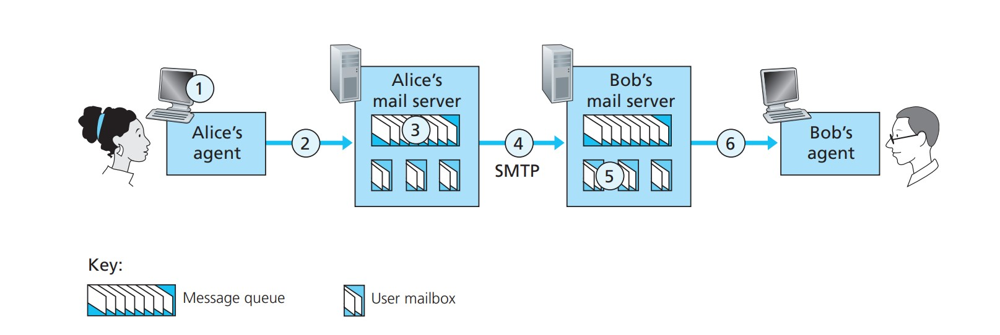
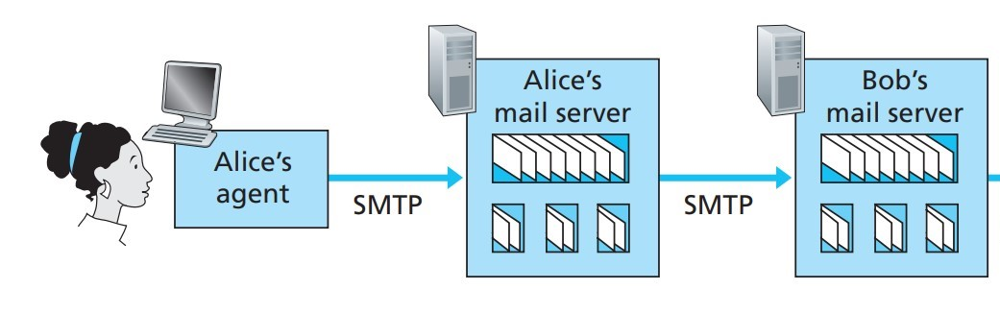
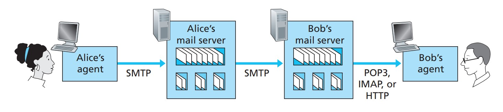

## Introduction

**SMTP (Simple Mail Transfer Protocol)** is a protocol that provides reliable and efficient transfer of electronic mail. It is used mainly for moving mail between systems and for notifying the sender about incoming messages.

## Basic operation

To show how SMTP basically works, imagine a common scenario. Alice wants to send Bob a short ASCII message:

1. Alice invokes her mail user agent, composes the message, supplies Bob's address (say <bob@someschool.edu>) and tells the user agent to send it;
2. Alice's user agent hands the message to her mail server, which places it in its outgoing message queue;
3. The SMTP client running on Alice's mail server sees the message sitting in that queue. Having resolved the recipient's address, it tries to open a TCP connection to the SMTP server running on Bob's mail server;
4. After a short SMTP handshake, the client pushes Alice's message to Bob's mail server over that TCP connection;
5. Bob's SMTP server receives it and drops the message into Bob's mailbox;
6. Bob can then read it whenever he next opens his user agent.

The whole sequence looks like this:

In short: SMTP carries the message from Alice's mail server to Bob's mail server, at which point it lands in Bob's mailbox.

In everything above we have quietly assumed that Bob logs in to the server host and runs a mail reader there to read his mail. Up to the early 1990s that was in fact the standard arrangement.

Today, though, we all read mail through a client–server architecture: people read their mail indirectly, via a client — a user agent — running on their own end system (an office PC, a laptop, a phone).

Since the recipient runs a user agent on a local PC, one could also put a mail server on that same local PC. The sender's mail server would then talk directly to the recipient's personal computer. That approach has a problem:

Because mail servers run on both the client and the server side of SMTP, if the recipient's mail server lived on his own PC, that PC would have to be **powered on and connected to the internet all the time**, ready to accept mail that could arrive at any moment. For obvious reasons that is impractical for most internet users.

Instead, a user runs a user agent on a local PC to reach their mailbox, but the mailbox itself no longer lives on a separate server of its own — it sits on an *always-on shared mail server*. That server is shared with other users and is normally maintained by the user's ISP (a university or a company, for instance).

Now let's retrace the path of an email from sender Alice to recipient Bob:

From the discussion above we know that somewhere along that path the message has to be deposited on Bob's mail server. All it takes is for Alice's user agent to send the message straight to Bob's mail server — **SMTP, after all, was designed to push email from one host to another**.

In practice, though, the sender's user agent usually does not talk to the recipient's mail server directly. Instead, as in the **diagram below**, Alice's user agent uses SMTP to push the message to her own mail server, which then acts as an SMTP client and uses SMTP to try to relay the message on to Bob's mail server.

Why take two steps? Because without relaying through Alice's mail server, Alice's user agent has no way to deliver the message directly to Bob's mail server. By first depositing the message on her own mail server and letting that server send it, Alice's mail server can act as a client and retry the delivery to Bob's mail server again and again — every 30 minutes, say — until Bob's mail server is up and able to accept it.

One piece of the path is still missing, though: how does a recipient like Bob, who runs a user agent on a local PC, get hold of his mail?

We need a special mail access protocol to move the message from Bob's mail server down to his local PC, and only then is the path complete. Several such protocols are in wide use, among them Post Office Protocol-Version 3 (POP3), the Internet Mail Access Protocol (IMAP) and HTTP.

::: tip Why can't SMTP do this part?
A user agent cannot fetch mail with SMTP, because fetching is a *pull* operation while SMTP is a *push* protocol. SMTP has no way to learn whether new mail has arrived at the mail server it is associated with; all it can do is push new mail to that server. Some other mail access protocol is therefore required here.
:::

The complete path then looks like this:

In the diagram, SMTP carries the message from the sender's user agent to the sender's mail server, and from there to the recipient's mail server. The other, dedicated mail access protocols (POP3 and friends) pull the message from the recipient's mail server into the recipient's user agent.

## Reference

"Computer Networking: A Top-Down Approach" (James F. Kurose and Keith W. Ross, Seventh Edition, 2017)

::: important
This article was translated by `Hermes Agent`; the original text can be found at [here](../../../learningNote/Computer_Network/什么是SMTP.md). The translation is for reference only.
Translation time: 2026-11-05
:::
