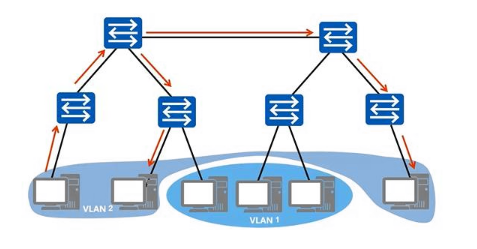
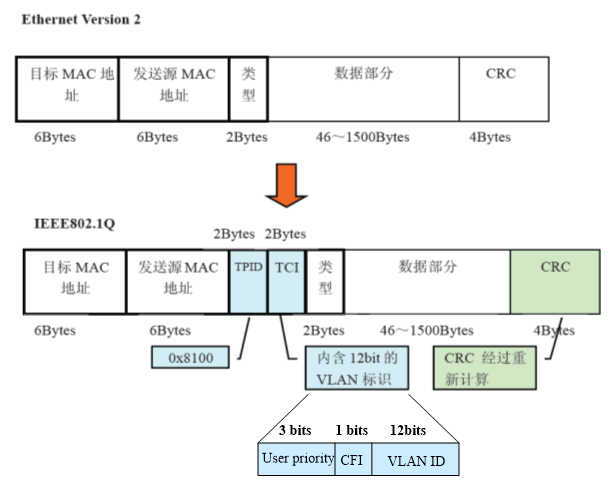
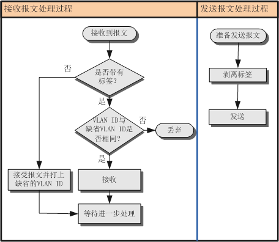
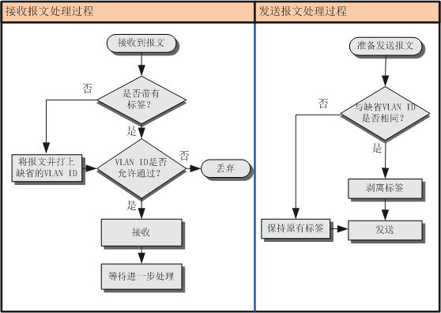
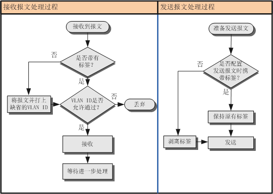
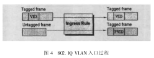

## 5. About VLAN (3.1-3.3)

### 1. Concepts (3.1)

VLAN (Virtual Local Area Network) — a virtual LAN — is a communication technology that logically divides one physical LAN into several broadcast domains. Hosts inside the same VLAN can talk to each other directly, while hosts in different VLANs cannot, and that keeps broadcast messages confined to a single VLAN.

Put another way: even devices sitting under different switches can, as long as they live in the same VLAN, talk to each other without generating any junk traffic beyond the useful traffic. This improves network performance, separates the relevant services, and buys you security.

### 2. VLAN tags (important) (3.1)

For devices to be able to tell which VLAN the data they are carrying belongs to — that is, to tell where that data may be broadcast — we need to add a field to the message identifying its VLAN. Hence the `VLAN tag` (also written VLAN Tag, or just Tag).

The IEEE 802.1Q standard lays out the VLAN tag as follows:

> Four bytes of VLAN tag (also written VLAN Tag, or just Tag) are inserted after the destination MAC address and source MAC address fields of the Ethernet frame and before the protocol type field, to identify the VLAN information.

The concrete flow is shown in the figure below:

There are two Ethernet frame formats in the figure, top and bottom:

- Untagged frame: the original frame, without the 4-byte VLAN tag added. This is the upper part of the figure.

- Tagged frame: a frame with the 4-byte VLAN tag added. This is the lower part of the figure.

### 3. Structure of the VLAN tag (important) (3.1)

#### I. TPID (Tag Protocol Identifier)

TPID contains a **fixed value**, 0x8100, which says that this is a frame with an 802.1Q tag added — it is an identifier.

#### II. TCI (Tag Control Information)

TCI contains this data frame's control information. It consists of the following elements:

##### ①. User Priority

Defines this frame's priority; there are 8 priority levels, <u>0 being the lowest and 7 the highest</u>, and 0 is the default value. IEEE 802.1P defines the operation of the 3-bit user priority field.

The usual places each priority is used are below, for reference:

> Priority 7, the highest, is generally used for critical network traffic, such as routing table updates for the Routing Information Protocol (RIP) and the Open Shortest Path First (OSPF) protocol. Priorities 6 and 5 are mainly used for delay-sensitive applications, such as interactive video and voice. Priorities 4 down to 1 are mainly used for controlled-load applications, such as streaming multimedia and business-critical traffic.

##### ②. CFI (Canonical Format Indicator)

CFI means Canonical Format Indicator. A CFI value of 0 indicates canonical format, 1 non-canonical. It is used in the token ring / source-routed FDDI media access methods to indicate the bit-order information of the addresses carried in the encapsulated frame.

##### ③. VLAN ID (VLAN Identifier, sometimes abbreviated VID)

VLAN ID is the identifier field for a VLAN, commonly used in the 802.1Q standard. The field is 12 bits, supporting identification of 4096 (that is, 2 to the power of 12) VLANs. Among those 4096 possible VIDs, <u>VID=0 is used to identify frame priority</u>. <u>4095 (FFF) is reserved</u>, so the valid VLAN ID range is generally **1-4094**. Here 1 is the default value.

### 4. Ethernet links and VLAN ports (3.2-3.3)

#### I. Concepts (3.2)^[ [A must-have skill for network engineers: VLAN port types explained — Zhihu column](https://zhuanlan.zhihu.com/p/356170682) ]

We already know that hosts in different VLANs cannot talk to each other directly, but through the **`VLAN ports`** on a device and the **`Ethernet links`** between devices, we can achieve layer-three interworking between VLANs (layer three meaning the network layer — see section 4, "The five-layer TCP/IP model", for details).

That said, a VLAN port is actually a kind of virtual interface. It does not exist on the device as a physical entity; it exists virtually in the third layer of the TCP/IP network protocol model — the network layer. Every VLAN corresponds to one VLAN port, which is why VLANs can be divided on a per-port basis, that is, defining VLAN membership by device port. Once a given port has been added to a given VLAN, the IP address of the VLAN port can serve as the gateway address for the network devices inside that VLAN, and the port can then perform the IP-address-based layer-three forwarding needed for messages crossing segments.

Ethernet links are simpler — think of them as the line connecting two device nodes.

#### II. Link types (3.2)

In VLANs, Ethernet links can be split into two link types: access links and trunk links.

##### ①. Access link

The link connecting a user host and a switch is called an access link. Most of the frames passing over an access link are untagged VLAN frames, though a small number of tagged VLAN frames do exist on such a link.

##### ②. Trunk link

The link connecting a switch and a switch is called a trunk link. The frames passing over a trunk link are generally tagged VLAN frames.

#### III. Port types (3.2)^[ [VLAN interface types_ShaShark0's blog - CSDN blog](https://blog.csdn.net/u011083888/article/details/115679480) ]

VLAN has three access port types in total: access ports, trunk ports and hybrid ports.

##### ①. Access port

- Concept: an access port is the port on a switch used to connect user hosts; it can only connect access links, and only a single VLAN ID is allowed through it.

- Purpose: for connecting to user terminals that cannot recognise tags, or when there is no need to distinguish between VLAN members. Commonly the port used on both sides when a user device connects to a switch.

- The rules for an access port sending and receiving frames are as follows: (the object the port belongs to is the switch; this is about the interaction between the switch and user devices)
  
  1. When **receiving a frame**:

     If the frame the port receives from the peer device is untagged, the switch forcibly adds the port's PVID (Port Default VLAN ID, i.e. the default VLAN).

     If the frame the port receives from the peer device is tagged, the switch checks the VLAN ID in that tag: when the VLAN ID equals the port's PVID, the message is accepted; when the VLAN ID differs from the port's PVID, the message is dropped.
  
  2. When **sending a frame**:

     First strip the frame's tag, then send. Ethernet frames an access port sends to a peer device are always untagged.

     

##### ②. Trunk port

- Concept: the port on a switch used to connect other switches; it can only connect trunk links (relay links). It allows frames from multiple VLANs to pass through tagged, but only one VLAN's frames leave this kind of interface untagged (that is, with the tag stripped), and that VLAN is the default VLAN (PVID).

- Purpose: for connecting to other switches.

- The rules for a trunk port sending and receiving frames are as follows: (the object the port belongs to is the switch; this is about the interaction between switches)
  
  1. When **receiving a frame**:

     When an untagged frame arrives from the peer device, the port's PVID is added; if the PVID is in the list of VLAN IDs allowed through, the message is accepted, otherwise it is dropped;

     When a tagged frame arrives from the peer device, the port checks whether the VLAN ID is in the list of VLAN IDs allowed through. If it is, the message is accepted. Otherwise it is dropped.
  
  2. When **sending a frame**:

     When the VLAN ID equals the port's PVID and is one of the VLAN IDs allowed through the port, the tag is removed and the message is sent;

     When the VLAN ID differs from the port's PVID but is one of the VLAN IDs allowed through the port, the original tag is kept and the message is sent.

     

##### ③. Hybrid port

- Concept: a port that can be used both to connect other switches and to connect user hosts. It can connect trunk links (relay links) as well as access links. It allows frames from multiple VLANs through tagged, and lets you configure whether frames of a given VLAN leave this kind of interface tagged.

- Purpose: for connecting to other switches or to user terminals, either is fine.

- The rules for a trunk port sending and receiving frames are as follows: (the object the port belongs to is the switch; this is about the interaction between switches, and between switches and user devices)
  
  1. When **receiving a frame**:

     When an untagged frame arrives from the peer device, the port's PVID is added; if the PVID is in the list of VLAN IDs allowed through, the message is accepted, otherwise it is dropped;

     When a tagged frame arrives from the peer device, the port checks whether the VLAN ID is in the list of VLAN IDs allowed through. If it is, the message is accepted. Otherwise it is dropped.
  
  2. When **sending a frame**:

     First check whether the interface allows frames of this VLAN ID through. If it does, you can use a command to configure whether the frame carries a tag when sent:

     - After configuring the `port hybrid tagged vlan vlan-id` command, when the interface sends frames of that vlan-id it does not strip the VLAN Tag from the frame, it sends it as is. This command is generally configured on ports connected to switches.

     - After configuring the `port hybrid untagged vlan vlan-id` command, when the interface sends frames of that vlan-id it strips the VLAN Tag from the frame before sending it out. This command is generally configured on ports connected to hosts.

     

##### TIPS: the default VLAN (PVID) (3.3) ^[ [Li Deshui. "Implementation principles of VLAN based on IEEE 802.1Q frame tagging." (2006)](http://www.doc88.com/p-793921426875.html) ]

Concept: every port on a switch has a VID as that port's default VID, and that is the PVID (Port VID, also called the default VLAN). When a frame (message) the switch receives is untagged, the switch adds the PVID to mark it. In other words, it is generally assigned to untagged frames and priority frames.

- For an access interface, the default VLAN is simply the VLAN it is allowed to pass, so changing the default VLAN changes the VLAN the interface is allowed to pass.

- For a trunk interface, one interface can allow multiple VLANs through, but there can only be one default VLAN. The interface's default VLAN and the VLANs allowed through have to be configured separately, but the two do not affect each other.

::: important
This article was translated by Hermes Agent; the original text can be found at ../../../learningNote/Computer_Network/关于VLAN.md. The translation is for reference only.
Translation time: 2026-11-05
:::
