In this post we'll go through the principles of implementing reliable data transfer in the **transport layer**, covering the various rdt protocols, discussing the difference between stop-and-wait and pipelined protocols on top of rdt3.0, and introducing the two pipelined protocols: GBN and SR.

## Starting from the transport layer

The main job of the transport layer is to provide an end-to-end data transfer service. TCP, for instance, offers a reliable, connection-oriented data transfer service. TCP uses sequence numbers, acknowledgements, retransmission and other mechanisms to make data transfer reliable. So from an **abstract point of view**, we can regard the specific communication between transport layers as providing a relatively reliable communication mechanism.

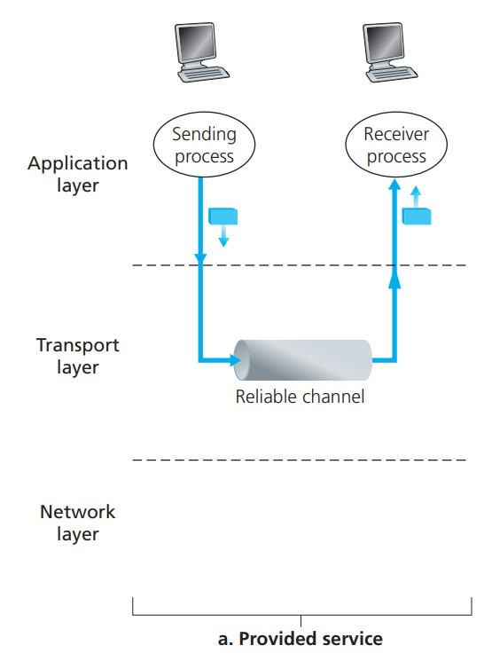

But in the other layers — the network layer (IP), the link layer (Ethernet and friends) and the physical layer, the layers responsible for moving packets around the network and for pushing bits over the physical medium — the communication channel they face **may suffer all kinds of interference and uncertainty**, such as packet loss, corruption, duplication and delay, so they are generally considered unreliable.

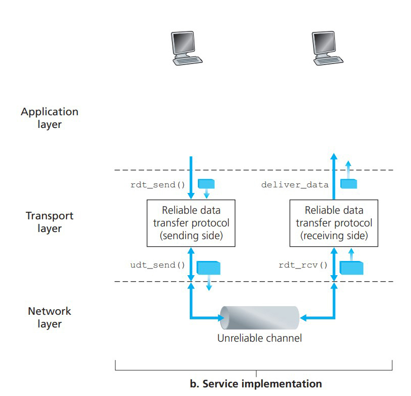

So from an abstract point of view, the transport layer offers a relatively reliable communication mechanism, while the communication channels provided by the network layer, link layer and physical layer beneath it are considered unreliable. Put another way, the transport layer has to hand reliable information up to the layer above, but its own lower layers are unreliable — and that is exactly why the transport layer needs to implement reliable data transfer.

## How do we implement reliable data transfer?

From this section on we will progressively develop the sender and receiver sides of a reliable data transfer protocol (rdt). Following these ground rules:

- We only consider unidirectional data transfer in which "all packets flow from sender to receiver" (since bidirectional transfer is essentially two unidirectional data transfer problems combined)
-Use finite state machines (FSM) to describe the sender and the receiver (figure below)
    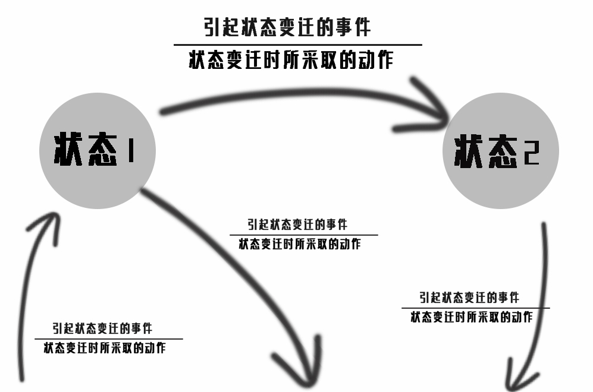

### Step by step one: first assume the layer below the transport layer is reliable (rdt1.0)

We start with the simplest case, where the underlying channel is perfectly reliable: everything sent arrives in order, and nothing is ever lost in transit. That lets us build a protocol that isn't complicated at all, and we call it **rdt1.0**.

The finite state machines (FSM) of the rdt1.0 sender and receiver are defined in the figure:

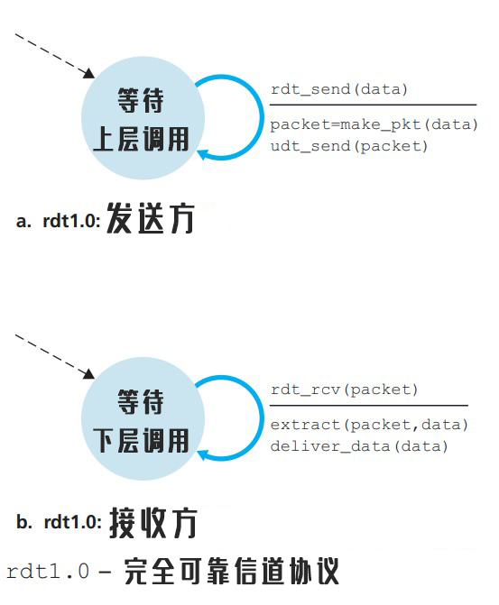

In that figure:

- The rdt sender only has to **accept** data from the layer above through the rdt_send(data) event, **create** a packet containing data through the make_pkt(data) action, and then **send** the packet down into the channel below. That's it. In fact, the rdt_send(data) event is the result of the upper-layer protocol calling a function (rdt_send(), say) according to its built-in steps;
-And on the receiver side, rdt only has to **receive** a packet from the underlying channel through the rdt_rcv(packet) event, **extract** the data from the packet (through the extract (packet, data) action), and **deliver** the data up to the layer above (through the deliver_data(data) action). That's it. In fact, the rdt_rcv(packet) event is the result of the lower-layer protocol calling a function (rdt_rcv(), say) according to its built-in steps.

In this simple **rdt1.0** protocol, because the channel is perfectly reliable, the receiver has no need to give the sender any feedback at all.

### Step by step two: now assume the layer below the transport layer starts being unreliable (rdt2.0)

Next we consider the case where the transport layer starts getting unreliable — for instance, **the bits in the packets the sender transmits may get corrupted**. Such bit errors usually happen in the physical components of the network while a packet is being transmitted, propagated or buffered: in the cable, in the transmission hardware, and so on. Of course we'll keep assuming for now that all transmitted packets are received in the order they were sent. The protocol is now a bit more complicated than rdt1.0, and we call it **rdt2.0**.

In this protocol, to find out whether the receiver got the data correctly, the sender usually uses both ACK ("OK") and NAK ("please say that again") messages to acknowledge the data.

::: tip English time
 ACK stands for acknowledgement (got it), NAK stands for nagtive acknowledgement (didn't get it)
:::

With these control messages, the receiver can let the sender know which information was received correctly and which was received in error and needs to be sent again.

::: info ARQ (Automatic Repeat reQuest) protocol
    In a computer network, a reliable data transfer protocol that relies on automatic acknowledgement "control messages" to decide whether to retransmit is called an ARQ (Automatic Repeat reQuest) protocol.
:::

So this protocol needs three capabilities:

- error detection
- receiver feedback
- sender retransmission

The finite state machines (FSM) of the rdt2.0 sender and receiver are shown in the figures below:

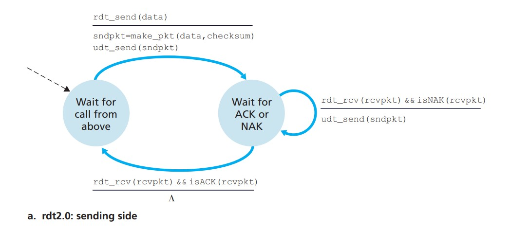

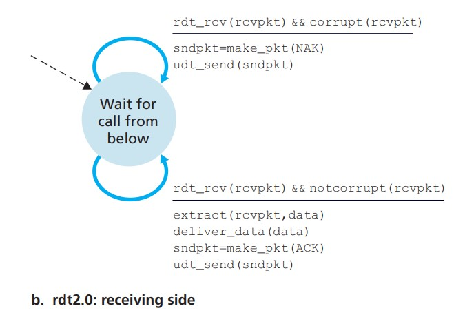

The rdt2.0 sender has two states:

In *the leftmost state*, the sender protocol is waiting for data to be handed down from the layer above. When the rdt_send(data) event occurs, the sender creates a packet (sndpkt) containing the data to be sent and a packet checksum (generated much like the checksum discussed [here](./UDP校验和.md)), then sends that packet with the udt_send(sndpkt) action. The sender protocol then moves to the rightmost state.

In *the rightmost state*, the sender protocol is waiting for an ACK or NAK packet from the receiver:

- If an ACK packet arrives (the test *rdt_rcv(rcvpkt) && isACK (rcvpkt)* in the figure corresponds to this event), the sender knows the most recently sent packet was received correctly, so the protocol returns to the state where it waits for data from above.

- If a NAK arrives, the protocol retransmits the last packet and keeps waiting for the receiver to come back with an ACK or NAK, saying whether to retransmit the packet or move to the leftmost state.

It's worth noting that while the sender is in the wait-for-ACK-or-NAK state it cannot get any more data from the layer above; that is, the rdt_send() event will not occur. That event only happens once the sender has received an ACK and left that state. In other words, only after it is sure the receiver has correctly received the current packet does the sender go back up and fetch more new data to send. Because this behaviour shows up in every protocol above rdt2.0, protocols above rdt2.0 are also called **stop-and-wait protocols**.

### Step by step three: the layer below the transport layer gets even more unreliable (rdt2.1)

Next we consider the transport layer being even less reliable — for instance, not only the packets coming out of the sender but **the ACK or NAK packets may also get corrupted**. Of course we'll keep assuming for now that all transmitted packets are received in the order they were sent. The protocol is now a bit more complicated than rdt2.0, and we call it **rdt2.1**.

Since ACK or NAK packets may also get corrupted, suppose the information the sender sent is fine but the ACK coming back from the receiver gets corrupted. The sender has then received an unknown packet and enters a confused period of "I have no idea whether the packet was sent correctly".

If the sender assumes the receiver did not get the data correctly, it will try to retransmit, and the receiver may end up with several identical packets; if the sender assumes the receiver did get the data correctly, it won't try to retransmit, and the receiver may end up waiting forever for a retransmission.

So we need to add a sequence number to every packet the sender sends, indicating the sending order. On the receiver side, all we need is one more check on the sequence number: after **the receiver sends an ACK**, if the next new packet it receives has **the same sequence number** as the previously received packet, the receiver **concludes the sender is retransmitting** and sends the ACK *associated with the previous packet's sequence number*; if the next new packet's **sequence number differs**, the receiver **concludes the sender has sent a new packet** and sends the ACK *associated with the current packet's sequence number*.

::: tip How many sequence numbers do we need to represent the sending order?
Two sequence numbers (0, 1) will do: because rdt uses a **stop-and-wait protocol**, the receiver only needs to know whether the sender is retransmitting the previous packet or sending a new one. So there are only ever two packets in play — the new one and the one before it, both known to each side.
:::

The finite state machines (FSM) of the rdt2.1 sender and receiver are shown in the figures below:

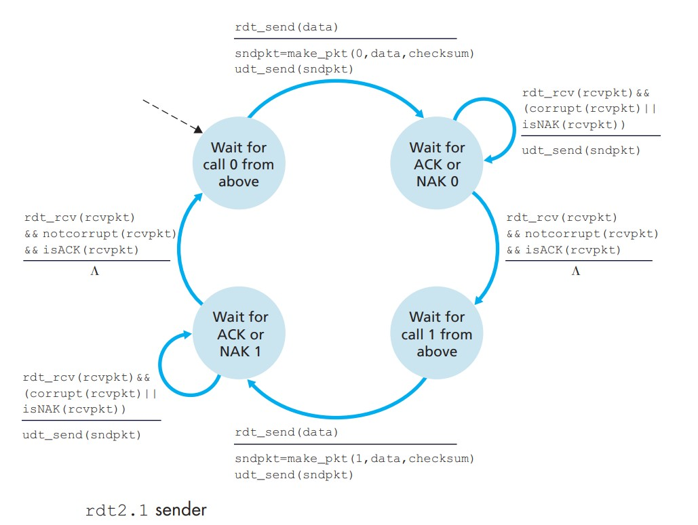

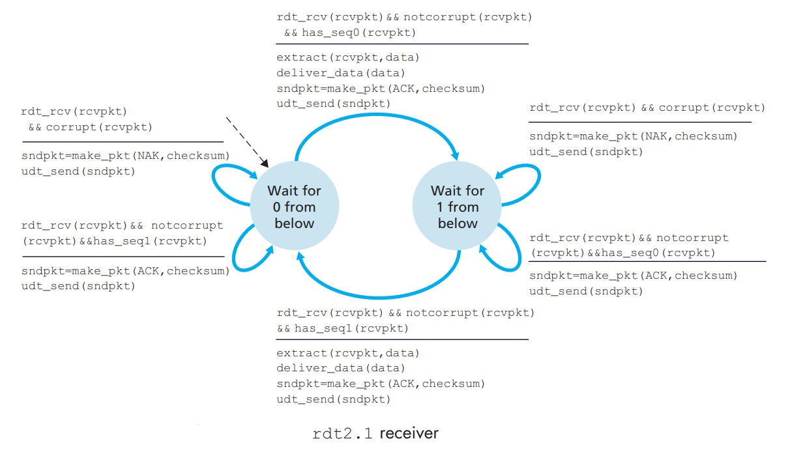

For the sender:

- The "wait for call 0 from above" state: on receiving data, package 0 and the data (with checksum) together and send it, then move to the "wait for ACK or NAK 0" state.

- The "wait for ACK or NAK 0" state: on receiving data from the receiver, if *the data failed the check or it is a NAK*, retransmit the data with sequence number 0; if *the check passed and it is an ACK*, go straight to the "wait for call 1 from above" state.

- The "wait for call 1 from above" state: on receiving data, package 1 and the data (with checksum) together and send it, then move to the "wait for ACK or NAK 1" state.

- The "wait for ACK or NAK 1" state: on receiving data from the receiver, if *the data failed the check or it is a NAK*, retransmit the data with sequence number 1; if *the check passed and it is an ACK*, go straight to the "wait for call 0 from above" state.

For the receiver:

- The "wait for 0 from below" state: on receiving data, if *the check passed and the sequence number is 0*, unpack it and send an ACK (sequence number 0) for the packet received, then move to the "wait for 1 from below" state; if *the check failed*, send a NAK (sequence number 1) for the last packet received; if *the check passed but the sequence number is 1*, send an ACK (sequence number 1) for the last packet received, so the sender moves to the next state and the two sides stay in sync.

- The "wait for 1 from below" state: on receiving data, if *the check passed and the sequence number is 1*, unpack it and send an ACK (sequence number 1) for the packet received, then move to the "wait for 0 from below" state; if *the check failed*, send a NAK (sequence number 0) for the last packet received; if *the check passed but the sequence number is 0*, send an ACK (sequence number 0) for the last packet received, so the sender moves to the next state and the two sides stay in sync.

### Step by step four: can we simplify it a little? (rdt2.2)

The situation is still as annoying as in rdt2.1: not only the packets coming out of the sender but **the ACK or NAK packets may also get corrupted**. Of course we'll keep assuming for now that all transmitted packets are received in the order they were sent.

But we start thinking:

>"Sending all these ACK 0/NAK 0/ACK 1/NAK 1/ACK 0/NAK 0/ACK 1/NAK 1 is such a pain! Can't we just use ACK?"
>
>"Because in this situation, as a receiver, sending NAK 1 or sending ACK 0 means exactly the same thing. So wouldn't it be simpler to just send an ACK?"

So the protocol is now a little simpler than rdt2.1, and we call it **rdt2.2**.

The finite state machines (FSM) of the rdt2.2 sender and receiver are shown in the figures below:

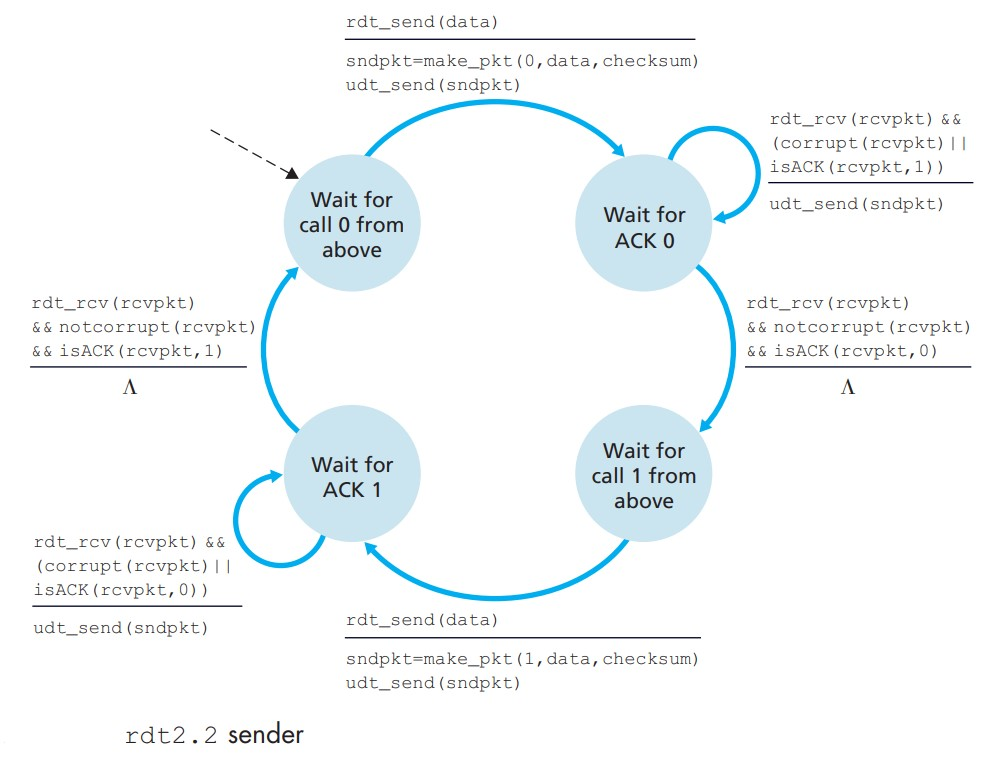

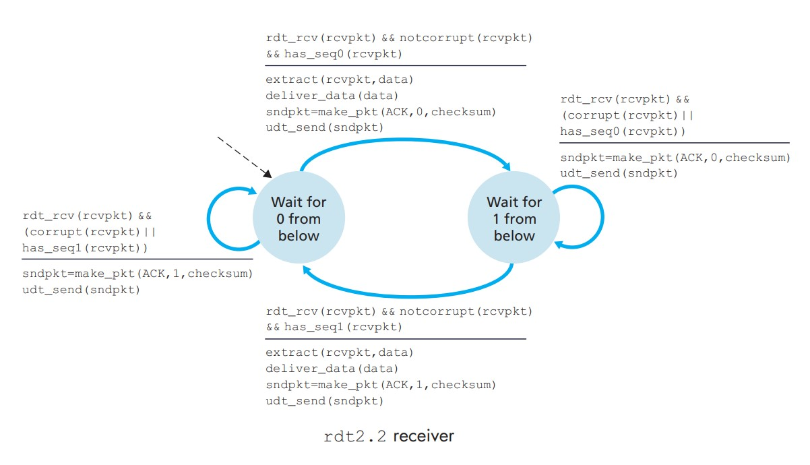

For the sender:

- The "wait for call 0 from above" state: on receiving data, package 0 and the data (with checksum) together and send it, then move to the "wait for ACK 0" state.

- The "wait for ACK 0" state: on receiving data from the receiver, if *the data failed the check or it is ACK 1*, retransmit the data with sequence number 0; if *the check passed and it is ACK 0*, go straight to the "wait for call 1 from above" state.

- The "wait for call 1 from above" state: on receiving data, package 1 and the data (with checksum) together and send it, then move to the "wait for ACK 1" state.

- The "wait for ACK 1" state: on receiving data from the receiver, if *the data failed the check or it is ACK 0*, retransmit the data with sequence number 1; if *the check passed and it is an ACK*, go straight to the "wait for call 0 from above" state.

For the receiver:

- The "wait for 0 from below" state: on receiving data, if *the check passed and the sequence number is 0*, unpack it and send ACK 0 for the packet received, then move to the "wait for 1 from below" state; if *the check failed or the sequence number is 1*, send ACK 1 for the last packet received.

- The "wait for 1 from below" state: on receiving data, if *the check passed and the sequence number is 1*, unpack it and send ACK 1 for the packet received, then move to the "wait for 0 from below" state; if *the check failed or the sequence number is 0*, send ACK 0 for the last packet received.

### Step by step five: expect the worst (rdt3.0)

Next we consider the most unreliable case in the transport layer: not only the packets coming out of the sender and the ACK or NAK packets may get corrupted, but **those packets may also be lost in transit**. Now we can no longer assume all transmitted packets are received in the order they were sent, so the protocol is clearly much more complicated than rdt2.1 and rdt2.2, and we call it **rdt3.0**.

In this case the sender cannot just sit waiting for the packet coming back from the receiver, because once a packet is lost in transit both sender and receiver drop into a "waiting for the other side to send the next packet" state, and deadlock. So we need to add a timer on both ends. That way, if a certain amount of time passes and the sender still hasn't heard back from the receiver, it simply decides the earlier packet transmission failed and retransmits that packet.

The finite state machines (FSM) of the rdt3.0 sender and receiver are shown in the figures below:

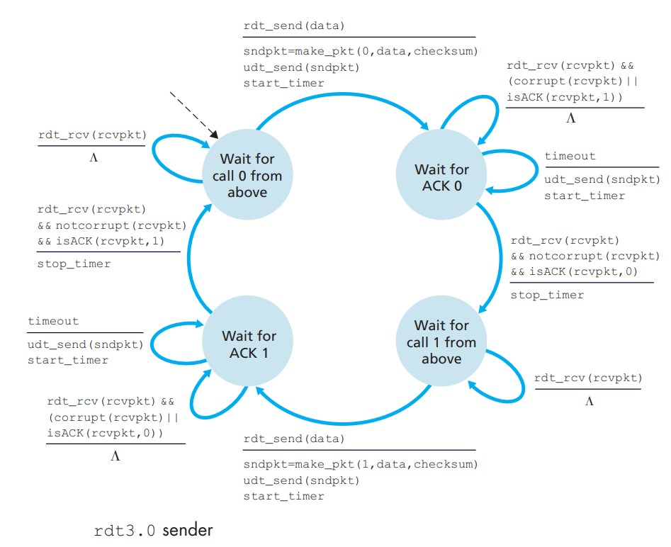

For the sender:

- The "wait for call 0 from above" state: on receiving data, package 0 and the data (with checksum) together and send it, start the timer, then move to the "wait for ACK 0" state; if data arrives from the receiver, do nothing;

- The "wait for ACK 0" state: on receiving data from the receiver, if *the data failed the check or it is ACK 1*, **do nothing at all and just wait for the timeout** (*since the timer is normally set very short, simply waiting for the timeout simplifies things*); if *it times out*, **resend the data with sequence number 0 and restart the timer**; if *the check passed and it is ACK 0*, **stop the timer** and move to the "wait for call 1 from above" state;

- The "wait for call 1 from above" state: on receiving data, package 1 and the data (with checksum) together and send it, start the timer, then move to the "wait for ACK 1" state; if data arrives from the receiver, do nothing;

- The "wait for ACK 1" state: on receiving data from the receiver, if *the data failed the check or it is ACK 0*, **do nothing at all and just wait for the timeout** (same reasoning as before); if *it times out*, **resend the data with sequence number 1 and restart the timer**; if *the check passed and it is ACK 1*, **stop the timer** and move to the "wait for call 0 from above" state.

For the receiver (here the same as rdt2.2):

- The "wait for 0 from below" state: on receiving data, if *the check passed and the sequence number is 0*, **unpack it and send ACK 0 for the packet received**, then move to the "wait for 1 from below" state; if *the check failed or the sequence number is 1*, **send ACK 1 for the last packet received**.

- The "wait for 1 from below" state: on receiving data, if *the check passed and the sequence number is 1*, **unpack it and send ACK 1 for the packet received**, then move to the "wait for 0 from below" state; if *the check failed or the sequence number is 0*, **send ACK 0 for the last packet received**.

And with that, rdt is more or less complete. With rdt3.0 we have a protocol that can cope with lost and corrupted packets. But it has one big problem: **when the channel is large, its RTT is large too, which makes the channel utilisation of rdt3.0 — a stop-and-wait protocol — very poor.**

In other words: it runs far too inefficiently!

## Stop-and-wait vs pipelined sending

From the definitions we gave earlier: "only after it is sure the receiver has correctly received the current packet does the sender go back up and fetch more new data to send. Hence this protocol above rdt2.0 — **one that can only send a single unacknowledged packet at a time, and where the sender has to stop and wait while the receiver hasn't acknowledged** — is also called a **stop-and-wait protocol**", or "stop-and-wait" for short.

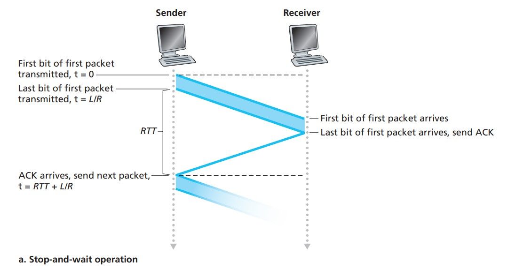

If we lay out the data to be transmitted as a row of abstract boxes, then under the protocol the data to be transmitted is as if enclosed by a selection frame; and when the old data has been sent successfully and new data needs to be sent, that selection window slides along and takes the new data in.

That's why we generally also call transport layer protocols **sliding window protocols**, with the sender's sliding window called the *sending window* and the receiver's sliding window called the *receiving window*.

And when a **sliding window protocol**'s **sending window** size, the sender's buffer size, the **receiving window** size and the receiver's buffer size are all one, that protocol is exactly the **stop-and-wait protocol** we built earlier.

We used that protocol earlier for two reasons:

- **One**, because we had no way of knowing the order of the packets sent, that is, the sequence numbers, so we had to wait for the previous transmission to finish before transmitting the next one;
- **Two**, because with the channel size unknown we assumed a small channel, which made the transmission-speed problems of using this protocol a fairly minor matter.

But since rdt2.1 we have been able to define sequence numbers for all packets; and after rdt3.0 we can also use a timer while sending to detect whether a retransmission is needed. Put another way, within the timer's duration we can be *a bit less* worried about whether the previous packet got through. So when the channel is large, why not just send several packets in one go?

And so, in contrast to stop-and-wait, **pipelined protocols** appeared.

We define: **a protocol that can send multiple unacknowledged packets at once** as a **pipelined protocol**, or pipelined sending protocol. In such a protocol we let the sender send several packets within the timer duration without waiting for an acknowledgement. That shortens the time between packets and improves transmission efficiency.

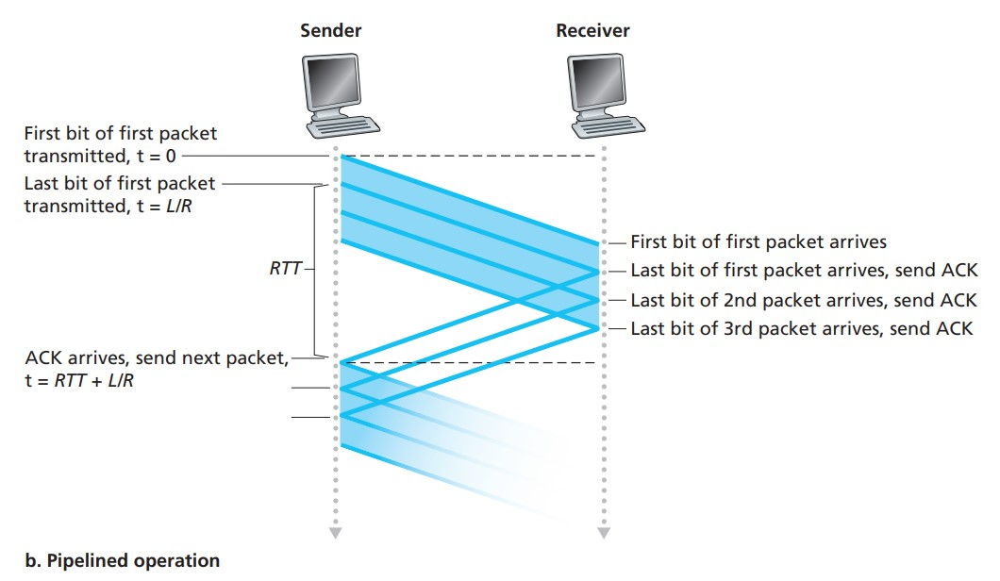

Sounds good. To implement a pipelined protocol we need to make some corresponding changes on top of stop-and-wait:

1. The sequence number range must be increased, using several bits to express different sequence numbers. Because every packet in flight (not counting retransmissions) must have a unique sequence number, and there may be several unacknowledged messages in flight.
2. Both sender and receiver may have to use buffering to store multiple packets. Because the sender needs to buffer packets it has sent but not yet had acknowledged, and the receiver may also need to buffer packets it has correctly received but not yet had a chance to acknowledge / pass up.
3. Of course, the sequence number range and buffering requirements such a protocol needs depend on how this kind of data transfer protocol handles lost, corrupted and excessively delayed packets.

Put simply, we need to expand the size of the **sender buffer** and the **receiver buffer**, so that the **sending window** and the **receiving window** can enclose more data, which makes transmission more efficient:

- When the **sender buffer** grows larger than one while the **receiver buffer** stays at one,

    the protocol is: the Go-Back-N (GBN) protocol

- When both the **sender buffer** and the **receiver buffer** grow larger than one,

     the protocol is: the Selective-Repeat (SR) protocol

::: tip How do you tell from the sending window size whether a protocol is pipelined or stop-and-wait?
When the **sending window** size can be **greater than one**, the protocol is a **pipelined protocol**;

When the **sending window** size can only **equal one**, the protocol is a **stop-and-wait protocol**.
:::

### Pipelined protocol one: Go-Back-N (GBN)

As said earlier:
> When the **sender buffer** grows larger than one while the **receiver buffer** stays at one,
>
> the protocol is: the Go-Back-N (GBN) protocol

Here is the full definition:

The **Go-Back-N (GBN) protocol** is a sliding-window-based pipelined protocol. The sender maintains a sliding window larger than one, so that it can send several pieces of data at the same time.

As a protocol using **cumulative acknowledgement**, it lets the sender send several packets back to back, even simultaneously, without waiting for the first packet's acknowledgement before sending the next. But if the sender doesn't get an acknowledgement for some packet within a certain time, it treats that packet as lost and retransmits it along with every packet after it.

Let's take the *interactive web page* built by a lecturer at the **University of Camerino, Italy** as our example:

::: info
URL: <https://computerscience.unicam.it/marcantoni/reti/applet/GoBackProtocol/goback.html>
:::

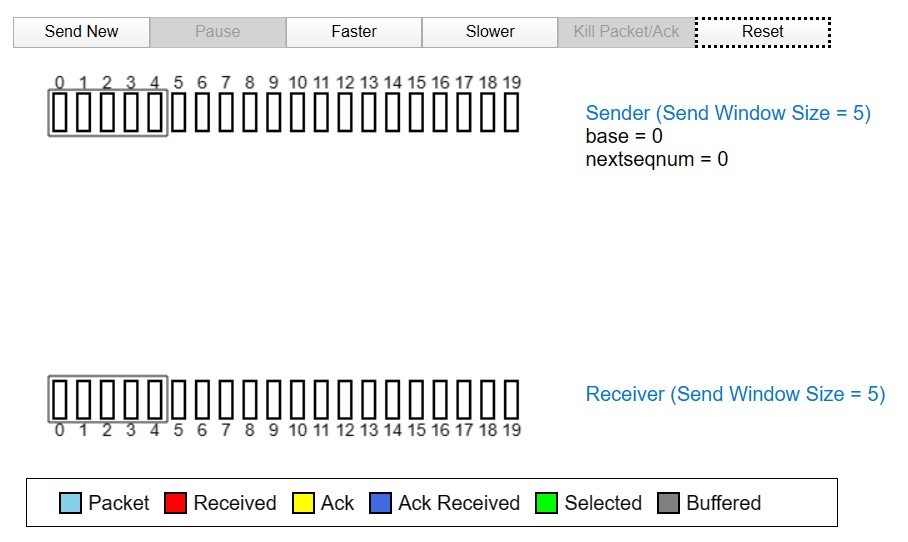

In this figure the top row is the sender and the bottom row is the receiver; you can see a grey rectangle over five of the sender's packets, and that rectangle is the GBN sender's sliding window.

When the sender and receiver are sending normally:

When a packet is lost in transit:

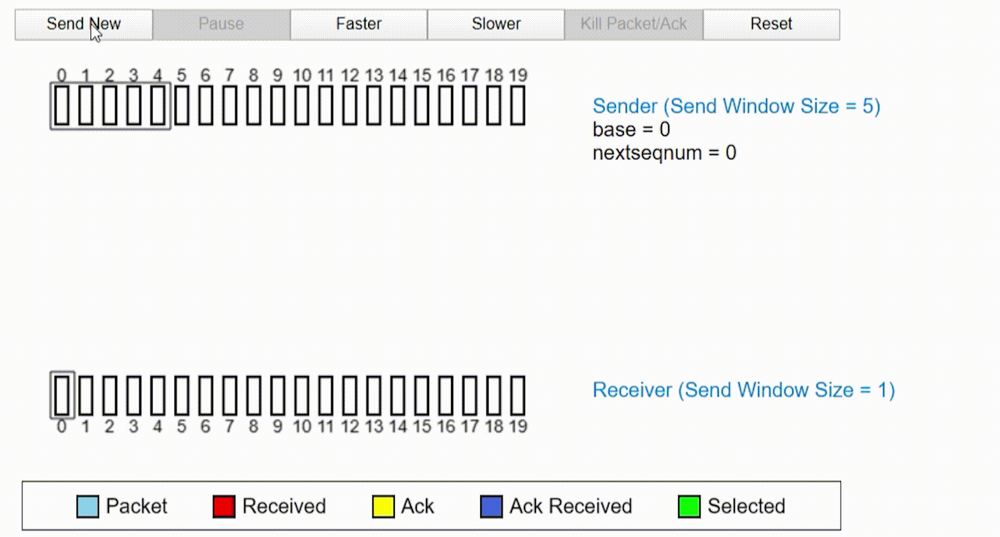

When packet number 2 is lost during transmission, the receiver gets packets 0 and 1 but never gets packet 2, so the `ACK3` and `ACK4` sent afterwards all turn into `ACK1`, which is the receiver telling the sender: "the highest packet sequence number received so far is 1".

After a while the sender's timer confirms a timeout and no `ACK3` or `ACK4` has arrived, so the sender retransmits packets 2, 3 and 4, and only when the receiver returns `ACK2` does it move the sliding window from 2 to 3.

When an ACK is lost in transit:

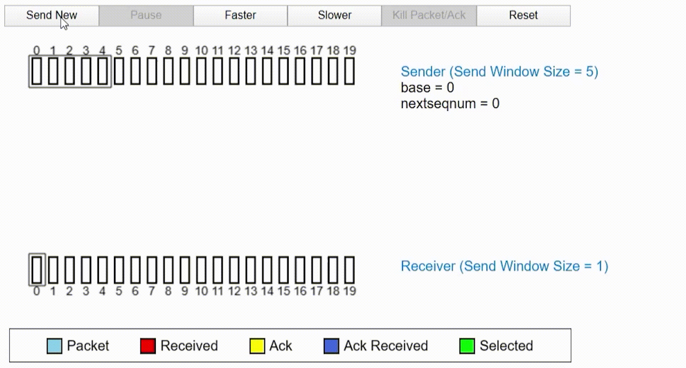

In this example we can see that when the receiver gets packets it returns `ACK0`,`ACK1`,`ACK2`,`ACK3`,`ACK4` to the sender.

When `ACK2` is lost, because the later ACK3 and ACK4 did come back normally, that is the receiver telling the sender: "the highest packet sequence number received so far is 4", so the sender can conclude the receiver has received everything before that "highest packet sequence number", and it doesn't bother resending packet 2.

### Pipelined protocol two: Selective-Repeat (SR)

As said earlier:
> When both the **sender buffer** and the **receiver buffer** grow larger than one,
>
> the protocol is: the Selective-Repeat (SR) protocol

Here too is the full definition:

The **Selective-Repeat (SR) protocol** is a sliding-window-based pipelined protocol. The sender and receiver each maintain a sliding window larger than one, for sending and receiving the data.

As a protocol using **selective acknowledgement**, it lets the sender send several packets back to back, even simultaneously, without waiting for the first packet's acknowledgement before sending the next. But if the sender doesn't get an acknowledgement for some packet within a certain time, it treats that packet as lost and retransmits **only** that packet.

Here again we take the *interactive web page* built by a lecturer at the **University of Camerino, Italy** as our example:

::: info
URL: <https://computerscience.unicam.it/marcantoni/reti/applet/SelectiveRepeatProtocol/selRepProt.html>
:::

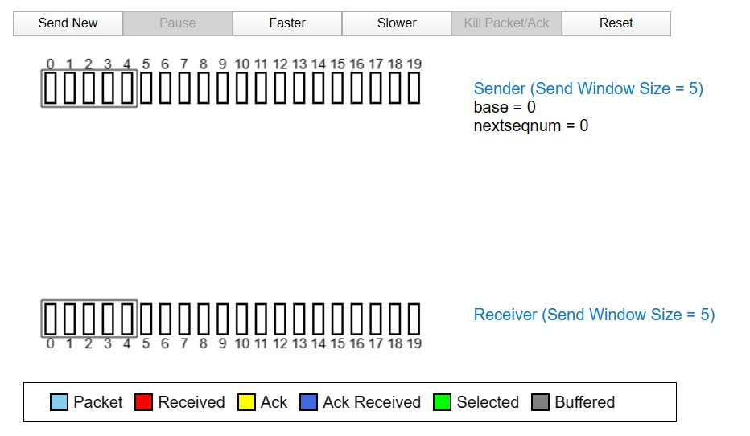

In this figure the top row is the sender and the bottom row is the receiver; you can see a grey rectangle over five of the sender's packets, and that rectangle is the SR sender's sliding window; there is a grey rectangle over five of the receiver's packets too, and that rectangle is the SR receiver's sliding window.

When the sender and receiver are sending normally:

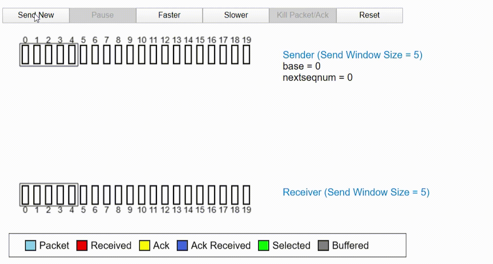

When a packet is lost in transit:

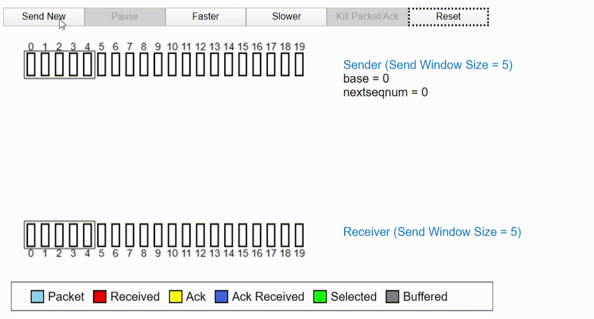

When packet number 2 is lost during transmission, the receiver gets packets 0 and 1 but not packet 2, yet it still gets packets 3 and 4, so the `ACK3` and `ACK4` sent afterwards stay as they are, which is the receiver telling the sender: "packets 3 and 4 have been received so far".

After a while the sender's timer confirms a timeout and no `ACK2` has arrived, so the sender resends packet 2, and only when the receiver returns `ACK2` does it move the sliding window from 2 to one past the highest sequence number currently in play.

When an ACK is lost in transit:

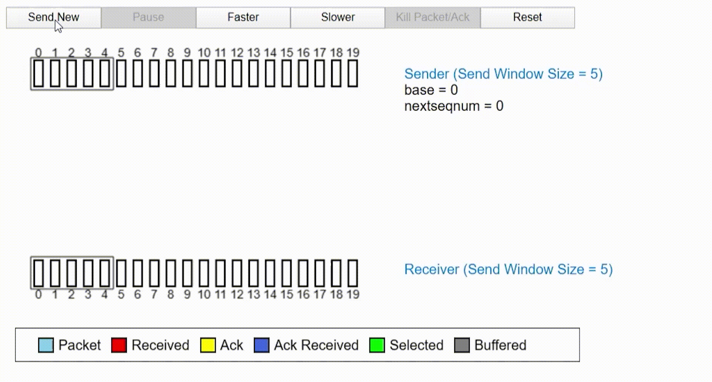

In this example we can see that when the receiver gets packets it returns `ACK0`,`ACK1`,`ACK2`,`ACK3`,`ACK4` to the sender.

When `ACK2` is lost, same as in the loss-in-transit case, because the later ACK3 and ACK4 did come back normally, that is the receiver telling the sender: "packets 3 and 4 have been received so far". So after the sender's timer confirms a timeout and no `ACK2` has arrived, it resends packet 2, and only when the receiver returns `ACK2` does it move the sliding window from 2 to one past the highest sequence number currently in play.

## Reference

"Computer Networking:A Top-Down Approach" (James F. Kurose and Keith W. Ross, Seventh Edition, 2017);

[Featured: rdt (reliable data transfer)_When Flowers Never Fade's blog - CSDN blog](https://blog.csdn.net/weixin_55267022/article/details/115200288)

[Animated explanation: go-back-N and selective repeat in computer networks_the difference between go-back-N and selective repeat - CSDN blog](https://blog.csdn.net/qq_44807642/article/details/103054914)

::: important
This article was translated by Hermes Agent; the original text can be found at ../../../learningNote/Computer_Network/可靠数据的传输原理.md. The translation is for reference only.
Translation time: 2026-11-05
:::
