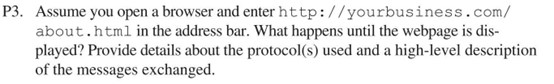

Let's first look at the question[^first]:

Translated, it says:

**Suppose you open your browser and type *<http://yourbusiness.com/about.html>* into the address bar. What happens between the moment you press Enter and the moment the page is displayed? Please provide detailed information about the protocols used and a high-level description of the information exchanged.**

Answer:

When we type a URL into the address bar and press ENTER, the following steps take place until the page is displayed:

1. DNS resolution

    - The browser first extracts the domain name from the URL, "yourbusiness.com" in this case;
    - It then sends a DNS query to a DNS server, resolving the domain name to an IP address;
    - The DNS server replies with the IP address associated with the domain name.

2. Establishing a TCP/IP connection

    - The browser establishes a TCP (Transmission Control Protocol) connection with the IP address obtained from the DNS query;
    - The browser and the server perform a three-way handshake to establish a reliable connection.

3. HTTP request

    - Once the TCP connection is up, the browser sends an HTTP GET request to the server for the specific resource "about.html".

4. Server-side processing

    - On receiving the HTTP request, the server retrieves the requested resource "about.html" from its file system.
    - The server generates an HTTP response containing the requested content together with the relevant headers and metadata.

5. HTTP response

    - The server sends the HTTP response to the browser over the established TCP connection, including a status code (such as 200 OK, meaning the request succeeded) and the requested content in the response body (namely "about.html").

6. Bowser rendering

    - On receiving the HTTP response the browser starts processing it, interpreting the HTML, fetching other resources referenced in the HTML such as CSS and JavaScript files, and firing off follow-up requests for those resources where necessary.
    - Finally the browser renders the page from the HTML, CSS and JavaScript it received and shows the result to the user.

Throughout the process, DNS is used for name resolution, TCP/IP for establishing a reliable connection, and HTTP for sending the request and receiving the response.

Of course this only describes the simple path from **typing a domain name → resolving it → getting the IP → visiting the IP → getting the response → parsing the page data**. The "parsing the page data" part involves a great deal of browser-engine stuff, which I won't go into here — search for it yourself if you're interested.

[^first]: The question comes from problem 3 (page 201) under "Problems" in **"Computer Networking:A Top-Down Approach" (James F. Kurose and Keith W. Ross, Seventh Edition, 2017)**

::: important
This article was translated by Hermes Agent; the original text can be found at ../../../learningNote/Computer_Network/输入URL回车后发生了什么.md. The translation is for reference only.
Translation time: 2026-11-05
:::
