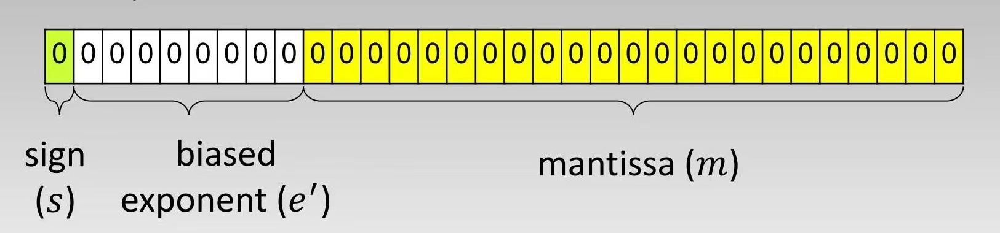
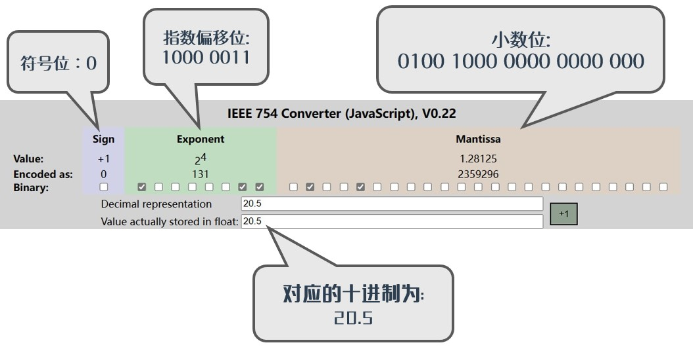
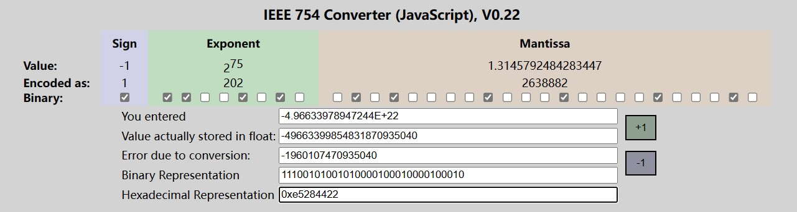
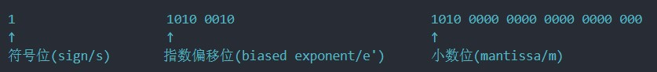
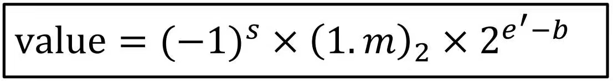

## Overview

These pages are all notes on computer organization. If you spot a mistake, please do point it out!

## Machine number

### 1. Introduction

When a decimal number is converted into the binary form a machine understands, a number that *can* be represented perfectly in binary — with no infinite non-repeating fractional part — is called a **machine number**.

---

### 2. Computation standard — IEEE-754

The IEEE standard for binary floating-point arithmetic (IEEE 754) has been the most widely used floating-point standard since the 1980s, adopted by many CPUs and floating-point units. It defines the format for representing floating-point numbers (including negative zero, -0, and denormal numbers), a few special values (infinity (Inf) and not-a-number (NaN)), and the "floating-point operators" that act on those values; it also lays down four rounding rules and five exception conditions (including when each exception occurs and how it is handled).
IEEE 754 specifies four ways of representing floating-point values: single precision (32 bits), double precision (64 bits), extended single precision (43 bits and up, rarely used) and extended double precision (79 bits and up, usually implemented as 80 bits).

Here we'll start with **single precision** and **double precision**. The **bias** of a **single-precision floating-point number** is **127**, and the **bias** of a **double-precision floating-point number** is **1023**. These two biases are written with the letter `b`.

The online converter (English only): [click](https://www.h-schmidt.net/FloatConverter/IEEE754.html)

The 32-bit floating-point format of IEEE 754 looks like this:

Where:

- sign/s occupies 1 bit and carries the sign: `0` means positive, `1` means negative.

- biased exponent/e' occupies bits 31 down to 23, 8 bits in total, and holds the exponent to base 2.

- mantissa/m occupies the remaining bits 22 down to 0, 23 bits in total, and stores the significand.

---

### 3. Converting a decimal to a machine number (binary)

#### The general method for small numbers

To store a decimal floating-point number in binary you first have to **express the decimal floating-point number in binary**; take the decimal number 20.5, which converts to:
**(20.5)~10~ = (10100.1)~2~**

Next you need to **turn that binary number into an exponential form to base 2**: **10100.1 = 1.01001 * 2^4^**

The idea: once the radix point sits right after the leading digit, the exponent to base 2 is simply how many places the point moved. Here it moved 4 places, so the exponent to base 2 is 4.

::: info
Expressing a *decimal floating-point number* as a *binary number* means writing it as **significand × exponent**, putting **the radix point between the first and second digits**, then **making sure the first digit is not 0**; that process is called **normalising (normalized)**.
:::

In the value **1.01001 * 2^4^**:

- `1.01001` is the **mantissa**, so we take what sits after the radix point, i.e. `01001`. Those bits are only 5 long and we need 23, so they get padded out — the padded result is `0100 1000 0000 0000 000`;

- `4` is the unbiased exponent, usually written `e`.

    [As mentioned above](./README.md#_2-computation-standard-—-ieee-754), the bias (b) for 32-bit single precision is 127, so here we add the bias (that is, `e' = e + b`).
    The **biased exponent (e')** we end up with is `4 + 127 = 131`.

    Finally we convert *131* to binary: **(131)~10~ = (1000 0011)~2~**

Which gives us:

- **biased exponent (e')** = `1000 0011`
- **mantissa (m)** = `0100 1000 0000 0000 000`
- and since **(20.5)~10~** is positive, the **sign bit (s)** = `0`.

Assembling the three parts gives `0 1000 0011 0100 1000 0000 0000 000`, that is `0x41A 4000`:

::: tip
While working through this you may hit a decimal number that cannot be turned into a machine number exactly,

for example $({1\over3})_{10} = (0.\overline{01})_2$ — it has infinitely many binary digits, so there is no machine number that represents it directly.

You therefore have to [round](./README.md#_9-rounding-rules-rounding-rule) it before you can get its machine number.
:::

#### What about large numbers?

The theory holds: to store a decimal floating-point number in binary you first **express the decimal floating-point number in binary** — 20.5, for instance, becomes **(20.5)~10~ = (10100.1)~2~**. For small magnitudes that is easy enough to work by hand.

But suppose the number we have to convert is not that one, but another, *rather large* one — say "**$-4.96633978947244\times 10 ^ {22}$**"?

Turning that from scientific notation into a plain written-out decimal is obviously annoying. So let's work on the number directly:

First, we know **($-4.96633978947244\times 10 ^ {22}$)~10~** is negative, so the **sign bit (s)** = `1`.

We need to turn **($4.96633978947244\times 10 ^ {22}$)~10~** into **($\text{1.x}\times 2 ^ {e}$)~10~** so as to work out the **biased exponent (e')** and the **mantissa (m)** (the sign is ignored, since the sign bit already carries it).

So how do we compute it:

- In scientific notation the number is of order $10 ^ {+22}$.
- Because we need to **express the decimal floating-point number in binary**, we first turn **the number's order of magnitude** into **the order of magnitude of its binary form**

    $$\because 10 ^ 3 \approx 2 ^ {10}$$

    $$\therefore 10 ^ {+22} \approx 2 ^ {70}$$

- So $4.96633978947244\times 10 ^ {22} \approx a \times 2 ^ {70}$, where **a** is unknown
::: tip How do I pick the exponent?
Rounding it to some tens of powers is enough — no need to be precise, because with this method the more precise the exponent, the *less* accurate the final value.
:::
- $\Rightarrow a = \frac{4.96633978947244\times 10 ^ {22}}{2 ^ {70}} \approx 42.06653429 = 1.3145791965 \times 2 ^ {5}$
- So **($\text{1.x}\times 2 ^ {e}$)~10~** comes out as **($\text{1.3145791965}\times 2 ^ {70 + 5}$)~10~**, where `e = 70 + 5 = 75`
- [As mentioned above](./README.md#_2-computation-standard-—-ieee-754), the bias (b) for 32-bit single precision is 127, so here we add the bias (that is, `e' = e + b`).
    The **biased exponent (e')** we end up with is `75 + 127 = 202`.

    Converting *202* to binary gives: **(202)~10~ = (1100 1010)~2~**

- Next, convert $(x)_{10}$ to $(m)_2$ to get the value of the **mantissa (m)**:

    $(0.3145791965)_{10} = (0.0101 0000 1000 1000 0100 0011)_{2}$

    Those bits are 24 long while we only have 23, so we round, leaving `0101 0000 1000 1000 0100 010`;

::: tip How to round
You can read up on the [rounding rules](./README.md#_9-rounding-rules-rounding-rule) here
:::

Which gives us:

- **biased exponent (e')** = `1100 1010`
- **mantissa (m)** = `0101 0000 1000 1000 0100 010`
- **sign bit (s)** = `1`.

Assembling the three parts gives `1 1100 1010 0101 0000 1000 1000 0100 010`, that is `0xE5284422`:

---

### 4. Converting a machine number (binary) back to decimal

Going from a machine number (binary) back to decimal simply runs the steps above in reverse. Take this worked example:
Find the decimal number that the IEEE-754 SP machine number 0xD1500000 corresponds to.

First we need the value of that machine number in binary: **0xD1500000 = (11010001010100000000000000000000)~2~**

Then split it into the **sign bit s**, the **biased exponent e'** and the **mantissa m** described above:

Which gives us: **e' = 2^7^ + 2^5^ + 2^1^ = 162** → **e = e' - b = 35**

There is a formula that sums up the whole computation after that. Writing the decimal value as `value`:

That is, **value = (-1)^1^ * (1.1010 0000 0000 0000 0000 000)~2~ * 2^35^** → **value = -1 * (1.625)~10~ * 2^35^**

∴ the final result is: **value = -1.625 * 2^35^ = -5.5834574848 * 10^10^**

---

### 5. Value range

When the binary value of the **biased exponent e'** is `0` or `1...1`, the machine number usually stands for one of a handful of special values (±0, ±∞, NaN).

Put another way, a machine number has a range of values it can represent.

In binary, assuming `1 ≤ e' ≤ 1...10`, the range a machine number covers differs with precision:

::: tabs#SPDP

@tab:active Single-precision range#SP

- sign/s occupies 1 bit

- biased exponent/e' occupies 8 bits.

- mantissa/m occupies 23 bits.

→ 1 ≤ e' ≤ 254
∵ b = 127 → -126 ≤ e ≤ 127

∴ largest machine value = (-1)^s^ × (1.1...1)~2~ × 2^127^ ≈ **± 3.4 × 10^38^**

   smallest machine value = (-1)^s^ × (1.0...0)~2~ × 2^-126^ ≈ **± 1.2 × 10^-38^**

@tab Double-precision range#DP

- sign/s occupies 1 bit

- biased exponent/e' occupies 11 bits.

- mantissa/m occupies 52 bits.

→ 1 ≤ e' ≤ 2046
∵ b = 1023 → -1022 ≤ e ≤ 1023

∴ largest machine value = (-1)^s^ × (1.1...1)~2~ × 2^1023^ ≈ **± 1.8 × 10^308^**

   smallest machine value = (-1)^s^ × (1.0...0)~2~ × 2^-1022^ ≈ **± 2.2 × 10^-308^**

:::

---

### 6. Overflow and underflow errors

If the *absolute value of a machine number* is greater than the **absolute value** of the **largest machine value** the **precision** supports, an overflow error (Overflow Error) occurs;
if the *absolute value of a machine number* is smaller than the **absolute value** of the **smallest machine value** that precision supports, an underflow error (Underflow Error) occurs.

::: tabs#SPDP

@tab:active Single precision#SP

|value| > the largest machine value **3.4 × 10^38^**, so an overflow error (Overflow Error) occurs

|value| < the smallest machine value **1.2 × 10^-38^**, so an underflow error (Underflow Error) occurs

@tab Double precision#DP

|value| > the largest machine value **1.8 × 10^308^**, so an overflow error (Overflow Error) occurs

|value| < the smallest machine value **2.2 × 10^-308^**, so an underflow error (Underflow Error) occurs

:::

---

### 7. Neighbouring machine values and machine epsilon

Plainly, the previous machine value is the machine number (known to be binary) *minus one*, and the next machine value is that machine number *plus one*. Doing it that way means converting from decimal to binary, doing the arithmetic in binary and converting back, which is tedious, so we normally do this instead:

::: tip
To keep the arithmetic simple, all machine numbers here are decimal and the precision is single, i.e. 23 mantissa bits
:::

First **express the decimal floating-point number in binary**; take the decimal number 20.5, which converts to:
**(20.5)~10~ = (10100.1)~2~**

Next you need to **turn that binary number into an exponential form to base 2**: **10100.1 = 1.01001 * 2^4^**.

Up to here everything matches [what was said above](./README.md#_3-converting-a-decimal-to-a-machine-number-binary). What follows is different:

`4` is the unbiased exponent, usually written `e`. Here we keep **2^e^**, that is **2^4^**, for the arithmetic;

Because adding or subtracting one both act on the last bit of the *mantissa*, bit **2^-23^**, we get

next machine value = 20.5 + 2^4^ × 2^-23^ = 20.5000019073486328125

previous machine value = 20.5 - 2^4^ × 2^-23^ = 20.4999980926513671875

The *distance from 1 to the next machine number at that precision* is what we call **machine epsilon**, usually written $\epsilon _{mach}$.

So at single precision the machine epsilon is: $\epsilon _{mach} = (1 + 2^{-23}) - 1 = 2^{-23} \approx 1.19209 \times 10^-7$

::: tip
In general $\epsilon _{mach}$ is 2 raised to the power of *the binary bit the last mantissa bit stands for*
:::

---

### 8. True error / true relative error

::: info
All machine numbers here are decimal
:::

Since a machine number (the "current value" from here on) still differs from its own previous and next machine values, any decimal value falling between *the current value and the previous one*, or between *the current value and the next one*, gets handled like this:

If it lies between (current value + previous value) / 2 and (current value + next value) / 2, the number is estimated as the value the current machine number represents.

For example, given previous machine value = 20.4999980926513671875 and current machine value = 20.5, we get (current value + previous value) / 2 = 20.49999904632568359375. Then 20.4999991, being *between (current value + previous value) / 2 and (current value + next value) / 2*, is estimated as 20.5

::: tip
This estimation is close to the [rounding rules](./README.md#_9-rounding-rules-rounding-rule) below; the two are worth reading together
:::

So the relevant calculations bring up true error and true relative error:

true error = | real value - estimated value (machine number) |

true relative error = | (real value - estimated value (machine number)) / real value | * 100%

In the example above:

true error = | 20.4999991 - 20.5 | = 0.0000009

true relative error = | (20.4999991 - 20.5) / 20.4999991| × 100% ≈ 0.00000439%

---

### 9. Rounding rules (Rounding Rule)

Any floating-point system has finite precision, so a number that cannot be converted into a machine number exactly — because its binary form has infinitely many fractional digits, say — simply cannot be represented exactly. Hence a set of rounding rules:

Constrain the fractional bits to the **mantissa**, then decide from the bit right after it (the MSB):

- if that last bit is 0, drop all the remaining fractional digits;
- if that last bit is 1, add one to the last mantissa bit.

::: tip
This estimation is close to the [estimation method](./README.md#_8-true-error-true-relative-error) above; the two are worth reading together
:::

An example:

Given $(9.4)_{10} = (1001.\overline{0110})_2$, where the fractional part repeats.

$(9.4)_{10} = (1001.\overline{0110})_2 = 1.001\overline{0110} \times 2^3$

$\Rightarrow s = 0, e = 3 \rightarrow e' = 3 + 127 = 130 = (10000010)_2, m = (0010 1100 1100 1100 1100 110)$

So the machine number starts out as $\textcolor{#329894}{0} \quad \textcolor{#983232}{10000010} \quad \textcolor{#877e00}{0010 1100 1100 1100 110} \quad \textcolor{#871e00}{01}$

And since the bits after the **mantissa** `0010 1100 1100 1100 110` are `01` with an MSB of 0, all remaining fractional digits are dropped.

Therefore $(9.4)_{10} = (1001.\overline{0110})_2 = 0 \quad 10000010 \quad 0010 1100 1100 1100 110$

::: important
This article was translated by Hermes Agent; the original text can be found at [here](../../../learningNote/Principles_of_Computer_Composition/README.md). The translation is for reference only.
Translation time: 2026-11-05
:::
