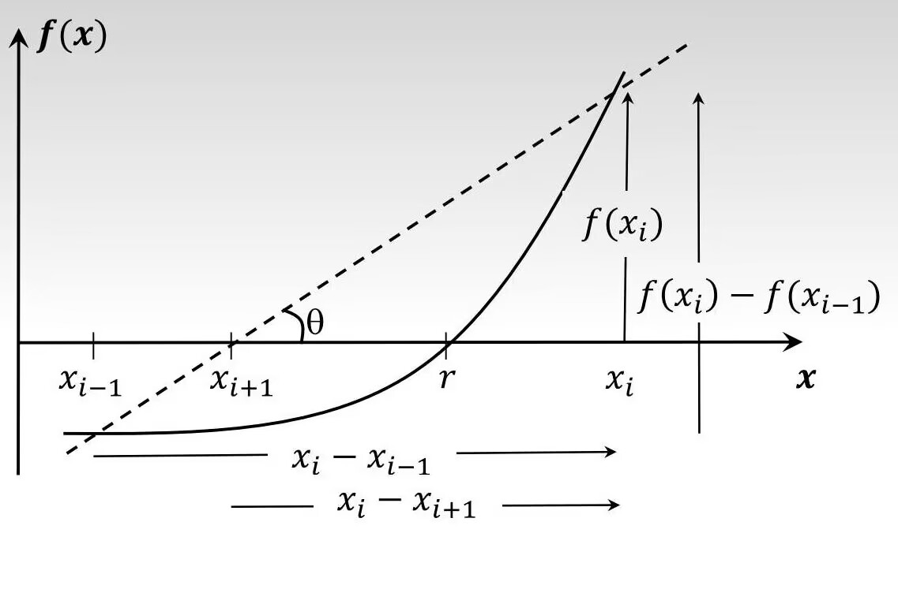

## Overview

These pages are all notes on calculation and simulation. If you spot a mistake, please do point it out!

## Machine number

See [here](./README.md#machine-number)

That section covers the calculations around **IEEE-754 single and double precision**, **converting between decimal and machine numbers**, **machine epsilon**, **true error / true relative error**, **rounding rules (Rounding Rule)** and so on.

## Reducing rounding error

### 1. Where errors come from

1. Truncation error: when we use a finite series to fit an infinite one, truncation error shows up. For example:

    Here is an infinite series: $\exp ^x = 1 + {x \over 1!} + {x^2 \over 2!} + \dots$

    When we fit it with the finite series: $P_3 (x) = 1 + x + {x^2 \over 2!} + {x^3 \over 3!}$,

    truncation error appears: $R_3 (x) = \exp ^x - P_3 (x)$

    See [Taylor theory](./compute_and_simutation.md#taylor-theory) for the details

2. Round-off error: when we try to store a non-machine number in a computer, the computer's own precision is limited, so round-off error appears.

3. Data error: all real data carries measurement error; here we call it measurement error.

4. Model error: every mathematical model is a fit to a physical phenomenon, so model error appears.

5. Operator error (blunders): error caused by the computer operator entering data by hand.

6. Propagated error: numerical methods are iterative, which means the solution at step i depends on the solution at step i-1. So the error at step i depends on the error at step i-1. As the method iterates, the propagated error keeps growing. If the computed solution grows and grows until it swamps the true solution, it becomes meaningless, and we say the method is unstable.

---

### 2. Horner's rule (the Qin Jiushao algorithm)

In general, evaluating a degree-n polynomial in one variable takes $(n+1)*n \over 2$ multiplications and `n` additions, whereas the Qin Jiushao algorithm needs only `n` multiplications and `n` additions. For hand calculation that simplifies the work a great deal.

Take a degree-n polynomial $f(x) = a_nx^n + a_{n-1}x^{n-1} + \dots + a_1x^1 + a_0$
and rewrite it in the following form:

$$f(x)$$

$$= (a_nx^{n-1} + a_{n-1}x^{n-2} + \dots + a_2x^1 + a_1)x + a_0$$

$$= ((a_nx^{n-2} + a_{n-1}x^{n-3} + \dots + a_2)x + a_1)x + a_0$$

$$\vdots$$

$$= ( \dots ((a_nx + a_{n-1})x + a_{n-2})x + \dots + a_1)x + a_0$$

To evaluate the polynomial, first compute the value of the innermost linear factor, that is

$$v_1 = a_nx + a_{n-1}$$

then work from the inside out, layer by layer:

$$v_2 = v_1x + a_{n-2}$$

$$v_3 = v_2x + a_{n-3}$$

$$\vdots$$

$$v_n = v_{n-1}x + a_{0}$$

This way, evaluating the degree-n polynomial f(x) turns into evaluating n linear factors.

Conclusion: **for a degree-n polynomial, at most n multiplications and n additions are needed.**

---

### 3. Fitting an arbitrary function with a Taylor expansion

For a function f(x) that can be differentiated as many times as we like at any point, its Taylor expansion about the expansion point (a, f(a)) is:

$$f(x) = f(a) + f'(a)(x-a) + {f''(a) \over 2!}(x - a)^2 + {f''(a) \over 3!}(x - a)^3 + \dots$$

$$= \sum_{k=0}^{\infin} {f^{(k)}(a) \over k!}(x - a)^k$$

So without knowing the function itself, as long as we know its value at some point and the derivatives at that value, $(a,f(a))$, we can fit the function with this formula.

::: info
A Maclaurin series is a special case of a Taylor series. When a function f(x) that can be differentiated as many times as we like at any point is fitted with a Taylor expansion and we take `a = 0`, that is we expand about $(0,f(0))$, the resulting series is called a Maclaurin series. It is usually written as:

$$f(x) = f(0) + f'(0)x + {f''(0) \over 2!}x^2 + {f''(0) \over 3!}x^3 + \dots$$

$$= \sum_{k=0}^{\infin} {f^{(k)}(0) \over k!}x^k$$
:::

## Taylor theory

**If a function f(x) has derivatives of order 1, 2, ..., (n + 1) on an interval containing a and x, then the value of f(x) can be written as: f(x) = the sum of the Taylor series truncated to (n + 1) terms + the remainder Rn .** As a formula:

$$f(x) = \sum_{k=0}^{n}{f^{(k)}(a) \over k!}(x - a)^{k} + R_n$$

And the remainder is what we usually call the **truncation error**. In formula form:

$$R_n = {f^{(n + 1)}(c) \over (n + 1)!}(x - a)^{n + 1} \space \text{where {\it c}} \in \text{the interval containing a and x}$$

### Mean value theorem

If a function f(x) is continuous and its first derivative exists on the interval (a, b), then there must be some $c \in (a, b)$ such that:

$$f'(c) = {f(b) - f(a) \over b-a}$$

From the Taylor theory above you can see that the mean value theorem is the special case of it with `n = 0`. Here `x = b`:

$$f(b) = \sum_{k=0}^{0}{f^{(b)}(a) \over k!}(b - a)^{k} + R_0$$

$$= f(a) + R_0$$

$$= f(a) + f'(c)(b-a)$$

$$\Rightarrow f'(c) = { f(b)-f(a) \over b-a }$$

## Zeros of functions and roots of equations

A zero of a function makes the function equal zero: if $f(z) = 0$, then `z` is a zero of `f()`;
a root of an equation satisfies the equation: if `r` satisfies it, it is a root of the equation.

Let `a` be a constant. Under the definitions above, a root of the equation $f(z) = a$ is not necessarily a zero of the function $f(z)$, but when $a = 0$ a zero of the function $f(z)$ is definitely a root of the equation $f(z) = a$.

## Analytical and numerical solutions of a function

An analytical solution works only for finding the roots of a few special functions. For a quadratic in one variable, say $f(X) = ax^2 + bx + c = 0$, its analytical solution comes from the formula $x = {-b \plusmn \sqrt{b^2-4ac} \over 2a}$.

A numerical solution can find the roots of most functions. When a function's analytical solution can't be found the usual way, we have to solve for its numerical root with numerical methods. For the function $f(X) = e^x - x = 0$, say, we can't easily find an analytical solution, so we can only get a numerical one.

::: tip
For the same function, the analytical solution always comes before the numerical one, because the analytical solution is exact while the numerical solution is an approximation.
:::

## Three algorithms for fitting functions

### 1. Bisection Method

**Prerequisite:** similar to the *bisection method*

Suppose `f(x)` is continuous on $[a, b]$ and $f(a)f(b) < 0$, i.e. the root lies in that interval. Then do the following:

- Compute the midpoint m = (a + b)/2
- Check the sign of f(a)f(m):
  - if it is less than zero (the root is in $[a, m]$), move b to m
  - if it is greater than zero (the root is not in $[a, m]$), move a to m
- Compute the true truncation error Et and the absolute truncation error Ea:
  - Et = abs(RealNumber - the current m)
  - Ea = abs(the current m - the previous m)
- The loop ends once the computed absolute truncation error is smaller than the given error value

As pseudocode:

```txt
Set the given true result value RealNumber

while (Ea > the given value, e.g. $10^{-10}$){
    Compute the midpoint  
    m = (a + b)/2

    Check f(m)
    if (f(a)f(m) < 0) {
        b = m
    } else {
        a = m
    }

    Compute the true truncation error Et
    Et = abs(RealNumber - the current m);

    Compute the absolute truncation error Ea
    Ea = abs(the current m - the previous m)
} 
```

### 2. Newton-Raphson method

Another way to get an approximate solution: iterate closer and closer to the root of a function or the solution of an equation. It uses a local linear approximation of the function to update the current approximate solution until the preset accuracy requirement is met.

Suppose we want the root of $f(x)$ and define an initial approximate solution $x_0$; the iteration formula for the approximate solution is then:

$$x_{n+1} = x_n - \frac{f(x_n)}{f'(x_n)}$$

where $f'(x_n)$ is the derivative of $f(x)$ at the point $x_n$.

This method gets an approximate root very fast. But it requires the function being solved, as well as the way it is computed, to have the following features before it can produce an approximate solution:

- the curve of the function being solved should be fairly smooth rather than changing a lot; otherwise the initial approximate solution easily lands near a local minimum, and the iteration converges on the minimum instead of the root.
- the derivative has to exist throughout the specified iteration range, i.e. the function must be differentiable over that range, otherwise the method fails
- (extreme case) the iteration must not get two points stuck near an inflection point looping forever, otherwise the method fails

### 3. Secant method

In a function, a straight line joining two points on the function is called a **secant**.

Suppose two estimates of the root are defined for the function $f(x)$, where *the current estimate* is $x_i$ and *the previous estimate* is $x_{i-1}$; then the point where the secant through $f(x_i)$ and $f(x_{i-1})$ meets the x-axis gives *the next estimate of the root*, $x_{i+1}$



$$ tan(\theta) = \frac {f(x_i)} {x_i-x_{i+1}} = \frac {f(x_i)-f(x_{i-1})} {x_i-x_{i-1}} $$

$$ \Rightarrow x_i-x_{i+1} = (\frac {x_i-x_{i-1}} {f(x_i)-f(x_{i-1})}) $$

So the formula for *the next estimate of the root* is:

$$ x_{i+1} = x_i-(\frac {x_i-x_{i-1}} {f(x_i)-f(x_{i-1})}) $$

This method needs no derivative, so it is relatively convenient. It has these features:

- faster than the bisection method, but slower than Newton-Raphson;
- if the two initial guesses are not close to the true root, it may fail to converge;
- it can't be computed when the denominator of that expression, $f(x_i)-f(x_{i-1})$, is zero;
- like Newton-Raphson, the initial approximate solution may land near a local minimum, so the iteration converges on the minimum instead of the root.

::: important
This article was translated by Hermes Agent; the original text can be found at [here](../../learningNote/Principles_of_Computer_Composition/compute_and_simutation.md). The translation is for reference only.
Translation time: 2026-11-05
:::
