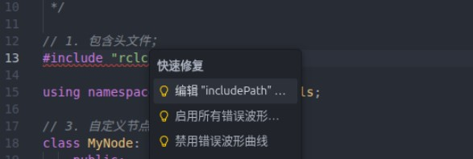
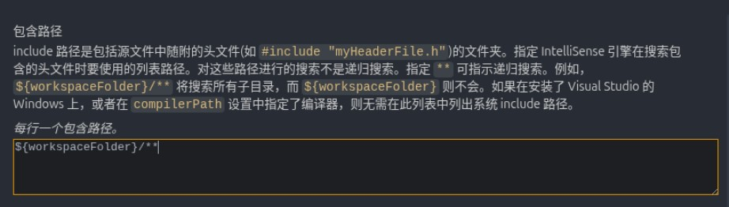

## Brief

These are my notes on ROS2. The software and hardware used throughout them is:

- ROS2 Jazzy Jalisco LTS
- Ubuntu 24.04.3 LTS
- Raspberry Pi 5B (4GB)

Most of these notes were written with reference to the following sites and video tutorials:

- The official ROS2 Jazzy documentation: [ROS 2 Documentation — ROS 2 Documentation: Jazzy documentation](https://docs.ros.org/en/jazzy/)
- The ROS2 online course by Zhao Xuzuo, lead author of the *ROS Robot Theory and Practice* textbook published by Tsinghua University Press: [Mengshi Boot Camp video collection · ROS2 Theory and Practice, Core Chapters](https://space.bilibili.com/1101432368/channel/collectiondetail?sid=700208)

::: note VSCode reports a header-file error while writing C++ files

You can go through the “Edit includePath...” option:



Find the “Include path” option:



Add this on a new line:

```txt
/opt/ros/jazzy/include/**
```

and that's it.

:::

::: note No completion suggestions while writing C++ files

Press `Ctrl+Shift+P（Windows/Linux）` or `Cmd+Shift+P（Mac）`, type `C/C++: Edit Configurations (UI)` and pick that command. In the configuration panel that pops up you don't need to change anything — just click the save button in the top right. VSCode then generates a `c_cpp_properties.json` file in the `.vscode` folder at the project root.
You can then edit `c_cpp_properties.json` and add "compilerPath" inside it:

```json
{
    "configurations": [
        {
            "name": "Linux",
            "includePath": [
                "${workspaceFolder}/**",
                "/opt/ros/jazzy/include/**"
            ],
            "defines": [],
            "compilerPath": "/usr/bin/g++", // 👈 NEW!!
            "cStandard": "c17",
            "cppStandard": "gnu++17",
            "intelliSenseMode": "linux-gcc-x64"
        }
    ],
    "version": 4
}
```

Save it, restart VSCode, and you're set.

:::

::: note Snippets you can use
Here are some snippets you can use, covering `node` and `launch`:

```json
// cpp.json
{
 "ros2_node_cpp":{
  "prefix": "ros2_node_cpp",
  "body": [
   " /*",
   "    Requirement:",
   "    Steps:",
   "        1. Include the header files;",
   "        2. Initialise the ROS2 client",
   "        3. Define the custom node class:",
   "",
   "        4. Call the spin function, passing in the node object pointer",
   "        5. Release resources.",
   " */",
   "",
   "// 1. Include the header files;",
   "#include \"rclcpp/rclcpp.hpp\"",
   "",
   "// 3. Define the custom node class:",
   "class MyNode: public rclcpp::Node{",
   "    public:" ,
   "        MyNode() : Node(\"mynode_node_cpp\"), count_(0)",
   "        {",
   "",
   "        }",
   "};",
   "",
   "int main(int argc, char *argv[])",
   "{",
   "    // 2. Initialise the ROS2 client",
   "    rclcpp::init(argc, argv);",
   "    // 4. Call the spin function, passing in the node object pointer.",
   "    rclcpp::spin(std::make_shared<MyNode>());",
   "    // 5. Release resources;",
   "    rclcpp::shutdown();",
   "    return 0; ",
   "} "
  ],
  "description": "ros2 node user snippets"
 },
}
```

```json
// python.json
{
    "ros2 node": {
        "prefix": "ros2_node_py",
        "body": [
            "\"\"\"  ",
            "    Requirement:",
            "    Flow:",
            "        1. Import the packages;",
            "        2. Initialise the ROS2 client;",
            "        3. Define the custom node class;",
            "                        ",          
            "        4. Call the spain function, passing in the node object;",
            "        5. Release resources. ",
            "",
            "",
            "\"\"\"",
            "# 1. Import the packages;",
            "import rclpy",
            "from rclpy.node import Node",
            "",
            "# 3. Define the custom node class;",
            "class MyNode(Node):",
            "    def __init__(self):",
            "        super().__init__(\"mynode_node_py\")",
            "",
            "def main():",
            "    # 2. Initialise the ROS2 client;",
            "    rclpy.init()",
            "    # 4. Call the spain function, passing in the node object;",
            "    rclpy.spin(MyNode())",
            "    # 5. Release resources. ",
            "    rclpy.shutdown()",
            "",
            "if __name__ == '__main__':",
            "    main()",
        ],
        "description": "ros2 node"
    },
    "ros2 launch py": {
        "prefix": "ros2_launch_py",
        "body": [
            "from launch import LaunchDescription",
            "from launch_ros.actions import Node",
            "# Classes wrapping terminal commands--------------",
            "# from launch.actions import ExecuteProcess",
            "# from launch.substitutions import FindExecutable",
            "# Declaring and getting parameters-----------------",
            "# from launch.actions import DeclareLaunchArgument",
            "# from launch.substitutions import LaunchConfiguration",
            "# Including files-------------------",
            "# from launch.actions import IncludeLaunchDescription",
            "# from launch.launch_description_sources import PythonLaunchDescriptionSource",
            "# Grouping----------------------",
            "# from launch_ros.actions import PushRosNamespace",
            "# from launch.actions import GroupAction",
            "# Events----------------------",
            "# from launch.event_handlers import OnProcessStart, OnProcessExit",
            "# from launch.actions import ExecuteProcess, RegisterEventHandler,LogInfo",
            "# Getting the package's share directory path-------",
            "# from ament_index_python.packages import get_package_share_directory",
            "",
            "def generate_launch_description():",
            "    ",    
            "    return LaunchDescription([])"
        ],
        "description": "ros2 launch"
    }
}
```

:::

::: important
This article was translated by Hermes Agent; the original text can be found at ../../learningNote/Ros2_Note/README.md. The translation is for reference only.
Translation time: 2026-11-05
:::
