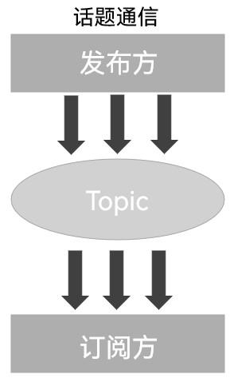
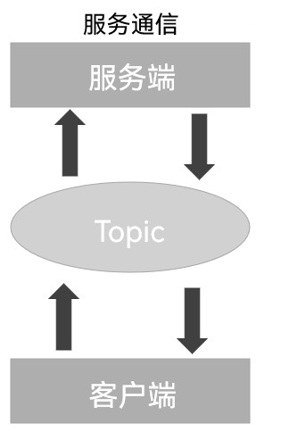
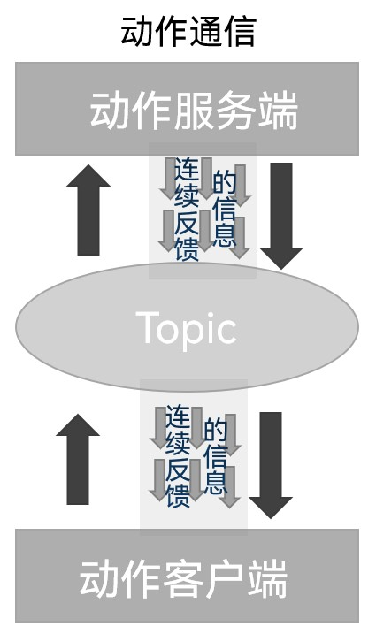
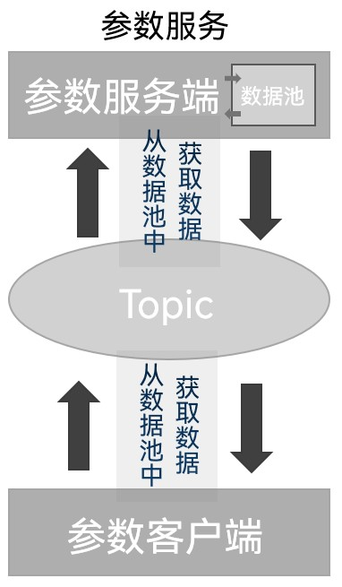

## Introduction

As a highly complex systemic implementation, a complete robot application is generally made up of several functional modules, and each of those modules may contain several functional points, and different modules and different functional points usually have to exchange data back and forth.
Take the path planning module in navigation as an example:

- The path planning module needs other modules to feed it all sorts of data, and outputs the corresponding processed data so that other modules can use it;
- The input data includes map data from the map service, robot pose data from the localisation module, goal point data from the human-machine interaction module, and so on;
- And the processed output data, i.e. the path information, gets subscribed to by motion control or echoed on the human-machine interaction interface.

So to get data flowing between these fairly independent modules or functional points, you need the various communication mechanisms ROS2 provides. The building blocks of these mechanisms are similar: in every mechanism communication is a two-party or multi-party affair, different communication objects have to be associated when communicating, each mechanism has its own model, and every mechanism necessarily involves a data carrier when it exchanges data.

## Nodes and topics

### Nodes

In the various communication mechanisms, building a communication object depends on nodes (Node). In ROS2, generally each node corresponds to a single functional module:

- A lidar driver node publishes lidar information;
- A camera driver node publishes image information;
- ...

A complete robot system is generally made up of multiple nodes working together, while a single executable in ROS2 (say a C++ program or a Python program) can contain one or more nodes.

### Topics

A topic (Topic) is the mechanism in ROS2 for **asynchronous** message communication between nodes; it is used to tie together nodes that share the same topic. Although ROS2 is cross-language (say a C++ program and a Python program implementing different nodes), as long as the two use the same topic, they can exchange data.

Topics are based on the publish/subscribe pattern: one node can publish messages over a topic (publisher), and another node can receive those messages by subscribing to the topic (subscriber).

Topics are generally used for one-to-many or many-to-many communication between nodes, because data in a topic flows continuously, which makes topics better suited to scenarios that don't need an immediate response.

## Communication models

In ROS2 the **commonly used** communication models are four:

1. Topic communication (Topics)
2. Service communication (Services)
3. Action communication (Actions)
4. Parameter service (Parameters)

### Topic communication (Topics)

Topic communication is a one-way communication model: of the two parties, the publisher publishes data and the subscriber subscribes to it, with the data flowing one way from the publisher to the subscriber.

So the characteristic of this mechanism is: **one-way data flow**

### Service communication (Services)

Service communication is a request-response model: of the two parties, the client sends request data to the server, and the server responds with the result to the client.

So the characteristic of this mechanism is: **request-response pattern**

### Action communication (Actions)

Action communication is a model with continuous feedback: of the two parties, the client sends request data to the server and the server responds with the result to the client — but in the stretch between the server receiving the request and producing the final response, the server sends continuous feedback to the client.

So the characteristic of this mechanism is: **continuous feedback**

### Parameter service (Parameters)

The parameter service is a sharing-based model: of the two parties, the server can set data, and the client can connect to the server and operate on the server's data. So this model is somewhat like a backend doing insert-delete-update-query on a database, and that is the equivalence you can use when learning it. In practice access is generally built on top of the service communication model with some extra processing.

The characteristic of this mechanism is: **data sharing**

::: important
This article was translated by `Hermes Agent`; the original text can be found at [here](../../../../learningNote/Ros2_Note/co_me/2024_09_18.md). The translation is for reference only.
Translation time: 2026-11-05
:::
