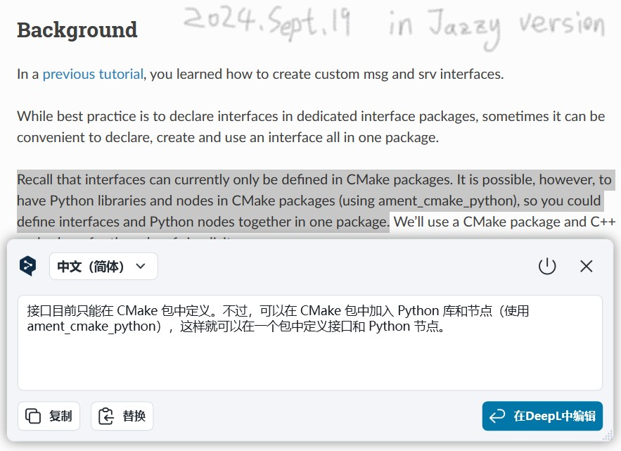

## Introduction: what are interfaces?

In the course of communicating, when nodes need to transfer data they necessarily have to transfer it in a particular format — that is, the data carrier we keep using. In ROS2 the data carrier is called an **interface**.

## The commonly used interface files

The data carrier used in communication generally has to be defined with an interface file. There are three commonly used interface files: `msg` files, `srv` files and `action` files, corresponding respectively to **topic communication**, **service communication** and **action communication** described in [the previous article](./2024_09_18.md#communication-models), and each kind of file needs its "variables" of a *specific data type* defined in a set format.

::: tip
Parameter communication needs no interface file: during parameter communication the data is wrapped into a parameter object, and both the parameter client and the parameter server operate on that parameter object.
:::

### 1. msg files

A `msg` file is the interface file used to define the data carrier in **topic communication**, and a typical `.msg` file looks like this:

```cmake
// .msg
int64 num1
int64 num2
```

Some data resembling **C++** variables is declared in the file.

### 2. srv files

An `srv` file is the interface file used to define the data carrier in **service communication**. A typical `.srv` file looks like this:

```cmake
// .srv
int64 num1
int64 num2
---
int64 sum
```

The data declared in the file is split into two parts by "---", where the **upper part** declares the request data and the **lower part** declares the response data.

### 3. action files

An `action` file is the interface file used to define the data carrier in **action communication**. A typical `.action` file looks like this:

```cmake
// .action
int64 num1
int64 num2
---
int64 sum
---
float64 progress
```

The data declared in the file is split into three parts by "---", where the **upper part** declares the request data, the **middle part** declares the response data, and the **lower part** declares the continuous feedback data.

## Variable types

Whatever the interface file, each line of data declared in it consists of a **field type** and a **field name**, and the **field types** you can use are the following:

- int8, int16, int32, int64 (or the unsigned types: uint*)
- float32, float64
- string
- time, duration
- variable-length and fixed-length arrays
- other msg files

ROS also has one special type: **Header**, which holds a timestamp and the coordinate frame information commonly used in ROS2. Many complex interface files put a Header on the first line.

::: tip
This is just a brief introduction to interfaces, for reference and general understanding. And since as of today ROS2 still **cannot** define interface files inside a Python package, all the code above is based on `CMAKE`. If that changes, I'll leave it for a later record article to cover.

:::

::: important
This article was translated by Hermes Agent; the original text can be found at ../../../../learningNote/Ros2_Note/co_me/2024_09_19.md. The translation is for reference only.
Translation time: 2026-11-05
:::
