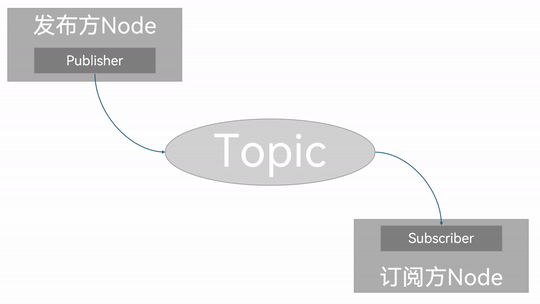
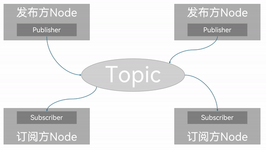
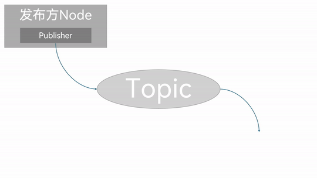

## Introduction

**Topic communication (Topics)** is a communication pattern that transfers data between different nodes by publishing and `subscribing`. The object that publishes data is called the publisher, the object that subscribes to data is called the subscriber; publisher and subscriber are associated through a topic (Topic), the publisher publishes a **message (Message)** on the topic, and the subscriber subscribes to that **message (Message)** from the topic. So in topic communication the flow of messages is always one-way.



But in **topic communication** the publisher and the subscriber are in a many-to-many relationship — that is, under the same topic there can be several publishers and several subscribers, which means data can end up crossing over.



And of course, if there is no subscriber, the data being transferred gets lost too.



That is why topic communication is generally used in data-transfer scenarios where the data keeps updating and needs little logical processing.

## Message interfaces

In the diagrams above we saw that publisher/subscriber nodes use a **message (Message)** as the carrier for the data being transferred. To keep the format regular, messages use a **message interface** to define the data format. There is more than one way to use a message interface:

- In ROS2, the official side has pre-packaged some native data types in the `std_msgs` package, for example:

  - String
  - Int8
  - Int16
  - Int32
  - Int64
  - Float32
  - Float64
  - Char
  - Bool
  - Empty
  - ......

  By the official design these native data types can each also serve on their own as the data carrier for topic communication, but using only these generally gives you a single `data` field, so the structure is fairly simple. The other interface files in the `std_msgs` package are quite simple as well, and a one-track structure means limited functionality, so when we need to transfer data with a somewhat complex structure they come up short;

- ROS2 also predefines plenty of **standard topic** message interfaces, which see wide use in actual work, for example:
  - the `sensor_msgs` package defines many interfaces related to **sensor messages** (e.g. lidar, camera, point cloud ......)
  - `geometry_msgs` in turn defines many interfaces related to **geometry messages** (e.g. coordinate points, coordinate frames, velocity commands ......)
  - ......

- If none of the interface files above can meet our needs, we can also define our own interface message;

So exactly what to pick depends on the specific case — case by case.

---

## A simple implementation of topic communication

Now let's implement it separately against the **native message interface** and the **custom message interface**, to get a deeper understanding of topic communication.

::: tip
Below, for convenience, the **implementation with the native message interface** is called Case 1, the **implementation with the custom message interface** is called Case 2, and together they are called **the two cases**.
:::

### Workflow overview

The shared main steps for implementing the two cases are:

1. Write the publisher implementation;
2. Write the subscriber implementation;
3. Edit the configuration files;
4. Build;
5. Run.

Case 2 of course needs the custom interface message defined first; apart from that, the implementation flow is the same as Case 1. The two cases are implemented in C++ and Python separately, and both follow the workflow above.

### Preparation

Create the workspace in a terminal:

```shell
mkdir -p ws01_plumbing/src
cd ws01_plumbing/src
colcon build
```

Enter the workspace's src directory:

```shell
cd src/
```

Call the following command to create the interface package we'll use later:

```shell
ros2 pkg create --build-type ament_cmake base_interfaces_demo

```

Call the following two commands to create the C++ package and the Python package respectively:

**C++:**

```shell
ros2 pkg create cpp01_topic --build-type ament_cmake --dependencies rclcpp std_msgs base_interfaces_demo
```

**Python:**

```shell
 ros2 pkg create py01_topic --build-type ament_python --dependencies rclpy std_msgs base_interfaces_demo
```

Preparation is done.

---

Next you can go through the [native message interface](./2024_09_22.md) and the [custom message interface](./2024_09_25_002.md) to implement topic communication respectively.

## Summary

In this section we systematically set out how, following the principles behind topic communication and working by hand, you can implement simple topic communication between nodes via the two approaches: the **native message interface** and the **custom message interface**.

::: tip Setting up code snippets in VSCode
Once we're familiar with the code-writing flow above, we'll notice that apart from the custom class being different, the code structure within the same programming language is basically identical. To cut down on writing repeated code and write code more efficiently, we can set up custom code snippets in VSCode so it generates the matching snippet for us automatically. See [here](../../coding_skill/2024_09_23.md) for details.
:::

::: important
This article was translated by `Hermes Agent`; the original text can be found at [here](../../../learningNote/Ros2_Note/co_me/2024_09_19_002.md). The translation is for reference only.
Translation time: 2026-11-05
:::
