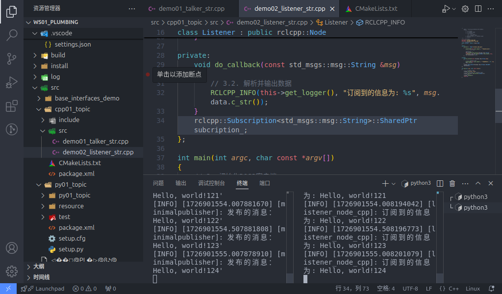
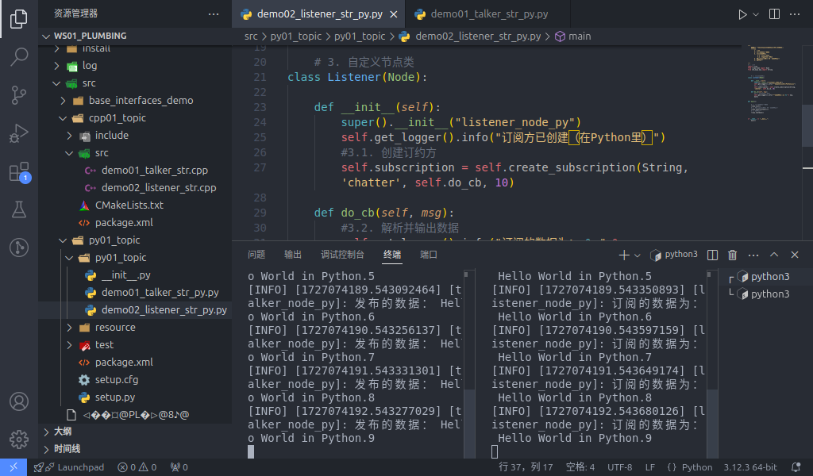

## Implementing topic communication with native message interfaces

Next we will implement topic communication using **native message interfaces**. If you haven't done the prep work in Ubuntu yet, see [here](./2024_09_19_002.md#preparation).

### C++

#### 1. Implementing the publisher

In the `src` directory of the package `cpp01_topic`, create a new C++ file `demo01_talker_str.cpp`, edit it, and put in the following:

```cpp
/*
    Requirement: send the text "Hello World!" at some fixed frequency, with a number suffixed to the text; one message per send, the number going up by 1.
    Steps:
        1. Include the header files;
        2. Initialise the ROS2 client
        3. Define a custom node class:
            3-1. Create the publisher;
            3-2. Create the timer;
            3-3. Assemble the message and publish it.
        4. Call the spin function, passing in the node object pointer
        5. Release resources.
 */

// 1. Include the header files;
#include "rclcpp/rclcpp.hpp"
#include "std_msgs/msg/string.hpp"

using namespace std::chrono_literals;

// 3. Define a custom node class:
class MinimalPublisher : public rclcpp::Node
{
    public: 
    // what count_(0) does is initialise count_ to 0
        MinimalPublisher() : Node("minimalpublisher"), count_(0)
        {
        // 3-1. Create the publisher;

        /*
            Template: the message type being published
            Parameters:
                1. the topic name;
                2. QOS (message queue length);
            Return value: the publisher object pointer.
         */

        publisher_ = this->create_publisher<std_msgs::msg::String>("topic", 10); 
        // 3-2. Create the timer;
        /*
            Parameters:
                1. the time interval;
                2. the callback;
            Return value: the timer object pointer.
         */
        timer_ = this->create_wall_timer(500ms, stc::bind(&MinimalPublisher::timer_callback, this)) 
        } 
    private: 
        void timer_callback() 
        {
            // 3-3. Assemble the message and publish it.
            auto message = std_msgs::msg::string();
            message.data = "Hello, world!" + std::to_string(count_++); RCLCPP_INFO(this->get_logger(), "Published message: '%s'", message.data.c_str());
            publisher_->publish(message); 

        }
        rclcpp::Publisher<stdmsgs::msg::String>::SharedPtr publisher_;
        rclcpp::TimerBase::SharedPtr timer_;
        size_t count_;
};

int main(int argc, char *argv[])
{
    // 2. Initialise the ROS2 client
    rclcpp::init(argc, argv);
    // 4. Call the spin function, passing in the node object pointer.
    rclcpp::spin(std::make_shared<MinimalPublisher>());
    // 5. Release resources;
    rclcpp::shutdown();
    return 0; 
} 

```

#### 2. Implementing the subscriber

In the `src` directory of the package `cpp01_topic`, create a new C++ file `demo02_listener_str.cpp`, edit it, and put in the following:

```cpp
/*      

  Requirement: subscribe to the messages the publisher publishes, and print them to the terminal.    
  Steps:      
     1. Include the header files;        
     2. Initialise the ROS2 client;        
     3. Define a custom node class;            
        3-1. Create the subscriber;            
        3-2. Handle the messages that come in.        
     4. Call the spin function, passing in the node object pointer;        
     5. Release resources. 
*/

// 1. Include the header files;
#include "rclcpp/rclcpp.hpp"
#include "std_msgs/msg/string.hpp"
using std::placeholders::_1;
// 3. Define a custom node class;

class MinimalSubscriber : public rclcpp::Node 
{
  public:  
    MinimalSubscriber()   
    : Node("minimal_subscriber")    
    {      
     // 3-1. Create the subscriber;  
    /*
        Template: the message type;
        Parameters:
            1. the topic name (should match the publisher's)
            2. QOS: queue length;
            3. the callback;
        Return value: the pointer for the subscription object
        
     */
     subscription_ = this->create_subscription<std_msgs::msg::String>("topic", 10, std::bind(&MinimalSubscriber::topic_callback, this, _1));    
    }
  private:    
    // 3-2. Handle the messages that come in;    
    void topic_callback(const std_msgs::msg::String & msg) const    
    {      
      RCLCPP_INFO(this->get_logger(), "Subscribed message: '%s'", msg.data.c_str());
    }    
      rclcpp::Subscription<std_msgs::msg::String>::SharedPtr subscription_; 
};

int main(int argc, char *argv[])
{  
  // 2. Initialise the ROS2 client;  
  rclcpp::init(argc, argv);  
  // 4. Call the spin function, passing in the node object pointer. 
  rclcpp::spin(std::make_shared<MinimalSubscriber>());  
  // 5. Release resources;  
  rclcpp::shutdown();  
  return 0; 
}

```

#### 3. Editing the configuration files

In a C++ package, the configuration files to pay attention to are `package.xml` and `CMakeLists.txt`. If you wrote the files yourself, you need extra configuration for each one.

##### Ⅰ. package.xml

When the package was created, the packages it depends on were already configured for you, like this:

```xml
<!-- package.xml -->
<depend>rclcpp</depend>
<depend>std_msgs</depend>
<depend>base_interfaces_demo</depend>
```

Worth noting:

1. In this case `<depend>base_interfaces_demo</depend>` is not required.
2. If a node you wrote pulls in new packages, each node file needs the extra package configuration.

##### Ⅱ. CMakeLists.txt

The core configuration for the publisher and subscriber programs in CMakeLists.txt is as follows:

```txt
find_package(rclcpp REQUIRED) 
find_package(std_msgs REQUIRED)
find_package(base_interfaces_demo REQUIRED) 

add_executable(demo01_talker_str src/demo01_talker_str.cpp) ament_target_dependencies(  
  demo01_talker_str  
  "rclcpp"  
  "std_msgs" 
) 

add_executable(demo02_listener_str src/demo02_listener_str.cpp) ament_target_dependencies(  
 demo02_listener_str  
 "rclcpp"  
 "std_msgs" 
) 

install(TARGETS  
 demo01_talker_str  
 demo02_listener_str  
 DESTINATION lib/${PROJECT_NAME})
```

Worth noting: if nodes you wrote are pulled in, you need to do the following for each node file:

1. If a node you wrote pulls in new packages, you need to set `find_package` to add the extra package configuration for each node;
2. A node you wrote needs three extra configuration entries — `add_executable`, `ament_target_dependencies` and `install` — where:

    - `add_executable` needs its node name and where the file lives;
    - `ament_target_dependencies` needs, for each node file, its node name and the names of the packages it references;
    - `install` needs its node name added

#### 4. Build

In a terminal, go into the current workspace and build the package:

```shell
colcon build --packages-select cpp01_topic
```

#### 5. Run

In the current workspace, open two terminals: terminal 1 runs the publisher program, terminal 2 runs the subscriber program.

In terminal 1, enter:

```shell
. install/setup.bash
ros2 run cpp01_topic demo01_talker_str
```

In terminal 2, enter:

```shell
. install/setup.bash
ros2 run cpp01_topic demo02_listener_str
```

The final result should look something like the figure below.



::: tip what the spin function does
Running `spin` in main suspends the main program, goes into the node object through the node object pointer passed in earlier, and executes the callbacks inside it. So in short, the spin function is what calls the callbacks inside the node object — without `spin`, those callbacks never run.
:::

### Python

#### 1. Implementing the publisher

In the `py01_topic` directory of the package `py01_topic`, create a new Python file `demo01_talker_str_py.py`, edit it, and put in the following:

``` python
"""      

  Requirement: send the text "hello world!" at some fixed frequency, with a number suffixed to the text; one message per send, the number going up by 1.    
  Steps:        
     1. Import the packages;        
     2. Initialise the ROS2 client;        
     3. Define the node class;            
        3-1. Create the publisher;            
        3-2. Create the timer;            
        3-3. Assemble the message and publish it.        
     4. Call the spin function, passing in the node object;        
     5. Release resources.
"""
# 1. Import the packages;
import rclpy
from rclpy.node import Node
from std_msgs.msg import String

# 3. Define the node class;
class MinimalPublisher(Node):    

  def __init__(self):
    super().__init__('minimal_publisher_py')

    # 3-1. Create the publisher;
    """
        Parameters:
            1. the message type
            2. the topic name
            3. QOS. (queue length)
        Return value: the publisher object.
    """

    self.publisher_ = self.create_publisher(String, 'topic', 10)

    # 3-2. Create the timer;
    """
        Parameters:
            1. the time interval
            2. the callback
        Return value: the timer object.
    """
    timer_period = 0.5
    self.timer = self.create_timer(timer_period, self.timer_callback)
    # create the counter
    self.counter = 0

    # 3-3. Assemble the message and publish it.
    def timer_callback(self):
    msg = String()
    msg.data = 'Hello World(py): count   %d' % self.counter 
    self.publisher_.publish(msg)
    self.get_logger().info('Published message: "%s"' % msg.data)        
    self.counter += 1

def main(args=None):    
   # 2. Initialise the ROS2 client;    
    rclpy.init(args=args)    

   # 4. Call the spin function, passing in the node object;    
    minimal_publisher = MinimalPublisher()    
    rclpy.spin(minimal_publisher)    

   # 5. Release resources.
    rclpy.shutdown()

if __name__ == '__main__':    
  main()

```

#### 2. Implementing the subscriber

In the `py01_topic` directory of the package `py01_topic`, create a new `Python` file `demo02_listener_str_py.py`, edit it, and put in the following:

```python
"""
  Requirement: subscribe to the messages the publisher publishes, and print them to the terminal.    
  Steps:      
     1. Include the header files;        
     2. Initialise the ROS2 client;        
     3. Define a custom node class;            
        3-1. Create the subscriber;            
        3-2. Handle the messages that come in.        
     4. Call the spin function, passing in the node object pointer;        
     5. Release resources. 

"""

# 1. Include the header files;
import rclpy
from rclpy.node import Node
from std_msgs.msg import String

# 3. Define a custom node class;
class MinimalSubscriber(Node):
    
    def __init__(self):
        super().__init__("minimal_subscriber_py")    
    # 3-1. Create the subscriber;  
    """
        Parameters:
            1. the message type;
            2. the topic name (should match the publisher's)
            3. the callback;
            4. QOS: queue length;
        Return value: the subscription object

    """

   self.subscription = self.create_subscription(String, "topic", self.listener_callback, 10)
    
    def listener_callback(self, msg):

        # 3-2. Handle the messages that come in;    
        self.get_looger().info("Subscribed message: '%s'", msg.data)


def main():
{  
    # 2. Initialise the ROS2 client;
   rclpy.init()  

    # 4. Call the spin function, passing in the node object.
    minimal_subscriber = MinimalSubscriber()
    rclpy.spin(minimal_subscriber);  
    # 5. Release resources;
    rclpy.shutdown()
}

if __name__ == '__main__':    
  main()

```

#### 3. Editing the configuration files

In a `Python` package, the configuration files to pay attention to are `package.xml` and `setup.py`. If you wrote the files yourself, you need extra configuration for each one.

##### Ⅰ. package.xml

When the package was created, the packages it depends on were already configured for you, like this:

```xml
<!-- package.xml -->
<depend>rclpy</depend>
<depend>std_msgs</depend>
<depend>base_interfaces_demo</depend>
```

Worth noting:

1. In this case `<depend>base_interfaces_demo</depend>` is not required.
2. If a node you wrote pulls in new packages, each node file needs the extra package configuration.

##### Ⅱ. setup.py

The core configuration for the publisher and subscriber programs in setup.py is as follows:

```py
......
 
setup(
    ......
    entry_points={
        'console_scripts': [
            'demo01_talker_str_py = py01_topic.demo01_talker_str_py:main',
            'demo02_listener_str_py = py01_topic.demo02_listener_str_py:main',
        ],
    },
)
```

Worth noting: if nodes you wrote are pulled in, you need to do the following for each node file:

1. A node you wrote needs the extra `console_scripts` configuration entry, which tells the compiler where the executable is, in the format:

    - 'node name = package the node lives in.node name:main'

Usually you just copy the code the program already generated and edit it, so the "package the node lives in" is the same here.

#### 4. Build

In a terminal, go into the current workspace and build the package:

```shell
colcon build --packages-select py01_topic
```

#### 5. Run

In the current workspace, open two terminals: terminal 1 runs the publisher program, terminal 2 runs the subscriber program.

In terminal 1, enter:

```shell
. install/setup.bash
ros2 run py01_topic demo01_talker_str_py
```

In terminal 2, enter:

```shell
. install/setup.bash
ros2 run py01_topic demo02_listener_str_py
```

The final result should look something like the figure below.



::: tip what the spin function does
Same as described in [the C++ run steps above](./2024_09_22.md#_5-run): running `spin` in main suspends the main program, goes into the node object through the node object pointer passed in earlier, and executes the callbacks inside it. So in short, the spin function is what calls the callbacks inside the node object — without `spin`, those callbacks never run.
:::

## Summary

Once you've done the **native message interfaces**, you can go on to [custom message interfaces](./2024_09_25_002.md), or head back to [ROS2-004-Communication Mechanisms: Topic Communication](./2024_09_19_002.md#summary) to read the summary for this section.

::: important
This article was translated by `Hermes Agent`; the original text can be found at [here](../../../../learningNote/Ros2_Note/co_me/2024_09_22.md). The translation is for reference only.
Translation time: 2026-11-05
:::
