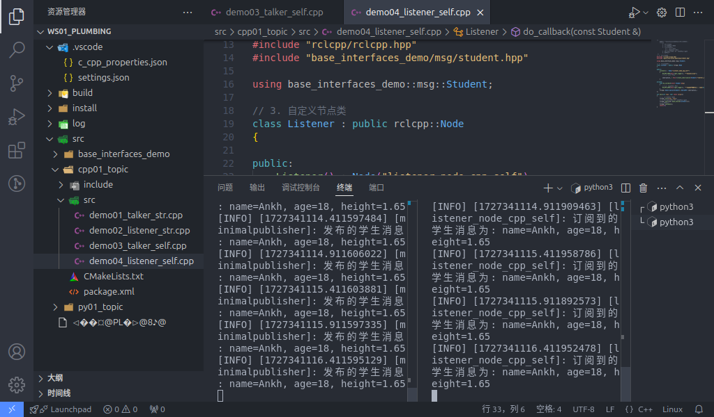
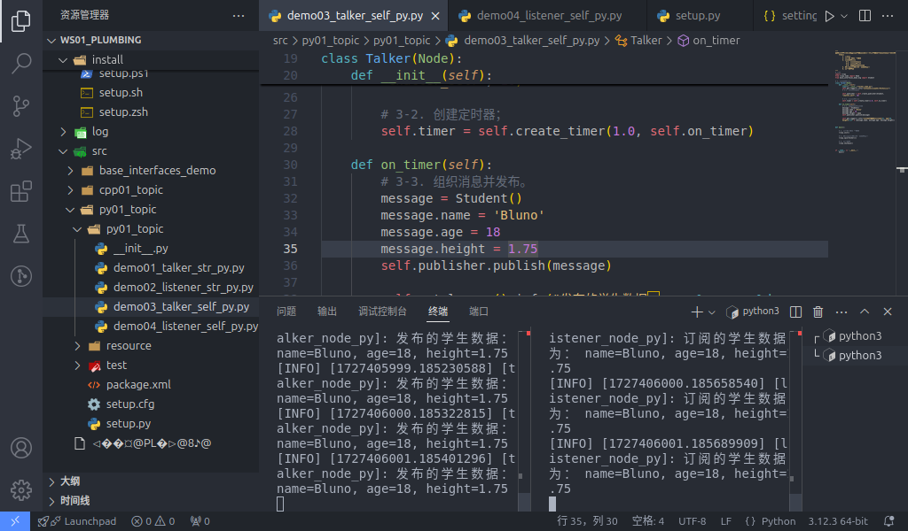

## Implementing topic communication with a custom message interface

In Case 1, the message Case 1 publishes is a string of text, and its message type is one of ROS2's built-in message types. Compared with using a native message interface, the data carrier behind a message published through a custom message interface is not predefined, so we have to configure it ourselves.

Next we'll implement topic communication using a **custom message interface**. If you haven't done the preparation in Ubuntu yet, see [here](./2024_09_19_002.md#preparation).

### The custom message interface file

For the actual implementation, see [here](./2024_09_25.md)

### C++

#### 1. Implementing the publisher

In the `src` directory of the `cpp01_topic` package, create a new C++ file `demo03_talker_self.cpp`, edit it, and enter the following:

```cpp
/*
    Requirement: publish the text "student info" at some fixed frequency, which includes the student's age, name, height and other data.
    Steps:
        1. Include the header files;
        2. Initialise the ROS2 client
        3. Custom node class:
            3-1. Create the publisher;
            3-2. Create the timer;
            3-3. Assemble the message and publish it.
        4. Call the spin function, passing in the node object pointer
        5. Release resources.
 */

// 1. Include the header files;
#include "rclcpp/rclcpp.hpp"
#include "base_interfaces_demo/msg/student.hpp"

using namespace std::chrono_literals;
using base_interfaces_demo::msg::Student;

// 3. Custom node class:
class MinimalPublisher : public rclcpp::Node
{
    public: 
    // count_(0) initialises count_ to 0
        MinimalPublisher() : Node("minimalpublisher"), count_(0)
        {
        // 3-1. Create the publisher;

        /*
            Template: the message type being published
            Parameters:
                1. topic name;
                2. QOS (message queue length);
            Return value: publisher object pointer.
         */

        publisher_ = this->create_publisher<Student>("topic_self", 10); 
        // 3-2. Create the timer;
        /*
            Parameters:
                1. time interval;
                2. callback;
            Return value: timer object pointer.
         */
        timer_ = this->create_wall_timer(500ms, stc::bind(&MinimalPublisher::timer_callback, this)) 
        }

    private: 
        void timer_callback() 
        {
            // 3-3. Assemble the message and publish it.
            auto message = Student();
            message.name = 'Ankh';
            message.age = count_++;
            message.height = 1.65;
            RCLCPP_INFO(this->get_logger(), "Published student message: name=%s, age=%d, height=%.2f", message.name.c_str(), message.age, message.height);

            publisher_->publish(message); 

        }
        rclcpp::Publisher<Student>::SharedPtr publisher_;
        rclcpp::TimerBase::SharedPtr timer_;
        size_t count_;
};

int main(int argc, char *argv[])
{
    // 2. Initialise the ROS2 client
    rclcpp::init(argc, argv);
    // 4. Call the spin function, passing in the node object pointer.
    rclcpp::spin(std::make_shared<MinimalPublisher>());
    // 5. Release resources;
    rclcpp::shutdown();
    return 0; 
} 

```

#### 2. Implementing the subscriber

In the `src` directory of the `cpp01_topic` package, create a new C++ file `demo04_listener_self.cpp`, edit it, and enter the following:

```cpp
/*      

  Requirement: subscribe to the student message published by the publisher, and output it to the terminal.    
  Steps:      
     1. Include the header files;        
     2. Initialise the ROS2 client;        
     3. Custom node class;            
        3-1. Create the subscriber;            
        3-2. Handle the messages received.        
     4. Call the spin function, passing in the node object pointer;        
     5. Release resources. 
*/

// 1. Include the header files;
#include "rclcpp/rclcpp.hpp"
#include "base_interfaces_demo/msg/student.hpp"

using base_interfaces_demo::msg::Student;
using std::placeholders::_1;
// 3. Custom node class;

class MinimalSubscriber : public rclcpp::Node 
{
  public:  
    MinimalSubscriber()   
    : Node("minimal_subscriber")    
    {      
     // 3-1. Create the subscriber;  
    /*
        Template: the message type;
        Parameters:
            1. topic name (must match the publisher's)
            2. QOS: queue length;
            3. callback;
        Return value: the pointer for the subscription object
        
     */
     subscription_ = this->create_subscription<Student>("topic_self", 10, std::bind(&MinimalSubscriber::topic_callback, this, _1));    
    }

  private:    
    // 3-2. Handle the messages received;    
    void topic_callback(const Student &msg) const    
    {      
      RCLCPP_INFO(this->get_logger(), "Subscribed student message: name=%s, age=%d, height=%.2f", msg.name.c_str(), msg.age, msg.height);
    }    
      rclcpp::Subscription<Student>::SharedPtr subscription_; 
};

int main(int argc, char *argv[])
{  
  // 2. Initialise the ROS2 client;  
  rclcpp::init(argc, argv);  
  // 4. Call the spin function, passing in the node object pointer. 
  rclcpp::spin(std::make_shared<MinimalSubscriber>());  
  // 5. Release resources;  
  rclcpp::shutdown();  
  return 0; 
}

```

#### 3. Editing the configuration files

In a C++ package there are two configuration files to look at: `package.xml` and `CMakeLists.txt`. If the file is one you created yourself, it needs extra configuration for each file.

#### Ⅰ. package.xml

When the package was created, the packages it depends on were already configured automatically, as follows:

```xml
<!-- package.xml -->
<depend>rclcpp</depend>
<depend>std_msgs</depend>
<depend>base_interfaces_demo</depend>
```

One thing to explain:

1. Unlike the [native node implementation](./2024_09_22.md#i-package-xml), in this case `<depend>std_msgs</depend>` is not required.
2. If a node you created pulls in new related packages, the extra package configuration has to be added for each node file.

#### Ⅱ. CMakeLists.txt

The core configuration for the publisher and subscriber programs in CMakeLists.txt is as follows:

```txt
find_package(rclcpp REQUIRED) 
find_package(std_msgs REQUIRED)
find_package(base_interfaces_demo REQUIRED) 

add_executable(demo03_talker_self src/demo03_talker_self.cpp) ament_target_dependencies(  
  demo03_talker_self
  "rclcpp"  
  "std_msgs"
  "base_interfaces_demo"
) 

add_executable(demo04_listener_self src/demo04_listener_self.cpp) ament_target_dependencies(
  demo04_listener_self
  "rclcpp"
  "std_msgs"
  "base_interfaces_demo"
) 

install(TARGETS  
 demo03_talker_self
 demo04_listener_self
 DESTINATION lib/${PROJECT_NAME})

```

One thing to explain: if you created new nodes and they get pulled in, the following has to be done for each node file:

1. If a node you created pulls in new related packages, the extra package configuration has to be set up for each node through `find_package`;
2. A node you created needs three extra configuration items — `add_executable`, `ament_target_dependencies` and `install`, where:

    - `add_executable` needs its node name and where the file lives added;
    - `ament_target_dependencies` needs its node name and the names of the packages it references added for each node file;
    - `install` needs its node name added

#### 4. Build

In a terminal, go into the current workspace and build the package:

```shell
colcon build --packages-select cpp01_topic
```

#### 5. Run

In the current workspace, open two terminals: terminal 1 runs the publisher program, terminal 2 runs the subscriber program.

Terminal 1 takes the following commands:

```shell
. install/setup.bash
ros2 run cpp01_topic demo03_talker_self
```

Terminal 2 takes the following commands:

```shell
. install/setup.bash
ros2 run cpp01_topic demo04_listener_self
```

The final output should look like the screenshot below.



::: tip What the spin function does
Calling the `spin` function in main suspends the main program, enters the node object through the node object pointer passed in earlier, and runs the callbacks inside that node object. So in short, spin can be used to call the callbacks inside a node object; without the `spin` function those callbacks never run.
:::

### Python

#### 1. Publisher Implementation

In the `py01_topic` directory of the `py01_topic` package, create a new Python file `demo03_talker_self_py.py`, edit it, and enter the following:

``` python
"""      

  Requirement: publish the text "student info" at some fixed frequency, which includes the student's age, name, height and other data.  
  Steps:        
     1. Import the packages;        
     2. Initialise the ROS2 client;        
     3. Define the node class;            
        3-1. Create the publisher;            
        3-2. Create the timer;            
        3-3. Assemble the message and publish it.        
     4. Call the spin function, passing in the node object;        
     5. Release resources.
"""
# 1. Import the packages;
import rclpy
from rclpy.node import Node
from base_interfaces_demo.msg import Student

# 3. Define the node class;
class MinimalPublisher(Node):    

  def __init__(self):
    super().__init__('minimal_publisher_py')

    # 3-1. Create the publisher;
    """
        Parameters:
            1. the message type
            2. topic name
            3. QOS. (queue length)
        Return value: the publisher object.
    """

    self.publisher_ = self.create_publisher(Student, 'topic_self', 10)

    # 3-2. Create the timer;
    """
        Parameters:
            1. time interval
            2. callback
        Return value: the timer object.
    """
    timer_period = 0.5
    self.timer = self.create_timer(timer_period, self.timer_callback)
    # create the counter
    self.counter = 0

    # 3-3. Assemble the message and publish it.
    def timer_callback(self):
    msg = Student()
    msg.name = 'Ankh';
    msg.age = 18 + self.counter;
    msg.height = 1.65;
    self.publisher_.publish(msg)
    self.get_logger().info('Published message: name=%s, age=%d, height=%.2f', % (msg.name, msg.age, msg.height))    
    self.counter += 1

def main(args=None):    
   # 2. Initialise the ROS2 client;    
    rclpy.init(args=args)    

   # 4. Call the spin function, passing in the node object;    
    minimal_publisher = MinimalPublisher()    
    rclpy.spin(minimal_publisher)    

   # 5. Release resources.
    rclpy.shutdown()

if __name__ == '__main__':    
  main()

```

#### 2. Subscriber Implementation

In the `py01_topic` directory of the `py01_topic` package, create a new `Python` file `demo04_listener_self_py.py`, edit it, and enter the following:

```python
"""
  Requirement: subscribe to the student message published by the publisher, and output it to the terminal.    
  Steps:      
     1. Include the header files;        
     2. Initialise the ROS2 client;        
     3. Custom node class;            
        3-1. Create the subscriber;            
        3-2. Handle the messages received.        
     4. Call the spin function, passing in the node object pointer;        
     5. Release resources. 

"""

# 1. Include the header files;
import rclpy
from rclpy.node import Node
from base_interfaces_demo.msg import Student

# 3. Custom node class;
class MinimalSubscriber(Node):
    
    def __init__(self):
        super().__init__("minimal_subscriber_py")    
    # 3-1. Create the subscriber;  
    """
        Parameters:
            1. the message type;
            2. topic name (must match the publisher's)
            3. callback;
            4. QOS: queue length;
        Return value: the subscription object

    """

     self.subscription = self.create_subscription(Student, "topic_self", self.listener_callback, 10)
      
    def listener_callback(self, msg):

        # 3-2. Handle the messages received;    
        self.get_looger().info("Subscribed message: name=%s, age=%d, height=%.2f", % (msg.name, msg.age, msg.height)) 


def main():
{  
      # 2. Initialise the ROS2 client;
    rclpy.init()  

    # 4. Call the spin function, passing in the node object.
    minimal_subscriber = MinimalSubscriber()
    rclpy.spin(minimal_subscriber);  
    # 5. Release resources;
    rclpy.shutdown()
}

if __name__ == '__main__':    
  main()

```

#### 3. Editing the Configuration Files

In a `Python` package there are two configuration files to look at: `package.xml` and `setup.py`. If the file is one you created yourself, it needs extra configuration for each file.

#### Ⅰ. package.xml

When the package was created, the packages it depends on were already configured automatically, as follows:

```xml
<!-- package.xml -->
<depend>rclpy</depend>
<depend>std_msgs</depend>
<depend>base_interfaces_demo</depend>
```

One thing to explain:

1. In this case `<depend>std_msgs</depend>` is not required.
2. If a node you created pulls in new related packages, the extra package configuration has to be added for each node file.

#### Ⅱ. setup.py

The core configuration for the publisher and subscriber programs in setup.py is as follows:

```py
......
 
setup(
    ......
    entry_points={
        'console_scripts': [
            'demo03_talker_self_py = py01_topic.demo03_talker_self_py:main',
            'demo04_listener_self_py = py01_topic.demo04_listener_self_py:main',
        ],
    },
)
```

One thing to explain: if you created new nodes and they get pulled in, the following has to be done for each node file:

1. A node you created needs the extra `console_scripts` configuration item, to give the compiler the location of the executable, in the format:

    - 'node name = package name the node lives in.node name:main'

Normally you just copy the code the program generated and modify it, so here the 'package name the node lives in' is the same for all of them.

#### 4. Build

In a terminal, go into the current workspace and build the package:

```shell
colcon build --packages-select py01_topic
```

#### 5. Run

In the current workspace, open two terminals: terminal 1 runs the publisher program, terminal 2 runs the subscriber program.

Terminal 1 takes the following commands:

```shell
. install/setup.bash
ros2 run py01_topic demo03_talker_self_py
```

Terminal 2 takes the following commands:

```shell
. install/setup.bash
ros2 run py01_topic demo04_listener_self_py
```

The final output should look like the screenshot below.



::: tip What the spin function does
Same as described in the [C++ execution steps above](./2024_09_25_002.md#_5-run): calling the `spin` function in main suspends the main program, enters the node object through the node object pointer passed in earlier, and runs the callbacks inside that node object. So in short, spin can be used to call the callbacks inside a node object; without the `spin` function those callbacks never run.
:::

## Summary

Once you've implemented the **custom message interface**, you can go on to implement the [native message interface](./2024_09_22.md), or head back to [ROS2-004-Communication Mechanisms: Topic Communication](./2024_09_19_002.md#summary) to read this section's summary.

::: important
This article was translated by `Hermes Agent`; the original text can be found at [here](../../../learningNote/Ros2_Note/co_me/2024_09_25_002.md). The translation is for reference only.
Translation time: 2026-11-05
:::
