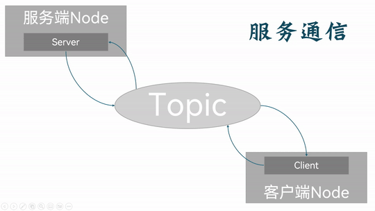
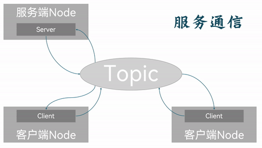

## Introduction

**Service communication (Services)** is a communication pattern that moves data between different nodes on a `request-response` basis. The object that sends the request data is called the **client**; the object that receives the request and sends back the corresponding data is called the **server**. As with topic communication, the client and the server are associated through a topic (Topic), but here the client and the server can exchange data in both directions. So in service communication the message flow is bidirectional.



In **service communication**, the server and the clients stand in a one-to-many relationship. That is, under the same service topic there can be several clients, but only one server. Every client can send requests to the server — i.e. set up its own independent back-and-forth communication with that single server.



Hence topic communication is generally better suited to occasional data-transfer scenarios which do have real-time requirements and need a certain amount of logic processing.

---

## A simple implementation of service communication

Now, to get a deeper understanding of service communication, we'll implement the following case separately in C++ and Python.

### The case requirements & case analysis

Requirement: write service communication where the client can submit two integers to the server, the server receives the request, parses the two integers, sums them, and then responds with the result to the client.

Analysis: in the requirement above we need to care about three elements:

1. the client;
2. the server;
3. the message carrier.

### Workflow overview

Before implementing the case you need a custom service interface.

Once the interface is ready, the main steps for implementing service communication are:

1. Write the server implementation;
2. Write the client implementation;
3. Edit the configuration files;
4. Build;
5. Run.

The case will be implemented in C++ and in Python separately, and both follow the flow above.

### Preparation

Create the workspace in a terminal:

```shell
mkdir -p ws01_plumbing/src
cd ws01_plumbing/src
colcon build
```

Go into the src directory of the workspace:

```shell
cd src/
```

Call the following command to create the interface package we'll use later:

```shell
ros2 pkg create --build-type ament_cmake base_interfaces_demo

```

Call the following two commands to create the C++ package, the Python package and the server node each of them needs:

**C++:**

```shell
ros2 pkg create cpp01_topic --build-type ament_cmake --dependencies rclcpp std_msgs base_interfaces_demo --node-name demo01_server
```

**Python:**

```shell
 ros2 pkg create py01_topic --build-type ament_python --dependencies rclpy std_msgs base_interfaces_demo --node-name demo01_server_py
```

Define the custom service interface message file inside the interface package:

see [here](./2024_10_03_002.md) for the details.

Preparation is done.

---

Next you can go ahead and implement service communication in [C++](./2024_10_03_003.md) and in [Python](./2024_10_03_004.md) respectively.

## Summary

In this section we systematically set out how, following the principles behind service communication, you can do it yourself and get simple service communication between nodes working.

::: important
This article was translated by Hermes Agent; the original text can be found at [here](../../../../learningNote/Ros2_Note/co_me/2024_10_03.md). The translation is for reference only.
Translation time: 2026-11-05
:::
