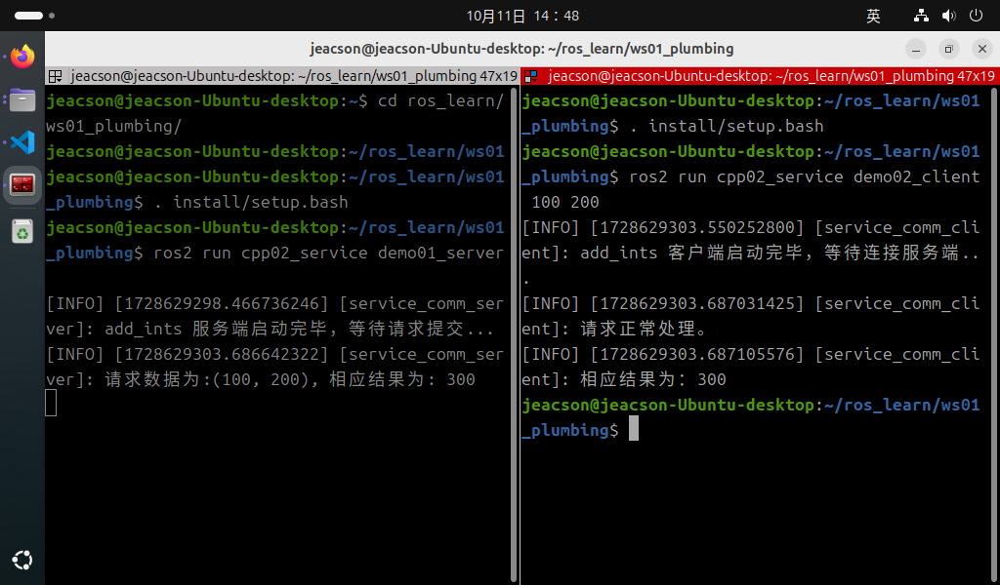

## Introduction

Now, we'll implement the following case requirement in C++, to get a deeper understanding of service communication.

### The case requirements & case analysis

Requirement: write a service communication where the client can submit two integers to the server, the server receives the request, parses the two integers, adds them up, and then responds with the result to the client.

Analysis: in the requirement above, we need to pay attention to the following three elements:

1. the client;
2. the server;
3. the message carrier.

### Workflow overview

Before implementing the case, a custom service interface has to be defined.

Once the interface is ready, the main steps for implementing service communication are:

1. Write the server implementation;
2. Write the client implementation;
3. Edit the configuration files;
4. Build;
5. Run.

### Preparation

See [the previous page](./2024_10_03.md)

---

## The C++ implementation of service communication

### 1. Writing the server implementation

In the `src` directory of the `cpp02_service` package, create a new C++ file `demo01_server.cpp`, edit it, and enter the following:

```cpp
/*
    Requirement: write a server that receives the request sent by the client, extracts the two integer values in it, adds them and responds to the client with the result.
    Steps:
        1. Include the header files;
        2. Initialise the ROS2 client
        3. Custom node class:
            3-1. Create the server;
            3-2. Handle the request data and respond with the result.
        4. Call the spin function, passing in the node object pointer;
        5. Release resources.
 */

// 1. Include the header files;
#include "rclcpp/rclcpp.hpp"
#include "base_interfaces_demo/srv/add_ints.hpp"

using base_interfaces_demo::srv::AddInts;

using std::placeholders::_1;
using std::placeholders::_2;

// 3. Custom node class:
class MinimalService : public rclcpp::Node
{
    public: 
        MinimalService() : Node("minimal_service"){

        // 3-1. Create the server;

        /*
            Parameters:
                1. topic name;
                2. callback;
            Return value: server object pointer.
         */

        server_ = this->create_service<AddInts>("add_ints", std::bind(&MinimalService::add, this, _1, _2)); 
        RCLCPP_INFO(this->get_logger(),"add_ints server started, waiting for a request..."); 

        } 

    private: 
        rclcpp::Service<AddInts>::SharedPtr server_;    

        // 3-2. Handle the request data and respond with the result.   
        void add(const AddInts::Request::SharedPtr req,const AddInts::Response::SharedPtr res){

            res->sum = req->num1 + req->num2;      
            RCLCPP_INFO(this->get_logger(),"Request data:(%d,%d), response result:%d", req->num1, req->num2, res->sum);
        }
};

int main(int argc, char *argv[])
{
    // 2. Initialise the ROS2 client
    rclcpp::init(argc, argv);

    // 4. Call the spin function, passing in the node object pointer.
    auto server = std::make_shared<MinimalService>();
    rclcpp::spin(server);

    // 5. Release resources;
    rclcpp::shutdown();
    return 0; 
} 

```

Once the server is written, we can debug it with the methods below to check that it works:

After building the package in this workspace, start the server:

```shell
colcon build --packages-select cpp02_service
. install/setup.bash
ros2 run cpp02_service demo01_server
```

Open another terminal, cd into this workspace, then:

```shell
. install/setup.bash
ros2 service call add_ints base_interfaces_demo/srv/AddInts "{'num1': 10, 'num2': 30}"
```

The parameters in the key command `ros2 service call add_ints base_interfaces_demo/srv/AddInts "{'num1': 10, 'num2': 30}"` mean the following:

1. **add_ints** is the topic name inside this server;
2. **base_interfaces_demo/srv/AddInts** declares (specifies) the type of the data to be submitted;
3. **"{'num1': 10, 'num2': 30}"** is a JSON-formatted `string` wrapped in English double quotes, which has to contain the data to be submitted to the server — here, two integer values.

### 2. Writing the client implementation

In the `src` directory of the `cpp02_service` package, create a new C++ file `demo02_client.cpp`, edit it, and enter the following:

```cpp
/*

  Requirement: write a client that, after checking the number of arguments, sends two integer variables as the request data, and handles the response result.   
  Steps:
      1. Include the header files;
      2. Initialise the ROS2 client;
      3. Custom node class;
        3-1. Create the client;
        3-2. Wait for the service connection.
        3-3. Assemble the request data and send it.
      4. Create the object pointer, call its functionality, and handle the response result;
      5. Release resources. 
*/

// 1. Include the header files;
#include "rclcpp/rclcpp.hpp"
#include "base_interfaces_demo/srv/add_ints.hpp"

using base_interfaces_demo::srv::AddInts;

using namespace std::chrono_literals;

// 3. Custom node class;

class MinimalClient : public rclcpp::Node 
{

  public:  
    MinimalClient():Node("minimal_client"){      
     // 3-1. Create the client;  
    /*
        Template: the message type;
        Parameters:
            1. topic name (must match the publisher's)

        Return value: client object pointer
        
     */
        client_ = this->create_client<AddInts>("add_ints");
        RCLCPP_INFO(this->get_logger(),"add_ints client created, waiting to connect to the server..."); 

    }

    // 3-2. Wait for the service connection;    
    bool connect_server() {
        while (!client_->wait_for_service(1s))
        {
            if (!rclcpp::ok())
            {
                RCLCPP_INFO(rclcpp::get_logger("rclcpp"),"Forced exit!"); 
                return false;
            }

            RCLCPP_INFO(this->get_logger(),"Connecting to the add_ints server, please wait..."); 
        }
        return true;
    }

    // 3-2. Assemble the request data and send it;
    rclcpp::Client<AddInts>::FutureAndRequestId send_request(int23_t num1, int23_t num2) {
        auto request_ = std::make_shared<AddInts::Request>();
        request_->num1 = num1;
        request_->num2 = num2;

        return client_->async_send_request(request);
    }

  private:
      rclcpp::Client<AddInts>::SharedPtr client_; 

};

int main(int argc, char *argv[])
{  
    if (argc != 3) {
        RCLCPP_INFO(rclcpp::get_logger("rclcpp"),"Please submit two integer values!"); 
        return 1;
    }

    // 2. Initialise the ROS2 client;  
    rclcpp::init(argc, argv);  

    // 4. Create the object pointer and call its functionality; 
    auto client = std::make_shared<MinimalClient>();   
    bool flag = client->connect_server();

    if (!flag) {
        RCLCPP_INFO(rclcpp::get_logger("rclcpp"),"Service connection failed!"); 
        return 0;
    }   

    auto response = client->send_request(atoi(argv[1]),atoi(argv[2]));

    // 4. Handle the response result;  
    if (rclcpp::spin_unitl_future_complete(client, response) == rclcpp::FutureReturnCode::SUCCESS){
        RCLCPP_INFO(client->get_logger(),"Request handled normally.")
        RCLCPP_INFO(client->get_logger(),"Response result: %d!", response.get()->sum);
    } else {
        RCLCPP_INFO(client->get_logger(),"Request error")
    }

    // 5. Release resources;  
    rclcpp::shutdown();  
    return 0; 
}

```

There are several things to keep in mind here:

::: tip ①. How do you get a logger outside the node object?

In the code above, because of how the runtime logic is constrained and out of consideration for performance, we need to validate the arguments the user entered before initialising the node object. Once the argument validation fails, we need to prompt the user through a logger. And since the logger is a built-in function inside the node object, we have to access it some other way.

Apart from calling the log function through the node object, we can use `rclcpp::get_logger()` to obtain the `get_logger()` function. `get_logger()` needs to be passed a string variable name, such as the `"rclcpp"` inside the `get_logger("rclcpp")` used in the code above.

This approach is generally used when no node object has been created, or when the node object has already been destroyed.

:::

::: tip ②. When using while to connect to the service, you need to handle exceptions during execution

The code above originally had this snippet:

```cpp
    // 3-2. Wait for the service connection;    
    bool connect_server() {
        while (!client_->wait_for_service(1s))
        {
            RCLCPP_INFO(this->get_logger(),"Connecting to the add_ints server, please wait..."); 
        }
        return true;
    }
```

This snippet tries to connect to the server once per second and prints the related log message. But if you only use this snippet, then when the user tries to close the client with the `cntl+c` shortcut or ends the ROS2 program some other way, a process error occurs and the loop can't be exited — the only way to stop the process is something like `cntl+z`.

So inside that loop it is necessary to check the client's execution status for the situation above. That is, when the client can't run normally, return `false` to force the loop to exit, so the process stops.

```cpp
    // 3-2. Wait for the service connection;    
    bool connect_server() {
        while (!client_->wait_for_service(1s))
        {
            // the following is the added snippet
            if (!rclcpp::ok())
            {
                RCLCPP_INFO(rclcpp::get_logger("rclcpp"),"Forced exit!"); 
                return false;
            }
            // the above is the added snippet

            RCLCPP_INFO(this->get_logger(),"Connecting to the add_ints server, please wait..."); 
        }
        return true;
    }
```

And inside that added snippet you must use `rclcpp::` rather than `this->` to obtain `get_logger()` and the like. Because when the user tries to close the client with the `cntl+c` shortcut or ends the ROS2 program some other way, the ROS2 program runs its **resource release** operation, at which point the `context object` gets cleaned up, and obtaining `get_logger()` and the like via `this->` depends precisely on the `context object`, so this gives the program a certain probability of a BUG. Obtaining `get_logger()` and the like via `rclcpp::` is not affected by the `context object`, so it works fine.

:::

::: tip ③. Why doesn't the client here use the spin function to suspend as before?

In **this** service communication case, the client only needs to send the relevant request once, so in terms of execution logic, suspending the client again is pointless. And this client has not defined any callbacks in the custom class that need the `spin()` function to operate, and the implementation doesn't need any callback other than `spin_unitl_future_complete()` to process data, so there is no need here to keep using the spin function to suspend after the request finishes. This differs a bit from the related operations before, so please take note.

:::

### 3. Editing the configuration files

In a C++ package there are two configuration files to look at: `package.xml` and `CMakeLists.txt`. If the file is one you created yourself, it needs extra configuration for each file.

#### Ⅰ. package.xml

When the package was created, the packages it depends on were already configured automatically, as follows:

```xml
<!-- package.xml -->
<depend>rclcpp</depend>
<depend>base_interfaces_demo</depend>
```

One thing to explain:

1. If a node you created pulls in new related packages, the extra package configuration has to be added for each node file.

#### Ⅱ. CMakeLists.txt

The core configuration for the publisher and subscriber programs in CMakeLists.txt is as follows:

```txt
find_package(rclcpp REQUIRED)
find_package(base_interfaces_demo REQUIRED) 

add_executable(demo01_server src/demo01_server.cpp) ament_target_dependencies(  
  demo01_server  
  "rclcpp"  
  "base_interfaces_demo" 
) 

add_executable(demo02_client src/demo02_client.cpp) ament_target_dependencies(  
 demo02_client  
 "rclcpp"  
 "base_interfaces_demo" 
) 

install(TARGETS  
 demo01_server  
 demo02_client  
 DESTINATION lib/${PROJECT_NAME})
```

One thing to explain: if you created new nodes and they get pulled in, the following has to be done for each node file:

1. If a node you created pulls in new related packages, the extra package configuration has to be set up for each node through `find_package`;
2. A node you created needs three extra configuration items — `add_executable`, `ament_target_dependencies` and `install`, where:

    - `add_executable` needs its node name and where the file lives added;
    - `ament_target_dependencies` needs its node name and the names of the packages it references added for each node file;
    - `install` needs its node name added

### 4. Build

In a terminal, go into the current workspace and build the package:

```shell
colcon build --packages-select cpp02_service
```

### 5. Run

In the current workspace, open two terminals: run the server in terminal 1 first, then the client in terminal 2.

Terminal 1 takes the following commands:

```shell
. install/setup.bash
ros2 run cpp02_service demo01_server
```

Terminal 2 takes the following commands:

```shell
. install/setup.bash
ros2 run cpp02_service demo02_client
```

The final output should look like the screenshot below.



::: tip You must start the server first!
When doing service communication you must make sure the client can connect to the server normally, so that the data isn't lost when the client sends a request. So the server must be started first, and then the client.
:::

## Summary

After trying to implement **service communication** in C++, you can try [implementing service communication in Python](./2024_10_03_004.md), or go back to [ROS2-005-Communication Mechanisms: Service Communication](./2024_09_19_002.md#summary) to read this section's summary.

::: important
This article was translated by `Hermes Agent`; the original text can be found at [here](../../../learningNote/Ros2_Note/co_me/2024_10_03_003.md). The translation is for reference only.
Translation time: 2026-11-05
:::
