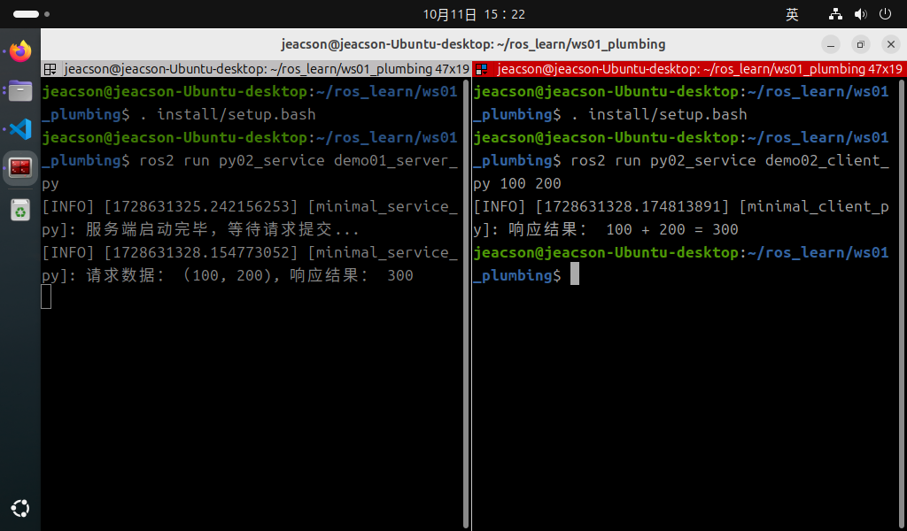

## The Python implementation of service communication

Now, we'll implement the following case requirement in Python, to get a deeper understanding of service communication.

### The case requirements & case analysis

Requirement: write a service communication where the client can submit two integers to the server, the server receives the request, parses the two integers, adds them up, and then responds with the result to the client.

Analysis: in the requirement above, we need to pay attention to the following three elements:

1. the client;
2. the server;
3. the message carrier.

### Workflow overview

Before implementing the case, a custom service interface has to be defined.

Once the interface is ready, the main steps for implementing service communication are:

1. Write the server implementation;
2. Write the client implementation;
3. Edit the configuration files;
4. Build;
5. Run.

### Preparation

See [the previous page](./2024_10_03.md)

---

## Implementing service communication in Python

### 1. Writing the server implementation

In the `py02_service` directory of the `py02_service` package, create a new Python file `demo01_server_py.py`, edit it, and enter the following:

``` python
"""      

  Requirement: write a server that receives the request sent by the client, extracts the two integer values in it, adds them and responds to the client with the result.
  Steps:        
     1. Import the packages;        
     2. Initialise the ROS2 client;        
     3. Custom node class:
        3-1. Create the server;
        3-2. Handle the request data and respond with the result;        
     4. Call the spin function, passing in the node object;        
     5. Release resources.
"""
# 1. Import the packages;
import rclpy
from rclpy.node import Node
from base_interfaces_demo.srv import AddInts

# 3. Define the node class;
class MinimalService(Node):
    
    def __init__(self):
        super().__init__('minimal_service_py')

        # 3-1. Create the server;
        """
            Parameters:
                1. the message type
                2. topic name
                3. QOS. (queue length)
            Return value: the publisher object.
        """

        self.srv_ = self.create_service(AddInts, 'add_ints', self.add_two_ints_callback)
    self.get_logger().info("Server started, waiting for a request...")

    # 3-2. Handle the request data and respond with the result;
    """
        Parameters:
            1. time interval
            2. callback
        Return value: the timer object.
    """
    def add_two_ints_callback(self, request, response):             

        response.sum = request.num1 + request.num2
        self.get_logger().info('Request data:(%d,%d), response result:%d' % (request.num1, request.num2, response.sum))
        return response

def main(args=None):    
   # 2. Initialise the ROS2 client;    
    rclpy.init(args=args)    

   # 4. Call the spin function, passing in the node object;    
    minimal_service = MinimalService()    
    rclpy.spin(minimal_service)    

   # 5. Release resources.
    rclpy.shutdown()

if __name__ == '__main__':    
  main()

```

Once the server is written, we can debug it with the methods below to check that it works:

After building the package in this workspace, start the server:

```shell
colcon build --packages-select py02_service
. install/setup.bash
ros2 run py02_service demo01_server
```

Open another terminal, cd into this workspace, then:

```shell
. install/setup.bash
ros2 service call add_ints base_interfaces_demo/srv/AddInts "{'num1': 10, 'num2': 30}"
```

The parameters in the key command `ros2 service call add_ints base_interfaces_demo/srv/AddInts "{'num1': 10, 'num2': 30}"` mean the following:

1. **add_ints** is the topic name inside this server;
2. **base_interfaces_demo/srv/AddInts** declares (specifies) the type of the data to be submitted;
3. **"{'num1': 10, 'num2': 30}"** is a JSON-formatted `string` wrapped in English double quotes, which has to contain the data to be submitted to the server — here, two integer values.

### 2. Writing the client implementation

In the `py02_service` directory of the `py02_service` package, create a new `Python` file `demo02_client_py.py`, edit it, and enter the following:

```python
"""
  Requirement: write a client that, after checking the number of arguments, sends two integer variables as the request data, and handles the response result.     
  Steps:      
      1. Import the packages;        
      2. Initialise the ROS2 client;        
      3. Custom node class;            
        3-1. Create the client;
        3-2. Wait for the service connection.
        3-3. Assemble the request data and send it.    
      4. Create the object, call its functionality, and handle the response result;
      5. Release resources. 

"""

# 1. Import the packages;
import sys
import rclpy
from rclpy.node import Node
from rclpy.logging import get_logger
from base_interfaces_demo.srv import AddInts

# 3. Custom node class;
class MinimalClients(Node):
    
    def __init__(self):
        super().__init__("minimal_client_py")  
          
    # 3-1. Create the client;  
    """
        Parameters:
            1. the message type;
            2. topic name (must match the publisher's)
            3. callback;
            4. QOS: queue length;
        Return value: the subscription object

    """
     self.cli_ = self.create_client(AddInts, "add_ints")
    # 3-2. Wait for the service connection.
    while not self.cli_.wait_for_service(timeout_sec=1.0):
        self.get_logger().info("Connecting to the service, please wait...")
    self.req = AddInts.Request()

    # 3-3. Assemble the request data and send it.
    def send_request(self):
   
        self.req.num1 = int(sys.argv[1])
        self.req.num2 = int(sys.argv[2])
        self.future = self.cli_.call_async(self.req)


def main():
{  
    # validation
    if len(sys.argv) != 3:
        get_logger("rclpy").info("Please submit two integer values!")
        return

    # 2. Initialise the ROS2 client;
    rclpy.init()  

    # 4. Create the object and call its functionality;
    minimal_client = MinimalClient()
    minimal_client.send_request()

    # 4. Handle the response result;
    rclpy.spin_until_future_complete(minimal_client, minimal_client.future)
    try:
        response = minimal_client.future.result()
    except Exception as e:
        minimal_client.get_logger().info("Service request failed: %r" % (e, ))
    else:
        minimal_client.get_logger().info("Response result: %d + %d = %d" % (minimal_client.req.num1, minimal_client.req.num2, response.sum))

    # 5. Release resources;
    rclpy.shutdown()
}

if __name__ == '__main__':    
  main()

```

There are several things to keep in mind here:

::: tip ①. How do you get a logger outside the node object?

In the code above, because of how the runtime logic is constrained and out of consideration for performance, we need to validate the arguments the user entered before initialising the node object. Once the argument validation fails, we need to prompt the user through a logger. And since the logger is a built-in function inside the node object, we have to access it some other way.

Apart from calling the log function through the node object, we can, after:

```python

    from rclpy.logging import get_logger

```

importing the related function, just use `get_logger()` directly to obtain the function. `get_logger()` needs to be passed a string variable name, such as the `"rclpy"` inside the `get_logger("rclpy")` used in the code above.

This approach is generally used when no node object has been created, or when the node object has already been destroyed.

:::

::: tip ②. Why doesn't the client here use the spin function to suspend as before?

In **this** service communication case, the client only needs to send the relevant request once, so in terms of execution logic, suspending the client again is pointless. And this client has not defined any callbacks in the custom class that need the `spin()` function to operate, and the implementation doesn't need any callback other than `spin_unitl_future_complete()` to process data, so there is no need here to keep using the spin function to suspend after the request finishes. This differs a bit from the related operations before, so please take note.

:::

### 3. Editing the configuration files

In a `Python` package there are two configuration files to look at: `package.xml` and `setup.py`. If the file is one you created yourself, it needs extra configuration for each file.

#### Ⅰ. package.xml

When the package was created, the packages it depends on were already configured automatically, as follows:

```xml
<!-- package.xml -->
<depend>rclpy</depend>
<depend>base_interfaces_demo</depend>
```

One thing to explain:

1. If a node you created pulls in new related packages, the extra package configuration has to be added for each node file.

#### Ⅱ. setup.py

The core configuration for the publisher and subscriber programs in setup.py is as follows:

```py
......
 
setup(
    ......
    entry_points={
        'console_scripts': [
            'demo01_server_py = py02_service.demo01_server_py:main',
            'demo02_client_py = py02_service.demo02_client_py:main',
        ],
    },
)
```

One thing to explain: if you created new nodes and they get pulled in, the following has to be done for each node file:

1. A node you created needs the extra `console_scripts` configuration item, to give the compiler the location of the executable, in the format:

    - 'node name = package name the node lives in.node name:main'

Normally you just copy the code the program generated and modify it, so here the 'package name the node lives in' is the same for all of them.

### 4. Build

In a terminal, go into the current workspace and build the package:

```shell
colcon build --packages-select py02_service
```

### 5. Run

In the current workspace, open two terminals: run the server in terminal 1 first, then the client in terminal 2.

Terminal 1 takes the following commands:

```shell
. install/setup.bash
ros2 run py02_service demo01_server_py
```

Terminal 2 takes the following commands:

```shell
. install/setup.bash
ros2 run py02_service demo02_client_py 100 200 
```

The final output should look like the screenshot below.



::: tip You must start the server first!
When doing service communication you must make sure the client can connect to the server normally, so that the data isn't lost when the client sends a request. So the server must be started first, and then the client.
:::

## Summary

After trying to implement **service communication** in Python, you can try [implementing service communication in C++](./2024_10_03_003.md), or go back to [ROS2-005-Communication Mechanisms: Service Communication](./2024_10_03.md#summary) to read this section's summary.

::: important
This article was translated by Hermes Agent; the original text can be found at [here](../../../learningNote/Ros2_Note/co_me/2024_10_03_004.md). The translation is for reference only.
Translation time: 2026-11-05
:::
