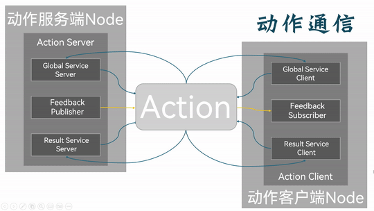

## Introduction

**Action communication (Actions)** is likewise a communication pattern that moves data between different nodes on a `request-response` basis. The object that sends the request data is called the **client**, and the object that receives the request and sends back the corresponding data is called the **server**. To tell it apart from the [service communication](./2024_10_03.md) above, the client here is called the action client and the server the action server.

Structurally, action communication is made up of three parts — goal, feedback and result. So unlike **service communication**, **action communication** can get continuous feedback while the request is being handled, and it can also send a task-cancel request to the action server.

At the implementation level, action communication is built on top of topic communication and service communication: sending a goal and getting the result are done by wrapping service communication, while the continuous feedback is done by wrapping topic communication — action communication is essentially a combination of topic and service communication. So, like the first two, the action client and the action server are associated through a topic (Topic), and they can exchange data in both directions. In service communication the message flow is bidirectional too.

For two nodes talking over action communication (call them A and B below), the overall flow goes like this:

1. Node A's action client sends a **goal request** (i.e. the action goal) to node B's action server. Based on the current state, whether resources are available and so on, the action server decides whether node B itself can accept that goal. If it can, node B's action server returns a **goal accepted response** to node A's action client and generates a **Goal ID** as a unique identifier for the task.

    

2. Node A's action client sends the goal execution request to node B's action server. Node B starts carrying out the request, and while doing so, node B's action server returns continuous processing results to node A's action client as real-time feedback.

    

3. Node B finishes carrying out the request and returns the final result through node B's action server to node A's action client. The flow ends.

    

Now, while node B is carrying out the request, node A's action client can cancel the running task by sending a **goal cancel request** to node B's action server; once node B's action server checks the state of the current task and decides it can be cancelled, the task is cancelled and that action communication ends.

So action communication is generally better suited to long-running tasks and comparatively time-consuming request-response scenarios, where you want continuous state feedback.

## A simple implementation of action communication

Now, to get a deeper understanding of action communication, we'll implement the following case separately in C++ and Python.

### The case requirements & case analysis

Requirement: write action communication where the action client submits an integer N, the action server receives the request data, sums all the integers from 1 to N, and returns the final result to the action client — and on every addition it has to work out the current progress and feed that back to the action client.

Analysis: in the requirement above we need to care about three elements:

1. the action client;
2. the action server;
3. the message carrier.

### Workflow overview

Before implementing the case you need a custom action interface.

Once the interface is ready, the main steps for implementing action communication are:

1. Write the action server implementation;
2. Write the action client implementation;
3. Edit the configuration files;
4. Build;
5. Run.

The case will be implemented in C++ and in Python separately, and both follow the flow above.

### Preparation

Create the workspace in a terminal:

```shell
mkdir -p ws01_plumbing/src
cd ws01_plumbing/src
colcon build
```

Go into the src directory of the workspace:

```shell
cd src/
```

Call the following command to create the interface package we'll use later:

```shell
ros2 pkg create --build-type ament_cmake base_interfaces_demo

```

Call the following two commands to create the C++ package, the Python package and the server node each of them needs:

**C++:**

```shell
ros2 pkg create cpp03_action --build-type ament_cmake --dependencies rclcpp rclcpp_action base_interfaces_demo --node-name demo01_action_server
```

**Python:**

```shell
 ros2 pkg create py03_action --build-type ament_python --dependencies rclpy base_interfaces_demo --node-name demo01_action_server_py
```

Define the custom service interface message file inside the interface package:

see [here](./2024_10_15_002.md) for the details.

Preparation is done.

---

Next you can go ahead and implement service communication in [C++](./2024_10_16.md) and in [Python](./2024_10_16_002.md) respectively.

## Summary

In this section we systematically set out how, following the principles behind action communication, you can do it yourself and get simple action communication between nodes working — and along the way we ran into some differences between programming languages. The communication method covered in this chapter is the most complex of the four, so do pay extra attention to it.

::: important
This article was translated by Hermes Agent; the original text can be found at ../../../../learningNote/Ros2_Note/co_me/2024_10_15.md. The translation is for reference only.
Translation time: 2026-11-05
:::
