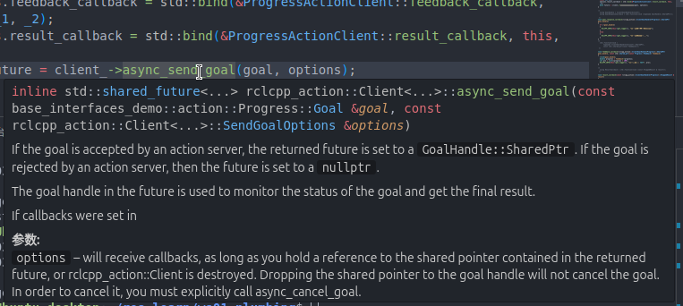
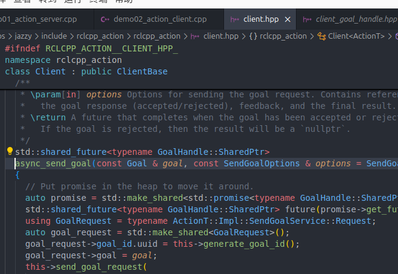
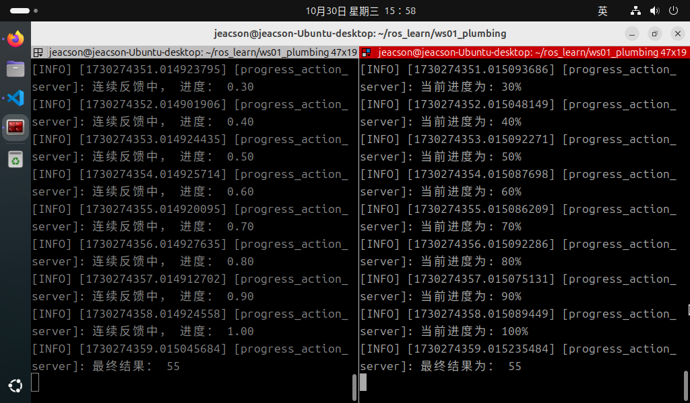

## Introduction

Now, to get a deeper understanding of action communication, we'll implement the following case in C++.

### The case requirements & case analysis

Requirement: write action communication where the action client submits an integer N, the action server receives the request data, sums all the integers from 1 to N, and returns the final result to the action client — and on every addition it has to work out the current progress and feed that back to the action client.

Analysis: in the requirement above we need to care about three elements:

1. the action client;
2. the action server;
3. the message carrier.

### Workflow overview

Before implementing the case you need a custom action interface.

Once the interface is ready, the main steps for implementing action communication are:

1. Write the action server implementation;
2. Write the action client implementation;
3. Edit the configuration files;
4. Build;
5. Run.

### Preparation

See [the previous article](./2024_10_15.md)

---

## The C++ implementation of action communication

### 1. Writing the action server implementation

In the `src` directory of the package `cpp03_action`, create a new C++ file `demo01_action_server.cpp`, edit it, and put in the following:

```cpp
/*
    Requirement: write the action server. The action client submits an integer N; the action server receives the request data, sums all the integers from 1 to N, and returns the final result to the action client — and on every addition it has to work out the current progress and feed that back to the action client.
    
         The final result has to be responded back to the client. And continuous feedback has to be generated during the request-response.
    Analysis:
        1. Create the action server object;
        2. Handle the goal value the action client submits;
        3. Generate continuous feedback;
        4. Respond with the final result;
        5. Handle cancel requests.
    Steps:
        1. Include the header files;
        2. Initialise the ROS2 client
        3. Define a custom node class:
            3-1. Create the action server object;
            3-2. Handle the goal value the action client submits (via a dedicated callback);
            3-3. Handle cancel requests (via a dedicated callback).
            3-4. Generate continuous feedback and respond with the final result (via a dedicated callback);
        4. Call the spin function, passing in the node object pointer;
        5. Release resources.
 */

// 1. Include the header files;
#include "rclcpp/rclcpp.hpp"
#include "rclcpp_action/rclcpp_action.hpp"
#include "base_interfaces_demo/action/progress.hpp"

using std::placeholders::_1;
using std::placeholders::_2;

// 3. Define a custom node class:
class ProgressActionServer : public rclcpp::Node
{
    public: 
        ProgressActionServer() : Node("progress_action_server"){
            RCLCPP_INFO(this->get_logger(),"action server created!");
            // 3-1. Create the action server object;
            /*
                Parameters:
                    1. the topic name;
                    2. the callbacks;
                        2-1. the callback handling the submitted goal;
                        2-2. the callback handling cancel requests;
                        2-3. the callback generating continuous feedback and responding with the final result;
                Return value: the action server object pointer.
            
            */
            server_ = rclcpp_action::create_server<Progress>(
                this,
                "get_sum",
                std::bind(&ProgressActionServer::handler_goal, this, _1, _2),
                std::bind(&ProgressActionServer::handler_cancel, this, _1),
                std::bind(&ProgressActionServer::handler_accept, this, _1),
            );

        } 

            // 3-2. Handle the goal value the action client submits (via a dedicated callback);
            /*
                std::function<
                    GoalResponse(
                        const GoalUUID &, 
                        std::shared_ptr<const typename ActionT::Goal>
                    )
                >

                return GoalResponse::
             */

             rclcpp_action::GoalResponse handler_goal(
                    const rclcpp_action::GoalUUID &uuid, 
                    std::shared_ptr<const typename Progress::Goal> goal
                ) {
                    (void)uuid;
                    // business logic: check whether the submitted number is greater than one; if so accept the goal, otherwise reject
                    if (goal->num <= 1) {
                        RCLCPP_INFO(this->get_logger(), "The submitted goal must be greater than one!")；
                        return rclcpp_action::GoalResponse::REJECT;
                    }
                    RCLCPP_INFO(this->get_logger(), "The submitted goal value is valid!")；
                    return rclcpp_action::GoalResponse::ACCEPT_AND_EXECUTE;
                };

            // 3-3. Handle cancel requests (via a dedicated callback).
            /*
                std::function<
                    CancelResponse(
                        std::shared_ptr<ServerGoalHandle<ActionT>>
                    )
                >

                return CancelResponse::
             */
            rclcpp_action::CancelResponse handler_cancel(
                std::shared_ptr<rclcpp_action::ServerGoalHandle<Progress>> cancel_goal_handler
            ) {
                // Normally you would use this cancel_goal_handler to judge whether the task can be cancelled. In this case we skip that judgement.
                (void)cancel_goal_handler;
                RCLCPP_INFO(this->get_logger(), "Received a task cancel request!")； 
                return rclcpp_action::CancelResponse::ACCEPT;
            };

            // 3-4. Generate continuous feedback and respond with the final result (via a dedicated callback);
            void execute(
                std::shared_ptr<rclcpp_action::ServerGoalHandle<Progress>> accept_goal_handler) {
                    //  1. We need to generate continuous feedback and return it to the client
                    // the relevant API:
                    /*
                        void rclcpp_action::ServerGoalHandle<base_interfaces_demo::action::Progress>::publish_feedback(std::shared_ptr<rclcpp_action::ServerGoalHandle<base_interfaces_demo::action::Progress Feesback> feedback_msg)

                        accept_goal_handler->publish_feedback();
                     */
                    //  first get the goal value
                    int num = accept_goal_handler->get_goal()->num;
                    int sum = 0;
                    auto feedback = std::make_shared<Progress::Feedback>(); 
                    // set up the sleep
                    rclcpp::Rate rate(1.0); // the unit here is Hz
                    // then loop, accumulating as we go; on every iteration compute the progress and publish it as continuous feedback
                    for (int i = 1; i<= num; i++) {
                        sum += i;
                        double progress = i / (double)num; // compute the progress
                        feedback->progress = progress;
                        accept_goal_handler->publish_feedback(feedback);
                        RCLCPP_INFO(this->get_logger(), " sending feedback, progress: %.2f", progress); 

                        // check whether a cancel request has come in
                        if (accept_goal_handler->is_canceling()) {
                            // if so, terminate the program
                            result->sum = sum;
                            accept_goal_handler->canceled(result);
                            return; 
                        }
                        rate.sleep();
                    }

                    //  2. We need to generate the final response result
                    //  the relevant API:
                    /*
                        void rclcpp_action::ServerGoalHandle<base_interfaces_demo::action::progress>::succeed(std::shared_ptr<base_interfaces_demo::action::progress Result> result_msg)
                        accept_goal_handler->succeed();
                     */
                      if (rclcpp::ok()) { // just in case, check whether the server is still up
                        // when the server is up
                        auto result = std::make_shared<Progress::Result>();
                        result->sum = sum;
                        RCLCPP_INFO(this->get_logger(), "Final result: %d", sum)； 
                        accept_goal_handler->succeed(result);
                      }

            };

            /*
                std::function<
                    void (
                        std::shared_ptr<ServerGoalHandle<ActionT>>
                    )
                >
             */
            void handler_accept(
                std::shared_ptr<rclcpp_action::ServerGoalHandle<Progress>> accept_goal_handler) {
                    //  spawn a child thread to handle the time-consuming main logic
                    // an anonymous thread is used here
                    std::thread(std::bind(&ProgressActionServer::execute, accept_goal_handler)).detach();
            }; 

    private: 
        rclcpp_action::Server<Process>::SharedPtr server_;

};

int main(int argc, char *argv[])
{
    // 2. Initialise the ROS2 client
    rclcpp::init(argc, argv);

    // 4. Call the spin function, passing in the node object pointer.
    auto server = std::make_shared<ProgressActionServer>();
    rclcpp::spin(server);

    // 5. Release resources;
    rclcpp::shutdown();
    return 0; 
} 

```

::: tip coding conventions to avoid compile warnings or errors
In the code above you may notice that many functions have a snippet like `(void)xxxx;`.

``` cpp
    rclcpp_action::CancelResponse handler_cancel(
        std::shared_ptr<rclcpp_action::ServerGoalHandle<Progress>> cancel_goal_handler
    ) {

        // here ↓
        (void)cancel_goal_handler;
        // here ↑

        RCLCPP_INFO(this->get_logger(), "Received a task cancel request!")； 
        return rclcpp_action::CancelResponse::ACCEPT;
    };
```

That snippet is really a coding convention: when an incoming argument of the function isn't used, declaring it with this snippet tells the compiler and friends that the argument is unused, which avoids compile warnings or errors. It's part of code style, really.
:::

Once the server is written, we can debug it like this and test whether it actually works:

After building the package in that workspace, start the server:

```shell
colcon build --packages-select cpp03_action
. install/setup.bash
ros2 run cpp03_action demo01_action_server
```

Open another terminal, cd into that workspace, and:

```shell
. install/setup.bash
ros2 action send_goal /get_sum base_interfaces_demo/action/Progress "{'num': 10}" --feedback
```

The parameters in the key command `ros2 action send_goal /get_sum base_interfaces_demo/action/Progress "{'num': 10}" --feedback` mean the following:

1. **send_goal** specifies sending a goal request;
2. **/get_sum** is the topic name inside that server;
3. **base_interfaces_demo/action/Progress** declares (specifies) the type of the data to be submitted;
4. **"{'num1': 10}"** is a JSON-format `string` wrapped in English double quotes, which needs to contain the data to submit to the server — here, one integer.
5. **--feedback** can also be written **-f**, declaring that the command needs continuous feedback.

::: tip on generating the continuous feedback and the final response
Generating the continuous feedback and the final response is a time-consuming operation; to keep the main-thread logic from blocking, another thread is usually started to handle it.
:::

### 2. Writing the action client implementation

In the `src` directory of the package `cpp02_service`, create a new C++ file `demo02_action_client.cpp`, edit it, and put in the following:

```cpp
/*

  Requirement: write the action client, able to send an integer to the server and handle the server's continuous feedback and final response result.
Flow:
    Prerequisite: able to parse the parameters of the dynamic function on the command line (one integer).
  Steps:
      1. Include the header files;
      2. Initialise the ROS2 client;
      3. Define a custom node class;
        3-1. Create the action client;
        3-2. Send the request;
        3-3. Handle the server's response about the goal value (via a callback);
        3-4. Handle the continuous feedback (via a callback);
        3-5. Handle the final response result (via a callback).
      4. Create the object pointer and call its functionality;
      5. Release resources. 
*/

// 1. Include the header files;
#include "rclcpp/rclcpp.hpp"
#include "rclcpp_action/rclcpp_action.hpp"
#include "base_interfaces_demo/action/progress.hpp"
#include <cstdlib> 
// as far as I remember the atoi-related library compiled fine without being included, reason unknown; it has now been added

using base_interfaces_demo::action::Progress;
using namespace std::chrono_literals;

using std::placeholders::_1;
using std::placeholders::_2;

// 3. Define a custom node class;

class ProgressActionClient : public rclcpp::Node 
{

  public:
    ProgressActionClient():Node("progress_action_client_node_cpp"){
        RCLCPP_INFO(this->get_logger(),"action client created, waiting to connect to the server..."); 
         // 3-1. Create the action client;  
        /*
            rclcpp_action::Client<ActionT>::SharedPtr create_client<ActionT, NodeT>(
            NodeT node, 
            const std::string &name, 
            rclcpp::CallbackGroup::SharedPtr group = nullptr, 
            const rcl_action_client_options_t &options = rcl_action_client_get_default_options()
            )
            
        */
        client_ = rclcpp_action::create_client<Progress>("get_sum");

    }

    // 3-2. Send the request;
    void send_goal(int num) {
        // 1. make sure the server is connected
        if(!client_->wait_for_action_server(10s)) {
            RCLCPP_ERROR(this->get_logger(), "Failed to connect to the server!");
            return;
        }
        // 2. send the actual request

        auto goal = Progress::Goal();
        goal.num = num;

        rclcpp_action::Client<Progress>::SendGoalOptions options;
        options.goal_response_callback = std::bind(&ProgressActionClient::goal_response_callback, this, _1);
        options.feedback_callback = std::bind(&ProgressActionClient::feedback_callback, this, _1, _2);
        options.result_callback = std::bind(&ProgressActionClient::result_callback, this, _1);

        /* std::shared_future<rclcpp_action::Client<Progress>::GoalHandle::SharedPtr> 
        rclcpp_action::Client<Progress>::async_send_goal
        (   const Progress::Goal &goal, 
            const rclcpp_action::Client<Progress>::SendGoalOptions &options 
            = rclcpp_action::Client<Progress>::SendGoalOptions()
        )
        */

        auto future = client_->async_send_goal(goal, options);
        // return true;
    }

    // 3-3. Handle the server's response about the goal value (via a callback);
    /*
        using GoalHandle = rclcpp_action::ClientGoalHandle<Progress>;
        std::function<void (typename GoalHandle::SharedPtr)> goal_response_callback

     */
    void goal_response_callback(rclcpp_action::ClientGoalHandle<Progress>::SharedPtr goal_handle) {
        if (!goal_handle) {
            RCLCPP_INFO(this->get_logger(), "The goal request was rejected by the server!");
        } else {
            RCLCPP_INFO(this->get_logger(), "Goal request being handled...");
        }
    }

    // 3-4. Handle the continuous feedback (via a callback);
    /*
        using GoalHandle = rclcpp_action::ClientGoalHandle<Progress>;
        std::function<void (
            typename GoalHandle::SharedPtr,
            const std::shared_ptr<const Feedback>
            )> 
     */
    void feedback_callback(
        rclcpp_action::ClientGoalHandle<Progress>::SharedPtr goal_handle, 
        const std::shared_ptr<const Progress::Feedback> feedback
    ) {
      (void)goal_handle;
      double progress = feedback->progress;
      int pro = (int)(progress * 100);
      RCLCPP_INFO(this->get_logger(), "Current progress: %d%%", pro);  
    }

    // 3-5. Handle the final response result (via a callback).
    /*
        using ResultCallback = std::function<void (
        const rclcpp_action::ClientGoalHandle<Progress>::WrappedResult &result)>
     */
    void result_callback(const rclcpp_action::ClientGoalHandle<Progress>::WrappedResult &result) {
        // judge the final result state by the status code result.code
        
        if (result.code == rclcpp_action::ResultCode::SUCCEED) {
            RCLCPP_INFO(this->get_logger(), "Final result: %ld", result.result->sum);
        } else if (result.code == rclcpp_action::ResultCode::ABORTED) {
            RCLCPP_INFO(this->get_logger(), "Aborted.");

        } else if (result.code == rclcpp_action::ResultCode::CANCELED) {
            RCLCPP_INFO(this->get_logger(), "Cancelled.");

        } else {
            RCLCPP_INFO(this->get_logger(), "Unknown exception..");
        }
    }

  private:
      rclcpp_action::Client<Progress>::SharedPtr client_; 

};

int main(int argc, char *argv[])
{  
    if (argc != 2) {
        RCLCPP_ERROR(rclcpp::get_logger("rclcpp"),"Please submit 'one' integer!"); 
        return 1;
    }

    // 2. Initialise the ROS2 client;  
    rclcpp::init(argc, argv);  

    // 4. Create the object pointer and call its functionality; 
    auto client = std::make_shared<ProgressActionClient>();   
    client->send_goal(atoi(argv[1]));
    rclcpp::spin(client);

    // 5. Release resources;  
    rclcpp::shutdown();  
    return 0; 
}

```

There are several things to note here, so do read them:

::: tip ① How do I get a logger object outside a node object?

In the code above, because of how the run logic is constrained and for the sake of performance optimisation, we need to validate the thing the user typed as a parameter before initialising the node object. As soon as validation fails, we need to prompt the user through a logger object. And since the logger object is a built-in function of the node object, we need another way to get at that logger.

Besides calling the log function through the node object, we can use `rclcpp::get_logger()` to obtain the `get_logger()` function. `get_logger()` takes a string variable name, e.g. the `"rclcpp"` inside the `get_logger("rclcpp")` used in the code above.

This approach is generally used when no node object has been created, or when the node object has already been destroyed.

:::

::: tip ② Defining code for each function's given parameters by reading the source

The code above has several callbacks and related main functions that need arguments of types specified by ros. For example:

```cpp
    ...
    auto future = client_->async_send_goal(goal, options);
    ...
```

The `async_send_goal` function here is one whose arguments ROS has already defined, so you need to confirm the argument types. When you're new to ROS, if you've never written C++ before, this can be fairly hard to get your head around. What I recommend here is the C++-related plugins in VSCode: once the function is correctly referenced, you can look up the related source by moving the mouse over the function, or by holding `cntl` and left-clicking it.





:::

::: tip ③ Using "rclcpp_action::ResultCode" to look up the status codes indirectly

When handling the final response result in a callback, we judge the state of the final result by the status code `result.code`. There are four status codes here, living in one enum class. They are:

- ABORTED forcibly terminated
- CANCELED cancelled
- SUCCEEDED succeeded
- UNKNOWN unknown exception

These status codes have to be compared against `rclcpp_action::ResultCode` before you can do the next step, so you can look them up under `rclcpp_action::ResultCode`. That's more convenient.

:::

### 3. Editing the configuration files

In a C++ package, the configuration files to pay attention to are `package.xml` and `CMakeLists.txt`. If you wrote the files yourself, you need extra configuration for each one.

#### Ⅰ. package.xml

When the package was created, the packages it depends on were already configured for you, like this:

```xml
<!-- package.xml -->
<depend>rclcpp</depend>
<depend>base_interfaces_demo</depend>
```

Worth noting:

1. If a node you wrote pulls in new packages, each node file needs the extra package configuration.

#### Ⅱ. CMakeLists.txt

The core configuration for the publisher and subscriber programs in CMakeLists.txt is as follows:

```txt
find_package(rclcpp REQUIRED)
find_package(base_interfaces_demo REQUIRED) 

add_executable(demo01_action_server src/demo01_action_server.cpp) ament_target_dependencies(  
  demo01_action_server  
  "rclcpp"  
  "base_interfaces_demo" 
) 

add_executable(demo02_action_client src/demo02_action_client.cpp) ament_target_dependencies(  
 demo02_action_client  
 "rclcpp"  
 "base_interfaces_demo" 
) 

install(TARGETS  
 demo01_action_server  
 demo02_action_client  
 DESTINATION lib/${PROJECT_NAME})
```

Worth noting: if nodes you wrote are pulled in, you need to do the following for each node file:

1. If a node you wrote pulls in new packages, you need to set `find_package` to add the extra package configuration for each node;
2. A node you wrote needs three extra configuration entries — `add_executable`, `ament_target_dependencies` and `install` — where:

    - `add_executable` needs its node name and where the file lives;
    - `ament_target_dependencies` needs, for each node file, its node name and the names of the packages it references;
    - `install` needs its node name added

### 4. Build

In a terminal, go into the current workspace and build the package:

```shell
colcon build --packages-select cpp03_action
```

### 5. Run

In the current workspace, open two terminals: run the server in terminal 1 first, then the client in terminal 2.

In terminal 1, enter:

```shell
. install/setup.bash
ros2 run cpp03_action demo01_action_server
```

In terminal 2, enter:

```shell
. install/setup.bash
ros2 run cpp03_action demo02_action_client
```

The final result should look something like the figure below.



::: tip you have to start the server first
Same as with service communication: for action communication you must make sure the action client can connect to the action server properly, so that no data is lost when the action client sends its request. So you have to start the action server first, then the action client.
:::

## Summary

In this section we tried implementing **action communication** in C++. If you already tried [implementing action communication in Python](./2024_10_16_002.md) before this, or even if you didn't, after all this switching between computer languages you should have noticed a few things that are more of a pain to write in c++ than in python:

When you write c++ for ROS2, every parameter has to be preceded by an extremely long-winded data type, and if you don't go out of your way to check them, they're easy to get wrong. So when writing this sort of code you need to look carefully at the hints and at various other references before you can write it more smoothly. Good luck!

After trying to implement **action communication**, you can go back to [ROS2-005-Communication Mechanisms: Action Communication](./2024_10_15.md#summary) to read the summary for this section.

::: important
This article was translated by `Hermes Agent`; the original text can be found at [here](../../../../learningNote/Ros2_Note/co_me/2024_10_16.md). The translation is for reference only.
Translation time: 2026-11-05
:::
