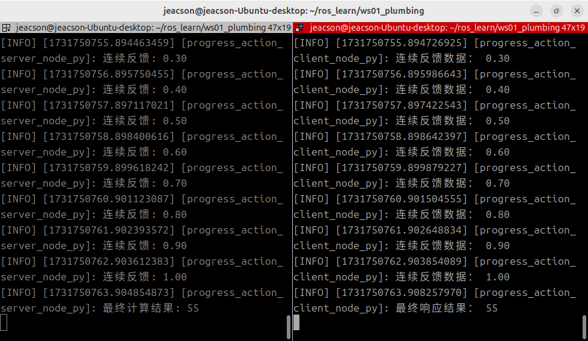

## The Python implementation of action communication

Now, we'll implement the following case requirement in Python, to get a deeper understanding of action communication.

### The case requirements & case analysis

Requirement: write an action server where the action client submits an integer N, the action server receives the request data and adds up all the integers between 1 and N, returns the final result to the action client, and after each addition works out the current progress and feeds it back to the action client.

Analysis: in the requirement above, we need to pay attention to the following three elements:

1. the action client;
2. the action server;
3. the message carrier.

### Workflow overview

Before implementing the case, a custom action interface has to be defined.

Once the interface is ready, the main steps for implementing action communication are:

1. Write the server implementation;
2. Write the client implementation;
3. Edit the configuration files;
4. Build;
5. Run.

### Preparation

See [the previous page](./2024_10_15.md)

---

## Implementing action communication in Python

### 1. Writing the server implementation

In the `py03_action` directory of the `py03_action` package, create a new Python file `demo01_action_server_py.py`, edit it, and enter the following:

``` python
"""      

  Requirement: write an action communication where the action client submits an integer N, the action server receives the request data and adds up all the integers between 1 and N, returns the final result to the action client, and after each addition works out the current progress and feeds it back to the action client.

  Steps:        
     1. Import the packages;        
     2. Initialise the ROS2 client;        
     3. Custom node class:
            3-1. Create the action server object;
            3-2. Handle the goal value submitted by the action client (done through a dedicated callback) --- implemented by default, but can be overridden;
            3-3. Handle cancel requests (done through a dedicated callback) --- implemented by default, but can be overridden;
            3-4. Generate continuous feedback and respond with the final result (done through a dedicated callback);
     4. Call the spin function, passing in the node object;        
     5. Release resources.
""" 
# 1. Import the packages;
import rclpy
import time
from rclpy.node import Node
from rclpy.action import ActionServer
from base_interfaces_demo.action import Progress

# 3. Define the node class;
class ProgressActionServer(Node):
    
    def __init__(self):
        super().__init__('progress_action_server_node_py')
        self.get_logger().info("Action server created!")

        # 3-1. Create the action server object;
        """
            Parameters:
                1. the node it depends on (self)
                2. the custom template type
                3. topic name
                4. the name of the main-logic callback (i.e. 3-4)
            Return value: the action server object.
        """

        self.server = ActionServer(
            self, 
            Progress, 
            "get_num", 
            self.execute_callback，
            goal_callback=self.goal_callback,
            cancel_callback=self.cancel_callback
        )

        # 3-2. Handle the goal value submitted by the action client (done through a dedicated callback);
        def goal_callback(self, goal_request):
            if goal_request.num <= 1:
                self.get_logger().info("The submitted goal value must be greater than one!")
                return GoalResponse.REJECT
                
            self.get_logger().info("The submitted goal value is valid.")
            return GoalResponse.ACCEPT


        # 3-3. Handle cancel requests (done through a dedicated callback);
        def cancel_callback(self, cancel_request):
            self.get_logger().info("Cancel request received.")
            return CancelResponse.ACCEPT

        # 3-4. Generate continuous feedback and respond with the final result (done through a dedicated callback);
    def execute_callback(self, goal_callback):
        # 1. Generate continuous feedback
        num = goal_handle.request.num
        sum = 0

        for i in range(1, num+1):
            # check whether the request has already been cancelled
            if goal_handle.is_cancel_requested:
                goal_handle.canceled()
                self.get_logger().info("The process has been cancelled.")
                return Progress.Result()

            sum += i
            feedback = Progress.Feedback()
            feedback.progress = i / num
            goal_handle.publish_feedback(geedback)
            self.get_logger().info("Feedback: %.2f" % feedback.progress)
            time.sleep(1.0)
         
        # 2. Respond with the final result
        goal_handle.succeed()
        result = Progress.Result()
        result.sum = sum
        self.get_logger().info("Final result: %d" % result.sum)

        return result 

def main(args=None):    
   # 2. Initialise the ROS2 client;    
    rclpy.init(args=args)    

   # 4. Call the spin function, passing in the node object;    
    rclpy.spin(ProgressActionServer())    

   # 5. Release resources.
    rclpy.shutdown()

if __name__ == '__main__':    
  main()

```

Once the server is written, we can debug it with the methods below to check that it works:

After building the package in this workspace, start the server:

```shell
colcon build --packages-select py03_action
. install/setup.bash
ros2 run py03_action demo01_action_server
```

Open another terminal, cd into this workspace, then:

```shell
. install/setup.bash
ros2 action send_goal /get_sum base_interfaces_demo/action/Progress "{'num': 10}" --feedback
```

The parameters in the key command `ros2 action send_goal /get_sum base_interfaces_demo/action/Progress "{'num': 10}" --feedback` mean the following:

1. **send_goal** specifies sending a goal request;
2. **/get_sum** is the topic name inside this server;
3. **base_interfaces_demo/action/Progress** declares (specifies) the type of the data to be submitted;
4. **"{'num1': 10}"** is a JSON-formatted `string` wrapped in English double quotes, which has to contain the data to be submitted to the server — here, one integer value.
5. **--feedback** can also be written **-f**, declaring that this command needs continuous feedback.

::: warning Not a cancellation
For unknown reasons (meaning that after stopping the `ros2 action send_goal` command above with CTRL+C, the action server doesn't receive the cancel request), cancellation requests can't be tested here yet; you can test cancellation once the client is implemented.
:::

### 2. Writing the client implementation

In the `py03_action` directory of the `py03_action` package, create a new `Python` file `demo02_action_client_py.py`, edit it, and enter the following:

```python
"""
  Requirement: write an action client that can send an integer to the server, and handle the server's continuous feedback and final response result.
  Precondition: it can parse the arguments of the dynamic function in the terminal (one integer).
  Steps:      
      1. Import the packages;
      2. Initialise the ROS2 client;        
      3. Custom node class;            
        3-1. Create the action client;
        3-2. Send the request;
        3-3. Handle the server's response regarding the goal value (done through a callback);
        3-4. Handle the continuous feedback (done through a callback);
        3-5. Handle the final response result (done through a callback).
      4. Create the object pointer and call its functionality;
      5. Release resources. 

"""

# 1. Import the packages;
import sys
import rclpy
from rclpy.node import Node
from rclpy.logging import get_logger
from rclpy.action import ActionClient

from base_interfaces_demo.action import Progress

# 3. Custom node class;
class ProgressActionClient(Node):
    
    def __init__(self):
        super().__init__("progress_action_client_node_py")  
          
        # 3-1. Create the client;  
        """
            Parameters:
                1. the node;
                2. the action interface type;
                3. topic name (must match the publisher's)
            Return value: the action client

        """
        self.client_ = ActionClient(self, Progress, "get_sum")
        self.get_logger().info("Action client created!")
    
    # 3-2. Send the request;
    def send_goal(self):
        # connect to the server
        self.client_.wait_for_server(timeout_sec=1.0)
        self.get_logger().info("Connecting to the service, please wait...")

        goal = Progress.Goal()
        goal.num = num
        """
            goal, feedback_callback, goal_uuid by default
        """
        self.future_ = self.client_.send_goal_async(goal, self.feedback_callback)
        self.future_.add_done_callback(self.goal_response_callback)  

    # 3-4. Handle the continuous feedback (done through a callback);
    def feedback_callback(self, fb_msg):
        progress_ = fb_msg.feedbaCK.progress
        self.get_logger().info("Continuous feedback data: %.2f" % progress_)

    def goal_response_callback(self, future):
        # get the goal handle
        goal_handle = future.result()
        # check whether the goal can be accepted normally
        if not goal_handle.accepted:
            self.get_logger(),error("Goal rejected.")
            return
            
        self.get_logger().info("Goal accepted, processing...")

        # handle the final response result
        self.result_future = goal_handle.get_result_async()
        self.result_future.add_done_callback(self.get_result_callback)

    # 3-5. Handle the final response result (done through a callback).
    def get_result_callback(self, future):
         


def main():
{  
    # validation
    if len(sys.argv) != 2:
        get_logger("rclpy").info("Please submit one integer value!")
        return

    # 2. Initialise the ROS2 client;
    rclpy.init()  

    # 4. Create the object and call its functionality;
    client = ProgressActionClient()
    client.send_goal(int(sys.argv[1]))
    rclpy.spin(client)

    # 5. Release resources;
    rclpy.shutdown()
}

if __name__ == '__main__':    
  main()

```

::: tip ①. How do you get a logger outside the node object?

In the code above, because of how the runtime logic is constrained and out of consideration for performance, we need to validate the arguments the user entered before initialising the node object. Once the argument validation fails, we need to prompt the user through a logger. And since the logger is a built-in function inside the node object, we have to access it some other way.

Apart from calling the log function through the node object, we can, after:

```python

    from rclpy.logging import get_logger

```

importing the related function, just use `get_logger()` directly to obtain the function. `get_logger()` needs to be passed a string variable name, such as the `"rclpy"` inside the `get_logger("rclpy")` used in the code above.

This approach is generally used when no node object has been created, or when the node object has already been destroyed.

:::

### 3. Editing the configuration files

In a `Python` package there are two configuration files to look at: `package.xml` and `setup.py`. If the file is one you created yourself, it needs extra configuration for each file.

#### Ⅰ. package.xml

When the package was created, the packages it depends on were already configured automatically, as follows:

```xml
<!-- package.xml -->
<depend>rclpy</depend>
<depend>base_interfaces_demo</depend>
```

One thing to explain:

1. If a node you created pulls in new related packages, the extra package configuration has to be added for each node file.

#### Ⅱ. setup.py

The core configuration for the publisher and subscriber programs in setup.py is as follows:

```py
......
 
setup(
    ......
    entry_points={
        'console_scripts': [
            'demo01_action_server_py = py03_action.demo01_action_server_py:main',
            'demo02_action_client_py = py03_action.demo02_action_client_py:main',
        ],
    },
)
```

One thing to explain: if you created new nodes and they get pulled in, the following has to be done for each node file:

1. A node you created needs the extra `console_scripts` configuration item, to give the compiler the location of the executable, in the format:

    - 'node name = package name the node lives in.node name:main'

Normally you just copy the code the program generated and modify it, so here the 'package name the node lives in' is the same for all of them.

### 4. Build

In a terminal, go into the current workspace and build the package:

```shell
colcon build --packages-select py03_action
```

### 5. Run

In the current workspace, open two terminals: run the server in terminal 1 first, then the client in terminal 2.

Terminal 1 takes the following commands:

```shell
. install/setup.bash
ros2 run py03_action demo01_action_server_py
```

Terminal 2 takes the following commands:

```shell
. install/setup.bash
ros2 run py03_action demo02_action_client_py 10
```

The final output should look like the screenshot below.



::: tip You must start the server first
The same as with service communication: when doing action communication you must make sure the action client can connect to the action server normally, so that the data isn't lost when the action client sends a request. So the action server must be started first, and then the action client.
:::

## Summary

In this subsection we tried implementing **action communication** in Python. If you already tried [implementing action communication in C++](./2024_10_16.md) before this, or even if you didn't, after all this switching between programming languages you should have noticed some things that are more of a pain to write in Python compared with C++:
When writing Python, ROS2 can't provide the full set of related code hints, because in many callbacks Python has no idea what type the arguments you pass in are. In other words:

> ROS2 apparently never provided Python with .pyi type-annotation stub files — from a comment by user *muzing_* (UID:439812477) under the video [赵虚左—— 2.4.4_动作通信_Python实现_03客户端_05补充](https://www.bilibili.com/video/BV1tt4y1w75i)

So when writing the related code, you need to refer to the examples the official side gives along with various other references before you can write code a bit more smoothly. Good luck!

After trying to implement **action communication**, you can go back to [ROS2-005-Communication Mechanisms: Action Communication](./2024_10_15.md#summary) to read this section's summary.

::: important
This article was translated by `Hermes Agent`; the original text can be found at [here](../../../learningNote/Ros2_Note/co_me/2024_10_16_002.md). The translation is for reference only.
Translation time: 2026-11-05
:::
