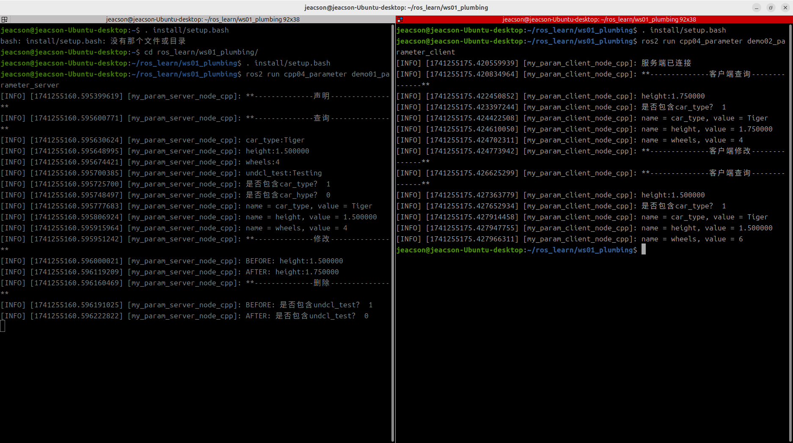

## Introduction

Now, we'll implement the following case requirement in C++, to get a deeper understanding of the parameter service.

### The case requirements & case analysis

Requirement: there are two nodes. Write a parameter service where some parameters are set in the parameter server (node A), so that the parameter client (node B) can view and modify those parameters by visiting the parameter server (node A), and the parameter server (node A) can itself add, delete, modify and query them.

Analysis: in the requirement above, we need to pay attention to the following three elements:

1. the parameter server;
2. the parameter client;
3. the parameters themselves.

### Workflow overview

Before implementing the case you first need to get to know the parameter-related APIs in ROS2 — both the client and the server use parameters — and the main steps for implementing the parameter service case are:

1. Write the parameter server implementation;
2. Write the parameter client implementation;
3. Edit the configuration files;
4. Build;
5. Run.

### Preparation

See [the previous page](./2024_11_27.md)

---

## The C++ implementation of the parameter service

### 1. Writing the parameter server implementation

In the `src` directory of the `cpp04_parameter` package, create a new C++ file `demo01_parameter_server.cpp`, edit it, and enter the following:

```cpp
/*
    Requirement: write a parameter server that sets and manipulates parameters.
    Steps:
        1. Include the header files;
        2. Initialise the ROS2 client
        3. Custom node class:
            3-1. Declare parameters
            3-2. Query parameters
            3-3. Modify parameters
            3-4. Delete parameters
        4. Call the spin function, passing in the node object pointer;
        5. Release resources.
 */

// 1. Include the header files;
#include "rclcpp/rclcpp.hpp"

// 3. Custom node class:
class MyParamServer : public rclcpp::Node
{
    public: 
        MyParamServer() : Node("my_param_server_node_cpp", 
        rclcpp::NodeOptions().allow_undeclared_parameters(true)){
        }
            
    // 3-1. Declare parameters
    void declare_param(){
        RCLCPP_INFO(this->get_logger(), "**--------------declare--------------**");
        // declare the parameter and set a default value
        this->declare_parameter("car_type", "Tiger");
        this->declare_parameter("height", 1.50);
        this->declare_parameter("wheels", 4);

        // requires rclcpp::NodeOptions().allow_undeclared_parameters(true)
        this->set_parameter(rclcpp::Parameter("undcl_test", "Testing"));
    }

    // 3-2. Query parameters
    void get_param(){
        RCLCPP_INFO(this->get_logger(), "**--------------query--------------**");
        // 1. get the specified parameter
        // 1.1 store it first, then use it
        rclcpp::Parameter car_type = this->get_parameter("car_type");
        RCLCPP_INFO(this->get_logger(), "car_type:%s", car_type.as_string().c_str());
        // 1.2 call it directly (for different types)
        RCLCPP_INFO(this->get_logger(), "height:%f", this->get_parameter("height").as_double());
        RCLCPP_INFO(this->get_logger(), "wheels:%ld", this->get_parameter("wheels").as_int());
        RCLCPP_INFO(this->get_logger(), "undcl_test:%s", this->get_parameter("undcl_test").as_string().c_str());

        // 2. check whether it contains the specified Parameters
        RCLCPP_INFO(this->get_logger(), "Does it contain car_type? %d", this->has_parameter("car_type"));
        RCLCPP_INFO(this->get_logger(), "Does it contain car_hype? %d", this->has_parameter("car_hype"));
        
        // 3. get all parameters
        auto params = this->get_parameters({"car_type", "height", "wheels"});
        for (auto &param : params)
        {
            RCLCPP_INFO(this->get_logger(), "name = %s, value = %s", param.get_name().c_str(), param.value_to_string().c_str());

        }
    }

    // 3-3. Modify parameters
    void update_param() {
        RCLCPP_INFO(this->get_logger(), "**--------------update--------------**");
        RCLCPP_INFO(this->get_logger(), "BEFORE: height:%f", this->get_parameter("height").as_double());
        this->set_parameter(rclcpp::Parameter("height", 1.75));
        RCLCPP_INFO(this->get_logger(), "AFTER: height:%f", this->get_parameter("height").as_double());
    }

    // 3-4. Delete parameters
    void del_param() {
        RCLCPP_INFO(this->get_logger(), "**--------------delete--------------**");
        RCLCPP_INFO(this->get_logger(), "BEFORE: does it contain undcl_test? %s", this->has_parameter("undcl_test"));
        // a declared Parameter cannot be deleted, so "undcl_test" is used here
        // i.e. only an undeclared Parameter can be deleted. Setting an undeclared Parameter
        // requires rclcpp::NodeOptions().allow_undeclared_parameters(true)
        this->undeclare_parameter("undcl_test");

        RCLCPP_INFO(this->get_logger(), "AFTER: does it contain undcl_test? %s", this->has_parameter("undcl_test"));

    }

};

int main(int argc, char *argv[])
{
    // 2. Initialise the ROS2 client
    rclcpp::init(argc, argv);

    // 4. Call the spin function, passing in the node object pointer.
    auto server = std::make_shared<MyParamServer>();
    server->declare_param();
    server->get_param();
    server->update_param();
    server->del_param();
    rclcpp::spin(server);

    // 5. Release resources;
    rclcpp::shutdown();
    return 0; 
} 

```

Once the server is written, we can debug it in the terminal window with the corresponding methods described in [the previous page](./2024_11_27.md#command-line-access-to-the-parameter-service), to check that it works.

For example, after building the package in this workspace, start the server:

```shell
colcon build --packages-select cpp04_parameter
. install/setup.bash
ros2 run cpp04_parameter demo01_action_server
```

Open another terminal, cd into this workspace, and you can then use the following code to query height:

```shell
. install/setup.bash
ros2 param get /my_param_server_node_cpp height
```

### 2. Writing the parameter client implementation

In the `src` directory of the `cpp04_parameter` package, create a new C++ file `demo02_parameter_client.cpp`, edit it, and enter the following:

```cpp
/*

  Requirement: write a parameter client that gets or modifies parameters.
Flow:
    Precondition: it can parse the arguments of the dynamic function in the terminal (one integer).
  Steps:
      1. Include the header files;
      2. Initialise the ROS2 client;
      3. Custom node class;
        3-1. Query parameters;
        3-2. Modify parameters.
      4. Create the object pointer and call its functionality;
      5. Release resources. 
*/

// 1. Include the header files;
#include "rclcpp/rclcpp.hpp"

using namespace std::chrono_literals;

// 3. Custom node class;

class MyParamClient : public rclcpp::Node 
{

  public:  
    MyParamClient():Node("my_param_client_node_cpp"){      
        paramClient = std::make_shared<rclcpp::SyncParametersClient>(this, "my_param_server_node_cpp");

    }

    bool connect_server(){
        // wait for the service connection;  
        while (!paramClient->wait_for_service (1s))
        {
            if(!rclcpp::ok())
            {
                RCLCPP_ERROR(this->get_logger(), "Server connection failed.");
                return false;
            }
            RCLCPP_ERROR(this->get_logger(), "Connecting to the server..");
        }
        RCLCPP_ERROR(this->get_logger(), "Server connected");
        return true;
    }

    // 3-1. Query parameters
    void get_param(){
        RCLCPP_INFO(this->get_logger(), "**--------------client query--------------**");
        // 1. get the specified parameter
        double height = paramClient->get_parameter<double>("height");
        RCLCPP_INFO(this->get_logger(), "height:%f", height);

        // 2. check whether it contains the specified Parameters
        RCLCPP_INFO(this->get_logger(), "Does it contain car_type? %d", paramClient->has_parameter("car_type"));

        // 3. get all parameters
        auto params = paramClient->get_parameters({"car_type", "height", "wheels"});
        for (auto &param : params)
        {
            RCLCPP_INFO(this->get_logger(), "name = %s, value = %s", param.get_name().c_str(), param.value_to_string().c_str());

        }
    }

    // 3-2. Modify parameters
    void update_param() {
        RCLCPP_INFO(this->get_logger(), "**--------------client update--------------**");
        paramClient->set_parameters({
            rclcpp::Parameter("height", 1.5),
            rclcpp::Parameter("wheels", 6),

            // this is a Parameter that does not exist on the server
            // only if the server has made the following setting:
            // rclcpp::NodeOptions().allow_undeclared_parameters(true)
            // will this parameter be set successfully
            rclcpp::Parameter("width", 1.05)
        });
    }

  private:
      rclcpp::SyncParametersClient::SharedPtr paramClient; 

};

int main(int argc, char *argv[])
{  
    // 2. Initialise the ROS2 client;  
    rclcpp::init(argc, argv);  

    // 4. Create the object pointer and call its functionality; 
    auto paramClient = std::make_shared<MyParamClient>(); 
    bool flag = paramClient->connect_server();
    if(!flag) {
        return 0;
    }

    paramClient->get_param();
    paramClient->update_param();
    paramClient->get_param();
    // rclcpp::spin(paramClient);

    // 5. Release resources;  
    rclcpp::shutdown();  
    return 0; 
}

```

### 3. Editing the configuration files

In a C++ package there are two configuration files to look at: `package.xml` and `CMakeLists.txt`. If the file is one you created yourself, it needs extra configuration for each file.

#### Ⅰ. package.xml

When the package was created, the packages it depends on were already configured automatically, as follows:

```xml
<!-- package.xml -->
<depend>rclcpp</depend>
<depend>base_interfaces_demo</depend>
```

One thing to explain:

1. If a node you created pulls in new related packages, the extra package configuration has to be added for each node file.

#### Ⅱ. CMakeLists.txt

The core configuration for the publisher and subscriber programs in CMakeLists.txt is as follows:

```txt
find_package(rclcpp REQUIRED)
find_package(base_interfaces_demo REQUIRED) 

add_executable(demo01_parameter_server src/demo01_parameter_server.cpp) ament_target_dependencies(  
  demo01_parameter_server  
  "rclcpp"  
  "base_interfaces_demo" 
) 

add_executable(demo02_parameter_client src/demo02_parameter_client.cpp) ament_target_dependencies(  
demo02_parameter_client  
 "rclcpp"  
 "base_interfaces_demo" 
) 

install(TARGETS  
demo01_parameter_server  
demo02_parameter_client  
 DESTINATION lib/${PROJECT_NAME})
```

One thing to explain: if you created new nodes and they get pulled in, the following has to be done for each node file:

1. If a node you created pulls in new related packages, the extra package configuration has to be set up for each node through `find_package`;
2. A node you created needs three extra configuration items — `add_executable`, `ament_target_dependencies` and `install`, where:

    - `add_executable` needs its node name and where the file lives added;
    - `ament_target_dependencies` needs its node name and the names of the packages it references added for each node file;
    - `install` needs its node name added

### 4. Build

In a terminal, go into the current workspace and build the package:

```shell
colcon build --packages-select cpp04_parameter
```

### 5. Run

In the current workspace, open two terminals: run the server in terminal 1 first, then the client in terminal 2.

Terminal 1 takes the following commands:

```shell
. install/setup.bash
ros2 run cpp04_parameter demo01_parameter_server
```

Terminal 2 takes the following commands:

```shell
. install/setup.bash
ros2 run cpp04_parameter demo02_parameter_client
```

The final output should look like the screenshot below.



::: tip You must start the server first
The same as with service communication: when working with the parameter service you must make sure the parameter client can connect to the parameter server normally, so that the data isn't lost when the parameter client sends a request. So the parameter server must be started first, and then the parameter client.
:::

## Summary

In this subsection we tried implementing the **parameter service** in C++. After that you can try [implementing the parameter service in Python](./2025_03_07.md), or you can go back to [ROS2-007-Communication Mechanisms: Parameter Service](./2024_11_27.md#summary) to read this section's summary.

::: important
This article was translated by `Hermes Agent`; the original text can be found at [here](../../../learningNote/Ros2_Note/co_me/2025_03_06.md). The translation is for reference only.
Translation time: 2026-11-05
:::
