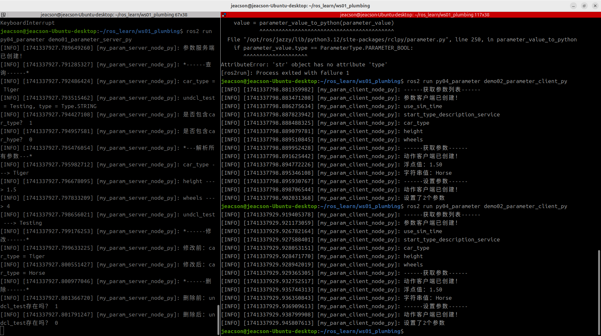

## The Python implementation of action communication

Now, we'll implement the following case requirement in Python, to get a deeper understanding of the parameter service.

### The case requirements & case analysis

Requirement: there are two nodes. Write a parameter service where some parameters are set in the parameter server (node A), so that the parameter client (node B) can view and modify those parameters by visiting the parameter server (node A), and the parameter server (node A) can itself add, delete, modify and query them.

Analysis: in the requirement above, we need to pay attention to the following three elements:

1. the parameter server;
2. the parameter client;
3. the parameters themselves.

### Workflow overview

Before implementing the case you first need to get to know the parameter-related APIs in ROS2 — both the client and the server use parameters — and the main steps for implementing the parameter service case are:

1. Write the parameter server implementation;
2. Write the parameter client implementation;
3. Edit the configuration files;
4. Build;
5. Run.

### Preparation

See [the previous page](./2024_11_27.md)

---

## Implementing the parameter service in Python

### 1. Writing the server implementation

In the `py04_parameter` directory of the `py04_parameter` package, create a new Python file `demo01_parameter_server_py.py`, edit it, and enter the following:

``` python
"""      

    Requirement: write a parameter server that sets and manipulates parameters.
    Steps:        
        1. Import the packages;        
        2. Initialise the ROS2 client
        3. Custom node class:
            3-1. Declare parameters
            3-2. Query parameters
            3-3. Modify parameters
            3-4. Delete parameters
        4. Call the spin function, passing in the node object pointer;
        5. Release resources.
""" 
# 1. Import the packages;
import rclpy
from rclpy.node import Node

# 3. Define the node class;
class MyParamServer(Node):
    
    def __init__(self):
        # to use an undeclared Parameter, you need to set
        # allow_undeclared_parameters = True
        super().__init__('my_param_server_node_py',
                        allow_undeclared_parameters=True)
        self.get_logger().info("Parameter server created!")

    # 3-1. Declare parameters
    def declare_param(self):
        # declare the parameter and set a default value
        self.declare_parameter("car_type", "Tiger")
        self.declare_parameter("height", 1.50)
        self.declare_parameter("wheels", 4)
        # the following is an undeclared Parameter.
        self.p1 = rclpy.Parameter("undcl_test", value = "Testing")
        # if you want to give its type, you can use the "type_" variable.
        # it goes between "name" and "value". For example:
        # self.p1 = rclpy.Parameter("undcl_test", type_ = Parameter.Type.STRING, value = "Testing")
        # note: this requires "from rclpy.parameter import Parameter"

        self.set_parameters([self.p1])

    # 3-2. Query parameters
    def get_param(self):
        self.get_logger().info("*------query------*")
        # 1. get the specified parameter
        car_type = self.get_parameter("car_type")
        self.get_logger().info("%s = %s" % (car_type.name, car_type.value))

        # 2. check whether it contains the specified Parameters
        self.get_logger().info("Does it contain car_type? %d", self.has_parameter("car_type"))
        self.get_logger().info("Does it contain car_hype? %d", self.has_parameter("car_hype"))

        # 3. get all parameters
        params = self.get_parameters(["car_type", "height", "wheels"])
        self.get_logger().info("*---parse all parameters---*")
        for param in params:
            self.get_logger().info("%s ---> %s" % (param.name, param.value))

    # 3-3. Modify parameters
    def update_params(self):
        self.get_logger().info("*------update------*")
        param_BEFORE = self.get_parameter("car_type")
        self.get_logger().info("Before update: car_type = %s" % param_BEFORE.value)
        self.set_parameters([rclpy.Parameter("car_type", value = "Horse")])
        param_AFTER = self.get_parameter("car_type")
        self.get_logger().info("After update: car_type = %s" % param_AFTER.value)

    # 3-4. Delete parameters
    def del_param(self):
        self.get_logger().info("*------delete------*")
        self.get_logger().info("Before delete: does undcl_test exist? %d" % self.has_parameter("undcl_test"))
        self.undeclare_parameter("undcl_test")
        self.get_logger().info("After delete: does undcl_test exist? %d" % self.has_parameter("undcl_test"))
        

def main(args=None):
    # 2. Initialise the ROS2 client;    
    rclpy.init(args=args)    

    # 4. Call the spin function, passing in the node object;
    param_server = MyParamServer()
    param_server.declare_param()
    param_server.get_param()
    param_server.update_params()
    param_server.del_param()

    rclpy.spin(param_server)

    # 5. Release resources.
    rclpy.shutdown()

if __name__ == '__main__':    
  main()

```

Once the server is written, we can debug it in the terminal window with the corresponding methods described in [the previous page](./2024_11_27.md#command-line-access-to-the-parameter-service), to check that it works.

For example, after building the package in this workspace, start the server:

```shell
colcon build --packages-select py04_parameter
. install/setup.bash
ros2 run py04_parameter demo01_parameter_server_py
```

Open another terminal, cd into this workspace, and you can then use the following code to query height:

```shell
. install/setup.bash
ros2 param get /my_param_server_node_py height
```

::: info Deleting is a bit odd here
In C++, if you want to delete a Parameter, the Parameter first has to be an Undeclared Parameter; but in Python it seems a Parameter doesn't have to be an Undeclared Parameter to be deleted. Even if "allow_undeclared_parameters=True" is not used when the node is created, the specified Parameter can still be deleted. All one can say is that this deserves a deeper dive into the source code.
:::

### 2. Writing the client implementation (not really)

::: tip well, actually ☝🤓
ROS2's Python client doesn't provide a dedicated API for parameter clients just yet (or maybe I just couldn't find it), but the parameter service is built on top of service communication, so here we operate the parameter server's parameters through **service communication (Services)**. You can just have a look, you don't have to actually run it.
:::

In the `py04_parameter` directory of the `py04_parameter` package, create a new `Python` file `demo02_parameter_client_py.py`, edit it, and enter the following:

```python


# 1. Import the packages;
import sys
import rclpy
from rclpy.node import Node
from rcl_interfaces.srv import ListParameters
from rcl_interfaces.srv import GetParameters
from rcl_interfaces.srv import SetParameters
from rcl_interfaces.msg import ParameterType
from rcl_interfaces.msg import Parameter
from rcl_interfaces.msg import ParameterValue

# 3. Custom node class;
class MyParamClient(Node):
   
    def __init__(self):
        super().__init__("my_param_client_node_py")  
         
    def list_params(self):
        # 3-1. Create the client;  
        self.cli_list = self.create_client(ListParameters, "/my_param_server_node_py/list_parameters")
        self.get_logger().info("Parameter client created!")
        # 3-2. Wait for the service connection.
        while not self.cli_list.wait_for_service(timeout_sec = 1.0):
            self.get_logger().info("Connecting to the list-parameters service, please wait...")
        self.req = ListParameters.Request()
        self.future = self.cli_list.call_async(self.req)
        rclpy.spin_until_future_complete(self, self.future)
        return self.future.result()

    def get_params(self, names):
        # 3-1. Create the client;  
        self.cli_get = self.create_client(GetParameters, "/my_param_server_node_py/get_parameters")
        self.get_logger().info("Action client created!")
        # 3-2. Wait for the service connection.
        while not self.cli_get.wait_for_service(timeout_sec = 1.0):
            self.get_logger().info("Connecting to the list-parameters service, please wait...")
        self.req = GetParameters.Request()
        self.req.names = names
        self.future = self.cli_get.call_async(self.req)
        rclpy.spin_until_future_complete(self, self.future)
        return self.future.result()

    def set_params(self):
        # 3-1. Create the client;  
        self.cli_set = self.create_client(SetParameters, "/my_param_server_node_py/set_parameters")
        self.get_logger().info("Action client created!")
        # 3-2. Wait for the service connection.
        while not self.cli_set.wait_for_service(timeout_sec = 1.0):
            self.get_logger().info("Connecting to the list-parameters service, please wait...")
        self.req = SetParameters.Request()

        self.p1 = Parameter()
        self.p1.name = "car_type"
        self.v1 = ParameterValue()
        self.v1.type = ParameterType.PARAMETER_STRING
        self.v1.string_value = "Rat"
        self.p1.value = self.v1

        self.p2 = Parameter()
        self.p2.name = "height"
        self.v2 = ParameterValue()
        self.v2.type = ParameterType.PARAMETER_DOUBLE
        self.v2.double_value = 0.3
        self.p2.value = self.v2

        self.req.parameters = [self.p1, self.p2]
        self.future = self.cli_set.call_async(self.req)
        rclpy.spin_until_future_complete(self, self.future)
        return self.future.result()

         


def main():
    # 2. Initialise the ROS2 client;
    rclpy.init();

    # 4. Create the object and call its functionality;
    client = MyParamClient();

    # get the parameter list
    client.get_logger().info("------get parameter list------");
    response = client.list_params();
    
    for name in response.result.names:
        client.get_logger().info(name)

    client.get_logger().info("------get parameters------")
    response = client.get_params(["height", "car_type"])
    values = response.values
    for value in values:
        if value.type == ParameterType.PARAMETER_STRING:
            client.get_logger().info("String value: %s" % value.string_value)
        elif value.type == ParameterType.PARAMETER_DOUBLE:
            client.get_logger().info("Float value: %.2f" % value.double_value)

    client.get_logger().info("------set parameters------")
    response = client.set_params()
    results = response.results
    client.get_logger().info("Set %d parameters" % len(results))

    for result in results:
        if not result.successful:
            client.get_logger().info("Failed to set parameter")

    # 5. Release resources;
    rclpy.shutdown()

if __name__ == '__main__':    
  main()

```

::: tip well, WELL actually ☝🤓
This is essentially just a test program standing in for a parameter client; you don't necessarily have to follow it for the related operations — the API might get updated at any moment — so you can just have a look (mainly because I couldn't get it working).
:::

### 3. Editing the configuration files

In a `Python` package there are two configuration files to look at: `package.xml` and `setup.py`. If the file is one you created yourself, it needs extra configuration for each file.

#### Ⅰ. package.xml

When the package was created, the packages it depends on were already configured automatically, as follows:

```xml
<!-- package.xml -->
<depend>rclpy</depend>
<depend>base_interfaces_demo</depend>
```

One thing to explain:

1. If a node you created pulls in new related packages, the extra package configuration has to be added for each node file.

#### Ⅱ. setup.py

The core configuration for the publisher and subscriber programs in setup.py is as follows:

```py
......
 
setup(
    ......
    entry_points={
        'console_scripts': [
            'demo01_parameter_server_py = py04_parameter.demo01_parameter_server_py:main',
            'demo02_parameter_client_py = py04_parameter.demo02_parameter_client_py:main',
        ],
    },
)
```

One thing to explain: if you created new nodes and they get pulled in, the following has to be done for each node file:

1. A node you created needs the extra `console_scripts` configuration item, to give the compiler the location of the executable, in the format:

    - 'node name = package name the node lives in.node name:main'

Normally you just copy the code the program generated and modify it, so here the 'package name the node lives in' is the same for all of them.

### 4. Build

In a terminal, go into the current workspace and build the package:

```shell
colcon build --packages-select py04_parameter
```

### 5. Run

In the current workspace, open two terminals: run the server in terminal 1 first, then the client in terminal 2.

Terminal 1 takes the following commands:

```shell
. install/setup.bash
ros2 run py04_parameter demo01_parameter_server_py
```

Terminal 2 takes the following commands:

```shell
. install/setup.bash
ros2 run py04_parameter demo02_parameter_client_py
```

The final output should look like the screenshot below.



::: tip You must start the server first
The same as with service communication: when working with the parameter service you must make sure the parameter client (?) can connect to the parameter server normally, so that the data isn't lost when the parameter client (?) sends a request. So the parameter server must be started first, and then the parameter client (?).
:::

## Summary

In this subsection we tried implementing the **parameter service** in Python. After that you can try [implementing the parameter service in C++](./2025_03_06.md), or you can go back to [ROS2-007-Communication Mechanisms: Parameter Service](./2024_11_27.md#summary) to read this section's summary.

::: important
This article was translated by Hermes Agent; the original text can be found at [here](../../../learningNote/Ros2_Note/co_me/2025_03_07.md). The translation is for reference only.
Translation time: 2026-11-05
:::
