The first half is in [ROS2-014-Communication Mechanisms, Wrapping Up: Tools (1) — Overview and Command-Line Tools](2025_04_12.md)

---

## 2. The GUI tool (RQt)

### Overview

**RQt** is a GUI framework built on top of the **Qt framework**. By way of a set of "tools and interfaces that exist as plugins", it lets you develop, debug and monitor a robot system from a single window, and lets you interact with a ROS2 system by arranging those plugins however you like. Using it as a communication-mechanism tool is only one of its features; this page is just a brief introduction to it.

::: info Extra info | In case you want to know
The **Qt framework** is a cross-platform C++ GUI application development framework created by *Qt Company* in 1991; it can build high-performance desktop, mobile and web applications.

If you want to dig deeper, its official site is the place to look — it hosts [Qt Academy](https://www.qt.io/academy), a free online course aimed at beginners.
:::

### Installation

Normally, if you installed ROS2 as the desktop variant, the RQt toolbox comes with it. If you need it separately:

```bash
sudo apt install ros-jazzy-rqt*
```

::: info
The ROS2 version used here is Jazzy Jalisco LTS. For other versions, check the official ROS2 documentation.
:::

### Launching

With ROS2 nodes running, start RQt from a new terminal with either:

- `rqt`
- `ros2 run rqt_gui rqt_gui`

You should end up with this window:

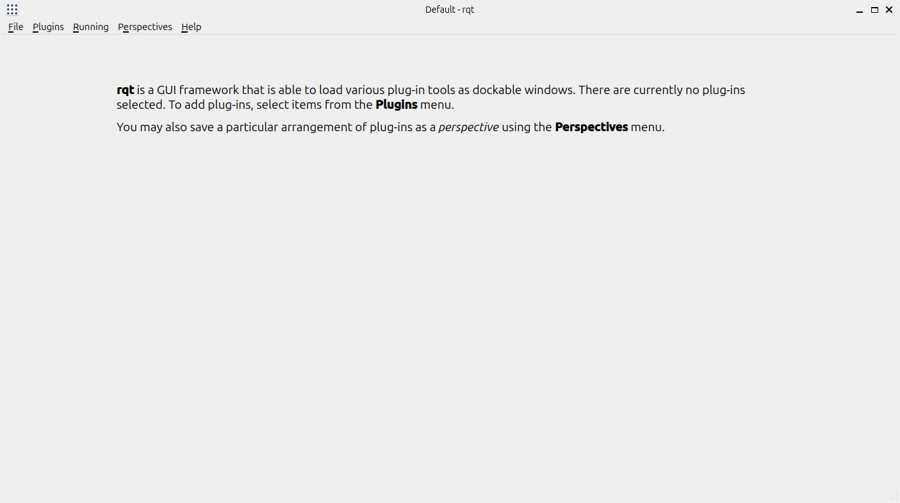

---

### Using it

As a communication-mechanism tool, you pick whichever plugin you need from the `plugins` menu.

#### 1. Node graph

For example, open the node graph like this:

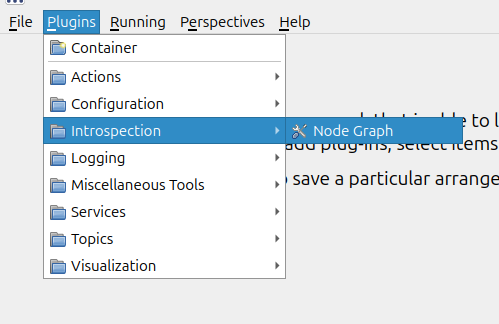

::: info
Of course, if you are comfortable with the command-line tools, you can also launch it directly with:

```bash
rqt_graph
```

or

```bash
ros2 run rqt_graph rqt_graph
```

to get the same node graph.
:::

The RQt window then shows:

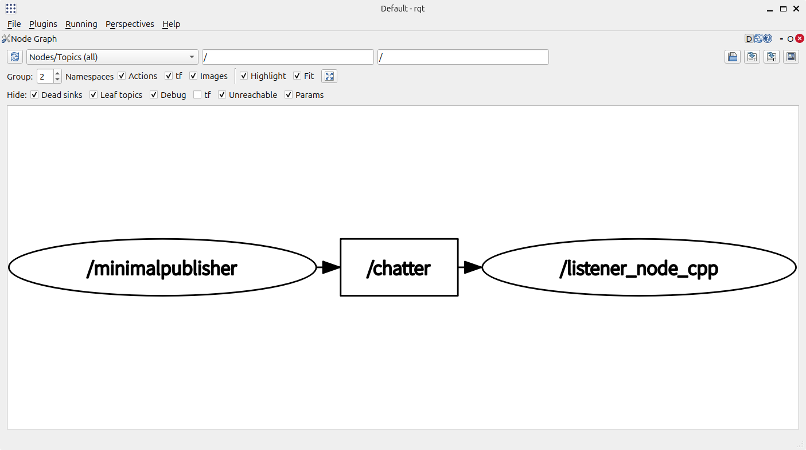

The graph lists the nodes that are currently running and shows how they are wired to one another through topics and the other communication mechanisms, so that they can talk.

#### 2. Message publisher

For example, open the message publisher like this:

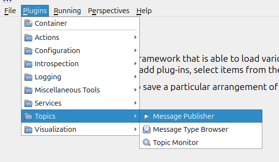

The page looks like this:

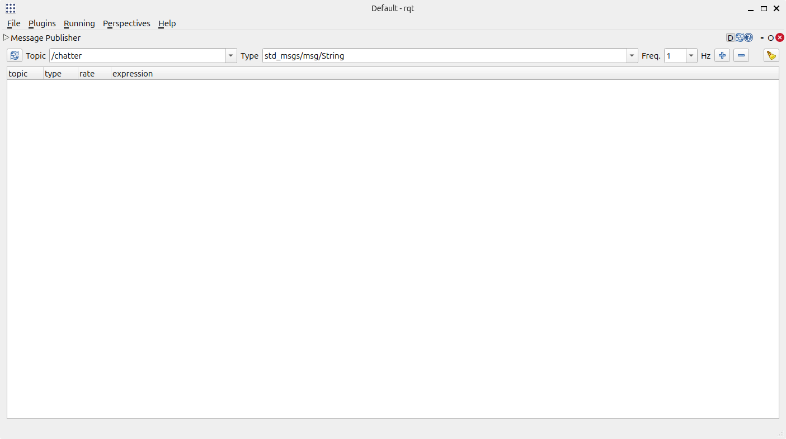

You can add a publisher for a given topic:

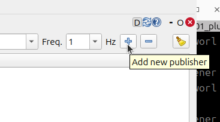

and use it to debug that topic.

Let's take the example used in [ROS2-004-Communication Mechanisms: Topic Communication — Branch One — Native Message Interfaces](../co_me/2024_09_22.md). With the subscriber already running, we debug the topic named */chatter* here:

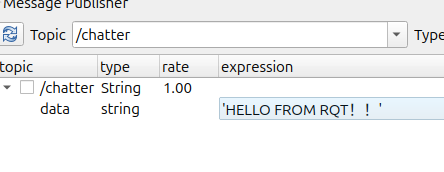

Tick the checkbox in front of it to start sending messages:

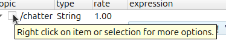

and the console that launched the subscriber receives them:

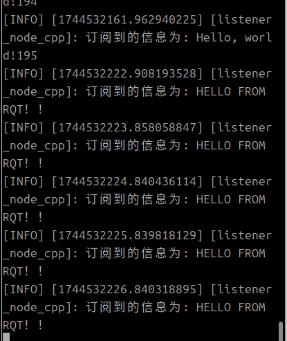

#### 3. Service caller

For example, open the service caller like this:

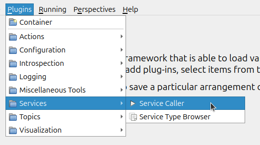

The page looks like this:

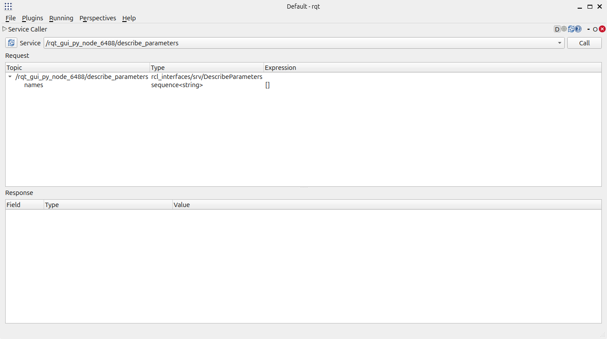

You select the matching service callback at the top:

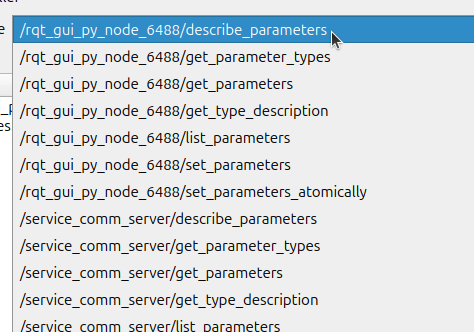

and invoke it to debug that service.

## Summary

This section gave a fairly brief account of the two kinds of communication-mechanism tools: the command line and the GUI. When ROS2 nodes talk to each other, both of them play an important role in debugging. They are one of those parts of learning ROS2 you simply have to taste 🤣

::: important
This article was translated by `Hermes Agent`; the original text can be found at [here](../../../../learningNote/Ros2_Note/co_me_2/2025_04_13.md). The translation is for reference only.
Translation time: 2026-11-05
:::
