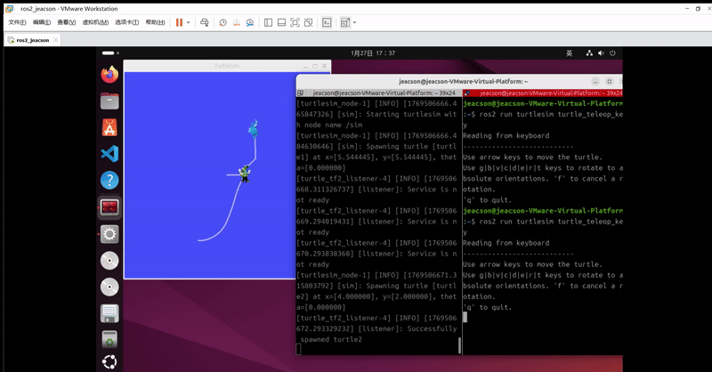

## Introduction

When we drive a robot around, we usually rely on a spread of sensors to perceive where the objects around it sit relative to the robot. Without configuring a sensor, though, all it can report is an object's position relative to itself. So some dedicated transformation step is needed to turn a sensor's position information into the object's position relative to the robot system, or to some other component of the robot. ROS packages this up in a module named `tf (TransForm Frame)`.

## Concepts

This module lets a user track multiple coordinate frames over time. It maintains the relationships between frames in a *tree structure* with **time buffering**, and lets the user transform points, vectors and the like between *any* two frames at *any* desired point in time. ROS already ships a library under the same name, and as ROS has iterated the library was upgraded to tf2 — the second-generation coordinate transform library.

A complete coordinate transform implementation consists of two parts: the **coordinate transform broadcaster** and the **coordinate transform listener**. The broadcaster publishes data describing the **relative pose between frames**, and the listener subscribes to what one or more broadcasters publish.

Each broadcaster normally takes care of `one set` of frame relationships, while the listener organises `many sets` of them into a single coordinate tree (which has one and only one root frame), so that points and vectors can be transformed between any two frames. A transform also has to consult the timestamp carried on the message data, so that the time gap between the two frames involved stays inside a given window — otherwise the coordinates you get back have no valid temporal reference and are off by some error.

::: info
Coordinate transforms in ROS are based on right-handed coordinate systems.
:::

## Trying the demo

Next we'll try the [Introduction to tf2](https://docs.ros.org/en/jazzy/Tutorials/Intermediate/Tf2/Introduction-To-Tf2.html) demo from the official site, to get a first feel for `tf2`.

First check whether the demo package and its dependencies are installed; if not, install them in bash with:

```bash
sudo apt-get install ros-jazzy-rviz2 ros-jazzy-turtle-tf2-py ros-jazzy-tf2-ros ros-jazzy-tf2-tools ros-jazzy-turtlesim
```

Or just clone the sources and build them yourself:

```bash
git clone https://github.com/ros/geometry_tutorials.git -b ros2
```

Then, in two separate terminals, launch `turtle_tf2_demo.launch.py` and the `keyboard teleop` node we used earlier:

```bash Terminal A
ros2 launch turtle_tf2_py turtle_tf2_demo.launch.py
```

```bash Terminal B
ros2 run turtlesim turtle_teleop_key
```

Drive the turtle around with the keyboard in `Terminal B`, and you will see this:



::: important
This article was translated by `Hermes Agent`; the original text can be found at [here](../../../learningNote/Ros2_Note/coor_trans/2026_01_28.md). The translation is for reference only.
Translation time: 2026-11-05
:::
