## Introduction

There are two main kinds of frame relationship: the static one and the dynamic one.

- A `static frame relationship` means the relative pose between two frames is **fixed**. For example, the lidar, camera and other components on a vehicle are usually fixed in place, so the relationship between the lidar frame and the vehicle chassis frame, or between the camera frame and the chassis frame, is a static one.

- A `dynamic frame relationship` means the relative pose between two frames **changes**. For example, the joints or grippers of a robotic arm on a vehicle, or the different vehicles in a multi-vehicle formation, can all move, so the relationship between the frame of an arm joint or gripper and the chassis frame, or between the frames of different vehicles, is a dynamic one.

This chapter focuses on how to implement **static coordinate transform broadcasting** and **dynamic coordinate transform broadcasting**.

## Case walkthrough

Here are two case requirements:

1. There is an unmanned vehicle, with a **fixed** lidar and camera mounted on its chassis. The chassis, the lidar and the camera each correspond to a frame, and each frame's origin is taken at its geometric centre. We know that the *lidar frame* is offset from the *chassis frame* by: `0.4 m along x, 0 m along y, 0.2 m along z, no rotation`. The *camera frame* is offset from the *chassis frame* by: `-0.5 m along x, 0 m along y, 0.4 m along z, no rotation`. Please *statically broadcast* **the relative pose between the lidar and chassis frames** and **the relative pose between the camera and chassis frames**, then look at the broadcast result in `rviz2`.
2. Launch `turtlesim_node`, take **the window as one world frame** (origin at the bottom-left corner) and **the turtle as another frame** (you can drive the turtle with the keyboard), and *dynamically broadcast* **the relative pose between the turtle frame and the world frame**.

In the cases above, **case 1** needs a *static coordinate transform* and **case 2** needs a *dynamic coordinate transform*. Either way, there are two things to focus on:

1. How to broadcast the relative pose between frames;
2. How to display that relative pose in rviz2.

The general steps for both are:

1. Write the broadcaster implementation source file;
2. Edit the config file;
3. Build;
4. Run;
5. View the frame relationships in rviz2.

Implementing a static coordinate transform in code follows much the same flow as implementing a dynamic one. We will do both cases in `C++` and in `Python`, and both follow the steps above.

::: note Static broadcasting is more than just code

It's worth pointing out that, besides implementing it in code, `tf2` also ships a *static broadcaster* tool that lets you publish a static frame relationship **without writing any code** — you **run** the node directly and pass in parameters describing the relative pose. For static broadcasting this method is in fact the recommended one.

The *dynamic broadcaster* has no such tool.

:::

## Preparation

In a terminal, go into the workspace's src directory and run these two commands to create a C++ package and a Python package:

```bash
ros2 pkg create cpp03_tf_broadcaster --build-type ament_cmake --dependencies rclcpp tf2 tf2_ros geometry_msgs turtlesim
ros2 pkg create py03_tf_broadcaster --build-type ament_python --dependencies rclpy tf_transformations tf2_ros geometry_msgs turtlesim
```

## Case 1 — Static broadcasting

### 1. Using commands

The tf2_ros package provides an executable named static_transform_publisher, which can broadcast a static frame relationship directly. Its syntax is as follows.

::: tabs#grammer

@tab:active Format 1#grammer1

Publish a static coordinate transform to tf2 using an `x/y/z` offset in **metres** and `roll/pitch/yaw` in **radians** (which can be read literally as roll/pitch/yaw, meaning the rotation about the x/y/z axes respectively).

```bash
ros2 run tf2_ros static_transform_publisher --x x --y y --z z --yaw yaw --pitch pitch --roll roll --frame-id frame_id --child-frame-id child_frame_id
```

For example:

```bash
ros2 run tf2_ros static_transform_publisher --frame-id base_link --child-frame-id laser --x 1.0
```

creates two frames:

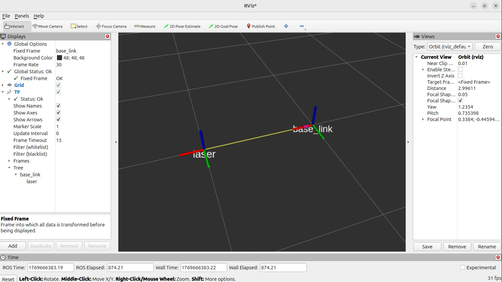

@tab:active Format 2#grammer2

Publish a static coordinate transform to tf2 using an `x/y/z` offset in **metres** and the `qx/qy/qz/qw` quaternion.

```bash
ros2 run tf2_ros static_transform_publisher --x x --y y --z z --qx qx --qy qy --qz qz --qw qw --frame-id frame_id --child-frame-id child_frame_id
```

For example:

```bash
ros2 run tf2_ros static_transform_publisher --frame-id base_link --child-frame-id laser --x 1.0 --qz -0.247404 --qw 0.968912
```

creates two frames:

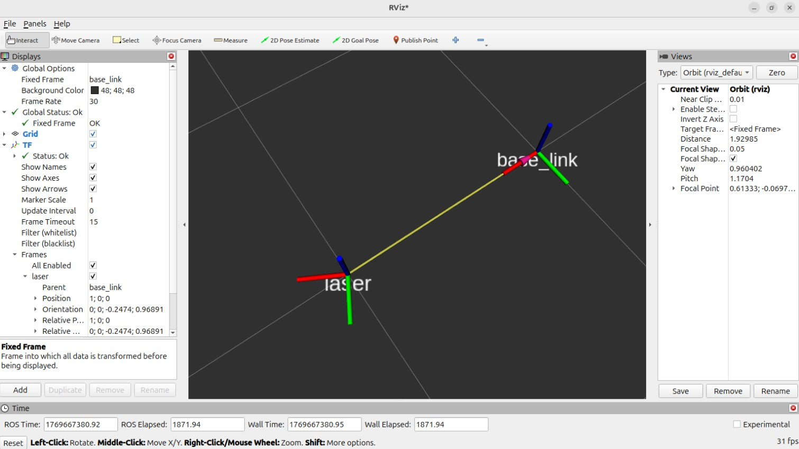

:::

::: note

① When there is an offset between the parent and child frames, an **arrow is generally drawn** from the child frame's origin to the parent frame's origin. The arrow that gets drawn has a yellow body and a pink head.

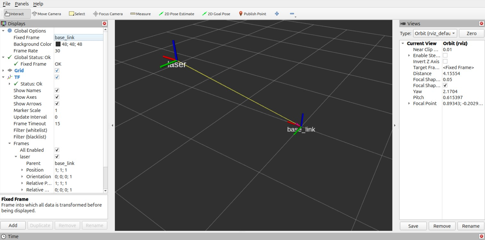

② In both formats above, apart from --frame-id, which gives the parent frame, and --child-frame-id, which gives the child frame, every other parameter is optional. If you don't specify one, its **default value is used directly**.

For example, suppose every parameter except the `id`s uses its default value:

```bash
ros2 run tf2_ros static_transform_publisher --frame-id base_link --child-frame-id laser
```

then you get two frames whose origins and axes overlap:

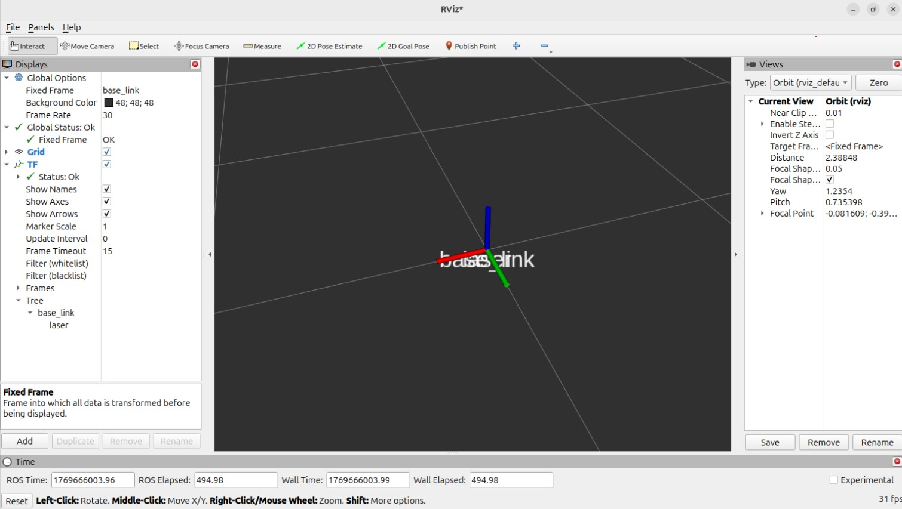 {id="ref-keypoint"}

③ **How do you view frame relationships in Rviz2?** 👈

Open a new terminal, run the command `rviz2` to start Rviz2, and configure the relevant plugins to view the coordinate transform messages:

- Set `Fixed Frame` under `Global Options` to `base_link`;
- Click the `add` button and add the `TF` plugin;
- Tick `show names` in the `TF` plugin.

The `Grid` window on the right then displays the coordinate transform relationships graphically.

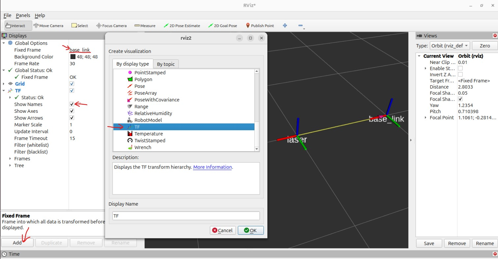
:::

On that basis, for `case 1` we can use the following commands:

```bash
ros2 run tf2_ros static_transform_publisher --frame-id base_link --child-frame-id laser --x 0.4 --y 0.0 --z 0.2
ros2 run tf2_ros static_transform_publisher --frame-id base_link --child-frame-id camera --x -0.5 --y 0.0 --z 0.4
```

As shown below:

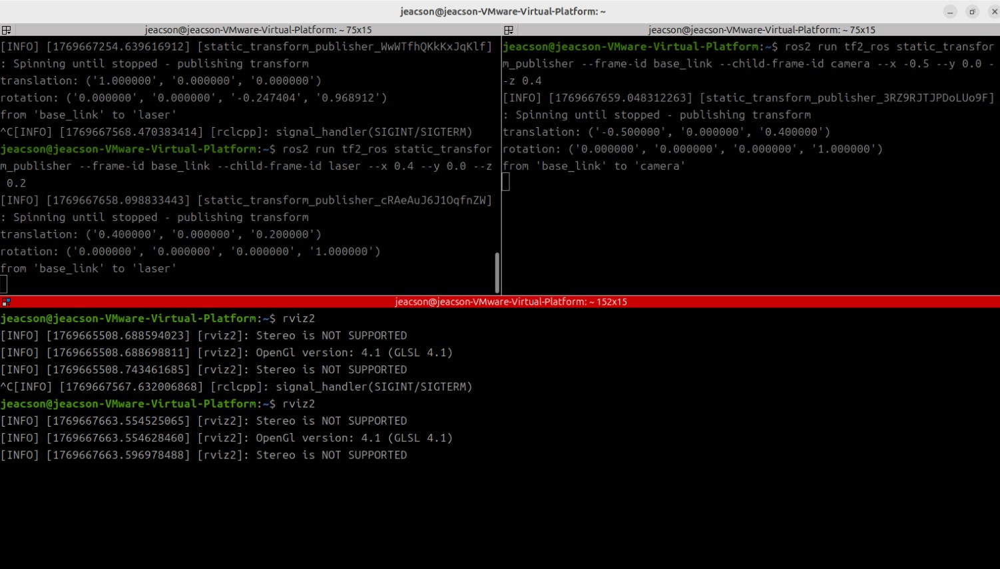

which creates the following three frames:

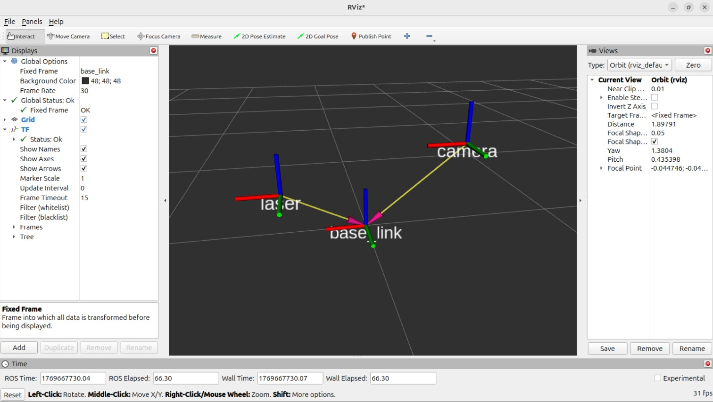

### 2. Using code

#### I. Writing the broadcaster implementation

::: tabs#CP

@tab:active C++

In the `src` directory of the `cpp03_tf_broadcaster` package, create a `C++` file named `demo01_static_tf_broadcaster.cpp` and fill it in with the following:

```cpp
/*  
  Requirement: write a static coordinate transform broadcaster. Running the program takes the relative pose of
      two frames plus the parent and child frame ids:
      ros2 run package executable x y z roll pitch yaw frame_id child_frame_id
  Steps:
    1. Include the header files;
    2. Check whether the parameters passed in from the terminal are valid;
    3. Initialise the ROS client;
    4. Define the node class;
      4-1. Create the static coordinate transform broadcaster object;
      4-2. Assemble a message from the passed-in parameters and publish it.
    5. Call the spin function, passing in the object pointer;
    6. Release resources.

*/

// 1. Include the header files;
#include <geometry_msgs/msg/transform_stamped.hpp>

#include <rclcpp/rclcpp.hpp>
// Library for the quaternion conversion
#include <tf2/LinearMath/Quaternion.h>
#include <tf2_ros/static_transform_broadcaster.h>

using std::placeholders::_1;

// 4. Define the node class;
class TFStaticBroadcaster : public rclcpp::Node
{
public:
  explicit TFStaticBroadcaster(char * transformation[]): Node("tf_static_broadcaster_node_cpp")
  {
    // 4-1. Create the static coordinate transform publisher;
    tf_publisher_ = std::make_shared<tf2_ros::StaticTransformBroadcaster>(this);
    // 4-2. Assemble and publish the message. (Here it's nicer to put it in its own function.)
    this->make_transforms(transformation);
  }

private:
  // 4-2. Assemble and publish the message.
  void make_transforms(char * transformation[])
  {
    // Assemble the message
    geometry_msgs::msg::TransformStamped t;

    t.header.stamp = this->now(); // Timestamp
    t.header.frame_id = transformation[7]; // Parent frame
    t.child_frame_id = transformation[8]; // Child frame

    t.transform.translation.x = atof(transformation[1]);
    t.transform.translation.y = atof(transformation[2]);
    t.transform.translation.z = atof(transformation[3]);

    // Create the quaternion object
    tf2::Quaternion q;
    q.setRPY(
      atof(transformation[4]),
      atof(transformation[5]),
      atof(transformation[6]));
    t.transform.rotation.x = q.x();
    t.transform.rotation.y = q.y();
    t.transform.rotation.z = q.z();
    t.transform.rotation.w = q.w();

    // Publish the message
    tf_publisher_->sendTransform(t);
    RCLCPP_INFO(get_logger(), "Broadcast published successfully!");
  }
  std::shared_ptr<tf2_ros::StaticTransformBroadcaster> tf_publisher_;
};

int main(int argc, char * argv[])
{
  // 2. Check whether the parameters passed in from the terminal are valid;
  auto logger = rclcpp::get_logger("logger");

  if (argc != 9) {
    RCLCPP_INFO(
      logger, "When running the program, pass the parameters as: x y z roll pitch yaw frame_id child_frame_id");
    return 1;
  }

  // 3. Initialise the ROS client;
  rclcpp::init(argc, argv);
  // 5. Call the spin function, passing in the object pointer;
  rclcpp::spin(std::make_shared<TFStaticBroadcaster>(argv));
  // 6. Release resources.
  rclcpp::shutdown();
  return 0;
}
```

Note: in the code above:

```cpp
...
public:
  explicit TFStaticBroadcaster(char * transformation[]): Node("tf_static_broadcaster_node_cpp")
  ...
```

`explicit` here decorates the class constructor, and it **stops** the compiler from doing an **implicit type conversion / implicit construction** on that constructor.

@tab Python

In the `py03_tf_broadcaster` directory of the `py03_tf_broadcaster` package, create a `Python` file named `demo01_static_tf_broadcaster_py.py` and fill it in with the following:

```python
"""  
    Requirement: write a static coordinate transform broadcaster. Running the program takes the relative pose of
      two frames plus the parent and child frame ids:
      ros2 run package executable x y z roll pitch yaw frame_id child_frame_id
    Steps:
        1. Import the packages;
        2. Check whether the parameters passed in from the terminal are valid;
        3. Initialise the ROS client;
        4. Define the node class;
            4-1. Create the static coordinate transform broadcaster object;
            4-2. Assemble a message from the passed-in parameters and publish it.
        5. Call the spin function, passing in the node object;
        6. Release resources.

"""
# 1. Import the packages;
import rclpy
from rclpy.node import Node
import sys
from rclpy.logging import get_logger
from tf2_ros.static_transform_broadcaster import StaticTransformBroadcaster
from geometry_msgs.msg import TransformStamped
from geometry_msgs.msg import Quaternion
import tf_transformations

# 4. Define the custom node class;
class TFStaticBroadcasterPy(Node):
    def __init__(self, argv):
        super().__init__("tf_static_broadcaster_py_node_py")
        # 4-1. Create the static coordinate transform broadcaster object;
        self.broadcaster = StaticTransformBroadcaster(self)
        # 4-2. Assemble a message from the passed-in parameters and publish it.
        self.make_transforms(argv)

    def make_transforms(self, argv):

        t = TransformStamped()
        # Assemble the message
        t.header.stamp = self.get_clock().now().to_msg() # Set the timestamp
        t.header.frame_id = argv[7]
        t.child_frame_id = argv[8]

        t.transform.translation.x = float(argv[1])
        t.transform.translation.y = float(argv[2])
        t.transform.translation.z = float(argv[3])

        # Set the quaternion
        q = tf_transformations.quaternion_from_euler(float(argv[4]),float(argv[5]),float(argv[6]))
        t.transform.rotation.x = q[0]
        t.transform.rotation.y = q[1]
        t.transform.rotation.z = q[2]
        t.transform.rotation.w = q[3]

        self.broadcaster.sendTransform(t)

        self.get_logger().info("Broadcast published successfully!")

def main():
    # 2. Check whether the parameters passed in from the terminal are valid;
    if len(sys.argv) != 9:
        get_logger("rclpy").error("When running the program, pass the parameters as: x y z roll pitch yaw frame_id child_frame_id")
        return
    # 3. Initialise the ROS2 client;
    rclpy.init()
    # 5. Call the spain function, passing in the node object;
    rclpy.spin(TFStaticBroadcasterPy(sys.argv))
    # 6. Release resources. 
    rclpy.shutdown()

if __name__ == '__main__':
    main()
```

Note:
> The `import tf_transformations` here pulls in the dependency installed with `sudo apt install ros-jazzy-tf-transformations`, which converts back and forth between Euler angles and quaternions. That dependency is normally the one you want when porting `ROS` code over to `ROS2`.
> If you're developing a project directly on ROS2, the `transforms3d` library is actually the better recommendation for converting between Euler angles and quaternions. In the official tutorial they even use a hand-written function.

:::

#### II. Editing the config file

::: tabs#CP

@tab:active C++

In `CMakeLists.txt`, the core config for a publisher or subscriber program looks like this:

```txt
find_package(ament_cmake REQUIRED)
find_package(rclcpp REQUIRED)
find_package(tf2 REQUIRED)
find_package(tf2_ros REQUIRED)
find_package(geometry_msgs REQUIRED)
find_package(turtlesim REQUIRED)

add_executable(demo01_static_tf_broadcaster src/demo01_static_tf_broadcaster.cpp)
ament_target_dependencies(
  demo01_static_tf_broadcaster
  "rclcpp"
  "tf2"
  "tf2_ros"
  "geometry_msgs"
  "turtlesim"
)

install(TARGETS demo01_static_tf_broadcaster
  DESTINATION lib/${PROJECT_NAME})
```

@tab Python

In `setup.py`, add the following to `console_scripts` under the `entry_points` field:

```python
...
entry_points={
    'console_scripts': [
        'demo01_static_tf_broadcaster_py = py03_tf_broadcaster.demo01_static_tf_broadcaster_py:main'
    ],
},
...
```

:::

#### III. Building

In a terminal, go into the current workspace and build the package:

::: tabs#CP

@tab:active C++

```bash
colcon build --packages-select cpp03_tf_broadcaster
```

@tab Python

```bash
colcon build --packages-select py03_tf_broadcaster
```

:::

#### IV. Running

In the current workspace, open two terminals. In terminal 1, enter the following command to publish the static coordinate transform of the lidar (laser) relative to the chassis (base_link):

::: tabs#CP

@tab:active C++

```bash
. install/setup.bash 
ros2 run cpp03_tf_broadcaster demo01_static_tf_broadcaster 0.4 0 0.2 0 0 0 base_link laser
```

In terminal 2, enter the following command to publish the static coordinate transform of the camera relative to the chassis (base_link):

```bash
. install/setup.bash
ros2 run cpp03_tf_broadcaster demo01_static_tf_broadcaster -0.5 0 0.4 0 0 0 base_link camera
```

and you should see this:

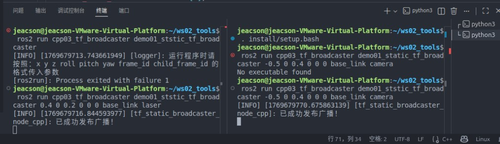

@tab Python

```bash
. install/setup.bash 
ros2 run py03_tf_broadcaster demo01_static_tf_broadcaster_py  0.4 0 0.2 0 0 0 base_link laser
```

In terminal 2, enter the following command to publish the static coordinate transform of the camera relative to the chassis (base_link):

```bash
. install/setup.bash
ros2 run cpp03_tf_broadcaster demo01_static_tf_broadcaster_py  -0.5 0 0.4 0 0 0 base_link camera
```

and you should see this:

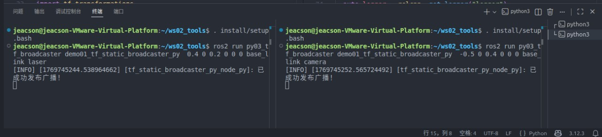

:::

#### V. Viewing the frame relationships in Rviz2

You can refer to the relevant bit of [the note above](./2026_01_29.md#_1-using-commands) to open `Rviz2`.

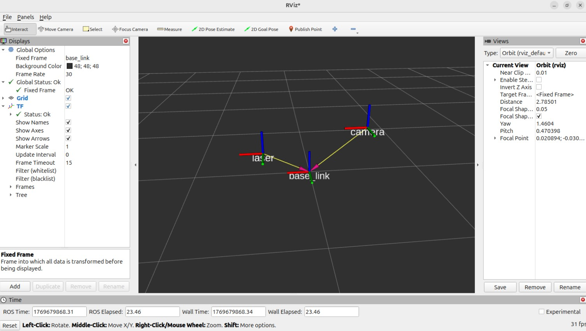

::: tip So you don't have to publish the topic yourself?
We said earlier that “a coordinate transform is topic communication underneath”, but when you write a coordinate transform you **don't publish the topic yourself** — the source code generates it for you.
Its default value is `/tf_static`, and you can check that in the source of `tf2_ros::StaticTransformBroadcaster` or `tf2_ros.static_transform_broadcaster`:

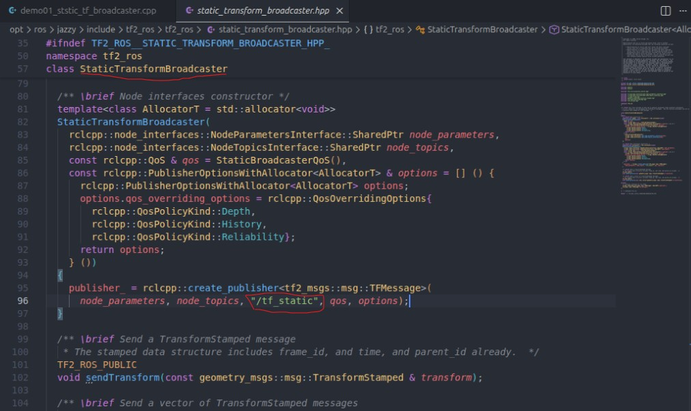

:::

::: tip Not even a node?
Right. Even though “whatever kind of communication object you create, it has to hang off a node”, taking `c++` as the example:

```cpp
...
    // 4-1. Create the static coordinate transform publisher;
    tf_publisher_ = std::make_shared<tf2_ros::StaticTransformBroadcaster>(this);

```

Here you only need to pass in the current object, `this`.

:::

## Case 2 — Dynamic broadcasting

Because dynamic broadcasting needs more code logic, there is no command that lets you set it up straight from the terminal.

In terms of configuring the code, the flow is similar to the [static broadcast](#i-writing-the-broadcaster-implementation) described above. The difference is that you have to subscribe to a node yourself and publish data dynamically according to how that subscribed node moves. When subscribing, the callback logic also leans towards “run the callback once, assemble one message, publish one batch of data”.

### I. Writing the broadcaster implementation

::: tabs#CP

@tab:active C++

In the src directory of the cpp03_tf_broadcaster package, create a C++ file named demo02_dynamic_tf_broadcaster.cpp and fill it in with the following:

```cpp
/*  
  Requirement: launch turtlesim_node, write a program, and publish the pose of the turtle (turtle1)
      relative to the window (world)
  Steps:
    1. Include the header files;
    2. Initialise the ROS client;
    3. Define the node class;
      3-1. Create the dynamic coordinate transform broadcaster object;
      3-2. Create a subscriber for the turtle pose
      3-3. In the callback, get the turtle pose, build the relative information and publish it.
    4. Call the spin function, passing in the object pointer;
    5. Release resources.

*/

// 1. Include the header files;
#include <geometry_msgs/msg/transform_stamped.hpp>
#include <turtlesim/msg/pose.hpp>

#include <rclcpp/rclcpp.hpp>
// Library for the quaternion conversion
#include <tf2/LinearMath/Quaternion.h>
#include <tf2_ros/transform_broadcaster.h>


using std::placeholders::_1;

// 3. Define the node class;
class TFDynamicBroadcaster : public rclcpp::Node
{
public:
  explicit TFDynamicBroadcaster(): Node("tf_dynamic_broadcaster_node_cpp")
  {
    // 3-1. Create the dynamic coordinate transform broadcaster object;
    tf_broadcaster_ = std::make_shared<tf2_ros::TransformBroadcaster>(this);

    // 3-2. Create a subscriber for the turtle pose
    pose_sub_ = this->create_subscription<turtlesim::msg::Pose>("/turtle1/pose", 10, 
      std::bind(&TFDynamicBroadcaster::do_pose, this, std::placeholders::_1)
    );
  }

private:
  // 3-3. In the callback, get the turtle pose, build the relative information and publish it.
  void do_pose(const turtlesim::msg::Pose & pose)
  {  
    // Assemble the message
    geometry_msgs::msg::TransformStamped ts;
    ts.header.stamp = this->now();
    ts.header.frame_id = "world";
    ts.child_frame_id = "turtle1";

    ts.transform.translation.x = pose.x;
    ts.transform.translation.y = pose.y;
    ts.transform.translation.z = 0.0;

    // Convert the Euler angles into a quaternion
    // but as a 2D turtle it only has yaw, no pitch and no roll (fixed at 0)
    tf2::Quaternion q;
    q.setRPY(0, 0, pose.theta);

    ts.transform.rotation.x = q.x();
    ts.transform.rotation.y = q.y();
    ts.transform.rotation.z = q.z();
    ts.transform.rotation.w = q.w();

    // Publish the message
    tf_broadcaster_->sendTransform(ts);
    RCLCPP_INFO(get_logger(), "Broadcast published successfully!");
  }

  std::shared_ptr<tf2_ros::TransformBroadcaster> tf_broadcaster_;
  rclcpp::Subscription<turtlesim::msg::Pose>::SharedPtr pose_sub_;
};

int main(int argc, char * argv[])
{

  // 2. Initialise the ROS client;
  rclcpp::init(argc, argv);
  // 4. Call the spin function, passing in the object pointer;
  rclcpp::spin(std::make_shared<TFDynamicBroadcaster>());
  // 5. Release resources.
  rclcpp::shutdown();
  return 0;
}
```

@tab Python

```python
"""  
    Requirement: launch turtlesim_node, write a program, and publish the pose of the turtle (turtle1)
        relative to the window (world)
    Steps:
        1. Include the header files;
        2. Initialise the ROS client;
        3. Define the node class;
            3-1. Create the dynamic coordinate transform broadcaster object;
            3-2. Create a subscriber for the turtle pose
            3-3. In the callback, get the turtle pose, build the relative information and publish it.
        4. Call the spin function, passing in the object pointer;
        5. Release resources.

"""
# 1. Import the packages;
import rclpy
from rclpy.node import Node
from tf2_ros import TransformBroadcaster
from turtlesim.msg import Pose
from geometry_msgs.msg import TransformStamped
import tf_transformations


# 3. Define the custom node class;
class TFDynamicBroadcasterPy(Node):
    def __init__(self):
        super().__init__("tf_dynamic_broadcaster_py_node_py")
        # 3-1. Create the dynamic coordinate transform broadcaster object
        self.broadcaster = TransformBroadcaster(self)
        # 3-2. Create a subscriber for the turtle pose
        self.sub = self.create_subscription(
            Pose, "/turtle1/pose", self.do_pose, 10
        )
        # 3-3. In the callback, get the turtle pose, build the relative information and publish it.    
    def do_pose(self, pose):
        ts = TransformStamped()
        # Assemble the message
        ts.header.stamp = self.get_clock().now().to_msg()
        ts.header.frame_id = "world"
        ts.child_frame_id = "turtle1"

        # Set the offset
        ts.transform.translation.x = pose.x
        ts.transform.translation.y = pose.y
        ts.transform.translation.z = 0.0

        # Set the quaternion
        q = tf_transformations.quaternion_from_euler(0.0, 0.0, pose.theta)
        ts.transform.rotation.x = q[0]
        ts.transform.rotation.y = q[1]
        ts.transform.rotation.z = q[2]
        ts.transform.rotation.w = q[3]

        # Publish the message
        self.broadcaster.sendTransform(ts)
        self.get_logger().info("Publishing the broadcast...")

def main():
    # 2. Initialise the ROS2 client;
    rclpy.init()
    # 4. Call the spain function, passing in the node object;
    rclpy.spin(TFDynamicBroadcasterPy())
    # 5. Release resources. 
    rclpy.shutdown()

if __name__ == '__main__':
    main()
```

:::

### II. Editing the config file

::: tabs#CP

@tab:active C++

In `CMakeLists.txt`, the core config for a publisher or subscriber program looks like this:

```txt
find_package(ament_cmake REQUIRED)
find_package(rclcpp REQUIRED)
find_package(tf2 REQUIRED)
find_package(tf2_ros REQUIRED)
find_package(geometry_msgs REQUIRED)
find_package(turtlesim REQUIRED)

...

add_executable(demo02_dynamic_tf_broadcaster src/demo02_dynamic_tf_broadcaster.cpp)

...

ament_target_dependencies(
  demo02_dynamic_tf_broadcaster
  "rclcpp"
  "tf2"
  "tf2_ros"
  "geometry_msgs"
  "turtlesim"
)

install(TARGETS demo01_static_tf_broadcaster demo02_dynamic_tf_broadcaster
  DESTINATION lib/${PROJECT_NAME})
```

@tab Python

In `setup.py`, add the following to `console_scripts` under the `entry_points` field:

```python
...
entry_points={
    'console_scripts': [
        ...
        'demo02_dynamic_tf_broadcaster_py = py03_tf_broadcaster.demo02_dynamic_tf_broadcaster_py:main'
    ],
},
...
```

:::

### III. Building

In a terminal, go into the current workspace and build the package:

::: tabs#CP

@tab:active C++

```bash
colcon build --packages-select cpp03_tf_broadcaster
```

@tab Python

```bash
colcon build --packages-select py03_tf_broadcaster
```

:::

### IV. Running

In the current workspace, open two new terminals. In terminal 1, start the little turtle node:

```bash
ros2 run turtlesim turtlesim_node 
```

Open a new terminal 2 and start the keyboard teleop node:

```bash
ros2 run turtlesim turtle_teleop_key 
```

Open a new terminal 3 and start the dynamic broadcast:

::: tabs#CP

@tab:active C++

```bash
. install/setup.bash 
ros2 run cpp03_tf_broadcaster demo02_dynamic_tf_broadcaster 
```

@tab Python

```bash
. install/setup.bash 
ros2 run py03_tf_broadcaster demo02_dynamic_tf_broadcaster_py
```

:::

### V. Viewing the frame relationships in Rviz2

In terminal 4, start `RVIZ2`:

```bash
rviz2
```

You can refer to the relevant bit of [the note above](./2026_01_29.md#_1-using-commands) to adjust the settings inside `Rviz2`.

Now put the mouse focus on terminal 2 and you should see:

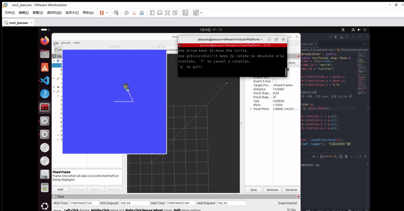

::: important
This article was translated by Hermes Agent; the original text can be found at ../../../learningNote/Ros2_Note/coor_trans/2026_01_29.md. The translation is for reference only.
Translation time: 2026-11-05
:::
