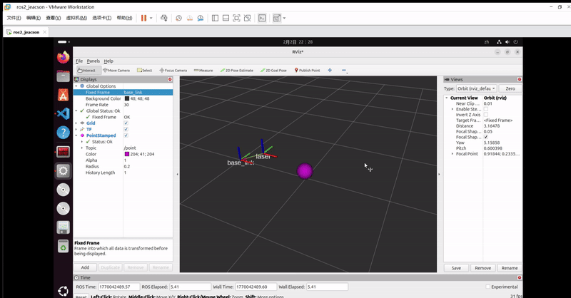

## Introduction

In [the previous chapter](./2026_01_29.md) we went through **static broadcasting** and **dynamic broadcasting**. This chapter is mainly about how to publish a point message.

## Case walkthrough

Here is the requirement for the case:

There is an unmanned vehicle, with a **fixed** lidar mounted on its chassis. The chassis and the lidar each correspond to a frame, and each frame's origin is taken at its geometric centre. The lidar has scanned a *point-shaped obstacle* and can locate the obstacle's coordinates. Please publish the obstacle's coordinate point **in the lidar frame**, then check the result in Rviz2.

The case above is a simple `topic publisher program`. Once you know about the `geometry_msgs/msg/PointStamped` interface message used for publishing point information, you just publish messages through a **topic publisher** following some logic of your own.

The main steps are:

1. Write the topic publisher implementation;
2. Edit the config file;
3. Build;
4. Run;
5. View the frame relationships in rviz2.

This case will be implemented in `C++` and in `Python`, and both follow the steps above.

## Preparation

In a terminal, go into the workspace's src directory and run these two commands to create a C++ package and a Python package:

```bash
ros2 pkg create cpp03_tf_broadcaster --build-type ament_cmake --dependencies rclcpp tf2 tf2_ros geometry_msgs turtlesim
ros2 pkg create py03_tf_broadcaster --build-type ament_python --dependencies rclpy tf_transformations tf2_ros geometry_msgs turtlesim
```

### I. Writing the topic publisher implementation

::: tabs#CP

@tab:active C++

In the `src` directory of the `cpp03_tf_broadcaster` package, create a `C++` file named `demo03_point_tf_broadcaster.cpp` and fill it in with the following:

```cpp
 /*
    Requirement: publish a point's data relative to the lidar frame
    Steps:
        1. Include the header files;
        2. Initialise the ROS2 client
        3. Define the custom node class:
            3-1. Create the publisher
            3-2. Create the timer
            3-3. Assemble and publish the message in the callback
        4. Call the spin function, passing in the node object pointer
        5. Release resources.
 */

// 1. Include the header files;
#include "rclcpp/rclcpp.hpp"
#include "geometry_msgs/msg/point_stamped.hpp"

using namespace std::chrono_literals;
// 3. Define the custom node class:
class PointBroadcaster: public rclcpp::Node{
    public:
        PointBroadcaster() : Node("point_broadcaster_node_cpp"), x(0.0){
            // 3-1. Create the publisher
            point_pub_ = this->create_publisher<geometry_msgs::msg::PointStamped>("point", 10);
            // 3-2. Create the timer
            timer_ = this->create_timer(0.1s, std::bind(&PointBroadcaster::timer_callback, this));
        }

    private:
        // 3-3. Assemble and publish the message in the callback
        void timer_callback(){
            // Assemble the message
            geometry_msgs::msg::PointStamped point;
            point.header.frame_id = "laser";
            point.header.stamp = this->now();

            // Move the point along
            x += 0.005;
            point.point.x = x;
            point.point.y = 0.0;
            point.point.z = -0.1;        
            // Publish the message
            point_pub_->publish(point);
        }   

        rclcpp::Publisher<geometry_msgs::msg::PointStamped>::SharedPtr point_pub_;
        rclcpp::TimerBase::SharedPtr timer_;
        double_t x;
};

int main(int argc, char *argv[])
{
    // 2. Initialise the ROS2 client
    rclcpp::init(argc, argv);
    // 4. Call the spin function, passing in the node object pointer.
    rclcpp::spin(std::make_shared<PointBroadcaster>());
    // 5. Release resources;
    rclcpp::shutdown();
    return 0; 
} 
```

@tab Python

In the `py03_tf_broadcaster` directory of the `py03_tf_broadcaster` package, create a `Python` file named `demo01_static_tf_broadcaster_py.py` and fill it in with the following:

```python
"""  
    Requirement: publish a point's data relative to the lidar frame
    Flow:
        1. Import the packages;
        2. Initialise the ROS2 client;
        3. Define the custom node class;
            3-1. Create the publisher
            3-2. Create the timer
            3-3. Assemble and publish the message in the callback                        
        4. Call the spin function, passing in the node object;
        5. Release resources. 


"""
# 1. Import the packages;
import rclpy
from rclpy.node import Node
from geometry_msgs.msg import PointStamped

# 3. Define the custom node class;
class PointBroadcasterPy(Node):
    def __init__(self):
        super().__init__("point_broadcaster_py_node_py")
        self.point_pub_ = self.create_publisher(PointStamped,"point",10)
        self.x = 0.0
        self.timer_ = self.create_timer(0.1, self.timer_callback())
    
    def timer_callback(self):
        # Assemble the information
        point = PointStamped()
        point.header.frame_id = "laser"
        point.header.stamp = self.get_clock().now().to_msg()
        self.x += 0.005
        point.point.x = self.x
        point.point.y = 0.0
        point.point.z = 0.2
        # Publish the information
        self.point_pub_.publish(point)

def main():
    # 2. Initialise the ROS2 client;
    rclpy.init()
    # 4. Call the spain function, passing in the node object;
    rclpy.spin(PointBroadcasterPy())
    # 5. Release resources. 
    rclpy.shutdown()

if __name__ == '__main__':
    main()
```

:::

### II. Editing the config file

::: tabs#CP

@tab:active C++

In `CMakeLists.txt`, the core config for a publisher or subscriber program looks like this:

```txt
find_package(ament_cmake REQUIRED)
find_package(rclcpp REQUIRED)
find_package(tf2 REQUIRED)
find_package(tf2_ros REQUIRED)
find_package(geometry_msgs REQUIRED)
find_package(turtlesim REQUIRED)

add_executable(demo03_point_tf_broadcaster src/demo03_point_tf_broadcaster.cpp)
ament_target_dependencies(
  demo03_point_tf_broadcaster
  "rclcpp"
  "tf2"
  "tf2_ros"
  "geometry_msgs"
  "turtlesim"
)

install(TARGETS demo03_point_tf_broadcaster
  DESTINATION lib/${PROJECT_NAME})
```

@tab Python

In `setup.py`, add the following to `console_scripts` under the `entry_points` field:

```python
...
entry_points={
    'console_scripts': [
        'demo03_point_tf_broadcaster_py = py03_tf_broadcaster.demo03_point_tf_broadcaster_py:main'
    ],
},
...
```

:::

### III. Building

In a terminal, go into the current workspace and build the package:

::: tabs#CP

@tab:active C++

```bash
colcon build --packages-select cpp03_tf_broadcaster
```

@tab Python

```bash
colcon build --packages-select py03_tf_broadcaster
```

:::

### IV. Running

In the current workspace, open two terminals. In terminal 1, enter the following command to publish the static coordinate transform of the lidar (laser) relative to the chassis (base_link) (published with the [command approach](./2026_01_29.md#_1-using-commands) used in the previous chapter):

```bash
. install/setup.bash 
ros2 run tf2_ros static_transform_publisher --frame-id base_link --child-frame-id laser --x 0.4 --y 0.0 --z 0.2
```

Then in terminal 2, enter the following command to run the code:

::: tabs#CP

@tab:active C++

```bash
. install/setup.bash
ros2 run cpp03_tf_broadcaster demo03_point_tf_broadcaster 
```

@tab Python

```bash
. install/setup.bash
ros2 run py03_tf_broadcaster demo03_point_tf_broadcaster_py

```

:::

### V. Viewing the frame relationships in Rviz2

Open a new terminal, run the command `rviz2` to start Rviz2, and configure the relevant plugins to view the coordinate transform messages:

- Set `Fixed Frame` under `Global Options` to `base_link`;
- Click the `add` button and add the `TF` plugin;
- Tick `show names` in the `TF` plugin.

The `Grid` window on the right then displays the transform relationship between the **two frames** graphically.

- Click the `add` button again and add the `PointedStamped` plugin;
- In the `PointedStamped` plugin, change the `topic` field to **“/point”**.

The `Grid` window on the right then displays the transform relationship between the **point and the frame** graphically.



::: important
This article was translated by Hermes Agent; the original text can be found at ../../../learningNote/Ros2_Note/coor_trans/2026_02_02.md. The translation is for reference only.
Translation time: 2026-11-05
:::
