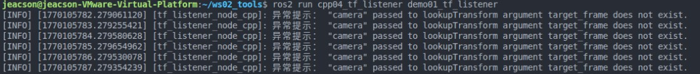
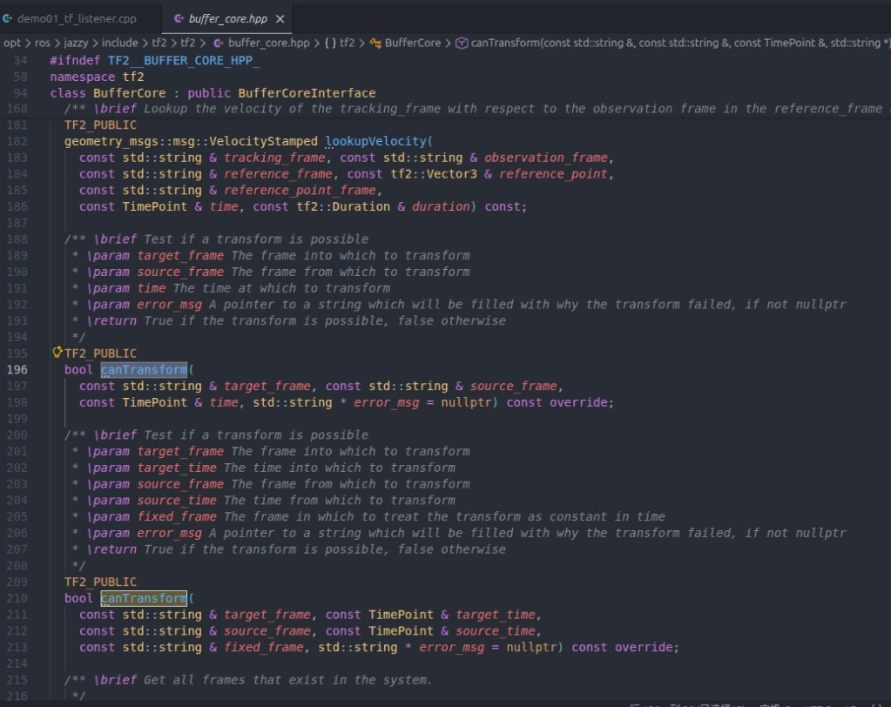
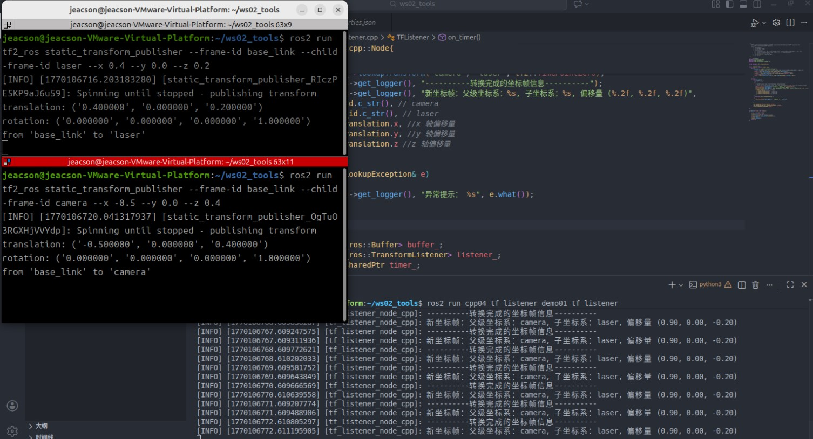
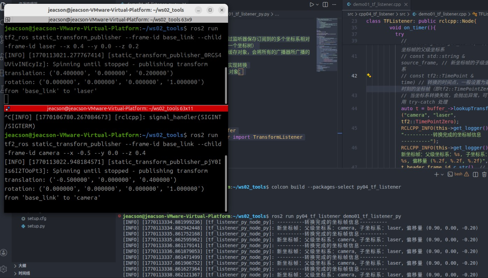

## Introduction

The **coordinate transform listener** can transform a point from one frame to another, or transform between several different frames.
Listening for coordinate transforms presupposes that **the relative poses between several different frames have already been broadcast** — it doesn't matter whether they were broadcast statically or dynamically. That's because what the listener gets is always the relative pose at some moment, some point in time.

## Case walkthrough

Here are two cases:

1. In [case one of the previous two chapters (ROS2-022-ROS2 Tools: Coordinate Transforms (3) — Coordinate Transform Broadcasting)](./2026_01_29.md#case-walkthrough), we published the frame relationship of `laser` relative to `base_link` and of `camra` relative to `base_link`. Based on that, work out **the frame relationship of `laser` relative to `camera`**.
2. In [the case of the previous chapter (ROS2-023-ROS2 Tools: Coordinate Transforms (4) — Publishing Point Messages)](./2026_02_02.md#case-walkthrough), we published the frame relationship of `laser` relative to `base_link`, plus the coordinate data of a *point-shaped obstacle* in the `laser` frame. Based on that, work out **that point-shaped obstacle's** coordinates in the `base_link` frame.

In the cases above, case 1 transforms between **different frames** in a **multi-frame** scenario, while case 2 transforms **the same point** into a **different frame**. The requirements differ, but the algorithms are all wrapped up for us — all we have to do is call the relevant API.

The two cases follow a similar flow. The main steps are:

1. Write the coordinate transform program implementation;
2. Edit the config file;
3. Build;
4. Run.

We'll implement both cases in `C++` and in `Python`, and both follow the steps above.

## Preparation

In a terminal, go into the workspace's src directory and run these two commands to create a C++ package and a Python package:

```bash
ros2 pkg create cpp04_tf_listener --build-type ament_cmake --dependencies rclcpp tf2 tf2_ros geometry_msgs --node-name demo01_tf_listener
ros2 pkg create py04_tf_listener --build-type ament_python --dependencies rclpy tf_transformations tf2_ros geometry_msgs --node-name demo01_tf_listener_py
```

## Case 1

### I. Writing the coordinate transform program

::: tabs#CP

@tab:active C++

In the `src` directory of the `cpp04_tf_listener` package, edit the `C++` file `demo01_tf_listener.cpp` and fill it in with the following:

```cpp
  /*
    Requirement: after "the relative frame relationship from laser to base_link" and "the relative frame
          relationship from camera to base_link" have been published externally,
          work out "the relative frame relationship from laser to camera"
    Steps:
        1. Include the header files;
        2. Initialise the ROS2 client
        3. Define the custom node class:
          3-1. Create the buffer object (the listener stores the relative pose data it subscribes to for
               several frames and combines it into one coordinate tree)
          3-2. Create the listener (bound to the buffer object; it writes everything the broadcasters
               broadcast into the buffer)
          3-3. Write a timer that does the transform in a loop
        4. Call the spin function, passing in the node object pointer
        5. Release resources.
 */

// 1. Include the header files;
#include "rclcpp/rclcpp.hpp"
#include "tf2_ros/buffer.h"
#include "tf2_ros/transform_listener.h"

using namespace std::chrono_literals;

// 3. Define the custom node class:
class TFListener: public rclcpp::Node{
    public:
        TFListener() : Node("tf_listener_node_cpp"){
          // 3-1. Create the buffer object (the listener stores the relative pose data it subscribes to for several frames and combines it into one coordinate tree)
          buffer_ = std::make_unique<tf2_ros::Buffer>(this->get_clock());
          // 3-2. Create the listener (bound to the buffer object; it writes everything the broadcasters broadcast into the buffer)
          listener_ = std::make_shared<tf2_ros::TransformListener>(*buffer_, this);
          // 3-3. Write a timer that does the transform in a loop
          timer_ = this->create_wall_timer(1s, std::bind(&TFListener::on_timer, this));
        }

    private:
        void on_timer(){
          // Do the frame transform
          // When the frame transform fails it throws an exception, which you can handle with try-catch
          try
          {
            // geometry_msgs::msg::TransformStamped // Returns a new coordinate frame
            // lookupTransform( const std::string &target_frame,  // The parent frame of the new coordinate frame
            // const std::string &source_frame, // The child frame of the new coordinate frame
            // const tf2::TimePoint &time) // The point in time to transform at; usually set to the latest frame (tf2::TimePointZero)
            auto t = buffer_->lookupTransform("camera", "laser", tf2::TimePointZero);
            RCLCPP_INFO(this->get_logger(), "----------Coordinate frame information after the transform----------");
            RCLCPP_INFO(this->get_logger(), "New coordinate frame: parent frame: %s, child frame: %s, offset (%.2f, %.2f, %.2f)", 
            t.header.frame_id.c_str(), // camera
              t.child_frame_id.c_str(), // laser
              t.transform.translation.x, // x-axis offset
              t.transform.translation.y, // y-axis offset
              t.transform.translation.z // z-axis offset
            );
          }
          catch(const tf2::LookupException& e)
          {
            RCLCPP_INFO(this->get_logger(), "Exception notice: %s", e.what());
          }
          
        }

        std::unique_ptr<tf2_ros::Buffer> buffer_;
        std::shared_ptr<tf2_ros::TransformListener> listener_; 
        rclcpp::TimerBase::SharedPtr timer_;

};

int main(int argc, char *argv[])
{
    // 2. Initialise the ROS2 client
    rclcpp::init(argc, argv);
    // 4. Call the spin function, passing in the node object pointer.
    rclcpp::spin(std::make_shared<TFListener>());
    // 5. Release resources;
    rclcpp::shutdown();
    return 0; 
} 
```

@tab Python

In the `py04_tf_listener` directory of the `py04_tf_listener` package, edit the `Python` file `demo01_tf_listener_py.py` and fill it in with the following:

```python
"""  
    Requirement: after "the relative frame relationship from laser to base_link" and "the relative frame
          relationship from camera to base_link" have been published externally,
          work out "the relative frame relationship from laser to camera"
    Flow:
        1. Import the packages;
        2. Initialise the ROS2 client;
        3. Define the custom node class;
            3-1. Create the buffer object (the listener stores the relative pose data it subscribes to for several frames and combines it into one coordinate tree)
            3-2. Create the listener (bound to the buffer object; it writes everything the broadcasters broadcast into the buffer)
            3-3. Write a timer that does the transform in a loop
        4. Call the spin function, passing in the node object;
        5. Release resources. 


"""
# 1. Import the packages;
import rclpy
from rclpy.node import Node

from tf2_ros.buffer import Buffer
from tf2_ros.transform_listener import TransformListener
from rclpy.time import Time

# 3. Define the custom node class;
class TFListenerPy(Node):
    def __init__(self):
        super().__init__("tf_listener_py_node_py")
        # 3-1. Create the buffer object (the listener stores the relative pose data it subscribes to for several frames and combines it into one coordinate tree)
        self.buffer_ = Buffer()
        # 3-2. Create the listener (bound to the buffer object; it writes everything the broadcasters broadcast into the buffer)
        self.listener_ = TransformListener(self.buffer_, self)
        # 3-3. Write a timer that does the transform in a loop
        self.timer_ = self.create_timer(1.0, self.on_timer)

    def on_timer(self):
        # Check whether the frame transform is possible
        if self.buffer_.can_transform("camera", "laser", Time()):
            # (method) def lookup_transform(
            #     target_frame: str, # The parent frame of the new coordinate frame
            #     source_frame: str, # The child frame of the new coordinate frame
            #     time: Time, # The point in time to transform at; usually set to the latest frame
            #     timeout: Duration = Duration() # Use the default value
            # ) -> TransformStamped
            t = self.buffer_.lookup_transform("camera", "laser", Time())
            self.get_logger().info("----------Coordinate frame information after the transform----------")
            self.get_logger().info(
                "New coordinate frame: parent frame: %s, child frame: %s, offset (%.2f, %.2f, %.2f)" 
                    %(t.header.frame_id, # camera
                    t.child_frame_id,  # laser
                    t.transform.translation.x, # x-axis offset
                    t.transform.translation.y, # y-axis offset
                    t.transform.translation.z) # z-axis offset
                )
        else:
            self.get_logger().info("Transform failed XD")

def main():
    # 2. Initialise the ROS2 client;
    rclpy.init()
    # 4. Call the spin function, passing in the node object;
    rclpy.spin(TFListenerPy())
    # 5. Release resources. 
    rclpy.shutdown()

if __name__ == '__main__':
    main()
```

:::

::: note Hints

In the `c++` example, if you run the program before the `camera` or `laser` frame relationship relative to `base_link` has been published, you get the following output:



That exception message is the one our `try-catch` caught back when we wrote the code. The description of that `excepetion` is (taking `c++` as the example):

> class tf2::LookupException
> An exception class to notify of bad frame number
> This is an exception class to be thrown in the case that a frame not in the graph has been attempted to be accessed. The most common reason for this is that the frame is not being published, or a parent frame was not set correctly causing the tree to be broken. (This exception class is thrown when an attempt is made to access a frame that does not exist in the graph. The most common reason is that the frame is not being published, or the parent frame was not set correctly, which breaks the tree structure.)

There is in fact another way to handle this exception: **check the `buffer` before the transform** to see whether the transform is possible.

In C++, for example, `buffer_` also has a function called `canTransform()`:



It returns a `bool`. So you can also rewrite the earlier `try-catch` code as something like:

```cpp
...
if (buffer_->canTransform("camera", "laser", tf2::TimePointZero)) {
    auto t = buffer_->lookupTransform("camera", "laser", tf2::TimePointZero);
} else {
    RCLCPP_INFO(this->get_logger(), "Exception notice: probably the frame relationship has not been published");
}
```

You can refer to how the `python` side handles the exception above.

:::

### II. Editing the config file

::: tabs#CP

@tab:active C++

In `CMakeLists.txt`, the core config for a publisher or subscriber program looks like this:

```txt
find_package(ament_cmake REQUIRED)
find_package(rclcpp REQUIRED)
find_package(tf2 REQUIRED)
find_package(tf2_ros REQUIRED)
find_package(geometry_msgs REQUIRED)
find_package(turtlesim REQUIRED)

add_executable(demo01_tf_listener src/demo01_tf_listener.cpp)
ament_target_dependencies(
  demo01_tf_listener
  "rclcpp"
  "tf2"
  "tf2_ros"
  "geometry_msgs"
  "turtlesim"
)

install(TARGETS demo01_tf_listener
  DESTINATION lib/${PROJECT_NAME})
```

@tab Python

In `setup.py`, add the following to `console_scripts` under the `entry_points` field:

```python
...
entry_points={
    'console_scripts': [
        'demo01_tf_listener_py = py03_tf_broadcaster.demo01_tf_listener_py:main'
    ],
},
...
```

:::

### III. Building

In a terminal, go into the current workspace and build the package:

::: tabs#CP

@tab:active C++

```bash
colcon build --packages-select cpp04_tf_listener
```

@tab Python

```bash
colcon build --packages-select py04_tf_listener
```

:::

### IV. Running

In the current workspace, open two terminals. In terminal 1, enter the following command to publish the static coordinate transform of the lidar (laser) relative to the chassis (base_link) (published with the [command approach](./2026_01_29.md#_1-using-commands) used in the *Coordinate Transforms (3)* chapter):

```bash
. install/setup.bash 
ros2 run tf2_ros static_transform_publisher --frame-id base_link --child-frame-id laser --x 0.4 --y 0.0 --z 0.2
```

In terminal 2, enter the following command to publish the static coordinate transform of the camera relative to the chassis (base_link) (likewise published with the [command approach](./2026_01_29.md#_1-using-commands) used in the *Coordinate Transforms (3)* chapter):

```bash
. install/setup.bash
ros2 run tf2_ros static_transform_publisher --frame-id base_link --child-frame-id camera --x -0.5 --y 0.0 --z 0.4

```

Open a new terminal 3 and enter the following command to run the code:

::: tabs#CP

@tab:active C++

```bash
. install/setup.bash
ros2 run cpp04_tf_listener demo01_tf_listener 
```

and that terminal prints:



@tab Python

```bash
. install/setup.bash
ros2 run py04_tf_listener demo01_tf_listener_py

```

and that terminal prints:



:::

## Case 2

See [the next chapter](./2026_02_04.md)

::: important
This article was translated by Hermes Agent; the original text can be found at [here](../../../learningNote/Ros2_Note/coor_trans/2026_02_03.md). The translation is for reference only.
Translation time: 2026-11-05
:::
