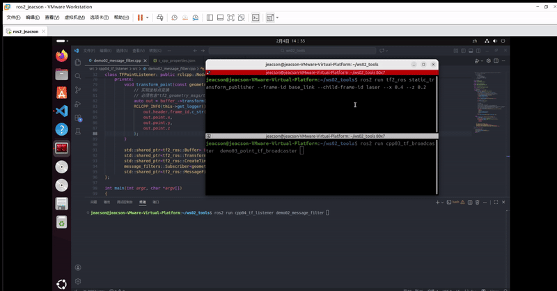
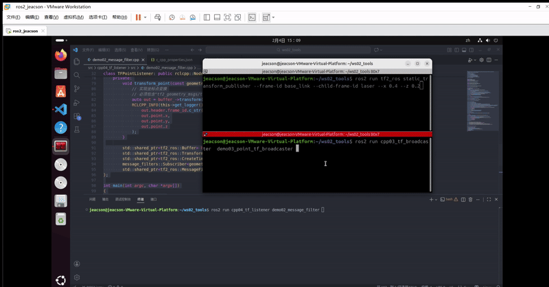

## Introduction

The **coordinate transform listener** can transform a point from one frame to another, or transform between several different frames.
Listening for coordinate transforms presupposes that **the relative poses between several different frames have already been broadcast** — it doesn't matter whether they were broadcast statically or dynamically. That's because what the listener gets is always the relative pose at some moment, some point in time.

In [the previous chapter](./2026_02_03.md#case-1) we used case one to transform between **different frames** in a **multi-frame** scenario. In this chapter we'll do case two, i.e. transforming **the same point** into a **different frame**. The requirements differ, but the algorithms are all wrapped up for us — all we have to do is call the relevant API.

## Case walkthrough

Case two is:

- In [the case of the previous two chapters (ROS2-023-ROS2 Tools: Coordinate Transforms (4) — Publishing Point Messages)](./2026_02_02.md#case-walkthrough), we published the frame relationship of `laser` relative to `base_link`, plus the coordinate data of a *point-shaped obstacle* in the `laser` frame. Based on that, work out **that point-shaped obstacle's** coordinates in the `base_link` frame.

The two cases follow a similar flow. The main steps are:

1. Write the coordinate transform program implementation;
2. Edit the config file;
3. Build;
4. Run.

We'll implement this case in `C++`, following the steps above.

::: info About Python
On `ROS2 Jazzy` you can implement the core functionality in `Python`, but `Python` **does not implement the `tf2_ros::MessageFilter` module**. So you have to handle “waiting for TF to be ready” by hand, and you can't use `MessageFilter`'s automatic callback mechanism the way `C++` does.

That said, `C++` is pretty good at the data-processing side, so just use the `C++` version.
:::

::: tip How is this program implemented?

For a relative transform between a point and a frame, the coordinate transform program goes like this:

1. Subscribe to the data;
    1. Create listener object A and subscribe to the frame transforms;
    2. Create buffer B and store the frame transform data;
    3. Create another new listener object C (a dedicated subscriber) and subscribe to the point data;
2. Solve.
    1. Create a filter that gets *the frame transform data stored in buffer B* and *the point data subscribed by object C*;
    2. Use the filter to combine the data and compute the transform of the point relative to the frame.

:::

## Preparation

In a terminal, go into the workspace's `src` directory and run the following command to create the `C++` package. Since the dependencies have grown, if you already created it in [the previous chapter](./2026_02_03.md#case-1) you need to edit `package.xml` and `CMakeLists.txt` (in `C++`). You can find them under [editing the config file](#ii-editing-the-config-file) below.

```bash
ros2 pkg create cpp04_tf_listener --build-type ament_cmake --dependencies rclcpp tf2 tf2_ros geometry_msgs tf2_geometry_msgs message_filters --node-name demo01_tf_listener
```

## Case implementation

### I. Writing the coordinate transform program

In the `src` directory of the `cpp04_tf_listener` package, create a `C++` file named `demo02_message_filter.cpp` and fill it in with the following:

```cpp
   /*
    Requirement: after "broadcasting the frame relationship from laser->base_link" externally and "publishing
            the point in the laser frame" externally,
            work out the coordinates of point->base_link
    Steps:
        1. Include the header files;
        2. Initialise the ROS2 client
        3. Define the custom node class:
            3-1. Create the coordinate transform listener;
            3-2. Create the point message subscriber;
            3-3. Create the filter to parse the data;
        4. Call the spin function, passing in the node object pointer
        5. Release resources.
 */

// 1. Include the header files;
#include "rclcpp/rclcpp.hpp"
# include "tf2_ros/buffer.h"
# include "tf2_ros/transform_listener.h"

#include "tf2_ros/create_timer_ros.h"

#include "message_filters/subscriber.h"
#include "geometry_msgs/msg/point_stamped.hpp"

#include "tf2_ros/message_filter.h"

#include "tf2_geometry_msgs/tf2_geometry_msgs.hpp"

using namespace std::chrono_literals;

// 3. Define the custom node class:
class TFPointListener: public rclcpp::Node{
    public:
        TFPointListener() : Node("tf_point_listener_node_cpp"){
            // 3-1. Create the coordinate transform listener;
            buffer_ = std::make_shared<tf2_ros::Buffer>(this->get_clock());
            // CreateTimerROS(
            // rclcpp::node_interfaces::NodeBaseInterface::SharedPtr node_base,
            // rclcpp::node_interfaces::NodeTimersInterface::SharedPtr node_timers, 
            // rclcpp::CallbackGroup::SharedPtr callback_group = nullptr)
            timer_ = std::make_shared<tf2_ros::CreateTimerROS>(
                this->get_node_base_interface(),
                this->get_node_timers_interface()
            );

            buffer_->setCreateTimerInterface(timer_);
            listener_ = std::make_shared<tf2_ros::TransformListener>(*buffer_);

            // 3-2. Create the point message subscriber;
            // Use the no-argument constructor
            point_sub.subscribe(this, "point");

            // 3-3. Create the filter to parse the data;

            // Create the filter
            //   MessageFilter(
            // F & f, // The subscription object
            //  BufferT & buffer, // The coordinate listener buffer
            // const std::string & target_frame, // The target frame (base_link here)
            // uint32_t queue_size, // Queue length (the message-processing queue length; 10 will do)
            // const rclcpp::node_interfaces::NodeLoggingInterface::SharedPtr & node_logging, // Get the logging interface
            // const rclcpp::node_interfaces::NodeClockInterface::SharedPtr & node_clock, // Get the time interface
            // std::chrono::duration<TimeRepT, TimeT> buffer_timeout =  // Timeout
            // std::chrono::duration<TimeRepT, TimeT>::max())
            filter_ = std::make_shared<tf2_ros::MessageFilter<geometry_msgs::msg::PointStamped>>(
                point_sub, 
                *buffer_,
                "base_link",
                20,
                this->get_node_logging_interface(),
                this->get_node_clock_interface(),
                1s
            );
            // Parse the data
            filter_->registerCallback(&TFPointListener::transform_point, this);
        }

    private:
        void transform_point(const geometry_msgs::msg::PointStamped & ps){
            // Do the point transform
            // You must include the "tf2_geometry_msgs/tf2_geometry_msgs.hpp" header, otherwise it errors out
            auto out = buffer_->transform(ps, "base_link");
            RCLCPP_INFO(this->get_logger(),"Parent frame: %s, coordinates: (%.2f,%.2f,%.2f)",
                out.header.frame_id.c_str(),
                out.point.x,
                out.point.y,
                out.point.z
            );
        }

        std::shared_ptr<tf2_ros::Buffer> buffer_;
        std::shared_ptr<tf2_ros::TransformListener> listener_;
        std::shared_ptr<tf2_ros::CreateTimerROS> timer_;
        message_filters::Subscriber<geometry_msgs::msg::PointStamped> point_sub;
        std::shared_ptr<tf2_ros::MessageFilter<geometry_msgs::msg::PointStamped>> filter_;
};

int main(int argc, char *argv[])
{
    // 2. Initialise the ROS2 client
    rclcpp::init(argc, argv);
    // 4. Call the spin function, passing in the node object pointer.
    rclcpp::spin(std::make_shared<TFPointListener>());
    // 5. Release resources;
    rclcpp::shutdown();
    return 0; 
} 
```

### II. Editing the config file

In `package.xml`, the config you need looks like this:

```xml

<depend>rclcpp</depend>
<depend>tf2</depend>
<depend>tf2_ros</depend>
<depend>geometry_msgs</depend>

<depend>tf2_geometry_msgs</depend> 
<!--  👆     NEW!!!     👇  -->
<depend>message_filters</depend>

```

In `CMakeLists.txt`, the core config for a publisher or subscriber program looks like this:

```txt
find_package(ament_cmake REQUIRED)
find_package(rclcpp REQUIRED)
find_package(tf2 REQUIRED)
find_package(tf2_ros REQUIRED)
find_package(geometry_msgs REQUIRED)
find_package(tf2_geometry_msgs REQUIRED)
find_package(message_filters REQUIRED)

add_executable(demo02_message_filter  src/demo02_message_filter.cpp)
ament_target_dependencies(
  demo02_message_filter 
  "rclcpp"
  "tf2"
  "tf2_ros"
  "geometry_msgs"
  "tf2_geometry_msgs"
  "message_filters"
)

install(TARGETS demo02_message_filter
  DESTINATION lib/${PROJECT_NAME})
```

### III. Building

In a terminal, go into the current workspace and build the package:

```bash
colcon build --packages-select cpp04_tf_listener
```

### IV. Running

In the current workspace, open two terminals. In terminal 1, enter the following command to publish the static coordinate transform of the lidar (laser) relative to the chassis (base_link) (published with [the command approach used in the *Coordinate Transforms (3)* chapter](./2026_01_29.md#_1-using-commands)):

```bash
. install/setup.bash 
ros2 run tf2_ros static_transform_publisher --frame-id base_link --child-frame-id laser --x 0.4 --y 0.0 --z 0.2
```

In terminal 2, enter the following command to publish the obstacle coordinate point in the lidar (laser) frame (published with [the approach used in the *Coordinate Transforms (4)* chapter](./2026_02_02.md)):

```bash
. install/setup.bash
ros2 run cpp03_tf_broadcaster  demo03_point_tf_broadcaster

```

Open a new terminal 3 and enter the following command to run the code:

```bash
. install/setup.bash
ros2 run cpp04_tf_listener demo02_message_filter 
```

and that terminal prints:



> ...
> [INFO] [1770188992.320459424] [tf_point_listener_node_cpp]: Parent frame: base_link, coordinates: (0.98,0.00,0.10)
> ...

::: warning What if you start it when *only the point messages are being published*
You get an error:



>[INFO] [1770188988.520952225] [tf_point_listener_node_cpp]: Message Filter dropping message: frame 'laser' at time 1770188987.520 for reason 'the timestamp on the message is earlier than all the data in the transform cache'

The error above comes from calling the official built-in error function. In theory, when you write the code you should implement your own `try-catch` for errors

But if you flip it around — start it when *only the frame relationships are being published* — then **nothing comes back at all**... so you'd better implement that custom `try-catch` after all

:::

::: important
This article was translated by Hermes Agent; the original text can be found at ../../../learningNote/Ros2_Note/coor_trans/2026_02_04.md. The translation is for reference only.
Translation time: 2026-11-05
:::
