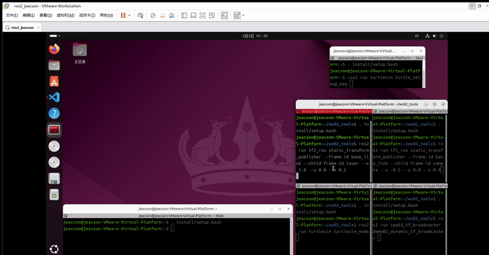
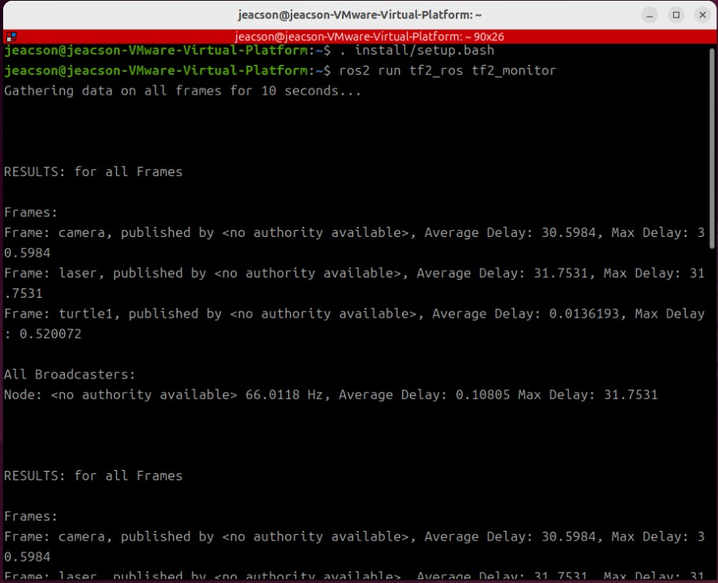
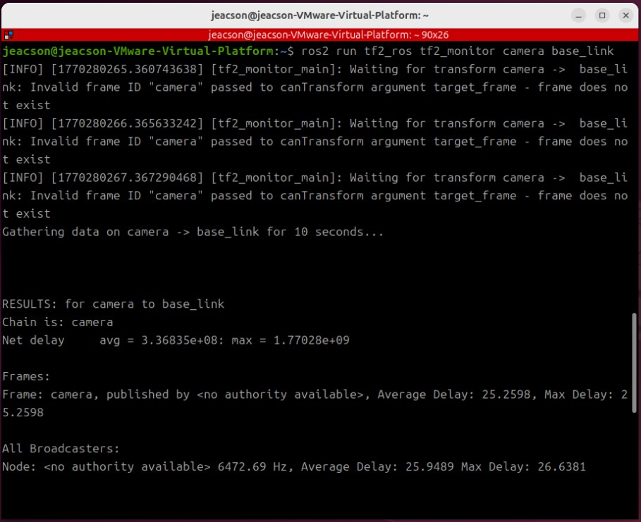
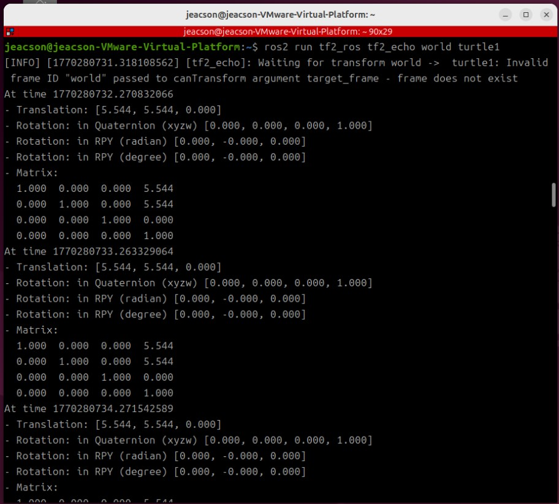
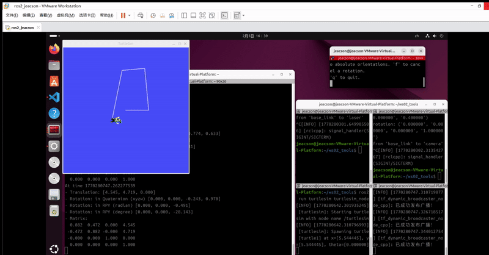
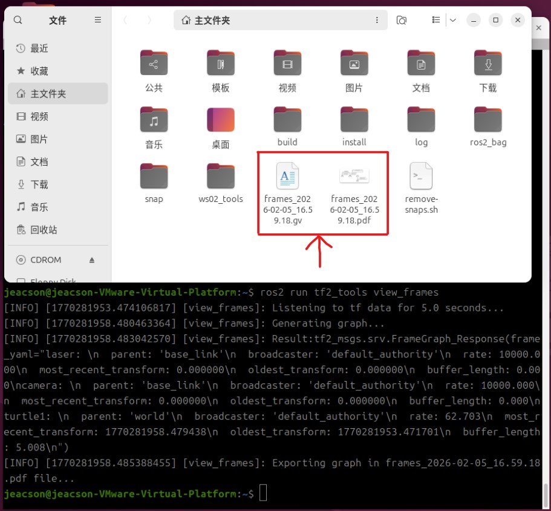
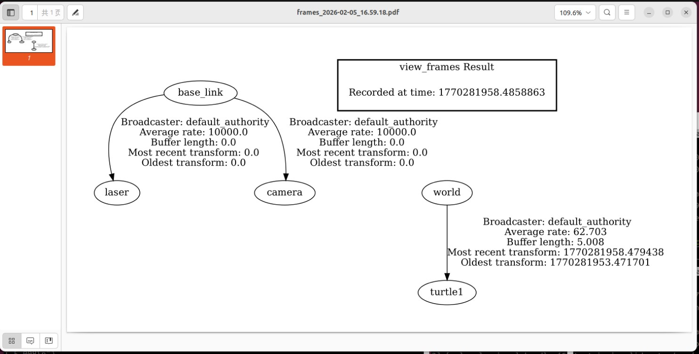

## Introduction

In the `TF` framework, besides wrapping up **coordinate broadcasting and listening**, `ROS2` also ships some tools that help us develop and debug more efficiently. This chapter is about using those tools.

They mainly involve two packages: `tf2_ros` and `tf2_tools`.

## The packages

The common nodes provided by the `tf2_ros` package are:

- `static_transform_publisher`: this node broadcasts static coordinate transforms. It was covered in detail in the **[ROS2-022-ROS2 Tools: Coordinate Transforms (3) — Coordinate Transform Broadcasting](./2026_01_29.md#_1-using-commands)** chapter, so I won't go over it again;

- `tf2_monitor`: this node prints the publishing rate and network delay of all frames, or of one particular frame;

- `tf2_echo`: this node prints the translation and rotation relationship of a particular frame.

The nodes provided by the `tf2_tools` package are:

- `view_frames`: this node generates a **pdf** file showing the frame relationships, containing a tree-structured map of the frames.

## Preparation

First, start several frame broadcasting nodes. Here we take the static and dynamic transforms from the **Coordinate Transforms (3) — Coordinate Transform Broadcasting** chapter as the example:

### Static transform

In the workspace, open two terminals, A & B. In terminal A, enter:

```bash
. install/setup.bash
ros2 run tf2_ros static_transform_publisher --frame-id base_link --child-frame-id laser --x 1.0 --y 0.0 --z 0.2
```

In terminal B, enter:

```bash
. install/setup.bash
ros2 run tf2_ros static_transform_publisher --frame-id base_link --child-frame-id camera --x -0.5 --y 0.0 --z 0.4
```

### Dynamic transform

In the workspace, open two terminals, C & D. In terminal C, enter:

```bash
. install/setup.bash
ros2 run turtlesim turtlesim_node
```

In terminal D, enter:

```bash
. install/setup.bash
ros2 run cpp03_tf_broadcaster demo02_dynamic_tf_broadcaster 
```

Open yet another new terminal, E, and enter:

```bash
. install/setup.bash
ros2 run turtlesim turtle_teleop_key
```

The whole thing looks something like:



---

## Examples of the tools' common nodes

Open yet another new terminal, F, for the new commands.

### I. tf2_monitor

This node prints the publishing rate and network delay of frames *within a set time (ten seconds by default)*.

In terminal F, enter:

```bash
ros2 run tf2_ros tf2_monitor
```

and you'll see output like this:



It prints the publishing rate and network delay of **all** frames within the set time.

You can also enter this in terminal F:

```bash
ros2 run tf2_ros tf2_monitor camera base_link

```

to see the publishing rate and network delay of the `camera` frame relative to the `base_link` frame.



> The first few exceptions are just because the given frame hasn't been found in the buffer yet — that's normal

### II. tf2_echo

This node prints the relative pose between two particular frames.

In terminal F, enter:

```bash
ros2 run tf2_ros tf2_echo world turtle1
```

and it prints the relative pose between the two particular frames `world` and `turtle1`.



Its default output interval is around 1 s:



### III. view_frames

This node displays frame relationships **graphically**.

In terminal F, enter:

```bash
ros2 run tf2_tools view_frames
```

After starting up, the node subscribes to the `/tf` and `/tf_static` topics for **5 seconds**, listening to and recording *all* the `coordinate transform data` published **during that window**, plus the `parent-child relationship` between every pair of frames.

It then generates several files in the current directory of that terminal:



The two files are described as follows:

| File extension | Description |
| ------ | ------ |
| `.gv` | A text file in Graphviz DOT format describing the graph structure; you can think of it as a description file for the `.pdf` below |
| `.pdf` | The rendered PDF diagram showing the hierarchy of the TF tree; this is the file you look at |

That `.pdf` shows the following once opened:



This method gets used a lot, because it displays the relative state of every node in a robot system much more intuitively afterwards.

::: important
This article was translated by Hermes Agent; the original text can be found at [here](../../../learningNote/Ros2_Note/coor_trans/2026_02_05.md). The translation is for reference only.
Translation time: 2026-11-05
:::
