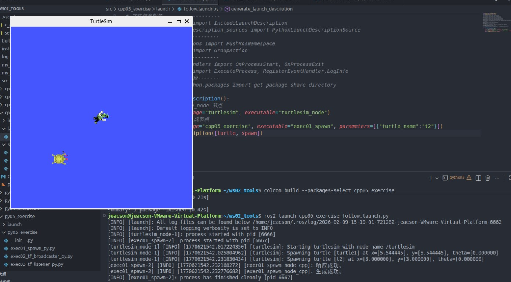
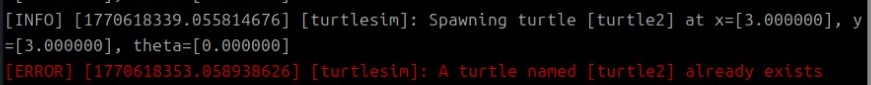
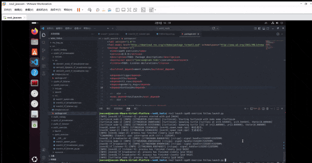

## Introduction

This chapter is about implementing the “turtle following” case.

## Case requirements & analysis

**Requirement:** write a program that, when run, launches the `turtlesim_node` node. That node opens a window with a native turtle (`turtle1`) in it, and then a new turtle (`turtle2`) is spawned. Whether `turtle1` sits still or is driven around with the keyboard, `turtle2` must treat `turtle1` as its target and move towards its geometric centre.

**Analysis:** the core of the “turtle following” case is working out the position of `turtle1` relative to `turtle2`. Once you have that position you can use it as the target point and drive `turtle2` towards it. That relative position can be worked out with coordinate transforms: roughly, first broadcast the frame relationship of `turtle1` relative to `world` and of `turtle2` relative to `world`, then listen to those frame relationships to get the frame relationship of `turtle1` relative to `turtle2`.

## Flow overview

The main steps of the case are:

1. Write a program that calls the `/spawn` service to spawn a new turtle;
2. Write the coordinate transform broadcast implementation, which broadcasts the frame relationship of `turtle1` relative to `world` and of `turtle2` relative to `world`;
3. Write the coordinate transform listener implementation, which gets the frame relationship of `turtle1` relative to `turtle2` and produces the velocity command that drives `turtle2`;
4. Write the `launch` file that integrates the nodes;
5. Edit the config file;
6. Build;
7. Run.

We'll implement the case in `C++` and in `Python`, and both follow the steps above.

## Preparation

### 1. Creating the package

In a terminal, go into the workspace's src directory and run these two commands to create a C++ package and a Python package:

```bash
ros2 pkg create cpp05_exercise --build-type ament_cmake --dependencies rclcpp tf2 tf2_ros geometry_msgs turtlesim
ros2 pkg create py05_exercise --build-type ament_python --dependencies rclpy tf_transformations tf2_ros geometry_msgs turtlesim
```

### 2. Creating the launch directory

Create a `launch` directory in each of the `cpp05_exercise` and `py05_exercise` packages, and edit their config files.

In the `CMakeLists.txt` of the `cpp05_exercise` package, add the following:

```txt
...
install(DIRECTORY launch
  DESTINATION share/${PROJECT_NAME}
)

```

In the `setup.py` of the `py05_exercise` package, the `data_files` attribute needs changing. Once changed it looks like this:

```python
data_files=[
    ('share/ament_index/resource_index/packages',
        ['resource/' + package_name]),
    ('share/' + package_name, ['package.xml'],),
    ('share/' + package_name, glob("launch/*.launch.xml")),
    ('share/' + package_name, glob("launch/*.launch.py")),
    ('share/' + package_name, glob("launch/*.launch.yaml")),
],
```

## Case implementation

### 1. Writing the program that calls the `/spawn` service to spawn a new turtle

::: tabs

@tab:active C++

In the `src` directory of the `cpp05_exercise` package, create a `C++` file named `execr01_spawn.cpp` and fill it in with the following:

```cpp
 /*
    Requirement: write a client implementation that sends a request to spawn a new turtle
    Steps:
        1. Include the header files;
        2. Initialise the ROS2 client
        3. Define the custom node class:
            3-1. Use the parameter service to declare the new turtle's information;
            3-2. Create the service client;
            3-3. Connect to the server; 
            3-4. Assemble and send the data;

        4. Create the custom node class object, organise the function calls, and handle the response
        5. Release resources.
 */

// 1. Include the header files;
#include "rclcpp/rclcpp.hpp"
#include "turtlesim/srv/spawn.hpp"

using namespace std::chrono_literals;
// 3. Define the custom node class:
class Exer01Spawn: public rclcpp::Node{
    public:
        Exer01Spawn() : Node("exer01_spawn_node_cpp"){
            // 3-1. Use the parameter service to declare the new turtle's information;
            this->declare_parameter("x", 3.0);
            this->declare_parameter("y", 3.0);
            this->declare_parameter("theta", 0.0);
            this->declare_parameter("turtle_name", "turtle2");

            x = this->get_parameter("x").as_double();
            y = this->get_parameter("y").as_double();
            theta = this->get_parameter("theta").as_double();
            turtle_name = this->get_parameter("turtle_name").as_string();

            // 3-2. Create the service client;
            spawn_client_ = this->create_client<turtlesim::srv::Spawn>("/spawn");

        }

        
        // 3-3. Connect to the server; 
        bool connect_server(){
            while (!spawn_client_->wait_for_service(2s)){
                if (!rclcpp::ok())
                {   
                    RCLCPP_INFO(rclcpp::get_logger("rclcpp"), "Forced exit.");
                    return false;
                }
                
                RCLCPP_INFO(this->get_logger(), "Connecting to the service...");
            }
            return true;
        }
        // 3-4. Assemble and send the data;
        rclcpp::Client<turtlesim::srv::Spawn>::FutureAndRequestId request(){
            // rclcpp::Client<turtlesim::srv::Spawn>::FutureAndRequestId 
            auto req = std::make_shared<turtlesim::srv::Spawn::Request>();
            req->x = x;
            req->y = y;
            req->theta = theta;
            req->name = turtle_name;

            // async_send_request(std::shared_ptr<turtlesim::srv::Spawn_Request> request)
            return spawn_client_->async_send_request(req);
        }

    private:
        double_t x,y,theta;
        std::string turtle_name;
        rclcpp::Client<turtlesim::srv::Spawn>::SharedPtr spawn_client_;
};

int main(int argc, char *argv[])
{
    // 2. Initialise the ROS2 client
    rclcpp::init(argc, argv);
    // 4. Create the custom node class object, organise the function calls, and handle the response
    auto client_ = std::make_shared<Exer01Spawn>();
    bool flag = client_->connect_server();
    if (!flag)
    {
        RCLCPP_INFO(rclcpp::get_logger("rclcpp"), "Failed to connect to the service");
        return 1;
    }
    // Send the request
    auto response = client_->request();
    // Handle the response
    if (rclcpp::spin_until_future_complete(client_,response) == rclcpp::FutureReturnCode::SUCCESS)
    {
        RCLCPP_INFO(client_->get_logger(), "Response received.");
        // Check whether the name is taken; a taken name returns empty, otherwise it returns the turtle name requested
        std::string name = response.get()->name;
        if (name.empty()) {
            RCLCPP_INFO(client_->get_logger(), "A turtle with that name already exists, spawn failed!");
        } else {
            RCLCPP_INFO(client_->get_logger(), "Spawned successfully.");
        }

    } else {
        RCLCPP_INFO(client_->get_logger(), "Response failed.");
    }
    
    // 5. Release resources;
    rclcpp::shutdown();
    return 0; 
} 
```

Next we start roughing out the `launch` file. In the `launch` directory of the `cpp05_exercise` package, create a `python` file named `follow.launch.py` and fill it in with the following:

``` python
from launch import LaunchDescription
from launch_ros.actions import Node
# Classes wrapping terminal commands--------------
# from launch.actions import ExecuteProcess
# from launch.substitutions import FindExecutable
# Declaring and getting parameters-----------------
# from launch.actions import DeclareLaunchArgument
# from launch.substitutions import LaunchConfiguration
# Including files-------------------
# from launch.actions import IncludeLaunchDescription
# from launch.launch_description_sources import PythonLaunchDescriptionSource
# Grouping----------------------
# from launch_ros.actions import PushRosNamespace
# from launch.actions import GroupAction
# Events----------------------
# from launch.event_handlers import OnProcessStart, OnProcessExit
# from launch.actions import ExecuteProcess, RegisterEventHandler,LogInfo
# Getting the package's share directory path-------
# from ament_index_python.packages import get_package_share_directory

def generate_launch_description():
    # 1. Launch the turtlesim_node node
    turtle = Node(package="turtlesim", executable="turtlesim_node")
    # 2. Launch the custom turtle spawn node
    spawn = Node(package="cpp05_exercise", executable="exec01_spawn", parameters=[{"turtle_name":"t2"}])
    return LaunchDescription([turtle, spawn])
```

The result of spawning the nodes with the launch file looks like this:



@tab Python

In the `py05_exercise` directory of the `py05_exercise` package, create a `python` file named `exec01_spawn_py.py` and fill it in with the following:

```python
"""  
    Requirement: write a client implementation that sends a request to spawn a new turtle
    Flow:
        1. Import the packages;
        2. Initialise the ROS2 client;
        3. Define the custom node class;
            3-1. Use the parameter service to declare the new turtle's information;
            3-2. Create the service client;
            3-3. Connect to the server; 
            3-4. Assemble and send the data;         

        4. Create the custom node class object, organise the function calls, and handle the response
        5. Release resources. 


"""
# 1. Import the packages;
import rclpy
from rclpy.node import Node
from turtlesim.srv import Spawn

# 3. Define the custom node class;
class Exec01SpawnPy(Node):
    def __init__(self):
        super().__init__("exec_01_spawn_py_node_py")

        # 3-1. Use the parameter service to declare the new turtle's information;
        self.declare_parameter("x", 3.0)
        self.declare_parameter("y", 3.0)
        self.declare_parameter("theta", 1.57)
        self.declare_parameter("turtle_name", "turtle2")

        self.x = self.get_parameter("x").get_parameter_value().double_value
        self.y = self.get_parameter("y").get_parameter_value().double_value
        self.theta = self.get_parameter("theta").get_parameter_value().double_value
        self.turtle_name = self.get_parameter("turtle_name").get_parameter_value().string_value
        # 3-2. Create the service client;
        self.client_ = self.create_client(Spawn, "/spawn")
        # 3-3. Connect to the server;    
        while not self.client_.wait_for_service(1.0):
            self.get_logger().info("Connecting to the service...")

        

    # 3-4. Assemble and send the data;         
    def request(self):
        # 1. Assemble the data
        request = Spawn.Request()
        request.x = self.x
        request.y = self.y
        request.theta = self.theta
        request.name = self.turtle_name
        # 2. Send the data
        self.future = self.client_.call_async(request)

def main():
    # 2. Initialise the ROS2 client;
    rclpy.init()
    # 4. Create the custom node class object, organise the function calls, and handle the response
    spawn = Exec01SpawnPy()
    spawn.request()
    rclpy.spin_until_future_complete(spawn, spawn.future)
    # Handle the response
    response = spawn.future.result()
    if len(response.name) == 0:
        spawn.get_logger().info("A turtle with that name already exists, spawn failed!")
    else:
        spawn.get_logger().info("Turtle spawned successfully.")
    # 5. Release resources. 
    rclpy.shutdown()

if __name__ == '__main__':
    main()
```

Next we start roughing out the `launch` file. In the `launch` directory of the `py05_exercise` package, create an `xml` file named `follow.launch.xml` and fill it in with the following:

```xml
<launch>
    
    <arg name="t_name" default="t2"/>
    <!-- 1. turtlesim_node -->
    <node pkg="turtlesim" exec="turtlesim_node"/>

    <!-- 2. The custom turtle spawn node -->
    <node pkg="py05_exercise" exec="exec01_spawn_py" name="spawn1">
        <param name="x" value="1.0" />
        <param name="y" value="3.0" />
        <!-- <param name="theta" value="3.0" /> -->
        <param name="turtle_name" value="$(var t_name)" />
    </node>

</launch>
```

:::

::: note When spawning a turtle you first have to check whether the name is taken

A taken name returns empty, otherwise it returns the turtle name requested.



So you need to check whether the name is taken.

:::

### 2. Writing the coordinate transform broadcast implementation, which broadcasts the frame relationship of `turtle1` relative to `world` and of `turtle2` relative to `world`

::: tabs

In the `src` directory of the `cpp05_exercise` package, create a `C++` file named `exec02_tf_broadcaster.cpp` and fill it in with the following:

@tab:active C++

```cpp
 /*
    Requirement: broadcast the frame relationships of the different turtles relative to world.
    Steps:
        1. Include the header files;
        2. Initialise the ROS2 client
        3. Define the custom node class:
            3-1. Create the dynamic coordinate transform broadcaster object;
            3-2. Create a subscriber for the turtle pose
            3-3. In the callback, get the turtle pose, build the relative information and publish it.
        4. Call the spin function, passing in the node object pointer
        5. Release resources.
 */

// 1. Include the header files;
#include <geometry_msgs/msg/transform_stamped.hpp>
#include <turtlesim/msg/pose.hpp>

#include <rclcpp/rclcpp.hpp>
// Library for the quaternion conversion
#include <tf2/LinearMath/Quaternion.h>
#include <tf2_ros/transform_broadcaster.h>

using std::placeholders::_1;

// 3. Define the custom node class:
class Exec02TFBroadcaster: public rclcpp::Node{
    public:
        Exec02TFBroadcaster() : Node("exec02_tf_broadcaster_node_cpp"){
            // Compared with the earlier demo02_dynamic_tf_broadcaster,
            // turtle is now dynamic data passed in as a parameter
            this->declare_parameter("turtle", "turtle1");
            turtle = this->get_parameter("turtle").as_string();
            // 3-1. Create the dynamic coordinate transform broadcaster object;
            tf_broadcaster_ = std::make_shared<tf2_ros::TransformBroadcaster>(this);

            // 3-2. Create a subscriber for the turtle pose
            pose_sub_ = this->create_subscription<turtlesim::msg::Pose>("/" + turtle + "/pose", 10, 
            std::bind(&Exec02TFBroadcaster::do_pose, this, std::placeholders::_1)
            );
        }

    
    private:
        
        // 3-3. In the callback, get the turtle pose, build the relative information and publish it.
        void do_pose(const turtlesim::msg::Pose & pose)
        {  
            // Assemble the message
            geometry_msgs::msg::TransformStamped ts;
            ts.header.stamp = this->now();
            ts.header.frame_id = "world";
            ts.child_frame_id = turtle;

            ts.transform.translation.x = pose.x;
            ts.transform.translation.y = pose.y;
            ts.transform.translation.z = 0.0;

            // Convert the Euler angles into a quaternion
            // but as a 2D turtle it only has yaw, no pitch and no roll (fixed at 0)
            tf2::Quaternion q;
            q.setRPY(0, 0, pose.theta);

            ts.transform.rotation.x = q.x();
            ts.transform.rotation.y = q.y();
            ts.transform.rotation.z = q.z();
            ts.transform.rotation.w = q.w();

            // Publish the message
            tf_broadcaster_->sendTransform(ts);
            // RCLCPP_INFO(get_logger(), "Broadcast published successfully!");
        }
        
        std::string turtle;
        std::shared_ptr<tf2_ros::TransformBroadcaster> tf_broadcaster_;
        rclcpp::Subscription<turtlesim::msg::Pose>::SharedPtr pose_sub_;
};

int main(int argc, char *argv[])
{
    // 2. Initialise the ROS2 client
    rclcpp::init(argc, argv);
    // 4. Call the spin function, passing in the node object pointer.
    rclcpp::spin(std::make_shared<Exec02TFBroadcaster>());
    // 5. Release resources;
    rclcpp::shutdown();
    return 0; 
} 
```

Next we keep filling out the `launch` file. In the `launch` directory of the `cpp05_exercise` package, edit the `python` file `follow.launch.py` and put in the following:

```python
from launch import LaunchDescription
from launch_ros.actions import Node
# Classes wrapping terminal commands--------------
# from launch.actions import ExecuteProcess
# from launch.substitutions import FindExecutable
# Declaring and getting parameters-----------------
from launch.actions import DeclareLaunchArgument
from launch.substitutions import LaunchConfiguration
# Including files-------------------
# from launch.actions import IncludeLaunchDescription
# from launch.launch_description_sources import PythonLaunchDescriptionSource
# Grouping----------------------
# from launch_ros.actions import PushRosNamespace
# from launch.actions import GroupAction
# Events----------------------
# from launch.event_handlers import OnProcessStart, OnProcessExit
# from launch.actions import ExecuteProcess, RegisterEventHandler,LogInfo
# Getting the package's share directory path-------
# from ament_index_python.packages import get_package_share_directory

def generate_launch_description():
    t2 = DeclareLaunchArgument(name="t2_name", default_value="t2") #      👈NEW!!
    # 1. Launch the turtlesim_node node
    turtle = Node(package="turtlesim", executable="turtlesim_node")
    # 2. Launch the custom turtle spawn node
    spawn = Node(package="cpp05_exercise", executable="exec01_spawn", parameters=[{"turtle_name":LaunchConfiguration("t2_name")}]) #      👈NEW!!
    
    # 3. Broadcast the coordinate transforms of the two turtles relative to world separately     👈NEW!!
    broadcaster1 = Node(package="cpp05_exercise", executable="exec02_tf_broadcaster", name="broa1")
    broadcaster2 = Node(package="cpp05_exercise", executable="exec02_tf_broadcaster", name="broa2", parameters=[{"turtle": LaunchConfiguration("t2_name")}])

    return LaunchDescription([t2, turtle, spawn, broadcaster1, broadcaster2])
```

@tab Python

In the `py05_exercise` directory of the `py05_exercise` package, create a `python` file named `exec02_tf_broadcaster_py.py` and fill it in with the following:

```python
"""  
    Requirement: broadcast the frame relationships of the different turtles relative to world.
    Flow:
        1. Import the packages;
        2. Initialise the ROS2 client;
        3. Define the custom node class;
            3-1. Create the dynamic coordinate transform broadcaster object;
            3-2. Create a subscriber for the turtle pose
            3-3. In the callback, get the turtle pose, build the relative information and publish it.                        
        4. Call the spin function, passing in the node object;
        5. Release resources. 


"""
# 1. Import the packages;
import rclpy
from rclpy.node import Node
from tf2_ros import TransformBroadcaster
from turtlesim.msg import Pose
from geometry_msgs.msg import TransformStamped
import tf_transformations


# 3. Define the custom node class;
class Exec02TFBroadcasterPy(Node):
    def __init__(self):
        super().__init__("exec02_tf_broadcaster_py_node_py")
        # Compared with the earlier demo02_dynamic_tf_broadcaster,
        # turtle is now dynamic data passed in as a parameter
        self.declare_parameter("turtle", "turtle1")
        self.turtle1 = self.get_parameter("turtle").get_parameter_value().string_value

        # 3-1. Create the dynamic coordinate transform broadcaster object
        self.broadcaster = TransformBroadcaster(self)
        # 3-2. Create a subscriber for the turtle pose
        self.sub = self.create_subscription(
            Pose, "/" + self.turtle1 + "/pose", self.do_pose, 10
        )
        # 3-3. In the callback, get the turtle pose, build the relative information and publish it.    
    def do_pose(self, pose):
        ts = TransformStamped()
        # Assemble the message
        ts.header.stamp = self.get_clock().now().to_msg()
        ts.header.frame_id = "world"
        ts.child_frame_id = self.turtle1

        # Set the offset
        ts.transform.translation.x = pose.x
        ts.transform.translation.y = pose.y
        ts.transform.translation.z = 0.0

        # Set the quaternion
        q = tf_transformations.quaternion_from_euler(0.0, 0.0, pose.theta)
        ts.transform.rotation.x = q[0]
        ts.transform.rotation.y = q[1]
        ts.transform.rotation.z = q[2]
        ts.transform.rotation.w = q[3]

        # Publish the message
        self.broadcaster.sendTransform(ts)
        # self.get_logger().info("Publishing the broadcast...")


def main():
    # 2. Initialise the ROS2 client;
    rclpy.init()
    # 4. Call the spin function, passing in the node object;
    rclpy.spin(Exec02TFBroadcasterPy())
    # 5. Release resources. 
    rclpy.shutdown()

if __name__ == '__main__':
    main()
```

Next we keep filling out the `launch` file. In the `launch` directory of the `py05_exercise` package, edit the `xml` file `follow.launch.xml` and add the following:

```xml
<launch>
    
    <arg name="t_name" default="t2"/>
    <!-- 1. turtlesim_node -->
    <node pkg="turtlesim" exec="turtlesim_node"/>

    <!-- 2. The custom turtle spawn node -->
    <node pkg="py05_exercise" exec="exec01_spawn_py" name="spawn1">
        <param name="x" value="1.0" />
        <param name="y" value="3.0" />
        <!-- <param name="theta" value="3.0" /> -->
        <param name="turtle_name" value="$(var t_name)" />
    </node>

    <!-- 3. Broadcast the coordinate transforms of the two turtles -->
    <node pkg="py05_exercise" exec="exec02_tf_broadcaster_py" name="bro1"/>
    <node pkg="py05_exercise" exec="exec02_tf_broadcaster_py" name="bro2">
        <param name="turtle" value="$(var t_name)"/>
    </node>

</launch>
```

:::

### 3. Writing the coordinate transform listener implementation, which gets the frame relationship of `turtle1` relative to `turtle2` and produces the velocity command that drives `turtle2`

::: tabs

@tab:active C++

In the `src` directory of the `cpp05_exercise` package, create a `C++` file named `exec03_tf_listener.cpp` and fill it in with the following:

```cpp
 /*
    Requirement: listen to the broadcast coordinate transform data and produce the coordinate data of turtle1
          relative to t2. Then use that coordinate data to generate the velocity command that drives t2
    Steps:
        1. Include the header files;
        2. Initialise the ROS2 client
        3. Define the custom node class:
            3-1. Declare the parameter service
            3-2. Create the buffer
            3-3. Create the listener
            3-4. Create the velocity publisher
            3-5. Create a timer and do the coordinate transform inside it. Generate and publish the velocity command

        4. Call the spin function, passing in the node object pointer
        5. Release resources.
 */

// 1. Include the header files;
#include "rclcpp/rclcpp.hpp"
#include "tf2_ros/buffer.h"
#include "tf2_ros/transform_listener.hpp"
#include "geometry_msgs/msg/twist.hpp"

using namespace std::chrono_literals;
// 3. Define the custom node class:
class Exec03TFListener: public rclcpp::Node{
    public:
        Exec03TFListener() : Node("exec03_tf_listener_node_cpp"){
            // 3-1. Declare the parameter service
            this->declare_parameter("father_frame", "t2");
            this->declare_parameter("child_frame", "turtle1");
            father_frame = this->get_parameter("father_frame").as_string();
            child_frame = this->get_parameter("child_frame").as_string();
            // 3-2. Create the buffer
            buffer_ = std::make_shared<tf2_ros::Buffer>(this->get_clock());
            // 3-3. Create the listener
            listener_ = std::make_shared<tf2_ros::TransformListener>(*buffer_);
            // 3-4. Create the velocity publisher
            cmd_pub_ = this->create_publisher<geometry_msgs::msg::Twist>("/" + father_frame + "/cmd_vel",10);
            // 3-5. Create a timer and do the coordinate transform inside it. Generate and publish the velocity command
            timer_ = this->create_wall_timer(1s, std::bind(&Exec03TFListener::on_timer, this));
        }
    
    private:
        void on_timer(){
            // 1. Do the coordinate transform
            try
            {
                auto ts = buffer_->lookupTransform(father_frame, child_frame, tf2::TimePointZero);

                geometry_msgs::msg::Twist twist;
                // 2. Assemble and publish the velocity command
                // 2-1. Set the fields explicitly
                // linear velocity x and angular velocity z
                // 2-2. Confirm the rules for computing linear and angular velocity
                // ts contains the x distance and y distance between the two frames
                // linear velocity = coefficient * sqrt(x^2 + y^2)
                // angular velocity = coefficient * arctan(y/x)
                twist.linear.x = 0.5 * sqrt(pow(ts.transform.translation.x,2) + pow(ts.transform.translation.y,2));
                twist.angular.z = 1.0 * atan2(ts.transform.translation.y, ts.transform.translation.x);

                cmd_pub_->publish(twist);

            }
            catch(const tf2::LookupException& e)
            {
                RCLCPP_INFO(this->get_logger(), "Exception notice: %s", e.what());
            }
        }

        std::string father_frame;
        std::string child_frame;
        std::shared_ptr<tf2_ros::Buffer> buffer_;
        std::shared_ptr<tf2_ros::TransformListener> listener_;
        rclcpp::Publisher<geometry_msgs::msg::Twist>::SharedPtr cmd_pub_;
        rclcpp::TimerBase::SharedPtr timer_;
};

int main(int argc, char *argv[])
{
    // 2. Initialise the ROS2 client
    rclcpp::init(argc, argv);
    // 4. Call the spin function, passing in the node object pointer.
    rclcpp::spin(std::make_shared<Exec03TFListener>());
    // 5. Release resources;
    rclcpp::shutdown();
    return 0; 
} 
```

Next we keep filling out the `launch` file. In the `launch` directory of the `cpp05_exercise` package, edit the `python` file `follow.launch.py` and put in the following:

```python
from launch import LaunchDescription
from launch_ros.actions import Node
# Classes wrapping terminal commands--------------
# from launch.actions import ExecuteProcess
# from launch.substitutions import FindExecutable
# Declaring and getting parameters-----------------
from launch.actions import DeclareLaunchArgument
from launch.substitutions import LaunchConfiguration
# Including files-------------------
# from launch.actions import IncludeLaunchDescription
# from launch.launch_description_sources import PythonLaunchDescriptionSource
# Grouping----------------------
# from launch_ros.actions import PushRosNamespace
# from launch.actions import GroupAction
# Events----------------------
# from launch.event_handlers import OnProcessStart, OnProcessExit
# from launch.actions import ExecuteProcess, RegisterEventHandler,LogInfo
# Getting the package's share directory path-------
# from ament_index_python.packages import get_package_share_directory

def generate_launch_description():
    t2 = DeclareLaunchArgument(name="t2_name", default_value="t2")
    # 1. Launch the turtlesim_node node
    turtle = Node(package="turtlesim", executable="turtlesim_node")
    # 2. Launch the custom turtle spawn node
    spawn = Node(package="cpp05_exercise", executable="exec01_spawn", parameters=[{"turtle_name":LaunchConfiguration("t2_name")}])
    
    # 3. Broadcast the coordinate transforms of the two turtles relative to world separately
    broadcaster1 = Node(package="cpp05_exercise", executable="exec02_tf_broadcaster", name="broa1")
    broadcaster2 = Node(package="cpp05_exercise", executable="exec02_tf_broadcaster", name="broa2", parameters=[{"turtle": LaunchConfiguration("t2_name")}])

    # 4. Create the listener node
    listener = Node(package="cpp05_exercise", executable="exec03_tf_listener", parameters=[{"father_frame": LaunchConfiguration("t2_name"), "child_frame": "turtle1"}])
    return LaunchDescription([t2, turtle, spawn, broadcaster1, broadcaster2, listener])
```

@tab Python

In the `py05_exercise` directory of the `py05_exercise` package, create a `python` file named `exec03_tf_listener_py.py` and fill it in with the following:

```python
"""  
    Requirement: listen to the broadcast coordinate transform data and produce the coordinate data of turtle1
          relative to t2. Then use that coordinate data to generate the velocity command that drives t2
    Flow:
        1. Import the packages;
        2. Initialise the ROS2 client;
        3. Define the custom node class;
                        
        4. Call the spin function, passing in the node object;
        5. Release resources. 


"""
# 1. Import the packages;
import rclpy
from rclpy.node import Node
from tf2_ros import Buffer, TransformListener
# from tf2_ros.buffer import Buffer
# from tf2_ros.transform_listener import TransformListener
from geometry_msgs.msg import Twist
from rclpy.time import Time
import math


# 3. Define the custom node class;
class Exec03TFListenerPy(Node):
    def __init__(self):
        super().__init__("exec03_tf_listener_py_node_py")
        # 1. Declare the parameter service
        self.declare_parameter("father_frame", "t2")
        self.declare_parameter("child_frame", "turtle1")
        self.father_frame = self.get_parameter("father_frame").get_parameter_value().string_value
        self.child_frame = self.get_parameter("child_frame").get_parameter_value().string_value
        # 2. Create the buffer
        self.buffer_ = Buffer()
        # 3. Create the listener
        self.listener_ = TransformListener(self.buffer_, self)
        # 4. Create the velocity publisher
        self.cmd_pub_ = self.create_publisher(Twist,"/" + self.father_frame + "/cmd_vel", 10)
        # Create a timer and do the coordinate transform inside it. Generate and publish the velocity command
        self.timer_ = self.create_timer(1.0, self.on_timer)

    def on_timer(self):
        # 1. Do the coordinate transform
        # Check whether the frame transform is possible
        if self.buffer_.can_transform(self.father_frame, self.child_frame, Time()):
            ts = self.buffer_.lookup_transform(self.father_frame, self.child_frame, Time())
            
            twist = Twist()
            twist.linear.x = 0.5 * math.sqrt(math.pow(ts.transform.translation.x,2) + math.pow(ts.transform.translation.y,2))
            twist.angular.z = 1.0 * math.atan2(ts.transform.translation.y, ts.transform.translation.x)

            #  3. Publish
            self.cmd_pub_.publish(twist)


def main():
    # 2. Initialise the ROS2 client;
    rclpy.init()
    # 4. Call the spin function, passing in the node object;
    rclpy.spin(Exec03TFListenerPy())
    # 5. Release resources. 
    rclpy.shutdown()

if __name__ == '__main__':
    main()
```

Next we keep filling out the `launch` file. In the `launch` directory of the `py05_exercise` package, edit the `xml` file `follow.launch.xml` and put in the following:

```xml
<launch>
    
    <arg name="t_name" default="t2"/>
    <!-- 1. turtlesim_node -->
    <node pkg="turtlesim" exec="turtlesim_node"/>

    <!-- 2. The custom turtle spawn node -->
    <node pkg="py05_exercise" exec="exec01_spawn_py" name="spawn1">
        <param name="x" value="1.0" />
        <param name="y" value="3.0" />
        <!-- <param name="theta" value="3.0" /> -->
        <param name="turtle_name" value="$(var t_name)" />
    </node>

    <!-- 3. Broadcast the coordinate transforms of the two turtles -->
    <node pkg="py05_exercise" exec="exec02_tf_broadcaster_py" name="bro1"/>
    <node pkg="py05_exercise" exec="exec02_tf_broadcaster_py" name="bro2">
        <param name="turtle" value="$(var t_name)"/>
    </node>

    <!-- 4. Create the listener node -->
    <node pkg="py05_exercise" exec="exec03_tf_listener_py">
        <param name="father_frame" value="$(var t_name)"/>
        <param name="child_frame" value="turtle1"/>
    </node>
</launch>
```

:::

### 4. Writing the `launch` file that integrates the nodes

::: tabs

@tab:active C++

As per the steps above, the relevant `launch` file looks like this:

```python
from launch import LaunchDescription
from launch_ros.actions import Node
# Classes wrapping terminal commands--------------
# from launch.actions import ExecuteProcess
# from launch.substitutions import FindExecutable
# Declaring and getting parameters-----------------
from launch.actions import DeclareLaunchArgument
from launch.substitutions import LaunchConfiguration
# Including files-------------------
# from launch.actions import IncludeLaunchDescription
# from launch.launch_description_sources import PythonLaunchDescriptionSource
# Grouping----------------------
# from launch_ros.actions import PushRosNamespace
# from launch.actions import GroupAction
# Events----------------------
# from launch.event_handlers import OnProcessStart, OnProcessExit
# from launch.actions import ExecuteProcess, RegisterEventHandler,LogInfo
# Getting the package's share directory path-------
# from ament_index_python.packages import get_package_share_directory

def generate_launch_description():
    t2 = DeclareLaunchArgument(name="t2_name", default_value="t2")
    
    # 1. Launch the turtlesim_node node
    turtle = Node(package="turtlesim", executable="turtlesim_node")
    # 2. Launch the custom turtle spawn node
    spawn = Node(package="cpp05_exercise", executable="exec01_spawn", parameters=[{"turtle_name":LaunchConfiguration("t2_name")}])
    
    # 3. Broadcast the coordinate transforms of the two turtles relative to world separately
    broadcaster1 = Node(package="cpp05_exercise", executable="exec02_tf_broadcaster", name="broa1")
    broadcaster2 = Node(package="cpp05_exercise", executable="exec02_tf_broadcaster", name="broa2", parameters=[{"turtle": LaunchConfiguration("t2_name")}])

    # 4. Create the listener node
    listener = Node(package="cpp05_exercise", executable="exec03_tf_listener", parameters=[{"father_frame": LaunchConfiguration("t2_name"), "child_frame": "turtle1"}])
    return LaunchDescription([t2, turtle, spawn, broadcaster1, broadcaster2, listener])

```

@tab Python

As per the steps above, the relevant `xml` file looks like this:

```xml
<launch>
    
    <arg name="t_name" default="t2"/>
    <!-- 1. turtlesim_node -->
    <node pkg="turtlesim" exec="turtlesim_node"/>

    <!-- 2. The custom turtle spawn node -->
    <node pkg="py05_exercise" exec="exec01_spawn_py" name="spawn1">
        <param name="x" value="1.0" />
        <param name="y" value="3.0" />
        <!-- <param name="theta" value="3.0" /> -->
        <param name="turtle_name" value="$(var t_name)" />
    </node>

    <!-- 3. Broadcast the coordinate transforms of the two turtles -->
    <node pkg="py05_exercise" exec="exec02_tf_broadcaster_py" name="bro1"/>
    <node pkg="py05_exercise" exec="exec02_tf_broadcaster_py" name="bro2">
        <param name="turtle" value="$(var t_name)"/>
    </node>

    <!-- 4. Create the listener node -->
    <node pkg="py05_exercise" exec="exec03_tf_listener_py">
        <param name="father_frame" value="$(var t_name)"/>
        <param name="child_frame" value="turtle1"/>
    </node>
</launch>
```

:::

### 5. Editing the config file

::: tabs

@tab:active C++

`CMakeLists.txt` is configured as follows:

```txt
cmake_minimum_required(VERSION 3.8)
project(cpp05_exercise)

if(CMAKE_COMPILER_IS_GNUCXX OR CMAKE_CXX_COMPILER_ID MATCHES "Clang")
  add_compile_options(-Wall -Wextra -Wpedantic)
endif()

# find dependencies
find_package(ament_cmake REQUIRED)
find_package(rclcpp REQUIRED)
find_package(tf2 REQUIRED)
find_package(tf2_ros REQUIRED)
find_package(geometry_msgs REQUIRED)
find_package(turtlesim REQUIRED)

add_executable(exec01_spawn src/exec01_spawn.cpp)
add_executable(exec02_tf_broadcaster src/exec02_tf_broadcaster.cpp)
add_executable(exec03_tf_listener src/exec03_tf_listener.cpp)

target_include_directories(exec01_spawn PUBLIC
  $<BUILD_INTERFACE:${CMAKE_CURRENT_SOURCE_DIR}/include>
  $<INSTALL_INTERFACE:include/${PROJECT_NAME}>)

target_include_directories(exec02_tf_broadcaster PUBLIC
  $<BUILD_INTERFACE:${CMAKE_CURRENT_SOURCE_DIR}/include>
  $<INSTALL_INTERFACE:include/${PROJECT_NAME}>)

target_include_directories(exec03_tf_listener PUBLIC
  $<BUILD_INTERFACE:${CMAKE_CURRENT_SOURCE_DIR}/include>
  $<INSTALL_INTERFACE:include/${PROJECT_NAME}>)

target_compile_features(exec01_spawn PUBLIC c_std_99 cxx_std_17)  # Require C99 and C++17
target_compile_features(exec02_tf_broadcaster PUBLIC c_std_99 cxx_std_17)  # Require C99 and C++17
target_compile_features(exec03_tf_listener PUBLIC c_std_99 cxx_std_17)  # Require C99 and C++17

ament_target_dependencies(
  exec01_spawn
  "rclcpp"
  "tf2"
  "tf2_ros"
  "geometry_msgs"
  "turtlesim"
)

ament_target_dependencies(
  exec02_tf_broadcaster
  "rclcpp"
  "tf2"
  "tf2_ros"
  "geometry_msgs"
  "turtlesim"
)

ament_target_dependencies(
  exec03_tf_listener
  "rclcpp"
  "tf2"
  "tf2_ros"
  "geometry_msgs"
)

install(TARGETS exec01_spawn exec02_tf_broadcaster exec03_tf_listener
  DESTINATION lib/${PROJECT_NAME}
)

# NEW
install(DIRECTORY launch
  DESTINATION share/${PROJECT_NAME}
)

if(BUILD_TESTING)
  find_package(ament_lint_auto REQUIRED)
  # the following line skips the linter which checks for copyrights
  # comment the line when a copyright and license is added to all source files
  set(ament_cmake_copyright_FOUND TRUE)
  # the following line skips cpplint (only works in a git repo)
  # comment the line when this package is in a git repo and when
  # a copyright and license is added to all source files
  set(ament_cmake_cpplint_FOUND TRUE)
  ament_lint_auto_find_test_dependencies()
endif()

ament_package()

```

`package.xml` is configured as follows:

```xml
<?xml version="1.0"?>
<?xml-model href="http://download.ros.org/schema/package_format3.xsd" schematypens="http://www.w3.org/2001/XMLSchema"?>
<package format="3">
  <name>cpp05_exercise</name>
  <version>0.0.0</version>
  <description>TODO: Package description</description>
  <maintainer email="jeacson@todo.todo">jeacson</maintainer>
  <license>TODO: License declaration</license>

  <buildtool_depend>ament_cmake</buildtool_depend>

  <depend>rclcpp</depend>
  <depend>tf2</depend>
  <depend>tf2_ros</depend>
  <depend>geometry_msgs</depend>
  <depend>turtlesim</depend>

  <!-- NEW -->
  <exec_depend>ros2launch</exec_depend> 
  <!-- NEW -->

  <test_depend>ament_lint_auto</test_depend>
  <test_depend>ament_lint_common</test_depend>

  <export>
    <build_type>ament_cmake</build_type>
  </export>
</package>

```

@tab Python

`setup.py` is configured as follows:

```python
from glob import glob
from setuptools import find_packages, setup

package_name = 'py05_exercise'

setup(
    name=package_name,
    version='0.0.0',
    packages=find_packages(exclude=['test']),
    data_files=[
        ('share/ament_index/resource_index/packages',
            ['resource/' + package_name]),
        ('share/' + package_name, ['package.xml']),
        # NEW
        ('share/' + package_name, glob("launch/*.launch.xml")),
        ('share/' + package_name, glob("launch/*.launch.py")),
        ('share/' + package_name, glob("launch/*.launch.yaml")),
    ],
    install_requires=['setuptools'],
    zip_safe=True,
    maintainer='jeacson',
    maintainer_email='jeacson@todo.todo',
    description='TODO: Package description',
    license='TODO: License declaration',
    extras_require={
        'test': [
            'pytest',
        ],
    },
    entry_points={
        'console_scripts': [
            'exec01_spawn_py = py05_exercise.exec01_spawn_py:main',
            'exec02_tf_broadcaster_py = py05_exercise.exec02_tf_broadcaster_py:main',
            'exec03_tf_listener_py = py05_exercise.exec03_tf_listener_py:main',
        ],
    },
)
```

`package.xml` is configured as follows:

```xml
<?xml version="1.0"?>
<?xml-model href="http://download.ros.org/schema/package_format3.xsd" schematypens="http://www.w3.org/2001/XMLSchema"?>
<package format="3">
  <name>py05_exercise</name>
  <version>0.0.0</version>
  <description>TODO: Package description</description>
  <maintainer email="jeacson@todo.todo">jeacson</maintainer>
  <license>TODO: License declaration</license>

  <depend>rclpy</depend>
  <depend>tf_transformations</depend>
  <depend>tf2_ros</depend>
  <depend>geometry_msgs</depend>
  <depend>turtlesim</depend>

  <test_depend>ament_copyright</test_depend>
  <test_depend>ament_flake8</test_depend>
  <test_depend>ament_pep257</test_depend>
  <test_depend>python3-pytest</test_depend>

  <export>
    <build_type>ament_python</build_type>
  </export>
</package>

```

:::

### 6. Building

::: tabs

In a terminal, go into the current workspace and build the package:

@tab:active C++

```bash
colcon build --packages-select cpp05_exercise
```

@tab Python

```bash
colcon build --packages-select py05_exercise
```

:::

### 7. Running

In the current workspace, open a terminal and run the launch file with:

::: tabs

@tab:active C++

```bash
. install/setup.bash
ros2 launch cpp05_exercise follow.launch.py 
```

@tab Python

```bash
. install/setup.bash
ros2 launch py05_exercise follow.launch.xml
```

:::

Then open another new terminal and start the `turtlesim` keyboard teleop node:

```bash
ros2 run turtlesim turtle_teleop_key
```

In that terminal you can drive `turtle1` with the keyboard, and `turtle2` follows `turtle1`. The final result looks like this:



::: important
This article was translated by Hermes Agent; the original text can be found at [here](../../../learningNote/Ros2_Note/coor_trans/2026_02_09.md). The translation is for reference only.
Translation time: 2026-11-05
:::
