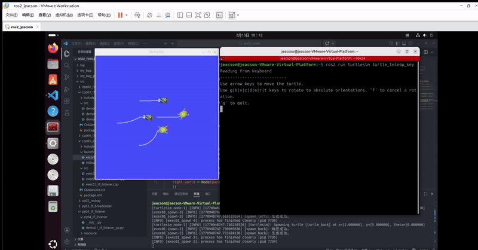
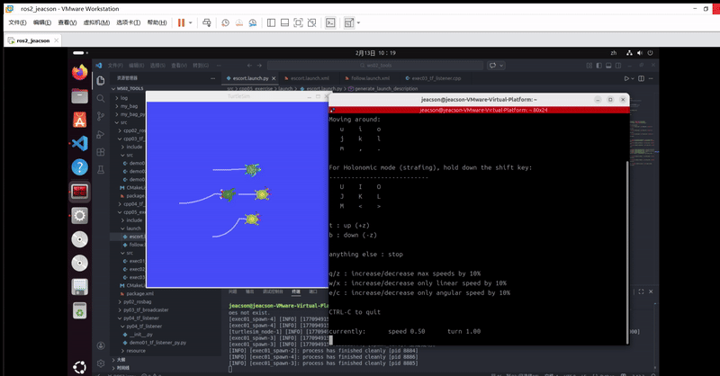

## Introduction

This chapter is about implementing the “turtle escort” case. Most of the code follows the relevant code from [the previous chapter, ROS2-Z01-ROS2 Tools: Coordinate Transforms (EXEC1) — Hands-on: the Turtle Following Case](../coor_trans/2026_02_09.md). So it's best to get the previous chapter's result working first before doing the hands-on work here.

## Case requirements & analysis

**Requirement:** build on what the previous chapter asked you to write. Taking the native turtle (`turtle1`) of the `turtlesim_node` node as the geometric centre, spawn several new turtles (three, for example, i.e. `turtle2`, `turtle3`, `turtle4`). Whether `turtle1` sits still or is driven around with the keyboard, `turtle2` must target `turtle1`'s geometric centre and escort it in some formation.

**Analysis:** in the previous chapter, the core of the “turtle following” case was working out the position of `turtle1` relative to `turtle2`. Once you have that position you can use it as the target point and drive `turtle2` towards it. In this chapter, the core becomes working out the positions of the various points laid out around the native turtle `turtle1` relative to the other `turtle`s. Those relative positions can likewise be found with coordinate transforms, where:

1. Each escort position is fixed relative to the native turtle `turtle1`'s frame, so you can broadcast the position of those **static coordinate points** relative to the native turtle with static broadcasting.
2. As for the turtles, you first broadcast each turtle's frame relationship relative to `world` separately, then listen to those frame relationships to get the frame relationship of the **static coordinate points** relative to each `turtle`.

Once the coordinate relationships are worked out, you can compute and publish the corresponding velocity commands to drive the escort of several turtles.

## Flow overview

The case already has the “spawn a new turtle” and “broadcast and listen to turtle frame transforms” parts done, so all that's left here is to write a launch file that organises the nodes. The main steps are:

1. Write a `launch` file that integrates the nodes;
2. Build;
3. Run.

We'll implement the case in `C++` and in `Python` as before, and both follow the steps above.

## Preparation

See [the previous chapter, ROS2-Z01-ROS2 Tools: Coordinate Transforms (EXEC1) — Hands-on: the Turtle Following Case](../coor_trans/2026_02_09.md). It's strongly recommended that you get that hands-on case working first.

## Case implementation

### 1. Writing a `launch` file that integrates the nodes

::: tabs

@tab:active C++

We can start with the escort for `one` turtle, requiring it to end up at a particular spot near the native turtle:

In the `launch` directory of the `cpp05_exercise` package, create a `python` file named `escort.launch.py` and fill it in with the following:

```python
from launch import LaunchDescription
from launch_ros.actions import Node

# Declaring and getting parameters-----------------
from launch.actions import DeclareLaunchArgument
from launch.substitutions import LaunchConfiguration


"""
    Requirement: implement the turtle escort case
    -----------------------------
         First get a single turtle escorting, ending up at a particular spot near the native turtle
    Idea:
         1. Publish the coordinate transform of the target point relative to the native turtle
         2. Listen to that turtle and the target point relative to the frame
    Implementation flow:
         1. Pull out the parameters;
         2. Create the turtlesim_node node and spawn the new turtle;
         3. Publish the coordinate transforms;
         4. Listen to the coordinate transforms.
"""

def generate_launch_description():
    

    # 1. Pull out the parameters;
    escort_back = DeclareLaunchArgument(name="turtle_back", default_value="turtle_back")
    # 2. Create the turtlesim_node node and spawn the new turtle E1;
    master = Node(package="turtlesim", executable="turtlesim_node")
    spawn_back = Node(package="cpp05_exercise", executable="exec01_spawn", name="spawn_back", parameters=[{
        "x": 2.0,
        "y": 5.0,
        "turtle_name": LaunchConfiguration("turtle_back")
    }])
    # 3. Publish the coordinate transforms;
    # 3.1 Broadcast the turtle frames
    turtle1_world = Node(package="cpp05_exercise", executable="exec02_tf_broadcaster", name="turtle1_world")
    back_world = Node(package="cpp05_exercise", executable="exec02_tf_broadcaster", name="back_world", parameters=[{
        "turtle": LaunchConfiguration("turtle_back")
    }])
    # 3.2 Broadcast the static coordinate points
    escort_point_back = Node(package="tf2_ros", executable="static_transform_publisher", name="escort_point_back", arguments=["--frame-id", "turtle1", "--child-frame-id", "escort_point_back", "--x", "-1.5"])

    # 4. Listen to the coordinate transforms.
    back_ep_back = Node(package="cpp05_exercise", executable="exec03_tf_listener", name="back_ep_back", parameters=[{
        "father_frame": LaunchConfiguration("turtle_back"),
        "child_frame": "escort_point_back"
    }])

    return LaunchDescription([
        escort_back, 
        master, 
        spawn_back, 
        turtle1_world, 
        back_world,
        escort_point_back,
        back_ep_back
        ])
```

Then you can get the other turtles escorting by modifying that code:

```python
from launch import LaunchDescription
from launch_ros.actions import Node

# Declaring and getting parameters-----------------
from launch.actions import DeclareLaunchArgument
from launch.substitutions import LaunchConfiguration


"""
    Requirement: implement the turtle escort case
    Idea:
         1. Publish the coordinate transform of the target point relative to the native turtle
         2. Listen to the new turtle and the target point relative to the frame
    Implementation flow:
         1. Pull out the parameters;
         2. Create the turtlesim_node node and spawn the new turtles;
         3. Publish the coordinate transforms;
         4. Listen to the coordinate transforms.
"""

def generate_launch_description():
    

    # 1. Pull out the parameters;
    escort_back = DeclareLaunchArgument(name="turtle_back", default_value="turtle_back")
    escort_left = DeclareLaunchArgument(name="turtle_left", default_value="turtle_left")
    escort_right = DeclareLaunchArgument(name="turtle_right", default_value="turtle_right")

    # 2. Create the turtlesim_node node and spawn the new turtles;
    master = Node(package="turtlesim", executable="turtlesim_node")

    spawn_back = Node(package="cpp05_exercise", executable="exec01_spawn", name="spawn_back", parameters=[{
        "x": 2.0,
        "y": 5.0,
        "turtle_name": LaunchConfiguration("turtle_back")
    }])
    spawn_left = Node(package="cpp05_exercise", executable="exec01_spawn", name="spawn_left", parameters=[{
        "x": 4.0,
        "y": 7.0,
        "turtle_name": LaunchConfiguration("turtle_left")
    }])
    spawn_right = Node(package="cpp05_exercise", executable="exec01_spawn", name="spawn_right", parameters=[{
        "x": 4.0,
        "y": 3.0,
        "turtle_name": LaunchConfiguration("turtle_right")
    }])

    # 3. Publish the coordinate transforms;
    # 3.1 Broadcast the turtle frames
    turtle1_world = Node(package="cpp05_exercise", executable="exec02_tf_broadcaster", name="turtle1_world")
    back_world = Node(package="cpp05_exercise", executable="exec02_tf_broadcaster", name="back_world", parameters=[{
        "turtle": LaunchConfiguration("turtle_back")
    }])
    left_world = Node(package="cpp05_exercise", executable="exec02_tf_broadcaster", name="left_world", parameters=[{
        "turtle": LaunchConfiguration("turtle_left")
    }])
    right_world = Node(package="cpp05_exercise", executable="exec02_tf_broadcaster", name="right_world", parameters=[{
        "turtle": LaunchConfiguration("turtle_right")
    }])

    # 3.2 Broadcast the static coordinate points
    escort_point_back = Node(package="tf2_ros", executable="static_transform_publisher", name="escort_point_back", arguments=["--frame-id", "turtle1", "--child-frame-id", "escort_point_back", "--x", "-1.5"])
    escort_point_left = Node(package="tf2_ros", executable="static_transform_publisher", name="escort_point_left", arguments=["--frame-id", "turtle1", "--child-frame-id", "escort_point_left", "--y", "1.5"])
    escort_point_right = Node(package="tf2_ros", executable="static_transform_publisher", name="escort_point_right", arguments=["--frame-id", "turtle1", "--child-frame-id", "escort_point_right", "--y", "-1.5"])

    # 4. Listen to the coordinate transforms.
    back_ep_back = Node(package="cpp05_exercise", executable="exec03_tf_listener", name="back_ep_back", parameters=[{
        "father_frame": LaunchConfiguration("turtle_back"),
        "child_frame": "escort_point_back"
    }])
    left_ep_left = Node(package="cpp05_exercise", executable="exec03_tf_listener", name="left_ep_left", parameters=[{
        "father_frame": LaunchConfiguration("turtle_left"),
        "child_frame": "escort_point_left"
    }])
    right_ep_right = Node(package="cpp05_exercise", executable="exec03_tf_listener", name="right_ep_right", parameters=[{
        "father_frame": LaunchConfiguration("turtle_right"),
        "child_frame": "escort_point_right"
    }])

    return LaunchDescription([
        escort_back, 
        escort_left, 
        escort_right, 
        master, 
        spawn_back, 
        spawn_left, 
        spawn_right, 
        turtle1_world, 
        back_world,
        left_world,
        right_world,
        escort_point_back,
        escort_point_left,
        escort_point_right,
        back_ep_back,
        left_ep_left,
        right_ep_right
        ])
```

@tab Python

In the `launch` directory of the `py05_exercise` package, create a `python` file named `escort.launch.xml` and fill it in with the following:

```xml
<launch>
    <arg name="turtle_back" default="turtle_back"/>
    <arg name="turtle_left" default="turtle_left"/>
    <arg name="turtle_right" default="turtle_right"/>

    <!-- 1. turtlesim_node -->
    <node pkg="turtlesim" exec="turtlesim_node"/>

    <!-- 2. The custom turtle spawn node -->
    <node pkg="py05_exercise" exec="exec01_spawn_py" name="spawn_back">
        <param name="x" value="2.0" />
        <param name="y" value="5.0" />
        <!-- <param name="theta" value="3.0" /> -->
        <param name="turtle_name" value="$(var turtle_back)" />
    </node>
    <node pkg="py05_exercise" exec="exec01_spawn_py" name="spawn_left">
        <param name="x" value="4.0" />
        <param name="y" value="7.0" />
        <!-- <param name="theta" value="3.0" /> -->
        <param name="turtle_name" value="$(var turtle_left)" />
    </node>
    <node pkg="py05_exercise" exec="exec01_spawn_py" name="spawn_right">
        <param name="x" value="4.0" />
        <param name="y" value="3.0" />
        <!-- <param name="theta" value="3.0" /> -->
        <param name="turtle_name" value="$(var turtle_right)" />
    </node>


    <!-- 3.1 Broadcast the turtles' coordinate transforms -->
    <node pkg="py05_exercise" exec="exec02_tf_broadcaster_py" name="turtle1_world"/>
    <node pkg="py05_exercise" exec="exec02_tf_broadcaster_py" name="back_world">
        <param name="turtle" value="$(var turtle_back)"/>
    </node>
    <node pkg="py05_exercise" exec="exec02_tf_broadcaster_py" name="left_world">
        <param name="turtle" value="$(var turtle_left)"/>
    </node>
    <node pkg="py05_exercise" exec="exec02_tf_broadcaster_py" name="right_world">
        <param name="turtle" value="$(var turtle_right)"/>
    </node>

    <!-- 3.2 Broadcast the coordinate transform of the coordinate points -->
    <node pkg="tf2_ros" exec="static_transform_publisher" name="escort_point_back" args="--frame-id turtle1 --child-frame-id escort_point_back --x -1.5"/>
    <node pkg="tf2_ros" exec="static_transform_publisher" name="escort_point_left" args="--frame-id turtle1 --child-frame-id escort_point_left --y 1.5"/>
    <node pkg="tf2_ros" exec="static_transform_publisher" name="escort_point_right" args="--frame-id turtle1 --child-frame-id escort_point_right --y -1.5"/>

    <!-- 4. Create the listener nodes -->
    <node pkg="py05_exercise" exec="exec03_tf_listener_py" name="back_ep_back">
        <param name="father_frame" value="$(var turtle_back)"/>
        <param name="child_frame" value="escort_point_back"/>
    </node>
    <node pkg="py05_exercise" exec="exec03_tf_listener_py" name="left_ep_left">
        <param name="father_frame" value="$(var turtle_left)"/>
        <param name="child_frame" value="escort_point_left"/>
    </node>
    <node pkg="py05_exercise" exec="exec03_tf_listener_py" name="right_ep_right">
        <param name="father_frame" value="$(var turtle_right)"/>
        <param name="child_frame" value="escort_point_right"/>
    </node>


</launch>
```

:::

### 2. Building

::: tabs

In a terminal, go into the current workspace and build the package:

@tab:active C++

```bash
colcon build --packages-select cpp05_exercise
```

@tab Python

```bash
colcon build --packages-select py05_exercise
```

:::

### 3. Running

In the current workspace, open a terminal and run the `launch` file with:

::: tabs

@tab:active C++

```bash
. install/setup.bash
ros2 launch cpp05_exercise escort.launch.py 
```

@tab Python

```bash
. install/setup.bash
ros2 launch py05_exercise escort.launch.xml
```

:::

Then open yet another new terminal and start the `turtlesim` keyboard teleop node:

```bash
ros2 run turtlesim turtle_teleop_key
```

In that terminal you can drive the `native turtle` with the keyboard, and `the other three turtles` follow the `native turtle`. The final result looks like this:



Of course, you may find that the native turtle moves too fast and the other three can't keep up.

In that case you can use a different control node:

```bash
ros2 run teleop_twist_keyboard teleop_twist_keyboard --ros-args --remap /cmd_vel:=/turtle1/cmd_vel
```

The result looks like this:



::: important
This article was translated by Hermes Agent; the original text can be found at [here](../../../learningNote/Ros2_Note/coor_trans/2026_02_13.md). The translation is for reference only.
Translation time: 2026-11-05
:::
