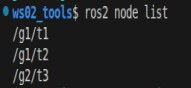
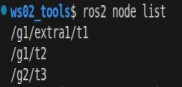

## Overview

For an introduction to launch files, see [the previous post](./2025_04_28.md#overview)

## Python syntax

Here is the syntax for **launch files** in Python:

### 1. Node setup: Node

In a **launch file written in Python**, the nodes to be executed all have to be wrapped as `launch_ros.actions.Node` objects and returned inside a wrapper object created by the `LaunchDescription()` function. Below I go through the arguments of that wrapped `Node` object.

Suppose the **file name** of the launch file is "py02_node_launch.py" and its **package** is "package_for_launch_01"; the launch file can be written as follows:

```python
# py02_node_launch.py
from launch import LaunchDescription
from launch_ros.actions import Node

# Get the share directory path of the package------
from ament_index_python.packages import get_package_share_directory
import os

def generate_launch_description():
    # Example node config
    turtle1 = Node(

        # Executable
        executable="turtlesim_node",

        # Package name
        package="turtlesim",

        # Whether the node restarts automatically (set to True here)
        respawn=True,

        # Override the node name
        name="t1",

        # Set the namespace
        namespace="/robot1",

        # Process display name (visible in ps/top)
        exec_name="turtle_sim",
        
        # Parameter config
        parameters=[
            {"background_r": 255, "background_g": 0, "background_b": 0},  # Pass parameters as a dict
            os.path.join(get_package_share_directory("package_for_launch_01"), "config", "custom_params.yaml" ) # Pass parameters via a YAML file (common, recommended)
        ],
         
        # Remapping config
        remappings=[
            ("/turtle1/cmd_vel", "/robot1/cmd_vel"),  # Topic remap
            ("/turtle1/pose", "/robot1/pose")
        ],
        
        # ROS-specific arguments
        ros_arguments=[
            "--log-level", "debug",  # Set the log level
            "--ros-args", "-p", "use_sim_time:=true"  # Override a parameter (--ros-args must be added explicitly)
        ],
        
        # Ordinary command-line arguments
        arguments=[
            "--custom-flag",  # Custom flag
            "--config", "/path/to/non_ros_config.json"
        ]
    )
    
    return LaunchDescription([turtle1])

```

Where:

- executable: the executable
- package: the name of the package the executable belongs to
- respawn: whether the node restarts automatically (for special nodes — say one that needs to come back up after an exception shuts it down — you can use this)
- name: sets the node name, which can be used to get around duplicate names
- namespace: sets the namespace, which can also be used to get around duplicate names
- exec_name: sets the label shown on the left of the command line while the program is running
- remappings: used to remap topics
- parameters
- ros_arguments
- arguments

::: info The difference between "parameters"/"ros_arguments"/"arguments"
In the initializer above that creates the `Node` object, three of the arguments have "parameter" in their meaning. They mean, respectively:

- **parameters**: the parameters the node **itself** needs to read when it runs — think of them as the "arguments" you pass to an **ordinary function call**
- **ros_arguments**: the ROS-specific arguments that **ROS2's underlying system** needs to read when the node runs (renaming the node, namespaces, loading parameter files, and so on).
- **arguments**: the ordinary application-level command-line arguments the **executable** needs to read when the node runs, *unrelated to ROS itself* (a custom config file path, debug flags, and so on)

Concretely, the three actually differ like this:

- parameters:
  - parameters that **the node itself** needs to read; usually used to pass parameters to the node
  - it supports defining a dict directly (e.g. `{"key": value}`) or pointing at a YAML/JSON file path (more common);
  - underneath, it auto-generates a `--params-file` argument and triggers the ROS middleware to parse it;
  - the parameters can be changed on the fly with the `ros2 param` command or a ROS service, and type inference is supported (integers, floats, strings and so on are recognized automatically).
- ros_arguments:
  - the ROS-specific arguments that **ROS2's underlying system** needs to read; usually also used to override the parameters originally given to a node, for debugging
  - if you do the equivalent on the command line, the values passed here get wrapped behind the `--ros-args` flag so the ROS middleware parses them forcibly;
  - ROS argument syntax is supported (e.g. `--log-level`, `__ns`, `--remap`).
- arguments:
  - the ordinary application-level command-line arguments the **executable** needs to read, unrelated to ROS itself
  - they are appended straight onto the end of the node's command line;
  - they do not trigger any special handling by the ROS argument parser (`rclcpp::init`).

Laid out as a table, the differences are:

| Feature                | parameters          | ros_arguments       | arguments           |
|---------------------|---------------------|---------------------|---------------------|
| **Scope**          | Parameters the node uses itself at runtime  | ROS middleware config inside ROS2's underlying system     | Process-level command-line arguments for the executable in the outside environment    |
| **Typical use**    | Algorithm and control parameters the node uses itself at runtime      | Remapping topics, namespaces, log level     | Specifying a config file, debug mode    |
| **Can it be changed at runtime**    | ✅ (via the ROS interface)  | ❌ (fixed at launch)     | ❌ (fixed at launch)     |
| **Typical syntax**        | `{"key": value}` or `params.yaml`    | `["--remap", "old:=new"]`  | `["--config", "my_config.txt"]`           |
| **Underlying flag**        | `--params-file`     | `--ros-args`        | no special flag          |
| **Precedence rule**      | lower than `ros_arguments`| higher, but lower than ROS command-line arguments                | separate scope          |
| **Priority when actually passing parameters to a node**      | use this first when feeding parameter data into a node | use it only when you need to override parameters         | not needed         |

So in practice the usual advice is:

1. **Prefer `parameters`** for managing a node's runtime configuration (type-safe, adjustable on the fly);
2. use `ros_arguments` only when you **need to override parameters**;
3. **avoid passing ROS-related arguments in `arguments`** (it easily breaks parsing).

:::

As described above, when passing parameters with `parameters`, if there are too many of them the `{"key": value}` approach becomes very awkward.

So when passing parameters through `parameters`, we in fact more often pass them in a `yaml` file.

For consistent formatting and so the code still compiles as-is, we usually create a **properly formatted** `yaml` file in the following steps: (assuming bash is at the workspace root)

1. Start the node described above first

    ```bash
    . install/setup.bash
    ros2 launch py01_launch py02_node_launch.py
    ```

2. In the same directory, open another terminal and enter:

    ```bash
        ros2 param dump /robot1/t1 > src/package_for_launch_01/config/custom_params.yaml
    ```

    A `custom_params.yaml` file now appears under `src/package_for_launch_01/config` in the workspace root, but this YAML file still can't be used directly.

3. Just as when we added the `launch` files, we need to add the following line at the `👈` spot in `CMakeLists.txt`:

    ```txt
    ......
    find_package(rclcpp REQUIRED)

    install(DIRECTORY launch config DESTINATION share/${PROJECT_NAME}) 👈

    if(BUILD_TESTING)
    ......
    ```

4. Build:

    ```bash
    colcon build --pakages-select package_for_launch_01
    ```

5. Finally, import the `get_package_share_directory` function to get at runtime the path of the `share` folder **under this package's name** inside the `install` directory, then join it with the `config` and `custom_params.yaml` path information:

    ```python
        # Get the share directory path of the package------
        from ament_index_python.packages import get_package_share_directory
        import os
        ...

        # Get the path dynamically when configuring parameters
        parameters=[
            os.path.join(get_package_share_directory("package_for_launch_01"), "config", "custom_params.yaml" ) # Pass parameters via a YAML file (common, recommended)
        ],
    ```

### 2. Command setup: ExecuteProcess

In a **launch file written in Python**, to wrap external processes such as ROS2 commands — so that part of the work can be fired off with a simple call — you need objects wrapped as `launch.actions.ExecuteProcess`, returned inside a wrapper object created by the `LaunchDescription()` function.

Below I go through the arguments of that wrapped `ExecuteProcess` object.

Suppose the **file name** of the launch file is "py03_cmd_launch.py" and its **package** is "package_for_launch_01"; the launch file can be written as follows:

```python
from launch import LaunchDescription
from launch_ros.actions import Node

# Classes for wrapping terminal commands------
from launch.actions import ExecuteProcess
from launch.substitutions import FindExecutable

"""
Requirement: start the turtlesim_node node and run a command to get the turtle's pose information
"""

def generate_launch_description():

    turtle = Node(
        package="turtlesim",
        executable="turtlesim_node",

    )

    # Wrap the command
    cmd = ExecuteProcess(
        # Way 1: pass the command as one string
        # cmd=["ros2 topic echo /turtle1/pose"],
        # Way 2: pass the command in parts (works)
        # cmd=["ros2 topic", "echo", "/turtle1/pose"],
        # Way 3: wrap the command with a function (recommended)
        cmd=[FindExecutable(name="ros2"),"topic", "echo", "/turtle1/pose"],

        output = "both", # Log to both the disk file and the terminal
        shell = True # Run the command as a terminal command
    )

    return LaunchDescription([turtle,cmd])
```

::: important Wrapping the command with the FindExecutable function is not overkill

The three ways of filling in ExecuteProcess's cmd argument each have their own pros and cons:

- **Passing the command as one string** sends the whole command off as a single string; it is simple and obvious, but you can't change parameters at runtime;
- **Passing the command in parts** separates the arguments, so it is easier to modify than *the single string*, but it assumes the executable's location is in the `system PATH environment variable`;
- **Wrapping it with a function** only wraps the leading `ros2` bit, but `FindExecutable()` lets ros2 look up the executable's location at runtime — even if that location differs between dev, production and container environments, or several ROS2 versions are installed in the same environment, the command still runs, adapting itself to most environments and complicated deployment setups.

:::

### 3. Argument setup: DeclareLaunchArgument&LaunchConfiguration

Argument setup is mainly about two things: *declaring* an argument and *calling* it. Declaring is wrapped as `launch.actions.DeclareLaunchArgument`; calling it is wrapped as `launch.substitutions import LaunchConfiguration`.

Suppose the **file name** of the launch file is "py04_args_launch.py" and its **package** is "package_for_launch_01"; the launch file can be written as follows:

```python
from launch import LaunchDescription
from launch_ros.actions import Node

# Declaring and getting arguments------
from launch.actions import DeclareLaunchArgument
from launch.substitutions import LaunchConfiguration

"""
Requirement: change turtlesim_node's background color dynamically when the launch file starts
Implementation:
    1. Declare the arguments (variables);
    2. Call the arguments (variables);
    3. Pass the arguments in dynamically when the launch file runs
"""

def generate_launch_description():
    # 1. Declare the arguments (variables);
    decl_bg_r = DeclareLaunchArgument(name="bg_r",default_value="255")
    decl_bg_g = DeclareLaunchArgument(name="bg_g",default_value="25")

    # 2. Call the arguments (variables);
    turtle = Node(
        package="turtlesim",
        executable="turtlesim_node",
        parameters=[{
            "background_r": LaunchConfiguration(variable_name="bg_r"),
            "background_g": LaunchConfiguration(variable_name="bg_g")
        }]
    )
    return LaunchDescription([decl_bg_r,
                              decl_bg_g,
                              turtle])
```

In the code above, to declare the arguments we used the `DeclareLaunchArgument()` function to create several objects. In them:

- name: the argument name;
- default_value: the default value.

Afterwards, when creating the `Node` object, we pass the `argument name` above into `parameters` through the `LaunchConfiguration()` function. That way, when the `launch` file runs, we can pass arguments in dynamically from `bash`:

```bash
ros2 launch cpp01_launch py04_args_launch.py bg_r:=100 bg_g:=86
```

Of course, if you don't pass anything in, the file falls back on the `default_value` that was given when the argument was declared.

::: info The argument name used for dynamic passing is a separate thing
When passing arguments in dynamically from `bash`, note that the name you pass must be **the same** as the name used inside *the `name` argument* when the argument was declared, and **not** the same as the argument name **itself**.
:::

### 4. File inclusion: IncludeLaunchDescription&PythonLaunchDescriptionSource

File inclusion mainly means the operation of including one `launch` file inside another `launch` file. The APIs needed are `launch.actions.IncludeLaunchDescription` & `PythonLaunchDescriptionSource`.

Suppose the **file name** of the launch file is "py05_include_launch.py" and its **package** is "package_for_launch_01", and it wants to call the `launch` file used in the [argument setup](#_3-argument-setup-declarelaunchargument-launchconfiguration) above; it can be written as follows:

```python
from launch import LaunchDescription
from launch_ros.actions import Node
import os
# File inclusion------
from launch.actions import IncludeLaunchDescription
from launch.launch_description_sources import PythonLaunchDescriptionSource
# Get the share directory path of the package------
from ament_index_python.packages import get_package_share_directory
"""
    Requirement: include other launch files in the current launch file

"""
def generate_launch_description():
    include = IncludeLaunchDescription(
        launch_description_source=PythonLaunchDescriptionSource(
            launch_file_path=os.path.join(
                get_package_share_directory("cpp01_launch"),
                "launch",
                "py",
                "py04_args_launch.py"
            )
        )
    )
    return LaunchDescription([include])
```

That way the earlier `launch` file gets called at runtime.

Of course, called this way the `launch` file uses the `default_value`s that were used inside the original file. If you need to change the arguments, the code above can be changed to:

```python
...
"""
    Requirement: include other launch files in the current launch file and pass specific arguments in

"""
def generate_launch_description():
    include = IncludeLaunchDescription(
        launch_description_source=PythonLaunchDescriptionSource(
            launch_file_path=os.path.join(
                get_package_share_directory("cpp01_launch"),
                "launch",
                "py",
                "py04_args_launch.py"
            )
        ),launch_arguments=[("bg_r", "80"),("bg_g", "100")] #👈NEW!
    )
    return LaunchDescription([include])
```

::: important Watch out when setting argument names
When defining arguments through `launch_arguments` inside the `IncludeLaunchDescription()` function, you must use the corresponding `name` that was set in the original `launch` file's `DeclareLaunchArgument()` function, otherwise it won't be recognized
:::

### 5. Node grouping: GroupAction&PushRosNamespace

To make nodes easier to manage in a launch file, we can group them. The APIs needed are `launch.actions.GroupAction` & `launch_ros.actions.PushRosNamespace`. In them:

- GroupAction: the core API for grouping
- PushRosNamespace: sets the namespace for the current group

Suppose the **file name** of the launch file is "py06_group_launch.py" and its **package** is "package_for_launch_01"; the launch file can be written as follows:

```python
from launch import LaunchDescription
from launch_ros.actions import Node
# Grouping------
from launch_ros.actions import PushRosNamespace
from launch.actions import GroupAction

"""
    Requirement: create 3 turtlesim_node nodes, put the first two in the same group and the third in a group of its own
"""
def generate_launch_description():
    # Create 3 turtlesim_node nodes
    t1 = Node(
        package="turtlesim",
        executable="turtlesim_node",
        name="t1"
    )
    t2 = Node(
        package="turtlesim",
        executable="turtlesim_node",
        name="t2"
    )
    t3 = Node(
        package="turtlesim",
        executable="turtlesim_node",
        name="t3"
    )
    # Grouping
    # Set the current group's namespace and the nodes it contains
    g1 = GroupAction(actions=[PushRosNamespace("g1"), t1, t2])
    g2 = GroupAction(actions=[PushRosNamespace("g2"), t3])
    return LaunchDescription([g1, g2])
```

Then when that `launch` file runs, you just open another terminal and type `ros2 node list` in `bash` to see how these `node`s are grouped:



::: info What if you used `namespace` when creating the `Node` object...
Suppose that, on the basis of the original code, `t1` is changed to:

```python
...
t1 = Node(
        package="turtlesim",
        executable="turtlesim_node",
        name="t1",
        namespace="extra1" # 👈NEW!
    )
...

```

Then when that `launch` file runs, the `Node` grouping becomes:



Essentially it just stacks one more namespace on the given `Node`, like this = =
:::

### 6. Event triggers: RegisterEventHandler&OnProcessStart&OnProcessExit

When you run nodes with a `luanch` file, the nodes fire different events while they run. We can use some `API`s to register some handling logic for them.

The APIs involved are:

- launch.actions.RegisterEventHandler registers an event
- launch.event_handlers.OnProcessStart fires when the node is created
- launch.event_handlers.OnProcessExit fires when the node is about to be destroyed

In the code below we combine it with the [command setup](#_2-command-setup-executeprocess) described above and wrap it into the API.

```python
from launch import LaunchDescription
from launch_ros.actions import Node
# Classes for wrapping terminal commands------
from launch.actions import ExecuteProcess
# Events------
from launch.event_handlers import OnProcessStart, OnProcessExit
from launch.actions import RegisterEventHandler, LogInfo
"""
    Requirement: bind events to turtlesim_node
        One: when the node starts, run the "spawn a new turtle" program
        Two: when the node shuts down, do a log output
"""
def generate_launch_description():
    turtle = Node(
        package="turtlesim",
        executable="turtlesim_node"
    )
    # Suppose the code you want to wrap is:
    # ros2 service call /spawn turtlesim/srv/Spawn "{'x':8.0, 'y':3.0}"
    # then it can be written as:
    spawn = ExecuteProcess(
        cmd=["ros2 service call /spawn turtlesim/srv/Spawn \"{'x':8.0, 'y':3.0}\""],
        output="both",
        shell=True
    )
    # Register event 1
    event_start = RegisterEventHandler(
        event_handler=OnProcessStart(
            target_action=turtle,
            on_start=spawn
        )
    )
    # Register event 2
    event_exit = RegisterEventHandler(
        event_handler=OnProcessExit(
            target_action=turtle,
            on_exit=[LogInfo(msg="turtlesim_node has exited")]
        )
    )

    return LaunchDescription([turtle, event_start, event_exit])
```

The code above registers a start event (event 1) and an exit event (event 2) for the `turtle` node: once `turtle` starts, `spawn` runs; when `turtle` exits, it outputs the log text: `"turtlesim_node has exited"`. In them:

The `RegisterEventHandler` object registers events; its arguments are:

- `event_handler`: the event object being registered.

`OnProcessStart` is the start-event object; its arguments are:

- `target_action`: the target object the event is registered on;
- `on_start`: the logic to run when the event fires.

`OnProcessExit` is the exit-event object; its arguments are:

- `target_action`: the target object the event is registered on
- `on_exit`: the logic to run when the event fires

`LogInfo` is the log-output object; its argument is:

- `msg`: the log message to output.

## Summary

In this post I went into reasonable detail on the topic of "how to write `launch` files with `pyhton`". Unless you want to write **only** in `C++`, since `XML` & `YAML` have **no event-trigger functions** of their own to adapt, I don't recommend `XML`/`YAML` as the first language for writing launch files. If you do need them, see [the next post](2026_01_22.md) and the [official docs](https://docs.ros.org/en/jazzy/Tutorials/Intermediate/Launch/Creating-Launch-Files.html).

::: important
This article was translated by `Hermes Agent`; the original text can be found at [here](../../../learningNote/Ros2_Note/launch_rosbag2/2025_04_29.md). The translation is for reference only.
Translation time: 2026-11-05
:::
