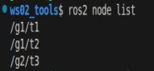
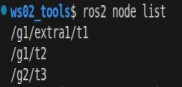

## Overview

For an introduction to launch files, see [this post](./2025_04_28.md#overview)

Unless you want to write **only** in `C++`, since `XML` & `YAML` have **no event-trigger functions** of their own to adapt, I personally don't recommend `XML`/`YAML` as the first language for writing launch files (even though they really are simpler to write = =). If you do need them, write the code alongside the [official docs](https://docs.ros.org/en/jazzy/Tutorials/Intermediate/Launch/Creating-Launch-Files.html).

Since the code formats are similar, below I describe `XML` and `YAML` files together.

## XML&YAML syntax

Here is the syntax for **launch files** in `XML` & `YAML`:

### 1. Node setup: node

In a **launch file written in `XML` / `YAML`**, the nodes to be executed all go into `node` tags.

::: tabs#XY

@tab:active XML

In XML, suppose the **file name** of the launch file is "xml02_node_launch.xml" and its **package** is "package_for_launch_01"; the launch file can be written as follows:

```XML
<launch>
    <node pkg="turtlesim" exec="turtlesim_node" name="t1" namespace="robot1" exec_name="t1_label" respawn="true"/>
    <node pkg="turtlesim" exec="turtlesim_node" name="t2">
        <!-- <param name="background_r" value="255" />
            <param name="background_g" value="255" />
            <param name="background_b" value="255" /> -->
        <param from="$(find-pkg-share package_for_launch_01)/config/t2.yaml" />
    </node>
    <node pkg="turtlesim" exec="turtlesim_node" name="t3">
        <remap from="/turtle1/cmd_vel" to="/cmd_vel" />
    </node>
    <node pkg="turtlesim" exec="turtlesim_node" ros_args="--remap __name:=t4 --remap __ns:=/group_2" />
    <node pkg="rviz2" exec="rviz2" args="-d $(find-pkg-share package_for_launch_01)/config/my.rviz" />  

</launch>

```

@tab YAML

In YAML, suppose the **file name** of the launch file is "yaml02_node_launch.yaml" and its **package** is "package_for_launch_01"; the launch file can be written as follows:

```yaml
launch:
- node:
    pkg: "turtlesim"
    exec: "turtlesim_node"
    name: "t1"
    namespace: "robot1"
    exec_name: "t1_label"
    respawn: "false"
- node:
    pkg: "turtlesim"
    exec: "turtlesim_node"
    name: "t2"
    param:
    # - 
    #   name: "background_r"
    #   value: 255
    # - 
    #   name: "background_b"
    #   value: 255
    - from: "$(find-pkg-share package_for_launch_01)/config/t2.yaml"
- node:
    pkg: "turtlesim"
    exec: "turtlesim_node"
    remap:
    -
      from: "/turtle1/cmd_vel"
      to: "/cmd_vel"

- node:
    pkg: "turtlesim"
    exec: "turtlesim_node"
    ros_args: "--ros-args --remap __name:=t4 --remap __ns:=/t4"
- node:
    pkg: "rviz2"
    exec: "rviz2"
    args: "-d $(find-pkg-share package_for_launch_01)/config/my.rviz"
```

:::

Where:

- exec: the executable
- pkg: the name of the package the executable belongs to
- respawn: whether the node restarts automatically (for special nodes — say one that needs to come back up after an exception shuts it down — you can use this)
- name: sets the node name, which can be used to get around duplicate names
- namespace: sets the namespace, which can also be used to get around duplicate names
- exec_name: sets the label shown on the left of the command line while the program is running
- args: the argument list used when calling the command
- ros_args: equivalent to args with the --ros-args prefix
  
The child tags of the node tag include:

- remap: used to remap topics; its attributes are:
  - from: the original topic name
  - to: the new topic name
- param: the tag for setting parameters; its attributes are:
  - name: the parameter name
  - value: the parameter value
  - from: the parameter file path

As described in [the Python implementation above](2025_04_29.md#_1-node-setup-node), when passing parameters with `param`, if there are too many of them the `<param name="xxx" value="yyy" />` approach becomes very awkward.

So when passing parameters through `param`, we in fact more often pass them in a `yaml` file.

For consistent formatting and so the code still compiles as-is, we usually create a **properly formatted** `yaml` file in the following steps: (assuming bash is at the workspace root)

1. Start the node described above first

    ```bash
    . install/setup.bash
    ros2 launch py01_launch py02_node_launch.py
    ```

2. In the same directory, open another terminal and enter:

    ```bash
        ros2 param dump /robot1/t1 > src/package_for_launch_01/config/custom_params.yaml
    ```

    A `custom_params.yaml` file now appears under `src/package_for_launch_01/config` in the workspace root, but this YAML file still can't be used directly.

3. Just as when we added the `launch` files, we need to add the following line at the `👈` spot in `CMakeLists.txt`:

    ```txt
    ......
    find_package(rclcpp REQUIRED)

    install(DIRECTORY launch config DESTINATION share/${PROJECT_NAME}) 👈

    if(BUILD_TESTING)
    ......
    ```

4. Build:

    ```bash
    colcon build --pakages-select package_for_launch_01
    ```

5. Finally, import the `get_package_share_directory` function to get at runtime the path of the `share` folder **under this package's name** inside the `install` directory, then join it with the `config` and `custom_params.yaml` path information:

::: tabs#XY

@tab:active XML

How to join them in XML:
  
```XML
...
<!-- Get the path dynamically when configuring parameters -->
<param from="$(find-pkg-share package_for_launch_01)/config/t2.yaml" />
```

@tab YAML

How to join them in YAML:
  
```yaml
    ...
    # Get the path dynamically when configuring parameters
    param:
    - from: "$(find-pkg-share package_for_launch_01)/config/t2.yaml"

```

:::

### 2. Command setup: executable

In a **launch file written in `XML` / `YAML`**, to wrap external processes such as ROS2 commands — so that part of the work can be fired off with a simple call — you need the `executable` tag. This is a bit simpler than in `python`.

::: tabs#XY

@tab:active XML

In XML, suppose the **file name** of the launch file is "xml03_cmd_launch.xml" and its **package** is "package_for_launch_01"; the launch file can be written as follows:

```xml
<launch>
    <node pkg="turtlesim" exec="turtlesim_node" />
    <executable cmd="ros2 run turtlesim turtlesim_node" output="both" />
</launch>
```

@tab YAML

In YAML, suppose the **file name** of the launch file is "yaml03_cmd_launch.yaml" and its **package** is "package_for_launch_01"; the launch file can be written as follows:

```yaml
launch:
- executable:
    cmd: "ros2 run turtlesim turtlesim_node"
    output: "both"
```

:::

The `executable` tag represents an executable command; its attributes are:

- cmd: the command to execute;
- output: where the logs are output to.

### 3. Argument setup: arg&param

Argument setup is mainly about two things: *declaring* an argument and *calling* it. Declaring is handled by the `arg` tag; calling it uses the `$()` substitution syntax directly.

::: tabs#XY

@tab:active XML

In XML, suppose the **file name** of the launch file is "xml04_args_launch.xml" and its **package** is "package_for_launch_01"; the launch file can be written as follows:

```xml
<launch>
    <!-- Declare the arguments -->
    <arg name="bg_r" default="255"/>
    <arg name="bg_g" default="255"/>
    <arg name="bg_b" default="255"/>
    <!-- Call the arguments -->
    <node pkg="turtlesim" exec="turtlesim_node">
        <param name="background_r" value="$(var bg_r)" />
        <param name="background_g" value="$(var bg_g)" />
        <param name="background_b" value="$(var bg_b)" />
    </node>

</launch>
```

@tab YAML

In YAML, suppose the **file name** of the launch file is "yaml04_args_launch.yaml" and its **package** is "package_for_launch_01"; the launch file can be written as follows:

```yaml
launch:
# Declare the arguments
- arg:
    name: "bg_r"
    default: "255"
- node:
    pkg: "turtlesim"
    exec: "turtlesim_node"
    param:
    # Call the arguments
    -
      name: "background_r"
      value: $(var bg_r)
```

:::

In the code above, to declare the arguments we used the `arg` tag to set several of them. In them:

- name: the argument name;
- default: the default value.

Afterwards, when creating the `Node` object, we use the `$()` substitution syntax inside the `param` tag to pass the `argument` above into `param.value`. That way, when the `launch` file runs, we can pass arguments in dynamically from `bash`:

::: tabs#XY

@tab:active XML

```bash
ros2 launch package_for_launch_01 xml04_args_launch.xml bg_r:=100
```

@tab YAML

```bash
ros2 launch package_for_launch_01 yaml04_args_launch.yaml bg_r:=50
```

:::

Of course, if you don't pass anything in, the file falls back on the `default` that was given when the argument was declared.

::: info The argument name used for dynamic passing is a separate thing
When passing arguments in dynamically from `bash`, note that the name you pass must be the same as the name used inside **the `name` argument** when the argument was declared, and **not** the same as the argument name **itself**.
:::

### 4. File inclusion: include&let

File inclusion mainly means the operation of including one `launch` file inside another `launch` file. The tag needed is `include`.

::: tabs#XY

@tab:active XML

In XML, suppose the **file name** of the launch file is "xml05_include_launch.xml" and its **package** is "package_for_launch_01", and it wants to call the `launch` file used in the [argument setup](#_3-argument-setup-arg-param) above; the launch file can be written as follows:

```xml
<launch>
    <!-- Requirement: include other launch files in the current launch file -->
    <include file="$(find-pkg-share package_for_launch_01)/launch/xml/xml04_args_launch.xml"/>
</launch>
```

That way the earlier `launch` file gets called at runtime. Here the `include` tag does the file inclusion; its attributes are:

- file: the path of the `launch` file being included.

Of course, called this way the `launch` file uses the `default`s that were used inside the original file; to change the arguments you need to add a `let` tag. The code above can be changed to:

```xml
<launch>
    <!-- Requirement: include other launch files in the current launch file and pass specific arguments in -->
    <let name="bg_r" value="0" />
    <include file="$(find-pkg-share package_for_launch_01)/launch/xml/xml04_args_launch.xml"/>

</launch>
```

The `let` tag is used to import arguments into the included `launch` file; its attributes are:

- name: the argument name
- value: the argument value

@tab YAML

In YAML, suppose the **file name** of the launch file is "yaml05_include_launch.yaml" and its **package** is "package_for_launch_01", and it wants to call the `launch` file used in the [argument setup](#_3-argument-setup-arg-param) above; the launch file can be written as follows:

```yaml
launch:
# Requirement: include other launch files in the current launch file
- include:
    file: "$(find-pkg-share package_for_launch_01)/launch/yaml/yaml04_arg.launch.yaml"
```

Here the `include` key serves the same file-inclusion purpose; its attributes are:

- file: the path of the `launch` file being included.

That way the earlier `launch` file gets called at runtime. If you need to change the arguments you need to add a `let` key. The code above can be changed to:

```yaml
launch:
# Requirement: include other launch files in the current launch file and pass specific arguments in
- let:
    name: "bgr"
    value: "255"
- include:
    file: "$(find-pkg-share package_for_launch_01)/launch/yaml/yaml04_arg.launch.yaml"
```

The `let` key is used to import arguments into the included `launch` file; its attributes are:

- name: the argument name
- value: the argument value
:::

::: important Watch out when setting argument names
If the `launch` file being referenced is written in `XML` / `YAML`, you must use the corresponding `name` set under the `arg` tag in the original `launch` file, otherwise it won't be recognized.
:::

### 5. Node grouping: group&push_ros_namespace

To make nodes easier to manage in a launch file, we can group them. The tags needed are `group` & `push_ros_namespace`. In them:

- group: the tag for grouping
- push_ros_namespace: sets the namespace for the current group

::: tabs#XY

@tab:active XML

In XML, suppose the **file name** of the launch file is "xml06_group_launch.xml" and its **package** is "package_for_launch_01"; the launch file can be written as follows:

```xml
<launch>
    <!-- Requirement: create 3 turtlesim_node nodes, put the first two in the same group and the third in a group of its own -->
    <!-- Just create the 3 turtlesim_node nodes under group tags and split them into groups -->
    <group>
        <!-- Use the push_ros_namespace tag here to set the namespace -->
        <push_ros_namespace namespace="g1" />
        <node pkg="turtlesim" exec="turtlesim_node" name="t1"/>
        <node pkg="turtlesim" exec="turtlesim_node" name="t2"/>
    </group>
    <group>
        <push_ros_namespace namespace="g2" />
        <node pkg="turtlesim" exec="turtlesim_node" name="t3"/>
    </group>

</launch>
```

@tab YAML

In YAML, suppose the **file name** of the launch file is "yaml06_group_launch.yaml" and its **package** is "package_for_launch_01"; the launch file can be written as follows:

```yaml
launch:
- group:
   - push_ros_namespace:
       namespace: "g1"
   - node:
       pkg: "turtlesim"
       exec: "turtlesim_node"
       name: "t1"
   - node:
       pkg: "turtlesim"
       exec: "turtlesim_node"
       name: "t2"
- group:
   - push_ros_namespace:
       namespace: "g2"
   - node:
       pkg: "turtlesim"
       exec: "turtlesim_node"
       name: "t3"
```

:::

Then when that `launch` file runs, you just open another terminal and type `ros2 node list` in `bash` to see how these `node`s are grouped:



::: info What if you used `namespace` when creating the `Node` tag...
Suppose that, on the basis of the original code, `t1` is changed to:

- XML:

    ```xml
    ...
    <node pkg="turtlesim" exec="turtlesim_node" name="t1" namespace="extra1"/>
    <!--                                                     👆NEW! -->
    ...

    ```

- YAML:

    ```yaml
    ...
    - node:
        pkg: "turtlesim"
        exec: "turtlesim_node"
        name: "t1"
        namespace: "extra1"  # 👈NEW!
    ...

    ```

Then when that `launch` file runs, the `Node` grouping becomes:



Essentially it just stacks one more namespace on the given `Node`, like this = =
:::

### 6. Event triggers: none

Yep — XML and YAML have no event-trigger functions. Someone probably thought writing them was too much hassle and just cut them out, I guess...

::: important
This article was translated by Hermes Agent; the original text can be found at ../../../learningNote/Ros2_Note/launch_rosbag2/2026_01_22.md. The translation is for reference only.
Translation time: 2026-11-05
:::
