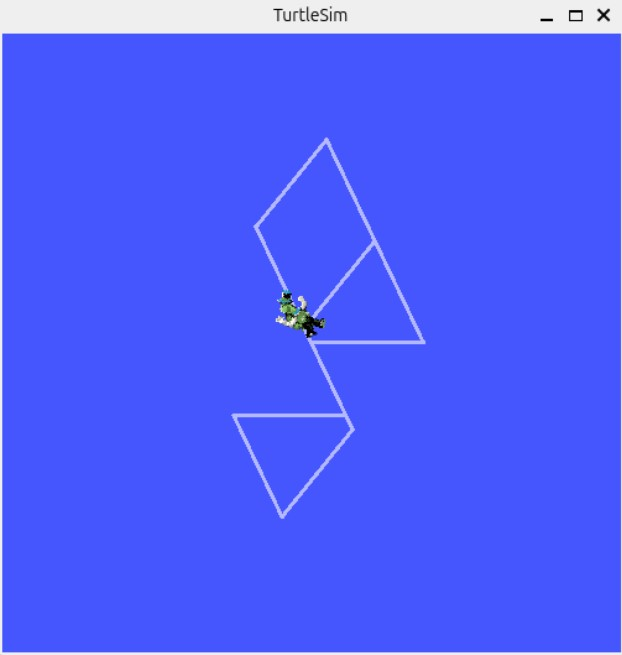
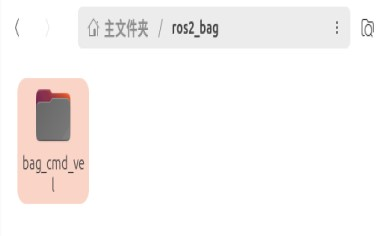
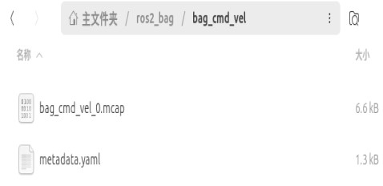
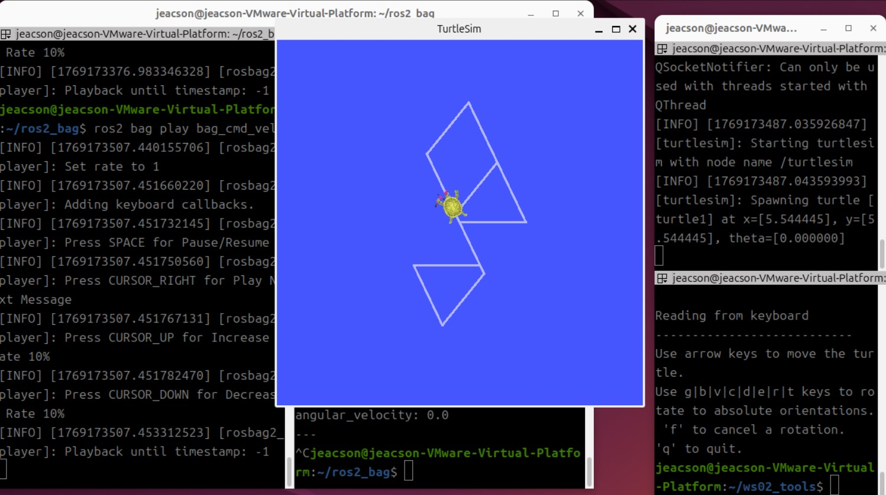
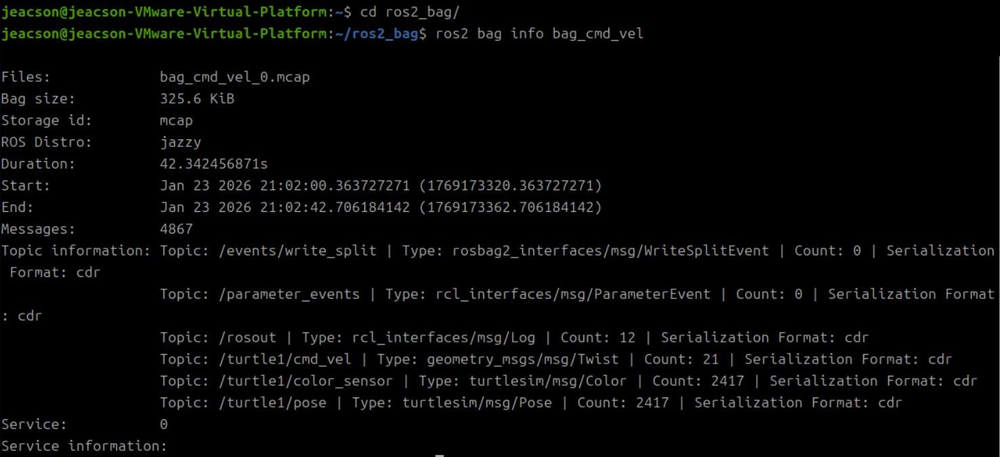
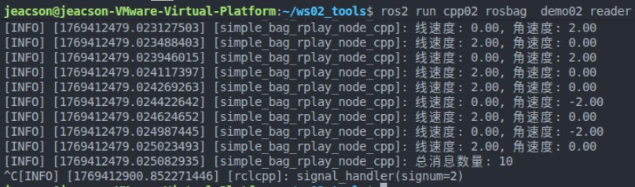
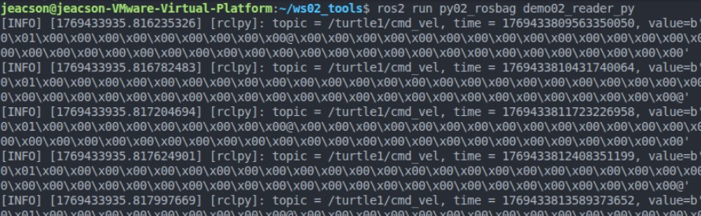

## Overview

Suppose you have a robot:

> - It runs fine day to day, but one time it suddenly throws an error. You want to dig into it right away, but the error only happened once — run it again and there is nothing.
> - You redesigned a motion control node for it, but you can't get some of its specific parameters dialled in. Running it straight in the real environment might turn up something unexpected.
> - In one navigation experiment you happened to get a navigation path, and you wish there were some tool to save it, so you could reproduce the result later.

For keeping data around and reading it back, `ROS2` provides a dedicated tool — `rosbag2`

## Concept and purpose

`rosbag2` is the **core tool suite** for recording and replaying the data that nodes exchange in a `ROS2` system. Simply put, it is like a "data logger" and a "data player" made for robot systems. We will be using it in a virtual machine.

## How to use it

### 0. Prerequisites

Create the package first:

::: tabs#CP

@tab:active C++

```bash
ros2 pkg create cpp02_rosbag --build-type ament_cmake --dependencies rclcpp rosbag2_cpp geometry_msgs --node-name demo01_writer
```

@tab Python

```bash
ros2 pkg create py02_rosbag --build-type ament_python --dependencies rclpy rosbag2_py geometry_msgs --node-name demo01_writer_py
```

:::

### 1. The command-line tool's basic syntax

In a terminal, you can use the `ros2 bag` command tool to record and replay data. Its basic syntax is:

```txt
burst    precisely control the playback process
convert  given a bag file, write out a new bag file with a different configuration;
info     output information about the bag file;
list     output information about the available plugins;
play     play back the data of a bag file;
record   record the data of a bag file;
reindex  rebuild a bag's metadata file.
```

You can see its help with the `--help` suffix; below I'll also walk through a case.

#### The case

Suppose you have already started a `turtlesim_node` node and a `keyboard teleop` node in two separate terminals:

```bash Terminal A
ros2 run turtlesim turtlesim_node
```

```bash Terminal B
ros2 run turtlesim turtle_teleop_key
```

The task: while it moves, have the speed and steering commands you type through `turtle_teleop_key` written by the `ros2 bag` tool into that folder path, so that the `turtlesim_node` node can reproduce the movement path by reading specific files in that folder.

#### Doing it

##### 1. Record first

On top of what you have, open another terminal, C, and create a folder for storing the `bag`:

```bash
cd
mkdir ros2_bag
```

Move into that folder, then use `ros2 bag record` to start recording the commands:

```bash
cd ros2_bag/
ros2 bag record /turtle1/cmd_vel -o bag_cmd_vel
```

::: note The `record` syntax

In the code above:

```bash
ros2 bag record /turtle1/cmd_vel -o bag_cmd_vel
#          ↑          ↑           ↑       ↑
#set subcommand = record     \           \      /
# the topic to record↗           /      \
# specify the output (pairs with the line below) ---------↗       /
# specify the output path & name (pairs with the line above; if omitted, a timestamped filename goes to the bash working directory)
```

You can see the details with `--help`; here it is only a quick introduction.

:::

In `terminal B` you can **drive the turtle with the keyboard**, and `ros2 bag` will record the turtle's current speed and direction.



After that you can stop recording in `terminal C` with `ctrl+c`.

::: important Only ever drive the turtle with the arrow keys!
When you drive the turtle with the keyboard in `terminal B`, you will see this message:

```txt
...
Use g|b|v|c|d|e|r|t keys to rotate to absolute orientations.
...
```

It is telling you that you can rotate the turtle to absolute orientations with these keys. But please *note* — **do not use** these `key`s to rotate the turtle directly!

Because rotating the turtle to an absolute angle with `g|b|v|c|d|e|r|t` calls the `/turtle1/teleport_absolute` **service**, and unless it is set up specially, the turtle's rotation cannot be recorded.

:::

When the recording finishes, you will see a new folder created under `~/ros2_bag`:



Two files are created in that folder:



Where:

- `metadata.yaml` is a source file storing some source information about the `bag` we recorded
- `bag_cmd_vel_0.mcap` is an open-source binary container format designed for **robot data recording**; compared with the older database files that used the `.db3` format, it has the edge in concurrency and streaming.

    ::: tip If you still need a database file in `.db3` format

    If some downstream tool doesn't support `.mcap` yet, or a particular situation still needs `.db3`, you can specify it with an argument:

    ```bash
    ros2 bag record /turtle1/cmd_vel --storage sqlite3
    ```

    :::

After that we can use these two files to play it back.

##### 2. Play it back afterwards

In `terminal A`, shut down the `node` that is running first, then restart it.

With the node still running in `terminal A`, open another terminal, D, and enter:

```bash
ros2 bag play bag_cmd_vel
```

::: note The `play` syntax

The play command is quite simple; in the code above:

```bash
ros2 bag play bag_cmd_vel
#          ↑          ↑
#set subcommand = play      /
# specify the input path & name ↗
```

You can see the details with `--help`; here it is only a quick introduction.

:::

Now the `ros2 bag` command sends the turtle's recorded speed and direction back to the turtle, and has it draw them again:



If you want to see information about a particular `bag`, you can run this in the `bag`'s path:

```bash
ros2 bag info bag_cmd_vel
```

That gives you information including its *version*, *recording length* and *storage size*:



### 2. Using rosbag2 programmatically

Sometimes we also need to use `rosbag2` programmatically; below I'll go through that with a case as well:

Suppose there is a folder path `~/ros2_bag` available for storing `bag`s. The task: start a `turtlesim_node` node and a `keyboard teleop` node:

```bash Terminal A
ros2 run turtlesim turtlesim_node
```

```bash Terminal B
ros2 run turtlesim turtle_teleop_key
```

The task: while it moves, have the speed and steering commands that are input written by `ros2 bag` into that folder path, so that after the `turtlesim_node` node is restarted it can reproduce the movement path by reading specific files in that folder.

#### ①. Serialization (recording)

Serialization is really just recording a `bag` file. Its core implementation has three steps:

1. Create the writer object (pointer)
2. Set the target file path to write to
3. Write the messages

::: tabs#CP

@tab:active C++

In the `demo01_writer.cpp` file you created, write the following code:

```cpp
/*
    Requirement: record the velocity commands of the moving turtle
    Steps:
        1. Include the header files;
        2. Initialize the ROS2 client
        3. Define a custom node class:
           3-1. Create a recorder object
           3-2. Set the disk file
           3-3. Write data (create a velocity subscriber, write in the callback)
        4. Call the spin function, passing in the node object pointer
        5. Release resources.
 */

// 1. Include the header files;
#include "rclcpp/rclcpp.hpp"
#include "geometry_msgs/msg/twist.hpp"
#include "rosbag2_cpp/writer.hpp"

// 3. Define a custom node class:
class SimpleBagRecorder: public rclcpp::Node{
    public:
        SimpleBagRecorder() : Node("simple_bag_recorder_node_cpp"){
            RCLCPP_INFO(this->get_logger(), "Message recorder object created");
            // 3-1. Create a recorder object
            writer_ = std::make_unique<rosbag2_cpp::Writer>();

            // 3-2. Set the disk file 
            writer_->open("my_bag"); // --this path is relative; it is a direct child of the workspace

            // 3-3. Write data (create a velocity subscriber, write in the callback)
            // writer_->write()
            sub_ = this->create_subscription<geometry_msgs::msg::Twist>("/turtle1/cmd_vel", 10, std::bind(&SimpleBagRecorder::do_write_msg, this, std::placeholders::_1));
        }
    private:
        void do_write_msg(std::shared_ptr<rclcpp::SerializedMessage> msg){
            // write(std::shared_ptr<rclcpp::SerializedMessage> message, // the message being written
            // const std::string &topic_name, // the topic name
            // const std::string &type_name, // the message type being written
            // const rclcpp::Time &time) // the timestamp
            RCLCPP_INFO(this->get_logger(), "Writing data...");
            writer_->write(msg, "/turtle1/cmd_vel", "geometry_msgs/msg/Twist", this->now());
        }
        std::unique_ptr<rosbag2_cpp::Writer> writer_;
        // The pointer should correspond to exactly one object; once the pointer is destroyed, the object must be released right away.
        // So that this "needs to touch disk files" object doesn't leak memory

        rclcpp::Subscription<geometry_msgs::msg::Twist>::SharedPtr sub_;

};

int main(int argc, char *argv[])
{
    // 2. Initialize the ROS2 client
    rclcpp::init(argc, argv);
    // 4. Call the spin function, passing in the node object pointer.
    rclcpp::spin(std::make_shared<SimpleBagRecorder>());
    // 5.Release resources;
    rclcpp::shutdown();
    return 0; 
} 

```

@tab Python

In the `demo01_writer_py.py` file you created, write the following code:

```python
"""  
  Requirement: record the velocity commands published by the turtle_teleop_key node.
  Steps:
    1. Import the packages;
    2. Initialize the ROS client;
    3. Define the node class;
      3-1. Create the writer object;
      3-2. Set the target file, topic and other parameters to write to;
      3-3. Write the messages.
    4. Call the spin function, passing in the object;
    5. Release resources.

"""
# 1. Import the packages;
import rclpy
from rclpy.node import Node
from rclpy.serialization import serialize_message
from geometry_msgs.msg import Twist
import rosbag2_py
from rclpy.logging import get_logger
# 3. Define the node class;
class SimpleBagRecorder(Node):
    def __init__(self):
        super().__init__('simple_bag_recorder_py')
        # 3-1. Create the writer object;
        self.writer = rosbag2_py.SequentialWriter()
        # 3-2. Set the target file, topic and other parameters to write to;
        storage_options = rosbag2_py.StorageOptions(
            uri='my_bag_py',
            storage_id='mcap')
        converter_options = rosbag2_py.ConverterOptions('', '')
        self.writer.open(storage_options, converter_options)

        topic_info = rosbag2_py.TopicMetadata(
            id=0,
            name='/turtle1/cmd_vel',
            type='geometry_msgs/msg/Twist',
            serialization_format='cdr')
        self.writer.create_topic(topic_info)
        self.get_logger().info("Bag created, setting up the subscription...")

        self.subscription = self.create_subscription(
            Twist,
            '/turtle1/cmd_vel',
            self.topic_callback,
            10)
        self.subscription

    def topic_callback(self, msg):
        self.get_logger().info("Message received by the node!")
        # 3-3. Write the messages.
        self.writer.write(
            '/turtle1/cmd_vel',
            serialize_message(msg),
            self.get_clock().now().nanoseconds)


def main(args=None):
    # 2. Initialize the ROS client;
    rclpy.init(args=args)
    # 4. Call the spin function, passing in the object;
    sbr = SimpleBagRecorder()
    rclpy.spin(sbr)
    # 5. Release resources.
    rclpy.shutdown()


if __name__ == '__main__':
    main()
```

:::

#### ②. Deserialization (reading)

Deserialization is really just reading a `bag` file. Its core implementation has four steps:

1. Create the reader object pointer
2. Set the target file to read
3. Read the messages
4. Close the file

::: tabs#CP

@tab:active C++

In the `demo02_readter.cpp` file you created, write the following code:

```cpp
/*
    Requirement: read the data of a bag file and output the data to the terminal
    Steps:
        1. Include the header files;
        2. Initialize the ROS2 client
        3. Define a custom node class:
           3.1 Create a player object;
           3.2 Set the file to be read;
           3.3 Read the messages;
           3.4 Close the file.
        4. Call the spin function, passing in the node object pointer
        5. Release resources.
 */

// 1. Include the header files;
#include "rclcpp/rclcpp.hpp"

#include "rosbag2_cpp/reader.hpp"
#include "geometry_msgs/msg/twist.hpp"

// 3. Define a custom node class:
class SimpleBagPlay: public rclcpp::Node{
    public:
        SimpleBagPlay() : Node("simple_bag_rplay_node_cpp"){
            RCLCPP_INFO(this->get_logger(), "Message player object created");
            int counter = 0;
            // 3.1 Create a player object;
            reader_ = std::make_unique<rosbag2_cpp::Reader>();
            // 3.2 Set the file to be read;
            reader_->open("my_bag");

            // 3.3 Read the messages in a loop;
            while (reader_->has_next())
            {
                auto twist = reader_->read_next<geometry_msgs::msg::Twist>();
                RCLCPP_INFO(this->get_logger(), "linear velocity: %.2f, angular velocity: %.2f", twist.linear.x, twist.angular.z);
                counter++;
            }
            
            // 3.4 Close the file.
            reader_->close();

            RCLCPP_INFO(this->get_logger(), "total message count: %d", counter);
        }

    private:
        std::unique_ptr<rosbag2_cpp::Reader> reader_;

};

int main(int argc, char *argv[])
{
    // 2. Initialize the ROS2 client
    rclcpp::init(argc, argv);
    // 4. Call the spin function, passing in the node object pointer.
    rclcpp::spin(std::make_shared<SimpleBagPlay>());
    // 5.Release resources;
    rclcpp::shutdown();
    return 0; 
} 

```

@tab Python

In the `demo02_readter_py.py` file you created, write the following code:

```python
"""  
    Requirement: read the data of a bag file.
    Steps:
        1. Import the packages;
        2. Initialize the ROS client;
        3. Define the node class;
            3-1. Create the reader object;
            3-2. Set the target file, topic and other parameters to read;
            3-3. Read the messages;
            3-4. Close the file.
        4. Call the spin function, passing in the object;
        5. Release resources.

"""
# 1. Import the packages;
import rclpy
from rclpy.node import Node
import rosbag2_py
from rclpy.logging import get_logger
# 3. Define the node class;
class SimpleBagPlayer(Node):
    def __init__(self):
        super().__init__('simple_bag_player_py')
        # 3-1. Create the reader object;
        self.reader = rosbag2_py.SequentialReader()
        # 3-2. Set the target file, topic and other parameters to read;
        storage_options = rosbag2_py.StorageOptions(
                uri="my_bag_py",
                storage_id='mcap')
        converter_options = rosbag2_py.ConverterOptions('', '')
        self.reader.open(storage_options,converter_options)

    def read(self):    
        # 3-3. Read the messages;
        while self.reader.has_next():
            msg = self.reader.read_next()
            get_logger("rclpy").info("topic = %s, time = %d, value=%s" % (msg[0], msg[2], msg[1]))

def main(args=None):
    # 2. Initialize the ROS client;
    rclpy.init(args=args)

    # 4. Call the spin function, passing in the object;
    reader = SimpleBagPlayer()
    reader.read()
    rclpy.spin(reader)
    # 5. Release resources.
    rclpy.shutdown()


if __name__ == '__main__':
    main()
```

:::

#### ③. Editing the config file

::: tabs#CP

@tab:active C++

Edit `CMakeLists.txt` in the `cpp02_rosbag` package:

```txt
...

add_executable(demo01_writer src/demo01_writer.cpp)
add_executable(demo02_reader src/demo02_reader.cpp)

target_include_directories(demo01_writer PUBLIC
  $<BUILD_INTERFACE:${CMAKE_CURRENT_SOURCE_DIR}/include>
  $<INSTALL_INTERFACE:include/${PROJECT_NAME}>)

target_include_directories(demo02_reader PUBLIC
  $<BUILD_INTERFACE:${CMAKE_CURRENT_SOURCE_DIR}/include>
  $<INSTALL_INTERFACE:include/${PROJECT_NAME}>)

target_compile_features(demo01_writer PUBLIC c_std_99 cxx_std_17)  # Require C99 and C++17
target_compile_features(demo02_reader PUBLIC c_std_99 cxx_std_17)  # Require C99 and C++17

ament_target_dependencies(
  demo01_writer
  "rclcpp"
  "rosbag2_cpp"
  "geometry_msgs"
)

ament_target_dependencies(
  demo02_reader
  "rclcpp"
  "rosbag2_cpp"
  "geometry_msgs"
)

install(TARGETS demo01_writer demo02_reader
  DESTINATION lib/${PROJECT_NAME})
...
```

@tab Python

Edit `setup.py` in the `py02_rosbag` package:

```python
...
    entry_points={
    'console_scripts': [
        'demo01_writer_py = py02_rosbag.demo01_writer_py:main',
        'demo02_reader_py = py02_rosbag.demo02_reader_py:main'
        ],
    },
```

:::

#### ④. Build

::: tabs#CP

@tab:active C++

Just build with `colcon build --packages-select cpp02_rosbag`.

@tab Python

Just build with `colcon build --packages-select py02_rosbag`.

:::

#### ⑤. Run

After starting a `turtlesim_node` node and a `keyboard teleop` node in `terminal A` and `terminal B` respectively, run the code:

::: tabs#CP

@tab:active C++

```bash
ros2 run cpp02_rosbag demo01_writer
```

@tab Python

```bash
ros2 run py02_rosbag demo01_writer_py
```

:::

When you **drive the turtle with the keyboard** in `terminal B`, `the code you just ran` records the turtle's current speed and direction.

After that you can stop recording in `terminal C` with `ctrl+c`.

")

In `terminal A`, shut down the `node` that is running first, then restart it.

With the node still running in `terminal A`, open another `terminal D` and enter:

::: tabs#CP

@tab:active C++

```bash
ros2 run cpp02_rosbag demo02_reader
```

@tab Python

```bash
ros2 run py02_rosbag demo02_reader_py
```

:::

`terminal D` now outputs the relevant data from the corresponding `bag` to the terminal the way the code is written to.

::: tabs#CP

@tab:active C++



@tab Python



:::

::: tip If you need to record synthetic data coming from the node itself

The code above only briefly introduces the ordinary setup of "creating something purely for saving topic data and its processing results"; its associated information gets its timestamps from the timer inside the particular topic. If you need to use rosbag2's APIs from a node via "a timer you create yourself", you can refer to **the official** [C++ approach](https://docs.ros.org/en/jazzy/Tutorials/Advanced/Recording-A-Bag-From-Your-Own-Node-CPP.html#record-synthetic-data-from-a-node) and [Python approach](https://docs.ros.org/en/jazzy/Tutorials/Advanced/Recording-A-Bag-From-Your-Own-Node-Py.html#record-synthetic-data-from-a-node). Using `rclcpp::Node::create_wall_timer()` and `rclpy.node.create_timer()`, they create a timer that **can take a callback**.

:::

::: important
This article was translated by Hermes Agent; the original text can be found at [here](../../../learningNote/Ros2_Note/launch_rosbag2/2026_01_24.md). The translation is for reference only.
Translation time: 2026-11-05
:::
