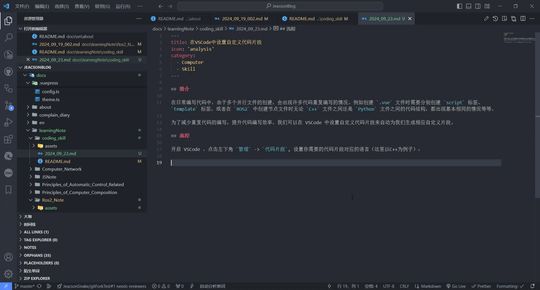
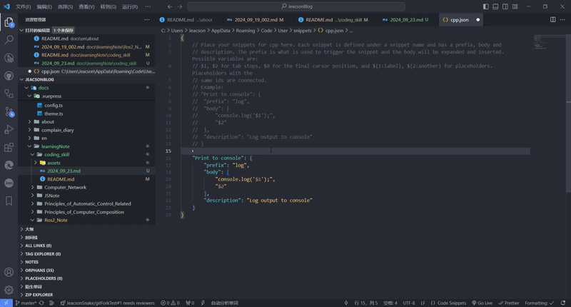
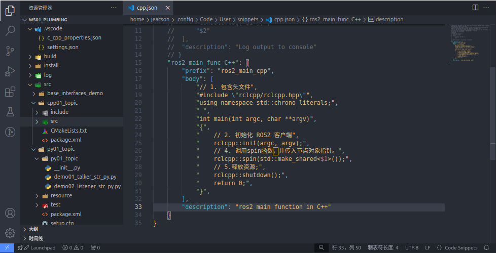
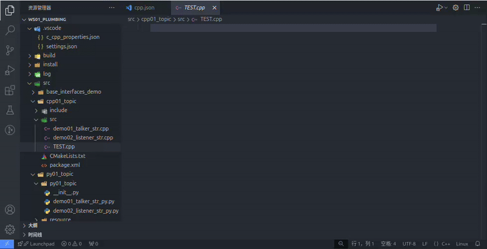

## Overview

When you write code day to day, creating a bunch of files side by side means the same code gets written over and over. When you create a `.vue` file, for instance, you have to create the `script` tag and the `template` tag separately; or when you create node files in `ROS2`, the code structure comes out basically the same whether they are `C++` files or `Python` files, and so on.

To cut down on all that repeated typing and write code more efficiently, we can set up custom snippets in VSCode and let it generate the snippet for us.

## Steps

Open VSCode, click `Manage` in the bottom-left corner -> `User Snippets`, and pick the language your snippet is for (C++ in this example):

Copy the commented-out example in the file, paste it between the braces in the file, and uncomment it:

Then just edit the relevant bits following its format.

When you want to use it, just type the shortcut you set up:

::: important
This article was translated by Hermes Agent; the original text can be found at ../../learningNote/coding_skill/2024_09_23.md. The translation is for reference only.
Translation time: 2026-11-05
:::
