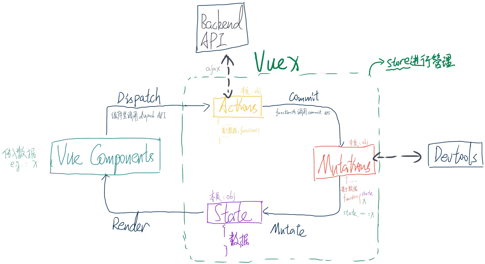

## Overview

These are the notes I produced back when I was learning vuex. They've now been tidied up from the image version into an electronic format you can read.

Official docs reference: [click](https://v3.vuex.vuejs.org/zh/guide/)

## The VUEX cycle diagram



## 1. Introducing VUEX

VueX is a vue plugin built specifically for centralised state (data) management in vue. It can centrally manage the shared state of several components in a vue app (reading and writing it, for example).
It can also be a way of communicating between components, and it works for any kind of inter-component communication.

## 2. Creating it and using it

::: tip
To make management easier, I strongly recommend splitting the various bits of config across several files rather than writing all of it into `main.js`.
:::

::: info
Assuming you created the vue project with a build tool like vue-cli, there will be a src folder.
:::

Create a store folder under src to hold the related config, and create the entry file index.js inside it:

```javascript
    // index.js
    // import vue and vuex
    import Vue from 'Vue'
    import Vuex from 'Vuex'

    // bring vuex in the way you bring in a plugin
    Vue.use(Vuex)

```

After that you can define it with the properties inside Vuex.store. The four most commonly used properties are `actions`, `mutations`, `state`, `getters`.

```javascript
    // index.js
    ...
    export default new Vuex.store({
        actions: {
            ...
        },
        mutations: {
            ...
        },
        state: {
            ...
        },
        getters: {
            ...
        }
    })
```

Of course you can also configure these four properties separately and then bring them in:

```javascript
    // index.js
    ...
    const actions = {...}

    const mutations = {...}

    const state = {...}

    const getters = {...}

    export default new Vuex.store({
        actions,
        mutations,
        state,
        getters
    })
```

Below I'll start from state and give a brief explanation of these four properties:

### 2.1 state

Used to store the data that every component in the whole vue app can share. The data inside is usually defined like this:

```javascript
    // index.js
    ...
    const state = {
        data1: 1,
        data2: 2,
        data3: 3,
        ...
    }

```

You can use `$store.state` to read the values inside it. A concrete example:

```vue
    // in vue component
    ...
    <script>
    export default {

        ...
        computed: {
            data1(value) {
                this.$store.state.data1
            }
            ...
        }

    }
    </script>
```

### 2.2 getters

It can be thought of as another kind of computed property, except the argument passed into this property is state:

```javascript
    // index.js
    ...
    const getters = {
        
        data1Times10(state) {
            return state.data1 * 10
        },
        data2MinusData3(state) {
            return state.data2 - state.data3
        },
        ...
    }
```

You can use `$store.getters` to read the values inside it. A concrete example:

```vue
    // in vue component
    ...
    <script>
    export default {

        ...
        computed: {
            increaseData1(value) {
                this.$store.getters.data1Times10
            }
            ...
        }

    }
    </script>
```

### 2.3 mutations

The only way to change the data in Vuex's store is to commit it with a function in a mutation:

```javascript
    // index.js
    ...
    const mutations = {
        
        increaseData1ByValue(state, value) {
            return state.data1 + value
        },
        decreaseData1ByValue(state, value) {
            return state.data1 - value
        },
        ...
    }
```

When you want to call the method inside to commit the data, you need to call `$store.commit` to commit it. A concrete example:

```vue
    // in vue component
    ...
    <script>
    export default {

        ...
        methods: {
            // ① pass the value directly
            increaseData1(value) {
                this.$store.commit('increaseData1ByValue', value)
            },
            // ② wrap the value in an object and pass it as a payload
            decreaseData1(value) {
                this.$store.commit('decreaseData1ByValue', {
                    value
                })
            },
            // ③ pass it as an object
            decreaseData1(value) {
                this.$store.commit({
                    type: 'decreaseData1ByValue'
                    value
                })
            }

            ...
        }

    }
    </script>
```

### 2.4 actions

Used to commit data, **but an action commits data through a mutation as the middleman, rather than changing state directly.** So this property is generally used for anything containing asynchronous operations.
An action function receives a context object that has the same methods and properties as the store instance, so you can call context.commit to commit a mutation, or get state and getters through context.state and context.getters.

::: tip
    Because of module splitting, context and store differ in a few places here, that is, `context !== store`.
    For details see [the official docs, Vuex 3.x Module](https://v3.vuex.vuejs.org/zh/guide/modules.html).
:::

```javascript
    // index.js
    // here you can use the three methods mentioned earlier to pass data
    ...
    const actions = {
        incrementData1Async1(context, value) {
            setTimeout(() => {
                context.commit('increaseData1ByValue', value)
            }, 1000)
        },
        // ② wrap the value in an object and pass it as a payload
        decreaseData1Async2(context, value) {
            context.commit('decreaseData1ByValue', {
                value
            })
        },
        // ③ pass it as an object
        decreaseData1Async3(context, value) {
            context.commit({
                type: 'decreaseData1ByValue'
                value
            })
        }
        ...
    }
```

Of course, if you need to reference commit several times and so on, you can end up having to use context over and over, so in practice we often use ES2015's **argument destructuring** to simplify the code — that is, **passing in just the properties we need from the object instead of passing the whole object in**:

```javascript
    // index.js
    ...
    const actions = {
        incrementData1Async ({ commit }) {
            setTimeout(() => {
                commit('increaseData1')
            }, 1000)
        }
        ...
    }
```

When you want to call the method inside to commit the data, you need to call `$store.dispatch` to commit it. A concrete example:

```vue
    // in vue component
    ...
    <script>
    export default {

        ...
        methods: {
            // ① pass the value directly
            increaseData1(value) {
                this.$store.dispatch('incrementData1Async1', value)
            },
            // ② wrap the value in an object and pass it
            decreaseData1(value) {
                this.$store.dispatch('decreaseData1Async2', {
                    value
                })
            },
            // ③ pass it as an object
            decreaseData2(value) {
                this.$store.dispatch({
                    type: 'decreaseData1Async3'
                    value
                })
            }

            ...
        }

    }
    </script>
```

### 2.5 The map helper functions

Vuex provides several map helper functions, so we can bring in several properties at once with less code.

#### 2.5.1 The mapState helper

When a component needs to get several pieces of state, declaring all of them as computed properties is a bit repetitive and redundant. To solve that, we can use the `mapState` helper to generate the computed properties for us:

```javascript
// in the standalone build the helper is Vuex.mapState
import { mapState } from 'vuex'

export default {
  // ...
  computed: mapState({
    // arrow functions make the code more concise
    count: state => state.count,

    // passing the string 'count' is the same as `state => state.count`
    countAlias: 'count',

    // to use `this` to get local state, you must use a regular function
    countPlusLocalState (state) {
      return state.count + this.localCount
    }
  })
}

```

When the mapped computed property's name matches the name of a state child node, we can also pass mapState an array of strings.

```javascript

computed: mapState([
  // map this.count to store.state.count
  'count'
])

```

If the component already has its own computed properties and needs to mix them with the store's properties, you can use the object spread operator to mix mapState into the computed object:

```javascript
computed: {
    // the computed properties it already had
    localComputedA () { /* ... */ },
    localComputedB () { /* ... */ },
    
    // use the object spread operator to mix this object into the outer object
    ...mapState({
    // ...
  })
}
```

#### 2.5.2 The mapGetters helper

The `mapGetters` helper simply maps the getters in the store onto local computed properties:

```javascript
import { mapGetters } from 'vuex'

export default {
  // ...
  computed: {
  // use the object spread operator to mix the getters into the computed object
    ...mapGetters([
      'doneTodosCount',
      'anotherGetter',
      // ...
    ])
  }
}
```

If you want to give a getter property another name, you can use the object form:

```javascript
...mapGetters({
  // map `this.doneCount` to `this.$store.getters.doneTodosCount`
  doneCount: 'doneTodosCount'
})
```

#### 2.5.3 The mapMutations helper

You can commit a mutation in a component with `this.$store.commit('xxx')`, or use the `mapMutations` helper to map the component's methods to `store.commit` calls (you need to inject the store at the root node).

```javascript
import { mapMutations } from 'vuex'

export default {
  // ...
  methods: {
    ...mapMutations([
      'increment', // map `this.increment()` to `this.$store.commit('increment')`

      // `mapMutations` supports payloads too:
      'incrementBy' // map `this.incrementBy(amount)` to `this.$store.commit('incrementBy', amount)`
    ]),
    ...mapMutations({
      add: 'increment' // map `this.add()` to `this.$store.commit('increment')`
    })
  }
}

```

#### 2.5.4 The mapActions helper

You can dispatch an action in a component with `this.$store.dispatch('xxx')`, or use the `mapActions` helper to map the component's methods to `store.dispatch` calls (again, you need to inject the store at the root node first):

```javascript
import { mapActions } from 'vuex'

export default {
  // ...
  methods: {
    ...mapActions([
      'increment', // map `this.increment()` to `this.$store.dispatch('increment')`

      // `mapActions` supports payloads too:
      'incrementBy' // map `this.incrementBy(amount)` to `this.$store.dispatch('incrementBy', amount)`
    ]),
    ...mapActions({
      add: 'increment' // map `this.add()` to `this.$store.dispatch('increment')`
    })
  }
}

```

### 3. Modules

Because vuex uses a [single state tree](https://v3.vuex.vuejs.org/zh/guide/state.html#%E5%8D%95%E4%B8%80%E7%8A%B6%E6%80%81%E6%A0%91), all of the app's state gets concentrated into one fairly large object, so once an app gets very complex, the store object can become quite bloated as the data grows.

To solve that, Vuex lets us split the store into several modules. Each module has its own state, mutation, action, getter, or even several other nested sub-modules — split in the same way all the way down:

```javascript
    const moduleA = {
        state: () => ({ ... }),
        mutations: { ... },
        actions: { ... },
        getters: { ... }
    }

    const moduleB = {
        state: () => ({ ... }),
        mutations: { ... },
        actions: { ... }
    }

    const store = new Vuex.Store({
        modules: {
            a: moduleA,
            b: moduleB
        }
    })

    store.state.a // -> moduleA's state
    store.state.b // -> moduleB's state
```

::: tip
By default, the actions, mutations and getters inside a module are registered in the global namespace — which lets several modules respond to the same mutation or action. If you want your module to be more encapsulated and reusable, you can add `namespaced: true` to make it a namespaced module:

```javascript
    const moduleC = {
        namespaced: true,
        state: () => ({ ... }),
        mutations: { ... },
        actions: { ... },
        getters: { ... }
    }

    const store = new Vuex.Store({
        modules: {
            c: moduleC
        }
    })

    store.state.a // -> moduleA's state
    store.state.b // -> moduleB's state
```

Once a module is registered, all its getters, actions and mutations automatically adjust their names according to the path the module was registered under, usually in the format `'module-name/original-name'`. For example:

```javascript
const store = new Vuex.Store({
  modules: {
    account: {
      namespaced: true,

      // module assets
      state: () => ({ ... }), // the state inside a module is already nested; the `namespaced` property has no effect on it
      getters: {
        isAdmin () { ... } // -> getters['account/isAdmin']
      },
      actions: {
        login () { ... } // -> dispatch('account/login')
      },
      mutations: {
        login () { ... } // -> commit('account/login')
      },

      // nested modules
      modules: {
        // inherits the parent module's namespace
        myPage: {
          state: () => ({ ... }),
          getters: {
            profile () { ... } // -> getters['account/profile']
          }
        },

        // nesting the namespace further
        posts: {
          namespaced: true,

          state: () => ({ ... }),
          getters: {
            popular () { ... } // -> getters['account/posts/popular']
          }
        }
      }
    }
  }
})
```

:::

::: important
This article was translated by Hermes Agent; the original text can be found at [here](../../../../learningNote/vueNote/VUE2/VUEX.md). The translation is for reference only.
Translation time: 2026-11-05
:::
