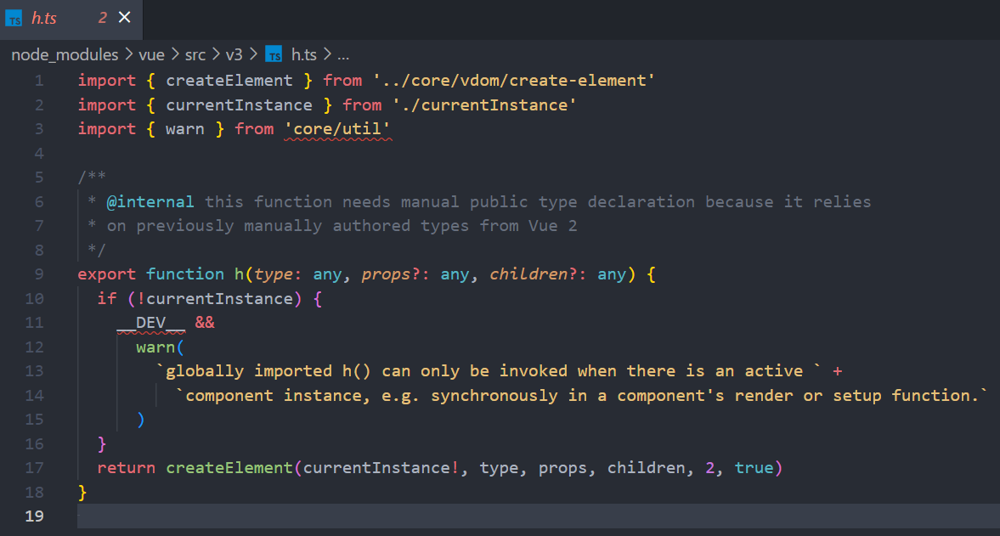

---
category:
  - VUE
  - Web
tag:
  - VUE3
  - COMPARE
---
# How Vue3 and Vue2 differ on render functions

When writing vue code, we usually write the HTML inside the template tag first. When we compile the code, VUE first <u>converts the code into several virtual DOM nodes according to the tags inside it</u>, that is, VNodes (VirtualDomNode), then it combines the Vnodes into a VirtalDOM, and only then does the VDOM get rendered into real DOM. That's how it goes most of the time.

But if we can skip the step of converting the code into nodes and write the code that generates vnodes directly, the browser will compile the code more efficiently. In that case we can use the render function render() inside the script tag, and call VUE's h() function in it. The h function calls createElement (Vue3 uses createVnode) to create the node, but it only adds some argument checks on top of that, so we can also call it the createElement function/createVnode function.

The definition of the h function in the Vue2 source:

The definition of the h function in the Vue3 source:

In Vue2, the h function has the following parameters:

- the type of web page element to render (types)
- the element's various parameters (stored as an object, can be omitted)
- the element's children (can be an array).

In Vue2, the h function is passed into render() as a parameter, and when you call h the second argument is rather verbose:

```javascript
render(h) {
    return h('div', {
        attrs: {
            id: 'test',
        },
        on: {
            click: this.onClick,
        }
    }, 'HelloWorld');
}
``` 

In Vue3, the h function has three parameters, namely:

- the type of web page element to render (types)
- the element's various parameters (also stored as an object)
- the element's children (can be an array, but the official docs recommend returning them in a callback)

In Vue3, all the attributes have been pulled out, which makes the object flatter:

```javascript
import { h } from 'Vue' // h has been changed so it can be imported globally, which means the render function can be split into several sub-functions

render() {
    return h('div', {
    id: 'test',
    onClick: this.onClick,// anything starting with "on" is directly treated as a property that needs listening to
    }, 'HelloWorld');
}
```

::: important
This article was translated by Hermes Agent; the original text can be found at ../../../../learningNote/vueNote/VUE3/VUE3_Vs_VUE2_In_Render_Function.md. The translation is for reference only.
Translation time: 2026-11-05
:::
