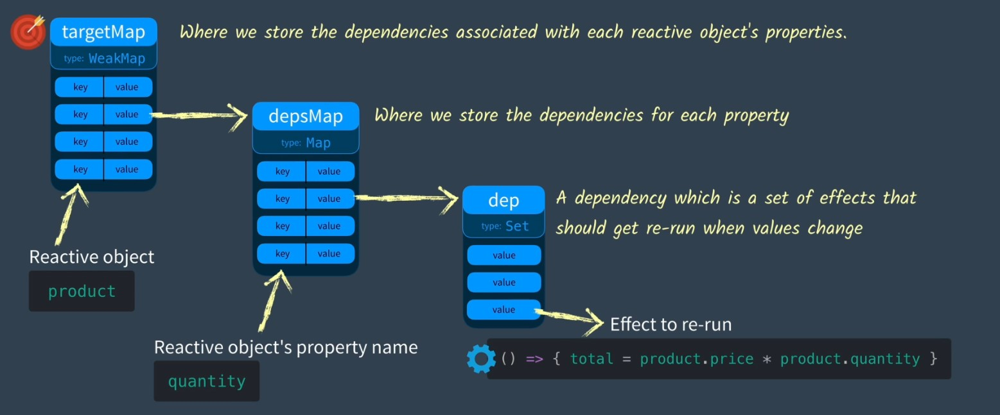

## Overview

Here I'll walk you through how Vue 3 implements data reactivity, starting from how the source is put together. This is part one.

Reference: [Vue Mastery — Vue 3 Reactivity](https://www.vuemastery.com/courses/vue-3-reactivity/)

## Starting from a simple template

Let's start by creating a simple Vue app and an html template:

```html
<!DOCTYPE html>
<html lang="en">
<head>
    <meta charset="UTF-8">
    <meta name="viewport" content="width=device-width, initial-scale=1.0">
    <title>Document</title>
</head>
<script src="https://cdn.jsdelivr.net/npm/vue@2.7.14/dist/vue.js"></script>

<body>
    <div id = "app">
        <div>Price: ${{ price }}</div>
        <div>Total: ${{ price * quantity}}</div>
        <div>Taxes: ${{ totalPriceWithTax }}</div>
    </div>
    
</body>


<script>
    let vm = new Vue({
        el: '#app',
        data: {
            price: 5.00,
            quantity: 2
        },
        computed: {
            totalPriceWithTax() {
                return this.price * this.quantity * 1.03
            }
        },

    })
</script>

</html>

```

We already know that when we change `price` to `10.00`, Vue knows how to update the relevant template info inside the HTML, and it can also update the computed property that depends on it, and update the relevant template info in the HTML at the same time. So here's a question:
**How does Vue know in what way it should be modified?**

After all, in plain old JavaScript code, suppose we have a snippet:

```javascript
let price = 5
let quantity = 2
let total = price * quantity
console.log(`total is: ${total}`)
```

Obviously the log here prints `total is: 10`.
But when we modify `price`:

```javascript
price = 10
console.log(`total is: ${total}`)
```

Obviously the log here still prints `total is: 10`. Because in this snippet, JS code runs in a very simple top-to-bottom order. So even if you modify `price`, the value of `total` won't be touched at all. In other words, in this piece of JavaScript, `total` can't get the **reactive update** we want.
So to make this code recompute and update the value of total after `price` is modified (updated), what method should we use?

## The three functions of reactivity — effect, track, trigger

To make this code recompute and update the value of total after `price` is modified (updated), we should try putting the formula above into some kind of storage class that's easy to iterate over, turning it into a sort of update function that can be called over and over. That way, later on we can just call this function to get a fairly convenient update.

And suppose the object we have contains many variables like `total` that all use the same variable `price` in their calculation, and each of those variables has its own kind of storage class — that means we'd also need a storage class that's easy to iterate, to store every one of those per-variable storage classes, and so on and so forth.

Sounds like a pain, but let's write it step by step.

First we name this update function `effect`, because this function can be thought of as having some kind of *effect* on `total`:

```javascript
// the original definition
let total = price * quantity
// the function after the change
let total = 0
let effect = function() {
    total = price * quantity
}

```

Then we need a method for saving this *update function*; when we want to save it, or rather when we want to *track* this value, we call this method. We name this tracking function `track`:

```javascript
track()
```

Finally we need a method for firing this *update function*; when we've updated `price`, we call this method to *trigger* the previously stored update function `effect()`. We name this triggering function `trigger`:

```javascript
trigger()
```

If we chain these three functions together, it roughly looks like this:

```javascript
let price = 5
let quantity = 2
let total = 0
let effect = function() {
    total = price * quantity
}

// declare that total should be tracked
track()
// run the update function once to get the first value of total
effect()
...
// on some later update, assuming price or quantity was modified, call this function to fire it
trigger()
```

## Storing the "update function" in a suitable container — a Set

To make each function appear only once in this easy-to-iterate storage class, with no duplicate values, we need to store them in *some kind of hash structure*, and it should be a **set** of unique values. So we use `Set` — a **set object** — to store them.

::: info
**Set** is an object type added in ES6, and what it stores is **a set of unique values**. That is, *even if you put the same element into a Set, only one copy of it is kept*.
:::

Here we'd normally define it like this:

```javascript
...
// define dep as a Set object used to store functions; here "dep" stands for "dependency"
dep = new Set() 
let effect = () => { total = price * quantity }// cut down to an arrow function
...
```

With that, we can define the two functions `track` and `trigger` [mentioned above](./VUE3的数据响应式_上.md#the-three-functions-of-reactivity-—-effect-track-trigger):

```javascript
function track() {
    // what this function does is add the effect we defined to dep
    dep.add(effect) 
}

function trigger() {
    // what this function does is walk every effect in dep and run them
    dep.forEach((effect) => {effect()})
}

```

So the earlier code becomes:

```javascript
let price = 5
let quantity = 2
let total = 0

dep = new Set() // stands for "dependency"
let effect = () => { total = price * quantity }// cut down to an arrow function

function track() {
    // add the effect we defined to dep
    dep.add(effect)
}

function trigger() {
    // walk every effect in dep and run them
    dep.forEach((effect) => {effect()})
}

// first declare that the property should be tracked
track()
// then run the update function once to get the first value of total under the property's effect
effect()
...

```

So in this situation, if we set `price` to 10 like we did at the start, the value still doesn't change when we try to print total — but **we can now update it by hand**. As long as we call `trigger()` after updating `price`, we can manually update the value of `total`.

## Stringing all the Sets together into a Map

Usually our object has more than one property, and to watch each of those properties separately, every one of them needs its own **dep**, or rather its own **Set** of *effects*. So how should we store these per-property **deps** so they're easier to manage?

For example, let's wrap the earlier price and quantity in a product object:

```javascript
let product = {price = 5, quantity = 2}
```

For the product object, every property inside it needs its own **dep**.

So that we can find them more easily later, we need to store these **deps** somewhere shared and quick to iterate. So we create a depMap, which is a "Map" class. This class is full of key-value pairs: we take each property's name as the *key*, and then take that property's **own dep**, that is, the **Set object**, as the *value*.

Let's try writing "depMap":

```javascript
const depMap = new Map()
```

Then our `track()` function becomes:

```javascript
function track(key) {
    // use the passed property value as key, find the matching dep
    dep = depMap.get(key)
    // in case there is no dep yet, let's just make a new one
    if (!dep) {
        depMap.set(key, (dep = new Set()))
    }
    // add the effect we defined to dep
    dep.add(effect)
}

```

The `trigger()` function becomes:

```javascript
function trigger(key) {
    // use the passed property value as key, find the matching dep
    dep = depMap.get(key)
    // if dep exists
    if (dep) {
        // walk every effect in dep and run them
        dep.forEach((effect) => {effect()})
    }
    // if dep does not exist there is nothing to run, just skip
    
}
```

Then our original code needs to be changed to this:

::: info
Because `track()` and `trigger()` are starting to get long, we omit them together with depMap (the code shown as ...). Just know it's the same function being called.
:::

```javascript

let product = {price = 5, quantity = 2}
let total = 0

let effect = () => { total = product.price * product.quantity }// cut down to an arrow function

...
// first declare that the property should be tracked, using price as an example
track("price")
// then run the update function once to get the first value of total
effect()
```

Same as before: if we set `price` to 10 like we did at the start, the value still doesn't change when we try to print total, but after updating `price` we call `trigger("price")` and we can update the value of `total` by hand.

## Stringing all the Maps together into a WeakMap

Up to here, we've got a fairly standard way of tracking dependencies for different properties on the same object — but what if we **have multiple reactive objects**? How would you handle those, then?

>"Why not string the previous depMaps together with another Map class? Just like depMap itself: take each reactive object as the *key*, and then take that object's **depMap**, that is, the **Map object**, as the *value* to map?"

Worth a try.

Let's set up another **Map**-like storage place; here we use **WeakMap**. **WeakMap** is similar in structure to **Map**, but **WeakMap** has a few advantages:

- It only accepts *objects* as keys (null excepted); no other type of value can be used as a key.
- A **WeakMap** key is not a formal reference and won't prevent JS from doing garbage collection, but as long as the key exists, the key/value pair stays in the map and is treated as a reference to the value, so the referenced object won't be counted by the garbage collector. (For a detailed intro to garbage collection you can look [here](https://blog.csdn.net/weixin_41636483/article/details/130831174).) This trait is similar to how a *reactive object* is expected to behave.

We usually call it `targetMap`. As for why, you can look for the answer in [the next post](./VUE3的数据响应式_下.md).

Let's try writing "targetMap":

```javascript
const targetMap = new WeakMap()
    ...
```

Then our `track()` function becomes:

```javascript
    ...
function track(target, key) {

    // use the passed object as target, find the matching depMap
    let depMap = targetMap.get(target)
    // in case there is no depMap yet, let's just make a new one
    if (!depMap) {
        targetMap.set(target, (depMap = new Map()))
    }

    // use the passed property value as key, find the matching dep
    let dep = depMap.get(key)
    // in case there is no dep yet, let's just make a new one
    if (!dep) {
        depMap.set(key, (dep = new Set()))
    }
    // add the effect we defined to dep
    dep.add(effect)
}
    ...
```

The `trigger()` function becomes:

```javascript
    ...
function trigger(target, key) {

    // use the passed object as target, find the matching depMap
    let depMap = targetMap.get(target)
    // in case there is no depMap yet, let's just make a new one
    if (!depMap) {
        // if depMap does not exist there is nothing to run, just skip
        return
    }
    
    // use the passed property value as key, find the matching dep
    let dep = depMap.get(key)
    // if dep exists
    if (dep) {
        // walk every effect in dep and run them
        dep.forEach((effect) => {effect()})
    }
    // if dep does not exist there is nothing to run, just skip
    ...
}
```

Then our original code needs to be changed to this:

::: info
Because `track()` and `trigger()` are too long, they're omitted together with targetMap (the code shown as ...). Just know it's the same function being called.
:::

```javascript

let product = {price = 5, quantity = 2}
let total = 0

...

let effect = () => { total = product.price * product.quantity }// cut down to an arrow function

...

// first declare that the property should be tracked, using price as an example
track(product, "price")
// then run the update function once to get the first value of total
effect()
```

Same as before: if we set `price` to 10 like we did at the start, the value still doesn't change when we try to print total, but after updating `price` we call `trigger(product, "price")` and we can update the value of `total` by hand.

## Wrap-up

In this chapter we did three things in total, to get our own reactive engine roughly built:

- [Storing the "update function" in a suitable container — a Set](./VUE3的数据响应式_上.md#storing-the-update-function-in-a-suitable-container-—-a-set)
- [Stringing all the Sets together into a Map](./VUE3的数据响应式_上.md#stringing-all-the-sets-together-into-a-map)
- [Stringing all the Maps together into a WeakMap](./VUE3的数据响应式_上.md#stringing-all-the-maps-together-into-a-weakmap)

In a picture, that looks like:



It feels like we did a lot of work, but in fact, up to this point we can still only use manual updates to observe the values we want to observe, and there is no way to make the *update function* **Set** of a *specific property* on a *reactive object* re-run by itself. Never mind — we'll cover it in the next part.

::: important
This article was translated by Hermes Agent; the original text can be found at [here](../../../learningNote/vueNote/VUE3/VUE3的数据响应式_上.md). The translation is for reference only.
Translation time: 2026-11-05
:::
