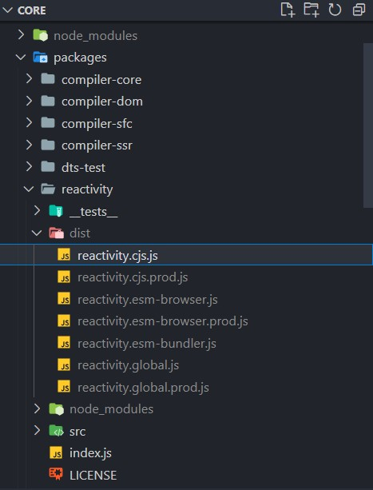

## Overview

Here I'll walk you through how Vue 3 implements data reactivity, starting from how the source is put together. This is the post after the post after the last one.

Reference: [Vue Mastery — Vue 3 Reactivity](https://www.vuemastery.com/courses/vue-3-reactivity/)

## Recap of the previous part

In the previous post we fixed two BUGs left in the code, namely:

- [the problem that track runs whether or not the update function is called](./VUE3的数据响应式_下.md#the-original-code-has-a-problem)
- [the problem of missing reactive data when a value bound to one update function is used by another update function](./VUE3的数据响应式_下.md#the-original-code-still-has-a-problem)

We used the following methods to fix them:

- [bringing in the activeEffect variable so track can tell who's calling](./VUE3的数据响应式_下.md#the-activeeffect-variable-and-a-standalone-effect-function)
- [using an Object Accessor to define the ref function, so the reactive data corresponding to the update function is kept](./VUE3的数据响应式_下.md#back-to-basics-—-using-an-object-accessor-javascript-s-own-computed-property-object-accessor)

In this post we'll keep following Vue 3's reactivity and keep enriching the code we wrote, until it runs successfully even when it directly calls Vue's own functions of the same name.

## The original code

Let's copy the original code over:

```javascript
// targetMap-activeEffect related

const targetMap = new WeakMap()

let activeEffect = null

function effect(eff) {
    // first assign the passed argument to activeEffect
    activeEffect = eff
    // then run activeEffect
    activeEffect()
    // finally set it back to null
    activeEffect = null
}

function track(target, key) {
    // if activeEffect is not null
    if (activeEffect) {
        // use the passed object as target, find the matching depMap
        let depMap = targetMap.get(target)
        // in case there is no depMap yet, let's just make a new one
        if (!depMap) {
            targetMap.set(target, (depMap = new Map()))
        }

        // use the passed property value as key, find the matching dep
        let dep = depMap.get(key)
        // in case there is no dep yet, let's just make a new one
        if (!dep) {
            depMap.set(key, (dep = new Set()))
        }
        // add the activeEffect we defined to dep ← new
        dep.add(activeEffect)
    }
    
}

function trigger(target, key) {

    // use the passed object as target, find the matching depMap
    let depMap = targetMap.get(target)
    // in case there is no depMap yet, let's just make a new one
    if (!depMap) {
        // if depMap does not exist there is nothing to run, just skip
        return
    }
    
    // use the passed property value as key, find the matching dep
    let dep = depMap.get(key)
    // if dep exists
    if (dep) {
        // walk every effect in dep and run them
        dep.forEach((effect) => {effect()})
    }
    // if dep does not exist there is nothing to run, just skip
}

function ref(raw) {
    const r = {
        get value() {
            track(r, 'value')
            return raw
        },
        set value(newVal) {
            raw = newVal
            trigger(r, 'value')
        }
    }
    return r
}
...
```

```javascript
// reactiveFunction related

function reactive(target) {
    const handler = {
        get(target, key, receiver) {
            // save the value we get first
            let result = Reflect.get(target, key, receiver)
            // declare that the key on target should be tracked
            track(target, key)
            // return result
            return result
        },

        set(target, key, value, receiver) {
            // save the old value first
            let oldValue = Reflect.get(target, key, receiver)
            // assign the new value to the target property and keep the result
            let result = Reflect.set(target, key, value, receiver)
            // if old and new values differ
            if (oldValue != result) {
                // call trigger() after updating the key on target
                trigger(target, key)
            }
            return result
        }
    }
    return new Proxy(target, handler)
}

```

```javascript
// main program

let product = reactive({price = 5, quantity = 2})
let total = 0

let salePrice = ref(0) //  ← NEW
...

effect(() => { 
    salePrice.value = product.price * 1.2 //  ← NEW
})

effect(() => { 
    total = salePrice.value * product.quantity //  ← NEW
})

...

console. log( 'before the update, total is ${total} (should be 12), salePrice is ${salePrice} (should be 6)')  //  ← NEW

product.quantity = 3 
console. log( 'after the update, total is ${total} (should be 18), salePrice is ${salePrice} (should be 6)')  //  ← NEW

product.price = 10  //  ← NEW
console. log( 'after the second update, total is ${total} (should be 36), salePrice is ${salePrice} (should be 12)')  //  ← NEW
```

## Adding computed properties to the code

You may have learned Vue's Composition API, in which case you might be thinking:

> After all that, why use two effects here to define a variable that has to be computed?
> Why not just write it with computed properties?

True enough — using computed properties in the code we've written is a great opportunity. So if we did that, what would our main program look like?

The earlier form, defined with the effect function:

```javascript
let total = 0

let salePrice = ref(0) //  ← NEW

effect(() => { 
    salePrice.value = product.price * 1.2 //  ← NEW
})

effect(() => { 
    total = salePrice.value * product.quantity //  ← NEW
})
```

gets changed to this:

```javascript
let total = computed(() => { 
    return salePrice.value * product.quantity //  ← NEW
})

let salePrice = computed(() => { 
    return product.price * 1.2 //  ← NEW
}) //  ← NEW

```

For this `computed function`, we passed in an anonymous function, and had it return the result computed by the formula we wrote earlier.

So, since we built reactivity from scratch, how should we define the `computed function` we're writing here?

Vue 3's answer to that is: a computed property should be reactive, and similar to the `ref function`.

## Defining a computed property

We define a `computed` function, and name its argument (the function passed in) `getter`:

```javascript

function computed(getter) {

}

```

Inside this function we need to do the following:

- use `ref()` to create a reactive reference, called `result`;
- to watch the reactive value passed in, we still need to call the effect function. But the anonymous function passed to effect should assign getter to result.value;
- return the reactive reference `result`.

```javascript

function computed(getter) {
    let result = ref()
    effect(() => {
        result.value = getter()
    })
    return result
}

```

Once the `computed` function is defined like this, when we call it to define a computed property, we get the effect of reactive data.

::: tip Defining computed() on top of ref()

`ref` can be seen as the basic version of the `computed` function, because at its core `computed` is what you get after wrapping the `ref` function and the `effect` function together. So we define the `ref` function first, and then build the `computed` function on top of it. If you want to recall how the `ref` function was defined, take a look at [the previous post](./VUE3的数据响应式_下.md#the-ref-function).

:::

## The advantage of Vue 3's data reactivity over Vue 2

Please see [this post](./VUE3_Vs_VUE2_In_Reactive_Data.md), also on this blog.

## Let's try swapping our code for the real source

By now we've built a reactive engine close to the one in Vue 3, so we might as well try dropping in a little Vue 3 source and see whether our code still runs.

### Introducing the Vue 3 source

First, look at (download) the latest VUE-NEXT code:

::: info What you need to know

In the reference video, the latest vue-next code version was alpha5;
but when the author was writing this, the latest vue-next code version was v3.3.4.
So here we go by the latest code the author had access to.

:::

Second, install its dependencies:

::: info What you need to know

The package manager used in the reference video is yarn;
but the package manager the author used was pnpm.
So from here on, everything follows the author's package manager.

:::

Use the code `$pnpm i`

After that, bundle the reactivity-related source in Vue:

`$pnpm build reactivity`

In the dist directory alongside the reactivity folder, a whole bunch of files will show up. We need to take 'packages/reactivity/dist/reactivity.cjs.js' out and move it into our own code directory.



And finally all you have to do is import it.

```javascript
const { reactive, computed, effect } = require('./reactivity.cjs')

let product = reactive({price = 5, quantity = 2})

let total = computed(() => { 
    return salePrice.value * product.quantity //  ← NEW
})

let salePrice = computed(() => { 
    return product.price * 1.2 //  ← NEW
}) //  ← NEW
...

console. log( 'before the update, total is ${total} (should be 12), salePrice is ${salePrice} (should be 6)')  //  ← NEW

product.quantity = 3 
console. log( 'after the update, total is ${total} (should be 18), salePrice is ${salePrice} (should be 6)')  //  ← NEW

product.price = 10  //  ← NEW
console. log( 'after the second update, total is ${total} (should be 36), salePrice is ${salePrice} (should be 12)')  //  ← NEW

```

Don't worry, under these conditions the main program still works. You can have a go yourself.

## Summary

In the four posts above, starting from the simplest JS code, we built our own reactive engine step by step: constructing the `effect`/`track`/`trigger` three functions, wrapping the `reactive()` function with proxy/reflect, and filling in the gaps with `activeEffect`, the `ref()` function and the `computed()` function and other related functions.

Of course, this is not the end. If you keep digging into the source, you may find more details about reactive data, including checking whether data is readonly, whether it's a shallow reference, and so on. Here we've only discussed the absolute core of Vue 3's reactive engine together.

So keep diving into the source! We'll meet again before long.

> "Keep on, keeping on!" 👍

::: important
This article was translated by `Hermes Agent`; the original text can be found at [here](../../../learningNote/vueNote/VUE3/VUE3的数据响应式_补.md). The translation is for reference only.
Translation time: 2026-11-05
:::
