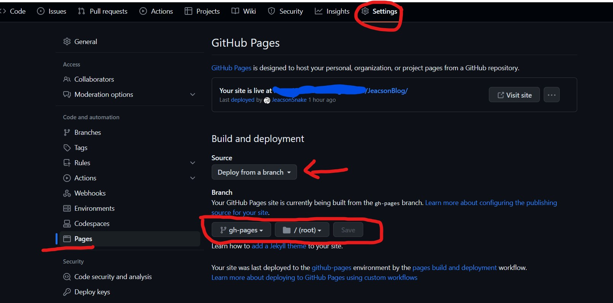

## 1. About the GITHUB_TOKEN permissions

Prerequisite: after creating the .github/workflow/docs.yml file I went and revised the inner configuration.

The problem: after using GitHub Action, the workflow threw this error:

The cause: when the workflow deploys the code to the gh-pages branch it needs read and write access to the default secrets.GITHUB_TOKEN, but the repository does not grant that permission by default.

The fix: configure the default GITHUB_TOKEN permissions.

Quoted from the official docs^[ [Setting the permissions of the GITHUB_TOKEN for your repository - GitHub Docs](https://docs.github.com/zh/repositories/managing-your-repositorys-settings-and-features/enabling-features-for-your-repository/managing-github-actions-settings-for-a-repository#setting-the-permissions-of-the-github_token-for-your-repository) ]

> By default, when you create a new repository in your personal account, GITHUB_TOKEN only has read permission for the contents and packages scopes. If you create a new repository in an organization, the setting is inherited from what is configured in the organization settings.
>
> On GitHub.com, navigate to the main page of the repository.
>
> Under the repository name, click Settings. If you cannot see the "Settings" tab, select the dropdown menu, then click Settings.
>
> A screenshot of the repository header showing the tabs. The "Settings" tab is outlined in dark orange.
>
> In the left sidebar, click Actions, then click General.
>
> Under Workflow permissions, choose whether you want the GITHUB_TOKEN to have read and write access to all scopes (permissive setting) or only read access to the contents and packages scopes (restricted setting).
>
> Click Save to apply the settings.

## 2. About switching the GitHub Pages source path

Prerequisite: after the steps above, GitHub Actions runs successfully.

The problem: even though it claims the page has been deployed successfully, the page is nowhere to be found under the domain you pointed it at.

The cause: after the project is bundled by that workflow, you have to switch the GitHub Pages source path to the path where the bundled files live before the page can be served.

The fix:

- First, in the project's own settings, under Code and automation, open Pages > Build and deployment and change Source to "Deploy from a branch"

- Then change the path, as circled in red below:

::: important
This article was translated by Hermes Agent; the original text can be found at ../../../postMortem/deploy/001_static_source_deploy.md. The translation is for reference only.
Translation time: 2026-11-05
:::
