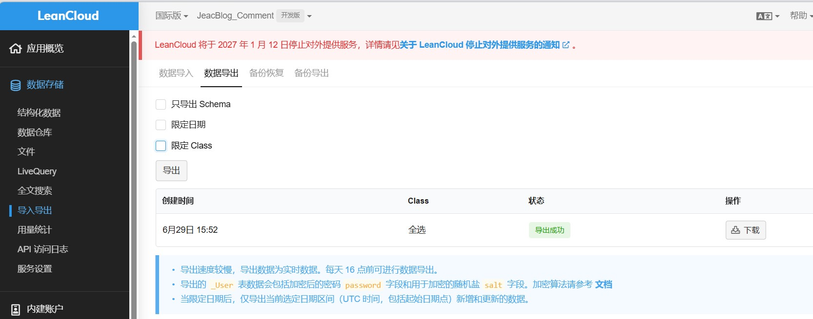
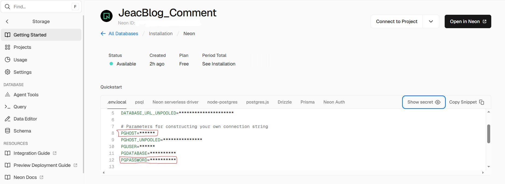
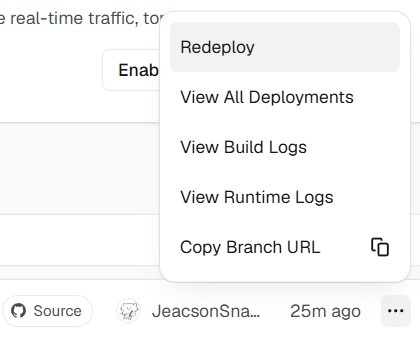

LeanCloud announced on `12 January 2026` that it will shut down its public service for good on `12 January 2027`. So on `29 June 2026` I exported the comment data from `LeanCloud` and switched this blog over to `Neon PostgreSQL`. After reading the **updated** [official documentation](https://waline.js.org/guide/get-started/), here is the full migration procedure — and it has to be done in this order:

## 1. Export the Waline data from LeanCloud

Sign in to the `LeanCloud` console, open the application you set up earlier to store comments, click `Data storage → Import/Export` in the left sidebar, switch to the `Export` tab and hit `Export`:



Comment volume here is tiny, so the export did not take long. What you get back is a `.tar.gz` file that still needs a format conversion later.

:::note
If the dataset is large, you can limit the export to just these three:

- 'Comment'
- 'Counter'
- 'Users'

:::

## 2. Create a Neon database in vercel and link it

In `vercel`, open the application you configured earlier, click `Storage` on the left and then `Create Database` on the right. Pick `Neon` from the provider list below:

")

Link your `Github` account to create the `Neon` account, then create the database with the defaults (I did rename mine and picked the `Singapore` region, figuring a physically closer server could not hurt — leaving it alone works just as well).

Once it is created, click `Open in Neon` to jump over there. In `Neon`, choose `SQL Editor` on the left, paste the `SQL` statements from [waline.pgsql](https://github.com/walinejs/waline/blob/main/assets/waline.pgsql) into the editor and click `Run` to create the tables.

## 3. Convert the exported data and upload it

Use [waline-data-import-tool](https://github.com/elkan1788/waline-data-import-tool) to convert the data (I picked the `waline-data-import-tool.exe` release asset, matching my platform). After downloading that `.exe`, you need to create two files for the conversion:

### 1. The waline-neon.ini file

Importing into `Neon` means replacing the `Key`s that pointed at `LeanCloud` in the old configuration with the ones pointing at `Vercel`, so create a file like this:

```waline-neon.ini
[neon]
host=ep-xxxx-dew-xxxx-pooler.c-4.us-east-1.aws.neon.tech
port=5432
user=neondb_owner
password=<PASSWORD>
database=neondb
sslmode=require
```

For `host` and `password`: go back to `vercel`, open the application, click `Storage`, select the `Neon` database you just created, and look them up in the `.env.local` block under `Quickstart` — the corresponding key/value pairs are:



Save the file when you are done.

### 2. The waline.json file

Convert the LeanCloud export described [above](#_1-export-the-waline-data-from-leancloud) with the following `python` code:

```python
import json
import os
import re

def parse_leancloud_jsonl(filepath):
    """Read the JSONL exported by LeanCloud and return a list of objects"""
    items = []
    with open(filepath, 'r', encoding='utf-8') as f:
        for line in f:
            line = line.strip()
            if not line:
                continue
            # Skip LeanCloud's comment header, e.g. #filetype:JSON-streaming ...
            if line.startswith('#'):
                continue
            obj = json.loads(line)
            
            # Handle LeanCloud's Date object format {"__type":"Date","iso":"..."}
            for key in ['insertedAt', 'createdAt', 'updatedAt']:
                if key in obj and isinstance(obj[key], dict) and obj[key].get('__type') == 'Date':
                    obj[key] = obj[key]['iso']
            
            # Drop fields we do not need (optional, keeps the payload smaller)
            for key in ['ACL', '__type']:
                obj.pop(key, None)
                
            items.append(obj)
    return items

def main():
    # Configuration: adjust to the actual filenames after unpacking
    files = {
        'Comment': 'Comment.0.jsonl',
        'Counter': 'Counter.0.jsonl',
        'Users': 'Users.0.jsonl',
    }
    
    data = {}
    for table, filename in files.items():
        if os.path.exists(filename):
            print(f"Processing {filename} ...")
            data[table] = parse_leancloud_jsonl(filename)
        else:
            print(f"Warning: {filename} not found, using an empty array")
            data[table] = []
    
    output = {
        "__version": "1.0.0",
        "type": "waline",
        "version": 1,
        "time": 0,
        "tables": ["Comment", "Counter", "Users"],
        "data": data
    }
    
    with open('waline.json', 'w', encoding='utf-8') as f:
        json.dump(output, f, ensure_ascii=False, indent=2)
    
    print("Done — waline.json generated")

if __name__ == '__main__':
    main()
```

It writes `waline.json` into the **same directory**.

### 3. Putting it together

Put `waline-data-import-tool.exe`, `waline-neon.ini` and `waline.json` in one folder, open `Powershell` as administrator in that folder and run:

```powershell
.\waline-data-import-tool.exe -f .\waline.json -c .\waline-neon.ini
```

The records are then uploaded to `Neon` incrementally.

## 4. Redeploy

When that finishes, click `Redeploy` in `vercel` so the settings are picked up on a fresh boot.



::: important
This article was translated by Hermes Agent; the original text can be found at ../../../postMortem/deploy/005_leancloud_migrate_neon_relate.md. The translation is for reference only.
Translation time: 2026-11-05
:::
