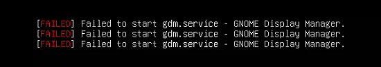
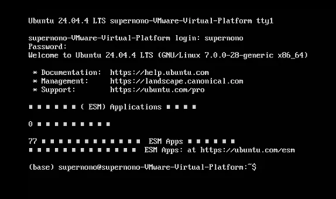
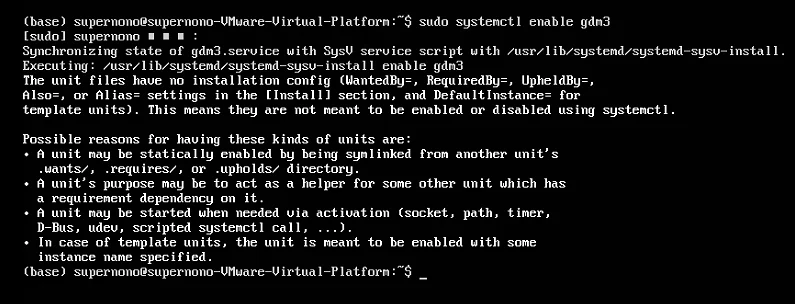
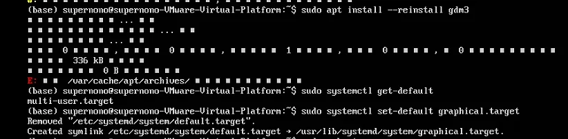
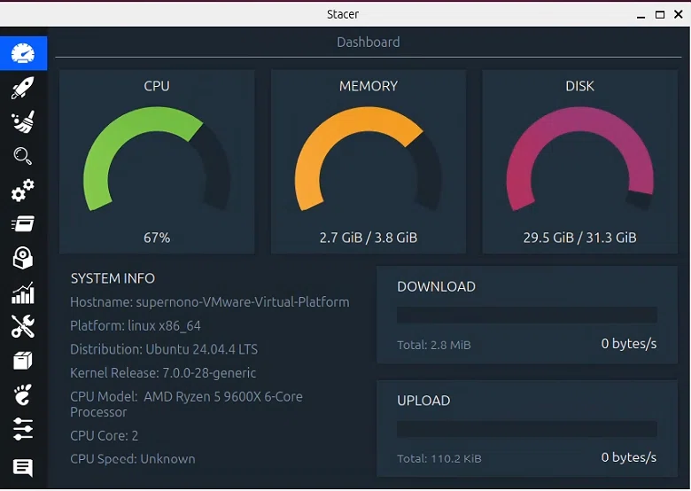
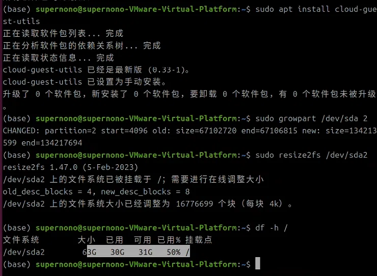

## Background

The user runs Ubuntu 24.04 in a virtual machine created with VMware Workstation Pro, and it had been going fine like that for about 7 months. But after one restart the system failed to reach the graphical login screen and reported `[FAILED] Failed to start gdm.service - GNOME Display Manager.`

On that screen the user tried `Ctrl + Alt + F2` to drop straight into a character terminal (`tty1`), which showed `Ubuntu 24.04.4 LTS ... tty1` and asked for a login. The user could log in fine, but `gdm3 (the GNOME Display Manager)` never started, so there was no graphical interface.

## What happened

- After boot the system sat at the `tty1` command line with no GUI.
- Running `systemctl status gdm3` showed the service as `inactive (not running)`, but with no obvious error log.

- Running `sudo systemctl enable gdm3` produced the warning "The unit files have no installation config", meaning it could not be set to start at boot through `systemctl enable`.
- Trying `sudo apt install --reinstall gdm3` to reinstall it threw an `E: /var/cache/apt/archives/` error (output truncated), pointing at a problem with the APT cache or the disk space.
- `systemctl get-default` showed the system's default boot target was `multi-user.target` rather than `graphical.target`, which is why the GUI did not start on boot.

(most of the letters had even turned into little boxes — an encoding problem)

## Root cause analysis

After working through it step by step, the root cause turned out to be: **not enough disk space**.

Concretely, the virtual machine had been given `32GB` of disk when it was first set up, and **Stacer** confirmed that the root partition `/` was over 95% full.

Running out of disk space caused all of the following:

1. The `APT` cache directory `/var/cache/apt/archives/` could not be written, so reinstalling `gdm3` failed;
2. System services (including `gdm3`) may fail to start because they cannot create temporary files or logs;
3. On boot the system drops back to `multi-user.target` (command-line mode) on its own, to keep the GUI from falling over for lack of resources.

## What I did

### 1. Emergency disk cleanup

1. Ran `sudo apt autoremove` to delete unneeded dependency packages.
2. Ran `sudo apt autoclean` to clear the cache of already-downloaded old packages.
3. Ran `sudo journalctl --vacuum-size=100M` to shrink the system logs, freeing about `100MB`.
4. Ran `sudo rm -rf /var/cache/apt/archives/*` to empty the corrupted `APT` cache.
5. Ran `sudo apt update` to refresh the package sources.
6. Reinstalled `gdm3`: `sudo apt install --reinstall gdm3`.
7. Set the default boot target to `graphical.target`: `sudo systemctl set-default graphical.target`.
8. Started the gdm3 service: `sudo systemctl start gdm3`, and the GUI came back.

### 2. Growing the virtual disk for real

Looking into it, the system does not use `LVM` but plain partitions (in this system `sda2` is mounted directly as the root directory `/`).

1. Shut the virtual machine down and delete every snapshot in VMware Workstation.
2. In the VM settings, grow the hard disk from 32GB to 64GB.
3. Boot the VM, get to a terminal and run the commands below:
4. Install the grow tools: `sudo apt install cloud-guest-utils`.
5. Grow partition `sda2` (the root partition) into the unallocated space: `sudo growpart /dev/sda 2`.
6. Grow the filesystem (*ext4*): `sudo resize2fs /dev/sda2`.
7. Verify: `df -h /` showed the root partition at about `63GB` total with about `31GB` free, so the resize worked.

## Final result

The graphical interface came back completely, `gdm3` starts as it should and the login screen appears. Free space on the root partition went from under 2GB to 31GB, which fixed the lack of disk space at the root. The virtual machine has been running steadily since, and can install software and take system updates normally again.

## Takeaways

Running out of disk space is a common reason for system services (especially the GUI) failing to start, so `df -h` should be the first thing you check. And in a virtual machine, growing the virtual disk and extending the partition is a far more thorough fix than simply clearing out junk.

::: important
This article was translated by Hermes Agent; the original text can be found at ../../../postMortem/deploy/006_Ubuntu_gdm3_cannot_activate.md. The translation is for reference only.
Translation time: 2026-11-05
:::
