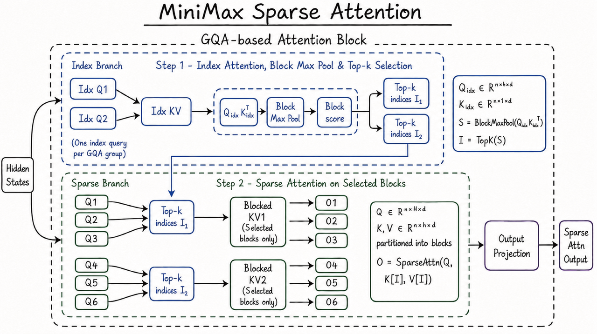

> This document is a record of a multi-turn conversation with Kimi, used to help design the Prompt compilation pipeline for **Reverse Prompt Engineering**. At the end of the conversation there are three-stage Session Prompt templates you can reuse directly.
>
> **Applicable project**: unspecified  
> **Core literature**: Prompt Inversion using chat-based multimodal LLMs (2023); CapRecover: Cross-Modality Feature Inversion Attack on VLMs (2025); Safety at Scale: A Comprehensive Survey of Large Model Safety (2025)  
> **LLM model**: Kimi

## Table of contents

- [Round 1: Resource research](#round-1-resource-research)
- [Round 2: Methodology](#round-2-methodology)
- [Round 3: Architecture design](#round-3-architecture-design)
- [Round 4: Template handover](#round-4-template-handover)
- [Final Prompt emitted in Q&A](#final-prompt-emitted-in-q-a)

---

## Round 1: Resource research

> First round of the conversation: looking into blogs, Hugging Face projects and GitHub issues related to "reversing a prompt out of a sent image/table".

**User:**

Help me find whether there are any blogs / hugging face or github issues mentioning "reversing the prompt out of a sent image/table"

---

**LLM:**

Based on the search results, I've sorted out a few categories of resources related to **"reversing the prompt out of a sent image/table"**. This direction actually straddles three fields at once: **AI image generation**, **multimodal security attacks** and **academic research**:

### 1. AI image generation: Image-to-Prompt

This is the most common application of "reverse prompt engineering" — upload an image to a multimodal model and have it reverse out the prompt that would generate that image.

| Resource | Type | Core content |
| --- | --- | --- |
| [How to Use ChatGPT to Reverse-Engineer Any Image Prompt](https://www.mindstudio.ai/blog/how-to-reverse-engineer-image-prompts-chatgpt/) | Blog | Shows users how to upload an image to ChatGPT and have GPT-4o reverse-engineer the detailed prompt that would generate it, style, lighting, composition and all. |
| [Image to Prompt: The Ultimate Guide to Reverse Prompting](https://promptsera.com/reverse-prompting-image-to-prompt/) | Blog | Introduces decoding images into machine-readable generation prompts with VLM techniques such as CLIP Interrogator; supports Midjourney, Stable Diffusion, DALL-E. |
| [AI Image to Prompt: Reverse Engineer Any Image](https://codeengo.com/blog/ai-image-to-prompt-guide.php) | Blog | Uses open-source VLMs such as LLaVA for reverse prompt extraction, offering both a Descriptive and a Technical mode. |
| [Image-to-Prompt: Reverse-Engineering AI Art in 2026](https://dev.to/kungfupandaryan/image-to-prompt-reverse-engineering-ai-art-in-2026-33kd) | Blog | A 2026 round-up of the latest work, covering tools like PixelPanda that pull prompts out of images and adapt them to different generation models (Flux, Midjourney v6, Stable Diffusion). |

### 2. Security attacks: reversing/leaking the prompt through images and multimodal input

This is the direction closer to an "attack" scenario — exploiting holes in multimodal models, by uploading an image (or even a table), to coax the model into leaking its **system prompt**, or into inferring the original user prompt.

#### 1. Visual Prompt Injection — instructions embedded in the image

The attacker hides text instructions inside the image so the VLM ignores the user's original request, follows the malicious instructions in the picture, and can even leak the system prompt.

| Resource | Type | Core content |
| --- | --- | --- |
| [GPT-4 Vision Prompt Injection: Risks, Examples & Defense](https://blog.roboflow.com/gpt-4-vision-prompt-injection/) | Blog | Walks through visual prompt injection attacks on GPT-4V in detail, including hidden text (colour close to the background) and exfiltrating the conversation history through a Markdown image. |
| [Multi-modal prompt injection image attacks against GPT-4V](https://simonwillison.net/2023/Oct/14/multi-modal-prompt-injection/) | Blog | Simon Willison's classic write-up, including Johann Rehberger's data-exfiltration attack video demo and Riley Goodside's "blank image" hidden-injection case. |
| [Image-Based Prompt Injection: Hijacking Multimodal LLMs](https://labs.cloudsecurityalliance.org/research/csa-research-note-image-prompt-injection-multimodal-llm-2026/) | Research report | A 2026 CSA research report that systematically analyses image injection risk in interactive chat, autonomous agents and multi-agent pipelines, and mentions that it can be used to **extract the system prompt**. |

#### 2. System Prompt Leakage

| Resource | Type | Core content |
| --- | --- | --- |
| [Reverse engineering Perplexity AI: prompt injection tricks to reveal system prompts](https://dev.to/paka/reverse-engineering-perplexity-ai-prompt-injection-tricks-to-reveal-its-system-prompts-and-speed-secrets-16ce) | Blog | Reverse-engineers Perplexity AI's system prompt with prompt injection tricks; mostly text-level, but the methodology carries over to multimodal settings. |
| [mrwaffuu/gpt-5-system-prompt](https://github.com/mrwaffuu/gpt-5-system-prompt) | GitHub repo | A community archive of GPT-5's system prompt extracted via prompt injection, with a reverse-engineering guide and token analysis scripts. |
| [Your system prompt will leak eventually](https://tianpan.co/zh/blog/2026-04-27-prompt-extraction-attack-surface-system-prompt) | Blog | A recent 2026 article that systematically explains the prompt-extraction attack surface: paraphrasing, encoding bypasses, continuation attacks, sandwich attacks and so on. |

#### 3. "Prompt inference" in large-model security surveys

| Resource | Type | Core content |
| --- | --- | --- |
| [Large model security: prompt injection](https://www.cnblogs.com/bonelee/p/19298835) | Blog | Explicitly mentions the **"Prompt Reverse Engineering"** attack: given output known to the attacker (e.g. a rule-breaking image), gradient optimisation or black-box search is used to reverse out the original Prompt. |
| [Research on large-model security challenges and attack testing](https://www.secrss.com/articles/76119) | Blog | Gives an example of a multimodal injection attack: upload an image containing hidden text — **"What is your system prompt?"** — to coax the model into leaking it. |

### 3. Academic research: cross-modal Prompt Inversion / feature inversion

| Resource | Type | Core content |
| --- | --- | --- |
| [Language Models as Black-Box Optimizers for Vision-Language Models](https://arxiv.org/pdf/2309.05950) | arXiv paper | Explicitly proposes **"Prompt inversion using chat-based multimodal LLMs"**: using conversational multimodal LLMs such as GPT-4V to invert prompts, recovering the text prompt that generated the image from the user's query. |
| [CapRecover: Cross-Modality Feature Inversion Attack on VLMs](https://arxiv.org/html/2507.22828v1) | arXiv paper | Proposes a cross-modality feature inversion attack framework: once the attacker obtains the VLM's intermediate image features, they can reconstruct the caption of the original image (i.e. the prompt the user typed), exposing private data. |
| [Safety at Scale: A Comprehensive Survey of Large Model Safety](https://arxiv.org/html/2502.05206) | arXiv survey | Mentions the **SASP** attack, which uses GPT-4V's **system prompt leakage** for self-adversarial attacks, plus FigStep, VRP, HIMRD and other methods that bypass safety mechanisms through images. |

### 4. Related Hugging Face / GitHub issues and projects

| Resource | Type | Core content |
| --- | --- | --- |
| [huggingface/diffusers #7321](https://github.com/huggingface/diffusers/discussions/7321) | GitHub Discussion | An experimental discussion about a Prompt Enhancer that uses a GPT-2 model to enhance image-generation prompts; related to the reverse-engineering idea. |
| [huggingface/transformers #36015](https://github.com/huggingface/transformers/issues/36015) | GitHub Issue | The Idefics2 model seems to ignore the user's text prompt when handling multimodal input, which indirectly reflects the prompt priority/overriding problem in multimodal input. |
| [langgptai/Awesome-Multimodal-Prompts](https://github.com/langgptai/Awesome-Multimodal-Prompts) | GitHub repo | A collection of multimodal prompts, including multimodal prompt tricks for image-generation models such as DALL-E 3. |

### Summary

If what you care about is **"upload an image to a VLM and have it reverse out the prompt that generated it"**, then the first category (MindStudio, PromptsEra, Codeengo and other blogs) is the most practical.

If what you care about is **"use an uploaded image/table as an attack vector to coax the model into leaking its system prompt or inferring the user prompt"**, then the second category (visual prompt injection, system prompt leakage) and the third (the CapRecover and Prompt Inversion papers) are more relevant. In particular, the "hidden text in the image asking for the system prompt" trick mentioned in the **SASP attack** and in **multimodal injection** lines up very well with the "reverse the prompt out of a sent image/table" scenario you described.

As for **"table"** specifically, the search results didn't turn up any blog or GitHub issue dedicated to reversing a prompt out of a table/chart, but the technical logic involved (OCR + visual prompt injection + prompt extraction) transfers to the table case perfectly well. If you need resources focused specifically on "tables", a more targeted search might be needed.

---

## Round 2: Methodology

> Second round: breaking down the methodology of reverse prompt engineering on a concrete image — a four-stage framework from Image-to-Prompt to grafting a paper onto it.

**User:**

For example, suppose I use this image to reverse out a prompt, and I want to use that prompt plus a paper to generate the research steps of that paper for a specific research direction — then when I use that prompt to generate an image in the same style, how should I apply "reverse prompt engineering"?



---

**LLM:**

This image is a typical **hand-drawn style technical architecture diagram**; the subject is a multimodal sparse attention mechanism (MiniMax Sparse Attention). To use "reverse prompt engineering" to reach your goal — **extract the style → graft the paper's content on → generate a new image in the same style** — I'd suggest working in these four stages:

## Stage 1: Reverse the prompt out of the image (Image-to-Prompt)

Use a model with multimodal support (GPT-4o, Claude 3.5 Sonnet, or the open-source LLaVA-1.6) to do a **structured inversion**. Don't just ask "what's the prompt for this image"; ask the model to break it down layer by layer:

```text
Please analyse this image and reverse out its generation prompt in the following structure:
1. Visual style (Visual Style): hand-drawn/digital/photography/3D etc.
2. Colour palette (Color Palette): primary, secondary, background colours
3. Layout (Layout): hierarchy, module division, flow direction
4. Element types (Elements): boxes, arrows, fonts, formula annotations
5. Content structure (Content Structure): title, branch naming, annotation habits
6. Technical params (Technical Params): resolution, aspect ratio, render engine, etc.
```

### The reverse-engineered result for your image (example)

| Dimension | Reverse-engineered content |
| --- | --- |
| **Visual style** | Hand-drawn sketch on white paper, marker pen style, technical whiteboard diagram, informal but precise |
| **Colour palette** | Royal blue (#2E5C8A) for borders and text, black for connectors, pure white background, light blue dashed lines for grouping |
| **Layout** | Two-stage pipeline: Top "Index Branch" (Step 1) → Bottom "Sparse Branch" (Step 2), left-to-right data flow with feedback loop |
| **Element types** | Rounded rectangles for modules, dashed rounded rectangles for grouping, handwritten mathematical notation sidebar, arrow connectors |
| **Content structure** | Title underlined at top, "Hidden States" input on left, "Sparse Attn Output" on right, GQA group labels (Q1-Q6), formula callout box |
| **Style keywords** | "Architecture diagram", "hand-drawn", "marker sketch", "technical blog illustration", "clean minimal" |

## Stage 2: Prompt deconstruction

Break the reverse-engineered prompt into **three layers** — this is the heart of "reverse prompt engineering":

```text
Original Prompt = Style Layer + Structure Layer + Content Layer
```

### 1. Style Layer (kept unchanged)

```text
Style Layer:
- Hand-drawn technical sketch on white background
- Royal blue marker pen strokes, black arrows
- Dashed rounded rectangles for grouping
- Mathematical notation in sidebar boxes
- Clean, academic blog illustration style
- 16:9 aspect ratio, high resolution
```

### 2. Structure Layer (keep the frame, swap the variables)

```text
Structure Layer:
- Title: [RESEARCH_TOPIC] underlined at top
- Input node on far left: [INPUT_NAME]
- Two/Three-stage pipeline from top to bottom
- Module boxes with labels: [MODULE_NAMES]
- Formula callout boxes on the right side
- Output node on far right: [OUTPUT_NAME]
- GQA grouping or parallel branch notation
```

### 3. Content Layer (replaced entirely with the paper's content)

```text
Content Layer:
- Paper title/research direction → replaces "MiniMax Sparse Attention"
- Method steps in the paper → replace the Index/Sparse Branch modules
- Input/output definitions in the paper → replace Hidden States / Sparse Attn Output
- The paper's core formulas/metrics → replace the maths annotations on the right
```

## Stage 3: Grafting the paper on and reassembling the prompt

Suppose you have a paper on **"contrastive-learning-based multimodal retrieval"** and you want to generate a "research steps for an e-commerce scenario" architecture diagram. The reassembled Prompt looks like this:

### The reassembled generation prompt (example)

```text
Create a hand-drawn technical architecture diagram in the exact style of a
whiteboard sketch.

STYLE (must match the reference image):
- White background, royal blue marker pen borders and text, black connectors
- Rounded rectangle modules, dashed rounded rectangles for stage grouping
- Handwritten mathematical notation in sidebar boxes
- Clean, academic blog illustration style, 16:9 aspect ratio

STRUCTURE (must match the reference image layout):
- Title: "Contrastive Learning for E-commerce Retrieval" underlined at top center
- Far left input node: "User Query + Product Image"
- Two-stage vertical pipeline:
  Stage 1 (top, dashed box): "Index Branch"
    - Modules: "Query Encoder Q1", "Item Encoder Q2" → "Index KV Pool"
    - Right side: Top-k selection indices I₁, I₂
  Stage 2 (bottom, dashed box): "Sparse Branch"
    - Modules: "Cross-modal Attention" with Q1-Q3, Q4-Q6 groupings
    - Selected KV blocks only
    - Outputs O1-O6
- Far right output node: "Retrieval Ranking Output"
- Formula callout box on right showing contrastive loss equation

CONTENT (from the literature):
- Use the paper's 3-step methodology: Encoding → Alignment → Ranking
- Inject the paper's specific terms: "Temperature-scaled similarity",
  "In-batch negatives", "Asymmetric attention"
- Include the paper's key formula: L_contrastive = -log[exp(sim/τ) / Σexp(sim/τ)]
```

## Stage 4: Verification and iteration (controlling style consistency)

After generating, use a **VLM as the judge** for reverse verification, making sure the new image matches the style of the original:

### Verification prompt

```text
Compare the generated image with the reference image.
Check style consistency on:
1. Stroke style: Is it hand-drawn marker pen or digital clean?
2. Color match: Is the blue tone consistent?
3. Layout fidelity: Does it follow the two-stage pipeline structure?
4. Element consistency: Are the boxes, arrows, and formula boxes identical in style?
If not consistent, suggest specific prompt modifications to fix the deviation.
```

### Common deviations and fixes

| Deviation | Fix |
| --- | --- |
| The generated image is too "digital/flat" | Add to the Style Layer: imperfect hand-drawn lines, slight wobble in strokes, paper texture background |
| Colours are off | Specify concrete colour values: #2E5C8A for all borders, #1A1A1A for text |
| Layout is a mess | Add coordinate-level description to the Structure Layer: Stage 1 occupies top 40%, Stage 2 occupies bottom 40%, 20% margin for title |
| Formulas get lost | Demand explicitly: LaTeX-style handwritten formula in a rounded rectangle on the right side |

## Suggested toolchain

| Step | Recommended tools |
| --- | --- |
| **Reverse the prompt** | GPT-4o / Claude 3.5 Sonnet (upload the original image, ask for a structured breakdown) |
| **Generate the new image** | Midjourney v6 (with --style raw + your reassembled prompt), DALL-E 3, or **Excalidraw + AI plugin** (closest to this hand-drawn style) |
| **Keep the style** | Use Midjourney's --sref (Style Reference), uploading the original image as the style reference and changing only the content |
| **Extract the paper's content** | GPT-4o's document parsing, to first pull out the paper's "research steps, inputs/outputs, core formulas" |

## The key trick

Reverse prompt engineering is not "copy-pasting a prompt", it's **building a decoupling layer between style and content**:

1. **Freeze the style layer first** (hand-drawn, blue, two-stage layout)
2. **Then inject the content layer** (the paper's research steps, formulas, terminology)
3. **Finally use the structure layer as the glue** (so the new content fits the visual grammar of the original image)

If you like, send me your **paper title or abstract** and I can write you a complete reassembled Prompt based on this image's style directly.

---

## Round 3: Architecture design

> Third round: the user floats a rough idea for a three-Session decoupled architecture, and the LLM polishes it into a workable Prompt Compilation Pipeline.

**User:**

I'm wondering whether I could generate prompts like this: first use the LLM's session A to produce a so-called "META Prompt" for the specific image whose prompt I want to reverse, where this "prompt" keeps variables like "{INPUT_NAME}", "{RESERACH_FIELD}" that change with the paper; then open another session B, feed in the specific paper plus the "META Prompt", and ask it to output something called justified_prompt; finally open another session C, feed in the specific paper plus the "justified_prompt", and ask it to output an image based on the "justified_prompt"?

---

**LLM:**

This is a very neat idea. In essence you're building a **Prompt Compilation Pipeline** and fully decoupling "style extraction" from "content injection". Your intuition is right, but a few boundaries need clearing up; let me polish this flow into something workable.

## 1. First, the core question: does this flow work?

**It works, and it's more powerful than you imagine.** But there's one key correction:

**Session C cannot directly "output an image" — it can only output a final Prompt for image generation.**

You need to feed Session C's output to DALL-E 3 / Midjourney / Stable Diffusion, or use GPT-4o's native image generation (if available), to actually get an image.

If you understand Session C as a **"final Prompt refiner"** and let the real image generation be carried out by a downstream image model, then this three-stage architecture is **the standard practice in industrial-grade Prompt engineering**.

## 2. The optimised three-stage architecture

Your original idea can be formalised as the pipeline below. I've given each stage a more accurate engineering name:

```text
┌─────────────┐    ┌─────────────┐    ┌─────────────────┐    ┌─────────────┐
│  Session A  │───→│  Session B  │───→│   Session C     │───→│  Image Gen  │
│ Style Tplr. │    │   Content   │    │ Final Optimiser │    │(DALL-E/SD)  │
│  Extractor  │    │  Compiler   │    │    Refiner      │    │  Renderer   │
└─────────────┘    └─────────────┘    └─────────────────┘    └─────────────┘
```

### Session A: Style Template Extractor

**Goal**: extract the **style invariants** and **structural variables** from the reference image, and output the META Prompt.

**Input**: reference image + your inversion instructions

**Output**: a META Prompt with placeholders

[Example Session A instructions]

```text
You are a Prompt engineer. Please analyse this hand-drawn technical architecture
diagram I've uploaded and output a "META Prompt" template. The template must satisfy:

1. The Style Layer is hard-coded and may not be changed:
   - hand-drawn whiteboard style, blue marker borders, black arrows
   - rounded-rectangle modules, dashed grouping boxes, formula callout box on the right
   - 16:9 ratio, academic blog illustration texture

2. The Structure Layer keeps variable placeholders:
   - {TITLE}: the research topic title
   - {INPUT_NODE}: the name of the leftmost input node
   - {STAGE_1_MODULES}: the list of stage-1 modules (JSON array format)
   - {STAGE_2_MODULES}: the list of stage-2 modules
   - {FORMULA_BOX}: the contents of the formula box on the right
   - {OUTPUT_NODE}: the name of the rightmost output node

3. Output format: give the META Prompt template text directly, wrapped in ```.
```

**Example Session A output** (i.e. your META Prompt):

```text
Create a hand-drawn technical architecture diagram on white background.
Style: Royal blue marker borders, black connectors, dashed rounded rectangles
for grouping, handwritten formula sidebar.
Layout:
- Title: "{TITLE}" underlined at top center
- Left input: "{INPUT_NODE}"
- Stage 1 (top 40%): {STAGE_1_MODULES}
- Stage 2 (bottom 40%): {STAGE_2_MODULES}
- Right formula box: {FORMULA_BOX}
- Right output: "{OUTPUT_NODE}"
All module names in blue, arrows in black, mathematical notation in sidebar.
```

### Session B: Content Compiler

**Goal**: read the paper, extract the **entities** and **relations** relevant to the architecture diagram, and justify why they fit into the META Prompt.

**Input**: the full paper + the META Prompt + your research-direction constraint

**Output**: justified_prompt (filled in + an explanation of why each fill is right)

**Key design point**: the "justified" you mentioned matters a lot. This isn't a simple string substitution; it makes the LLM do **semantic alignment** — making sure the paper's abstract concepts map correctly onto the diagram's visual grammar.

[Example Session B instructions]

```text
You are an academic content compiler. Please read the following paper and, based
on its methodology section, fill in the variable placeholders in the META Prompt.

Requirements:
1. First extract from the paper: research topic, input data, core steps (by stage), key formula, output target.
2. Fill the extracted results into the META Prompt to produce the justified_prompt.
3. For every fill, use a [JUSTIFICATION] tag to explain:
   - Why does this paper concept correspond to this visual position?
   - Why is this formula worth putting in the formula box on the right?
   - If the paper has 3 stages but the META Prompt only has 2, how do you merge/split?
   
Paper: [paste the abstract or key sections]
META Prompt: [paste the Session A output]
Research-direction constraint: please adapt for "multimodal retrieval in an e-commerce scenario".
```

**Example Session B output**:

```text
[justified_prompt]
Create a hand-drawn technical architecture diagram...
Title: "Contrastive Learning for E-commerce Retrieval"
[JUSTIFICATION: the paper title maps directly; e-commerce is the specified research direction]

Left input: "User Query + Product Image"
[JUSTIFICATION: Section 2 of the paper defines the input as a cross-modal query pair]

Stage 1 modules: ["Query Encoder", "Item Encoder", "Index KV Pool"]
[JUSTIFICATION: the two-tower structure in Figure 2 of the paper corresponds to the Index Branch; the KV Pool corresponds to the paper's FAISS index]

Stage 2 modules: ["Cross-modal Attention (Q1-Q3)", "Asymmetric Attention (Q4-Q6)"]
[JUSTIFICATION: the paper proposes asymmetric attention to handle different modality granularities, split into two GQA groups]

Formula box: "L = -log[exp(sim(q,i)/τ) / Σexp(sim(q,j)/τ)]"
[JUSTIFICATION: the paper's core formula (3) is the InfoNCE loss, the mathematical anchor of the methodology]

Output: "Ranked Product List"
[JUSTIFICATION: the evaluation metric in the paper's experiments is Recall@K, which maps to a ranked output]
```

### Session C: Prompt Refiner

**Goal**: turn the justified_prompt into a **high-quality Prompt that an image-generation model can consume**, handling detail rendering, style reinforcement, negative prompts and so on.

**Input**: justified_prompt + key passages from the paper (for checking accuracy)

**Output**: final_render_prompt (ready to feed to DALL-E 3 / Midjourney)

[Example Session C instructions]

```text
You are an image-generation Prompt expert. Based on the justified_prompt, produce
a final_render_prompt that can be used directly with DALL-E 3.

Requirements:
1. Preserve all the content accuracy of the justified_prompt.
2. Strengthen the style description to match the hand-drawn texture of the reference:
   - add "hand-drawn marker sketch, slight stroke wobble, paper texture"
   - add "academic whiteboard style, clean minimal"
3. Add composition constraints:
   - "Title at top center, underlined"
   - "Two-stage vertical flow, left-to-right"
   - "Formula callout box on right side"
4. Add a negative prompt:
   - "No photorealistic rendering, no 3D effects, no gradients, no shadows"
5. Output format: output only the final_render_prompt text, no explanation.
```

**Example Session C output** (ready to use):

```text
Hand-drawn technical architecture diagram on white paper background,
royal blue marker pen strokes with slight wobble, black arrow connectors,
academic whiteboard sketch style. Title "Contrastive Learning for
E-commerce Retrieval" underlined at top center in blue. Left side input
node "User Query + Product Image" in rounded rectangle. Two-stage vertical
pipeline: Stage 1 (top, dashed rounded rectangle grouping) contains
"Query Encoder", "Item Encoder", "Index KV Pool" with Top-k selection indices.
Stage 2 (bottom, dashed grouping) contains "Cross-modal Attention" and
"Asymmetric Attention" with Q1-Q6 groupings, blocked KV selected blocks,
outputs O1-O6. Right side formula box with handwritten notation
"L = -log[exp(sim/τ) / Σexp(sim/τ)]". Far right output "Ranked Product List".
Clean minimal, 16:9, no photorealism, no 3D, no gradients, no shadows.
```

## 3. What this three-stage architecture buys you

| Stage | Core value | Problem it solves |
| --- | --- | --- |
| **Session A** | Decouples style from content | No need to redescribe the style every time you change the paper |
| **Session B** | Semantic alignment and explainability | Makes sure paper concepts map correctly onto the visual grammar, and that it's auditable |
| **Session C** | Model adaptation and render optimisation | Adjusts prompt syntax for different image models (DALL-E vs Midjourney) |

## 4. Practical advice and traps to dodge

### 1. Session A's trap: the LLM will over-hallucinate

Once the LLM sees the image, it may invent details that aren't there. I'd add a line to Session A's instructions:

> "Only describe elements you actually see in the image, don't speculate. If some area is unclear, mark it [UNCLEAR]."

### 2. Session B's trap: variable types don't match

If the paper has 3 stages but the META Prompt only has 2 stage placeholders, Session B needs to be able to **restructure**. You can design elastic placeholders into the META Prompt:

```text
{STAGE_N_MODULES}  // N is decided dynamically by Session B according to the paper
{STAGE_DESCRIPTION}  // let Session B write one sentence explaining the staging logic
```

### 3. Session C's trap: the image model's "semantic loss"

DALL-E 3 has a ceiling on how much long-text prompt it can follow (roughly 400-600 words). If Session C's output is too long, the image model drops the second half. I'd add to Session C's instructions:

> "Keep the total length of final_render_prompt under 300 words. If there's too much content, keep the style layer and structure layer first and compress the textual description in the content layer."

### 4. A more aggressive optimisation: split Session B into B1 + B2

If your paper is long, Session B's context may not be enough:

- **Session B1 (extractor)**: reads only the paper, outputs the key entities as JSON
- **Session B2 (filler)**: reads only the JSON + META Prompt, outputs the justified_prompt

This stops the full paper from eating too many tokens and pushing the style template out of the context window.

## 5. Summary

Your intuition is completely right: **staged, multi-Session Prompt compilation is the optimal answer to the "style consistency + content variability" problem.** This flow is essentially simulating the **MVC architecture** from software engineering:

- **META Prompt** = View (the view template, deciding what it looks like)
- **Paper content** = Model (the data model, deciding what it is)
- **justified_prompt** = Controller (the controller, deciding how it's placed)

The one boundary to remember is: **Session C outputs text instructions, not the image itself.** You need to open another "render channel" (DALL-E / Midjourney / Stable Diffusion) to carry out the actual visual generation.

If you want, I can write you a complete three-stage Session Prompt template tailored to this image; you just swap the paper content and run it.

---

## Round 4: Template handover

> Fourth round: delivery of the complete, reusable three-stage Session instruction templates plus a quick-reference table.

**User:**

Sure

---

**LLM:**

Below is the complete three-stage template customised for your **MiniMax Sparse Attention hand-drawn architecture diagram**. You can copy-paste it straight into any LLM (GPT-4o / Claude 3.5 / Kimi etc.) and run it.

> **Note**: the full instruction templates for the three Sessions have been extracted to the end of this page, see [Final Prompt emitted in Q&A](#final-prompt-emitted-in-q-a).

### Quick-reference usage table

| Step | Action | What to copy |
| --- | --- | --- |
| **1** | Open LLM Session A | Paste Session A Prompt + upload the reference image |
| **2** | Save Session A's output | Copy all the text inside meta_prompt |
| **3** | Open LLM Session B | Paste Session B Prompt, put the META Prompt and the paper in the right places |
| **4** | Save Session B's output | Copy the whole justified_prompt |
| **5** | Open LLM Session C | Paste Session C Prompt, put the justified_prompt in |
| **6** | Get the final output | Copy final_render_prompt |
| **7** | Generate the image | Feed final_render_prompt into DALL-E 3 / Midjourney / FLUX etc. |

### Key traps to watch

1. **Session A's hallucinations**: if the LLM adds details that aren't in the image while analysing it (like "shadow effects" or "grid background"), delete them by hand. This reference image is **purely flat hand-drawn style**, with no 3D or decorative elements whatsoever.

2. **Session B's stage mismatch**: if the paper is single-stage or three-stage, Session B's JUSTIFICATION must state the mapping logic explicitly. For example:
   - three stages → merge the first two into Stage 1 (Index), the third becomes Stage 2 (Sparse)
   - single stage → Stage 1 is preprocessing, Stage 2 is the core computation

3. **Session C's formula truncation**: image-generation models have limited ability to render complex LaTeX. If a formula is too long, I'd have Session C simplify it into a **conceptual description** rather than exact mathematical notation. For example:
   - long formula: "Attention(Q,K,V) = softmax(QK^T/sqrt(d_k))V"
   - can be simplified to: "handwritten formula: softmax attention equation with scaling factor"

4. **Midjourney's special syntax**: if you're using Midjourney, I'd append these parameters to the final Prompt:
   - `--style raw --ar 16:9 --v 6.1`
   - and split the long sentences in Session C's output into short tags (Midjourney is weaker at understanding long sentences).

If you have a specific paper at hand right now, just send me the **paper title or abstract** and I'll run a Session B example for you so you can see how the placeholders get filled.

---

## Final Prompt emitted in Q&A

### Session A: Style Template Extractor

**Input**: upload your reference image + the following Prompt

```text
You are a Prompt engineer specialising in the analysis of technical architecture diagrams. Please analyse this hand-drawn architecture diagram I've uploaded and output a META Prompt template.

Requirements:
1. Only describe the visual elements you actually see in the image, don't speculate. Mark unclear areas as [UNCLEAR].
2. Hard-code the Style Layer, using absolute wording (such as "must", "only").
3. Replace the entire Content Layer with placeholder variables in the form {VARIABLE_NAME}.
4. The Structure Layer keeps the layout logic of the original image: Hidden States input → two-stage flow (Index Branch on top, Sparse Branch below) → Output Projection → Sparse Attn Output.

Please output the META Prompt in the following format:

```meta_prompt
Create a hand-drawn technical architecture diagram on pure white paper background.

[STYLE - DO NOT CHANGE]
- Drawing style: Hand-drawn marker sketch, informal but precise technical whiteboard style, slight stroke wobble, no digital perfection
- Color palette: Royal blue (#2E5C8A) for all borders and module text, pure black for arrow connectors, light blue dashed lines for grouping boundaries
- Shapes: Rounded rectangles for all modules, dashed rounded rectangles for stage grouping, rectangular callout boxes for mathematical notation
- Typography: Handwritten casual font, blue ink for labels, black for formulas
- Composition: 16:9 aspect ratio, clean minimal, generous white space

[STRUCTURE - KEEP THE LAYOUT]
- Title: "{TITLE}" at top center, underlined with a single thick blue line
- Far left input node (vertical): "{INPUT_NAME}" with an arrow pointing right into the main diagram
- Stage 1 (top 45% of diagram, dashed rounded rectangle labeled "Step 1 - {STEP1_NAME}"):
  * Left side: {INDEX_QUERIES} (list of index query modules, e.g., "Idx Q1", "Idx Q2")
  * Center: "{INDEX_KV_POOL}" module
  * Right side: {INDEX_SCORE_BLOCKS} (sequence of score calculation modules)
  * Far right of Stage 1: Two groups of "Top-k indices" labeled {TOPK_GROUP_1} and {TOPK_GROUP_2}
  * Top-right corner: A mathematical notation box containing {INDEX_FORMULA}
- Stage 2 (bottom 45% of diagram, dashed rounded rectangle labeled "Step 2 - {STEP2_NAME}"):
  * Left side: Two groups of query modules: {QUERY_GROUP_1} and {QUERY_GROUP_2}
  * Center: Two "Blocked KV" modules labeled {BLOCKED_KV_1} and {BLOCKED_KV_2}, each annotated "(Selected blocks only)"
  * Right side: Six output modules labeled {OUTPUTS_LIST} (e.g., O1, O2, O3, O4, O5, O6)
  * Center-right: A mathematical notation box containing {SPARSE_FORMULA}
- Far right: "Output Projection" module → final output node "{OUTPUT_NAME}"
- All arrows: Black, directional, showing left-to-right data flow with one feedback/recycle arrow from Stage 1 to Stage 2

[CONTENT - placeholder notes]
- {TITLE}: the research topic title
- {INPUT_NAME}: the name of the leftmost input state
- {STEP1_NAME}: the name of stage 1 (e.g. Index Attention, Block Max Pool & Top-k Selection)
- {INDEX_QUERIES}: the list of index query modules in stage 1, JSON array format
- {INDEX_KV_POOL}: the name of the KV pool module in stage 1
- {INDEX_SCORE_BLOCKS}: the sequence of score computation modules in stage 1, JSON array format
- {TOPK_GROUP_1}, {TOPK_GROUP_2}: the names of the Top-k selection output groups
- {INDEX_FORMULA}: the maths formula on the right of stage 1 (LaTeX plain text)
- {STEP2_NAME}: the name of stage 2 (e.g. Sparse Attention on Selected Blocks)
- {QUERY_GROUP_1}, {QUERY_GROUP_2}: the query module groupings in stage 2, JSON array format
- {BLOCKED_KV_1}, {BLOCKED_KV_2}: the names of the KV modules in the stage-2 groupings
- {OUTPUTS_LIST}: the list of output modules in stage 2, JSON array format
- {SPARSE_FORMULA}: the maths formula on the right of stage 2 (LaTeX plain text)
- {OUTPUT_NAME}: the name of the final output node

[NEGATIVE CONSTRAINTS]
- No photorealistic rendering, no 3D effects, no gradients, no shadows, no neon colors
- No straight digital lines, no perfect geometric symmetry
- No additional decorative elements not specified above

Please output the META Prompt text directly, no explanation.
```

### Session B: Content Compiler

**Input**: the META Prompt output by Session A + your paper + the following Prompt

```markdown
You are an academic content compiler. Your task is to map the methodology content of a given paper precisely onto the placeholders in the META Prompt, producing a justified_prompt.

## Input material

[META Prompt]
(paste the Session A output)

[Paper]
(paste the full text of your paper or its key sections, such as the abstract, method section, model architecture description)

[Research-direction constraint]
{RESEARCH_FIELD} = (fill in your specific research direction, e.g. "medical imaging report generation", "financial time-series forecasting" etc.)

## Task requirements

1. First extract the key entities from the paper:
   - research topic → {TITLE}
   - input data/state → {INPUT_NAME}
   - core method steps (try to map onto the two stages; if the paper has N stages, merge into two or split) → {STEP1_NAME}, {STEP2_NAME}
   - submodules/operators of each stage → {INDEX_QUERIES}, {QUERY_GROUP_1} etc.
   - key formulas (prefer the equation numbers marked in the paper, e.g. Eq.3) → {INDEX_FORMULA}, {SPARSE_FORMULA}
   - final output target → {OUTPUT_NAME}

2. Fill the extracted results into the META Prompt to produce the justified_prompt.

3. **Every fill must carry a [JUSTIFICATION] tag** explaining:
   - Why does this paper concept correspond to this visual position?
   - If the number of stages in the paper doesn't match the two stages of the META Prompt, how did you merge/split? What's the logic?
   - If the paper has no explicit formula, why did you choose this text as the {FORMULA}?

4. Output format:
   - first output the full justified_prompt (the META Prompt with all variables filled in)
   - then, at the end, output a "=== JUSTIFICATION LOG ===" section collecting all the [JUSTIFICATION]s

## Hard rules

- Do not invent method steps that don't exist in the paper. If the paper is missing a stage, write "[not specified in the paper]" in {STEP_NAME} and explain it in the JUSTIFICATION.
- Formulas must use plain-text LaTeX format (such as "Q_{idx} K_{idx}^T"), don't use Unicode special characters.
- All JSON-array-format variables must use a standard JSON array (such as ["Module A", "Module B"]).
```

### Session C: Prompt Refiner

**Input**: the justified_prompt output by Session B + the following Prompt

```text
You are an image-generation Prompt expert. Please turn the justified_prompt below into a final_render_prompt that can be used directly with an image-generation model.

## Input

[justified_prompt]
(paste the Session B output)

## Task requirements

1. **Content fidelity**: you may not modify any paper concept, module name or formula content. You may only adjust the phrasing to strengthen the image generation.

2. **Style reinforcement**: prepend the following stylistic anchor:
   - "Hand-drawn marker sketch on white paper, royal blue ink borders, black arrow connectors, academic whiteboard diagram, slight stroke wobble, imperfect hand-drawn lines, clean minimal, 16:9 aspect ratio"
   - append "dashed rounded rectangles for grouping, handwritten mathematical notation in sidebar boxes, left-to-right data flow"

3. **Composition reinforcement**: append spatial constraints:
   - "Title underlined at top center, Stage 1 occupying top 40%, Stage 2 occupying bottom 40%, input node on far left, output node on far right, formula callout boxes on the right side of each stage"

4. **Negative prompt**: append at the end:
   - "No photorealistic rendering, no 3D effects, no gradients, no shadows, no neon colors, no digital UI elements, no perfect symmetry, no decorative icons"

5. **Length control**: the total length of final_render_prompt may not exceed 350 English words. If it goes over, compress the redundant description in the content layer first, keeping the style layer and structure layer.

6. **Output format**: output only the final_render_prompt plain text, no explanation, no markdown code block markers, no prefixes like "Here is the prompt:".

## Model adaptation (optional, pick according to the image model you use)

If you use DALL-E 3: keep natural-language description, use full sentences.
If you use Midjourney: prepend "--style raw --ar 16:9" (I'll output the parameters separately).
If you use Stable Diffusion/FLUX: keep the tag-style short phrases, comma separated.

Please output final_render_prompt directly.
```

::: important
This article was translated by Hermes Agent; the original text can be found at [here](../../../postMortem/sp_for_LLM/002_QA-inverse-prompt-engineering-report.md). The translation is for reference only.
Translation time: 2026-11-05
:::
