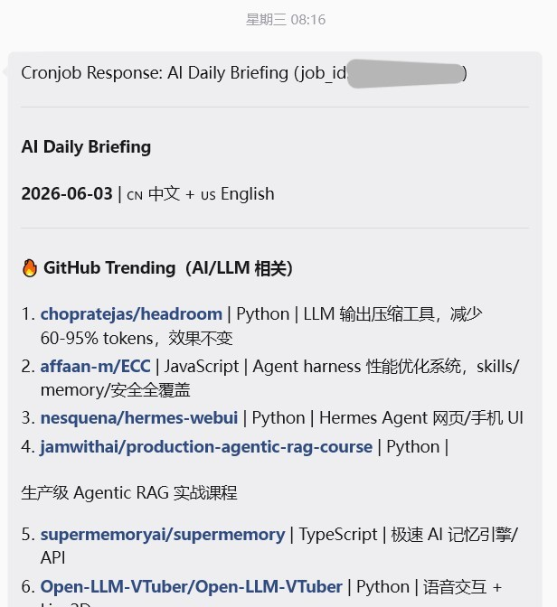
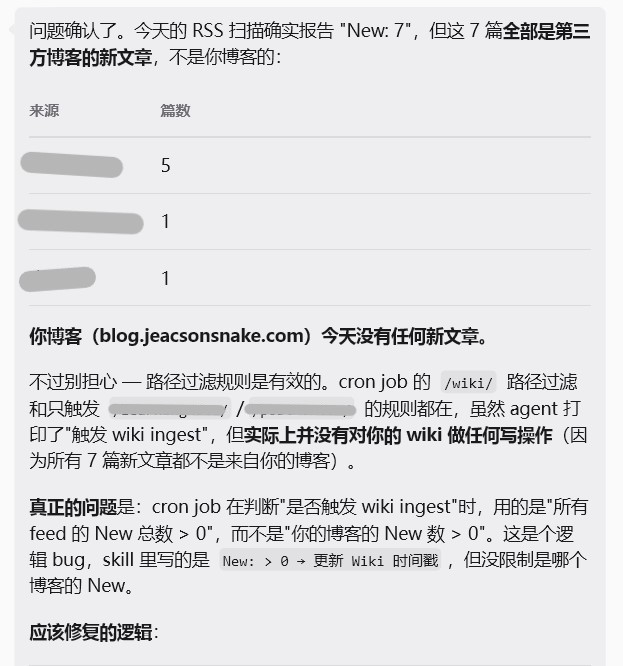
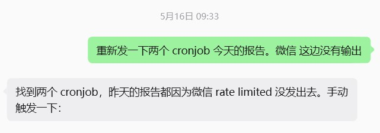
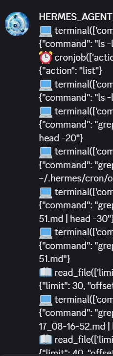
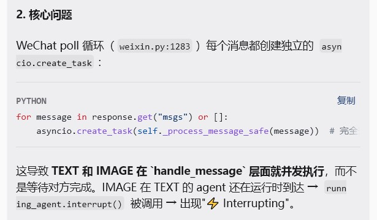
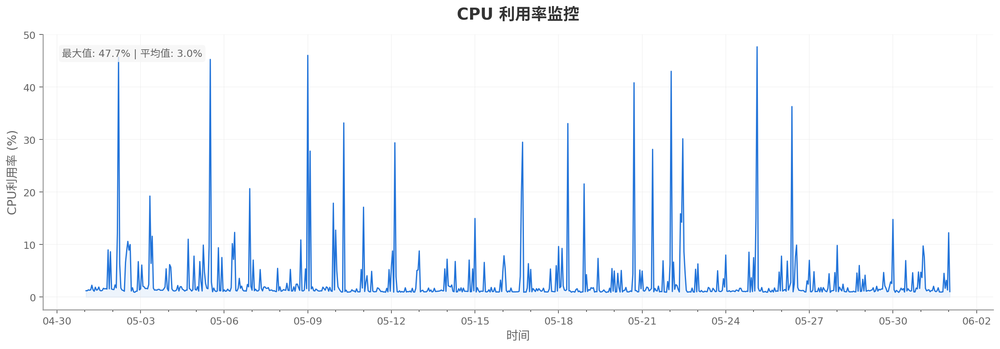
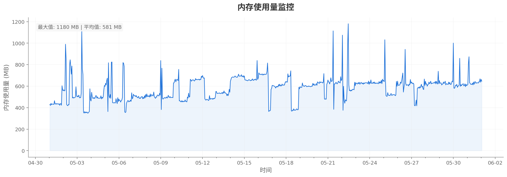
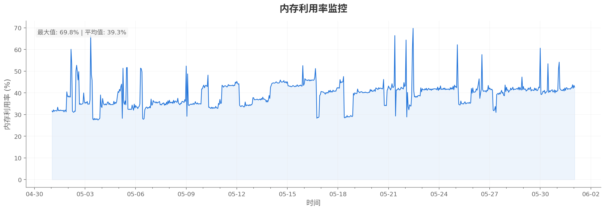
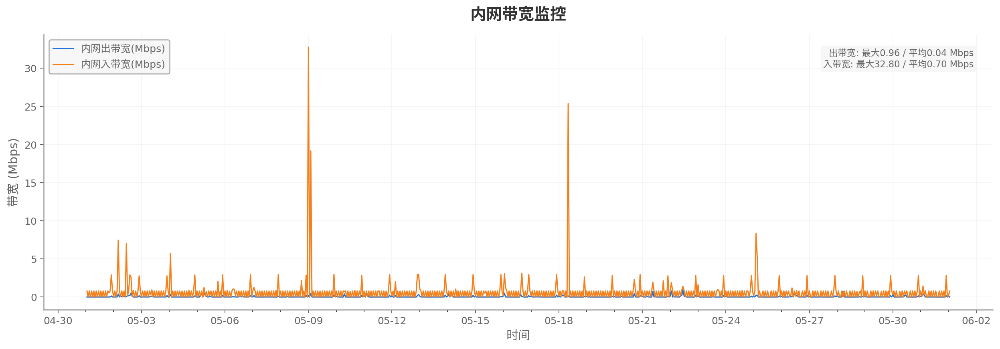
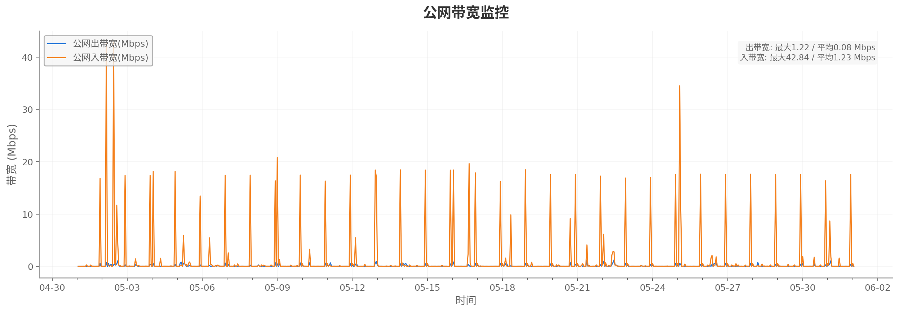

> This document is the blog author's initial record of using `Hermes Agent` over the period "from mid-April 2026 to early June". It covers, but is not limited to, a few configuration pitfalls and some musings brought on by the constant stream of new releases from `Hermes Agent` / `LLM`.
>
> **Applicable project**: AI Agent (Hermes Agent here, though some of the methodology should carry over to other AI agents)  
> **Period of use**: 2026.4.13~2026.6.7  
> **LLM models**:
> *Main model*: Minimax-2.6/Minimax-2.7/Minimax-3  
> *fallback model*: kimi-k2.5/kimi-k2.6/Deepseek-v4-flash  
> **Main environment**: Tencent Cloud entry-level instance:  
> *CPU* 2 cores, *memory* 2GB, *system disk* 40gb SSD cloud disk, *traffic package* 200GB/month (3Mbps bandwidth)  
> **OS**: Ubuntu Server 24.04 LTS 64bit

---

## Initial tasting notes: config & ideation record

> The following are some of the author's thoughts.

### Preface

After I discovered `Hermes agent` on 12 April, I started trying to find a server to set this `Agent` up on. Way back when `openclaw` first got popular I was actually just watching from the sidelines the whole time; it was only once this `Hermes agent` design idea showed up — the "you can adjust every `skill` and the connections between them yourself" one — that I really started using this `Agent`. But the thing that actually got me using it non-stop was learning that `Andrej Karpathy` had proposed this so-called `LLM wiki` architecture, and realising I could indeed use an `AI agent` to do this kind of thing. After all, I built this blog myself back in July and August 2023, and it holds a bunch of notes I've put together, so I figured "using this architecture to manage my own blog, and then waiting until I'm working and can keep using an `AI agent` to distil a working methodology out of it" was fairly important for my own development later on. I can't guarantee this idea will still hold up in five years, three years, or even six months (because tech moves pretty "fast" these days = =), but I still reckon I need to get involved with this stuff, otherwise it's far too easy to get stuck in your own ways.

It's a bit like something I heard someone say online a while back, summarised: "if you tried to do things with `AI` two years ago, then the direction you took is bound to be completely different from the direction now. And as time goes on, there'll be less and less you have to learn. Put another way, if you didn't learn it before, what you learn now is easier; but if you don't learn it now, then maybe later you really won't need to learn it at all."

::: center
(some unknown anime-section UP host on Bilibili)
:::

Not having to learn it cuts both ways: on one hand you no longer have to spend loads of time, energy and `AI` `token`s on a single thing the way you used to; on the other, if you never learn it, you can't guarantee that the work you do later won't just get replaced by `AI` outright — in which case you probably won't need to use `AI` either.

That said, from what I've seen other people run this architecture on `Obsidian`, rather than directly inside a `Vuepress` blog like mine. Which makes sense, to be fair: managing files the database-ish `Obsidian` way is probably a bit easier to query, and you don't have to sort out the links between files by hand like I do now. From my earlier rough understanding, `Obsidian` has its own dedicated file-linking setup — you can pull up something like a mind map, or a web-shaped mind map, and find the connection between one file and the others at any time. But since I've already got this blog, there's no need for `Obsidian`. (Mainly because actually wiring the blog up to `Obsidian` is a real pain, so I'll just keep maintaining the blog for now. When there really is a need for `Obsidian`, I'll look at how to migrate the articles over.)

### In the very beginning

The `Hermes agent` I'm using now got reinstalled three times between when I first touched it on 13 April and 17 April. At the very start I used the `Hermes agent` build template that ships with Tencent Cloud, but as I used it I found that building with that template pins some of the config down, so the customisation side is a pain to modify. So afterwards I configured it twice more, or rather installed two different `Ubuntu` systems and put `Hermes agent` on top of `Ubuntu`.

(It was only while writing this article that I suddenly remembered my server has never had a snapshot taken, so I hurried off and took one...)

Most of my configuration followed the install steps laid out in the `Hermes agent` official docs (i.e. [this URL](https://hermes-agent.nousresearch.com/docs/zh-Hans/)). (Only while writing this did I discover the official docs already have Chinese support. Before that I was cross-referencing [someone else's translated Chinese site](https://hermes-doc.aigc.green/), otherwise the very beginning really was confusing...)

The model I wanted to use at first was `Kimi-k2.5`, but since I also need `Kimi Code` over in the lab, using that model on my own `AI agent` would very easily have the two sides fighting over the `token` quota, so I went looking for another model, `mini Max-V2.6`, and took `Kimi-k2.6` (which had just come out at the time) as the `fallback model`. Though later, after the `Deepseek-V4` version came out, I didn't switch either — I just kept it as the fallback model.

When I first configured `Hermes agent`'s `gateway`, I used `WeChat`. The `WeChat` side talks to the `AI Agent` through something called the `ilink API`. But after actually using it for these two months, it feels like `WeChat`'s support for `AI agent`s really isn't all that good, because the scheduled tasks I've been running for the past month and a bit — the `cronjob`s I'll get to below — can't reliably push log info to the user through the `gateway` that `WeChat` provides. We'll get into that in detail later.

### Then it showed up

I've always thought you need enough data before you can make an accurate judgement, so at the start I only ever intended to use `Hermes agent` as a toy. I remembered that people writing blogs back in the day would provide `RSS`-style `feed sources` for users/followers to subscribe to, so around then I tried adding `RSS` to my blog and tried using `FOLO` to subscribe. Once that was done it suddenly occurred to me: could I have `Hermes agent` use `FOLO` to hunt down reliable `RSS` sources for me, and then every day send me a daily-report style round-up of `AI` or `LLM` news? So I had it make a `cronjob` like that, having `Hermes agent` run the task every morning at seven and send me the round-up. But because the server I'd bought was sitting in Guangzhou, scraping those `RSS` feeds turned out to be really difficult. Then a few days later I came across an open-source project on `GitHub` called `Agent-Reach` ([project link here](https://github.com/Panniantong/Agent-Reach`>)), and realised that while I'd been trying to get information via `feed sources`, someone had already worked out a whole method for using an `AI agent` to gather information. (Though honestly, getting to use someone else's wheel is pretty great — building the wheel is just too painful.) So afterwards I combined the `RSS` monitoring setup with the `Agent-Reach` approach and let the two act as shared sources for information gathering. Which made finding information from `Twitter`, or from `GitHub`, or from `arXiv` much simpler.

::: center

A screenshot of the daily briefing from a few days ago
:::

Then around 15 April, while browsing Weibo, I saw a blog post describing `LLM wiki` in some detail, explaining the architecture that `Andrej Karpathy` (who later joined `Anthropic`, but that's another story) had put forward on `Twitter`. After reading it I suddenly realised this `AI agent` was actually a bit useful to me, not purely a toy. I know nothing at all about `RAG` and the like, but I still felt that if I could have something like the **Earth Library** from *a certain tokusatsu show*, with a *certain character* in it, it'd be quite helpful for organising information later, so I decided to combine `Hermes agent` with `this existing blog` and build an `LLM wiki`. Though I didn't build the architecture myself — I sent `Karpathy`'s blog write-up and "a repo someone else had built reproducing it" that I found on GitHub to `Hermes agent`, and had it use those as reference to make a so-called *home-grown LLM wiki* that's "roughly the same architecture in theory but probably not quite the same in actual code". You can click `wiki` in the navbar above to have a look, or check the `wiki` folder down in this blog's source to see what the files it generated actually look like.

### Ideals are plump

After I got this `LLM wiki` going, I actually left it alone for over a month. Because I was busy on my end with exams, writing reports, writing papers and a whole pile of other things, I never got round to updating my blog either. It was only these past few days, when I finally had some downtime to start updating the blog again, that I found it actually still has a few problems. Though these problems are mostly because I didn't put any relevant limits in when I wrote the `skill` back then:

For instance, I found that: `Hermes agent` will take the `wiki` it updates onto the blog, treat it as something new on the blog, ruminate on it, and then put the newly-ruminated news back onto the `wiki` (an ouroboros at this point...). Luckily, when I set it up I'd created a new `GitHub` account for it in advance and had it `fork` my blog source from that account, then submit a `Pull Request` to me after making changes for me to review — otherwise the source could have been messed up in one go.

::: center

There was even a case of "because the `RSS source blog` updated, it updated my blog" (voice lost)
:::

Another thing I found: when `Hermes agent` is editing, because the `prompt` itself is somewhat descriptive and isn't a file structure it can go by, a lot of what `Hermes agent` does can't be fully reproduced. Because the broader the requirements I give it and the more files I hand it, the more its final result tends towards something middling, with no way to be targeted. It's a bit like going to the barber and telling `Tony` what kind of hairstyle I want, piling on restrictions — but what hairstyle actually comes out? Generally you leave it to fate (。 So I'm currently trying to revise it, to see whether I can turn the stuff it produces into an actual file structure, so that when it needs to update later it can fill content into the existing files according to that structure, or create new files. That should make revising it later a bit better.

(Though having said that, I'm actually in a waiting state myself. I feel like there's bound to be homework I can copy for this kind of thing later, so I'll first make a rubbish one I'm satisfied with, and then when there's homework to copy I'll chuck the homework at `Hermes agent` and have it revise based on that — that's my thinking~)

### Three heroes versus Lü Bu

Ever since I found that `WeChat`'s `ilink API` resists the `cronjob` style of interaction — "pushing several messages at the user at a set time without any discussion" — and will just intercept things in the backend when it hasn't sent them (`Hermes agent` shows it as sending too frequently, but if you have `Hermes agent` manually trigger the `cronjob` once, that message doesn't appear at all), I've been trying to find other `gateway` options.

:::center

*be like (there was even a space-time mix-up)
:::

So I tried using `Discord` as another `gateway`, and it wasn't until I used `Discord` that I realised the interaction `WeChat` offers is actually pretty useless. Because `WeChat`'s own interaction model really isn't suited to how an `AI agent` interacts.

First, when I'm interacting with an `AI agent`, what I actually want more is "being able to confirm its working state" and "what methods it's calling when faced with certain jobs", and with `WeChat` all of that is completely unknown. In `Hermes agent` there's an option called `verbose`, meaning that once you turn it on it can write out for you everything `Hermes agent` does while carrying out a task, including "what skill it called", "what commands it ran on the `TUI`" and so on, so you have a better idea of what it's actually doing in the background. But the information you can see on `WeChat` is far, far less than what you see on `Discord`. So I used to think `verbose` mode only gave you that much information.

:::center

What you can see on Discord (never fought such a well-supplied battle, honestly)
:::

And once the `gateway` on the WeChat side gets your message, it only shows its working state by changing the name info at the top to *`typing...`*, but you can't tell whether it's finished. So when I first started using it, the situation often came up where "you think it's done, so you send another message. But it actually hasn't finished on its end, the task gets interrupted, and then 80% of everything it did goes down the drain." Whereas the `Discord` `gateway` can change the emoji reaction under the message, letting the user judge whether the task it was given has actually been finished.

:::center

*a tick is correct
:::

Second, using `WeChat`'s `gateway` there's no way to send text and an image to `Hermes agent` at the same time, the way you can with other models on a website. Because `WeChat`'s way of sending text and images (at least when I was using it) is concurrent execution (meaning it's not packed into one package, it's *sending two packages at once*). Which left `Hermes agent` not knowing I'd sent an image, and the messages sent afterwards got jumbled up.

:::center

*be like
:::

I tried a lot of ways to fix it, but the end result wasn't great. Whereas `Discord` can publish an image and text to the `gateway` at the same time.

So after that I had `Hermes agent` send the briefing info to both the `Discord` and the `WeChat` `gateway` separately, so that even if I can't get the log on the `WeChat` side because of the so-called rate limiting, I can still get it on `Discord`. And gradually I moved over to the `Discord` `gateway` to ask questions too, because that way I can also use the multiple sub-channels it creates itself to tell different `session`s apart. (A little aside here: when I had `Hermes agent` adjust the briefing's `delivery` field itself, it wrote the config wrong, so after I'd configured `Discord` I got no briefing on either side the next day. It wasn't until I went back to check that I found it had gone wrong during configuration. Though I've already forgotten whether the `BUG` was "when turning a string into an array it didn't change the value type inside" or something like that)

Then I found that `Discord` itself lazy-loads too (head in hands). When its message reaches your phone, it usually shows up as a pop-up in the notification bar at the top. If you tap the push notification in the bar and go straight into `Discord`, you'll find maybe only half the briefing has loaded, maybe only a third or a quarter, and the other half looks like it's vanished. I originally thought it was a network problem stopping it loading, but when I logged into the web version of `Discord` I found it had in fact all been sent out, it's just that `Discord` on my Android end wasn't able to display it all. It wasn't until I looked up the relevant info that I learned `Discord` lazy-loads: it won't, or can't, dump everything out at once, and you need to wait 10 minutes, 20 minutes, or even an hour or two and go back in before you can see the full message it sent you. Which creates a problem: although I'll admit my sleep schedule isn't exactly normal (I'm working on it TT), if I happen to see its message right when I get up in the morning and tap in, I can't see the full info; but if I get up a bit later, by which point it's been sent for a while, then when I look I can see the complete briefing.

So things went the way you'd expect: I found another `gateway`: `Feishu`, as a third `gateway` on top of those two. Though on the `Feishu` side it's unclear why it intermittently can't split a `session` out, at least for now it can display the briefing output by the `cronjob` in full.

So at the moment I use three different `gateway`s for this `AI agent` interaction. What I'm doing is fairly low-level, admittedly...

### So you're saying I actually still can't get it to generate images decently?

Halfway through using it, `gpt-img-2` came out, so I started trying to work out how to hook that into `Hermes agent`, so that if I needed to get illustrations for my blog I could send it the article and have it generate a diagram for a particular section, which would also make the information easier to digest. And then I found that I actually had no way to use it, because my `GPT` account (created back before the region lock, though that's beside the point) is missing a payment method or something, so I couldn't use it. Later, while looking stuff up, I found my `Hermes agent` can use different models for different text and images. So I went on `Open Router` and picked a free model (`qwen/qwen3-vl-8b-instruct`) to generate images with. Of course I never actually used that model to generate images afterwards either — it's a bit like writing a placeholder first, then changing it when I really need to revise.

So yeah...

:::center

*Wat Can I Say
:::

### Summary: Frankenstein counts as a person in some sense

After nearly two months of use, I wouldn't dare claim I've built some grand project, but at least when facing other `AI agent`s later on I won't be so intimidated... Though there's plenty I haven't got to, like how `Hermes agent` now puts your messages in `/queue` by default when it's sending, or how using the `/reset` command on it in the `gateway` used to `reset` directly and was later changed to asking whether you want to `reset` (though I turned that prompt off afterwards anyway), or having it change its own `memory` type from `built-in memory` to `holographic memory`, and so on and so on. I'll get to that later (coo coo coo).

## May usage records

> The following is data monitoring from this server for the period from `2026-05-01T09:00:00+08:00` to `2026-06-01T09:00:00+08:00`, including `CPU utilisation monitoring`, `memory usage monitoring`, `memory utilisation monitoring`, `internal bandwidth monitoring` and `public bandwidth monitoring`. For reference only:

### CPU utilisation monitoring

### Memory usage monitoring

### Memory utilisation monitoring

### Internal bandwidth monitoring

### Public bandwidth monitoring

::: important
This article was translated by `Hermes Agent`; the original text can be found at [here](../../../postMortem/sp_for_LLM/003_think-Initial-notes-on-using-Hermes_Agent.md). The translation is for reference only.
Translation time: 2026-11-05
:::
