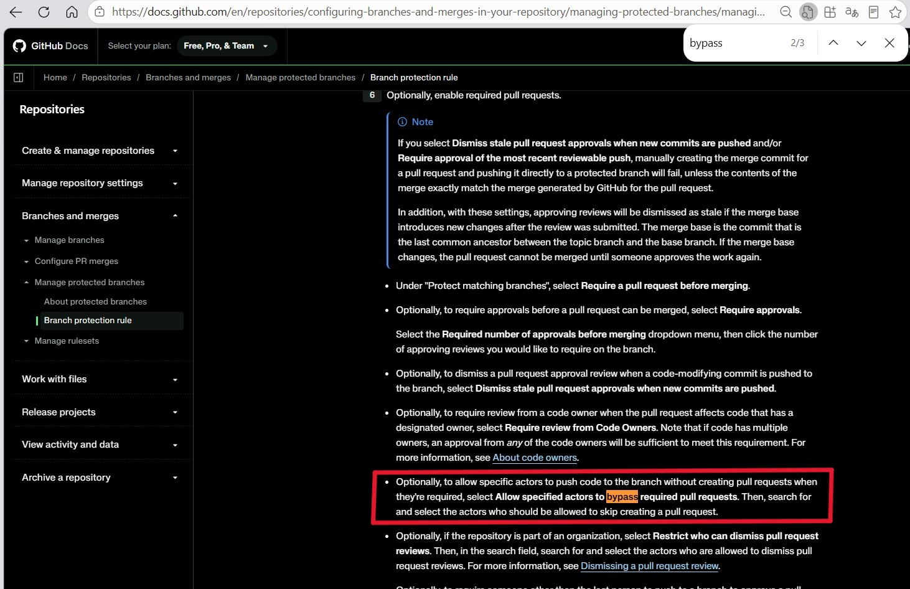

> This document is a full retrospective of the work from 2026-10-14 to 2026-10-18: turning the old "merge the AI daily briefing archive PR by hand every day" routine into a fully automatic pipeline, and hitting three structural problems in a row while landing it — **the merge-base invariant of a three-dot diff**, **doubled branch protection on master**, and **the ruleset bypass of a GitHub App**.
>
> ---
> Most of the content was put together by Hermes Agent from the sessions; I only did the factual checking and edits, so it is better to have an AGENT read and chew over it before you read it. I cannot promise there is no logical inconsistency in this article, so please keep that in mind (bows)
>
> ---
> **Sessions involved**:
>
> | Session | Model | Session time | Role |
> |------|----------|----------|------|
> | Session A | deepseek-flash | 2026-10-14| topology design, GitHub-side landing, skill / cron prompt rework |
> | Session B (daily archive run) | deepseek-flash | a fixed time every day | archive execution and pipeline receipts |
> | Session C (feishu) | kimi-for-coding | 2026-10-15 | fault diagnosis, fix design, live verification |
>
> **Original session source**: feishu
> **Subject keywords**: AI Daily Briefing, auto-archive, merge-base, three-dot diff, GitHub Ruleset, Branch Protection, GH013, GH006, GitHub App bypass, Cron Job

## Contents

- [Background and problem definition](#background-and-problem-definition): the requirement, the target topology and the objects at play
- [Phase 1: landing the topology](#phase-1-landing-the-topology): design, user-side landing, and one "fake success"
- [Phase 2: hop-1 precheck rejects the whole batch](#phase-2-hop-1-precheck-rejects-the-whole-batch): the real reason PR #40 was rejected
- [Phase 3: squash only syncs content](#phase-3-squash-only-syncs-content): the ancestry is unchanged, both guards are still dirty
- [Phase 4: delete and rebuild, and two gates](#phase-4-delete-and-rebuild-and-two-gates): GH013 → GH006 → delete the classic rule
- [Phase 5: end to end](#phase-5-end-to-end): hop-1 → hop-2 → deploy all green
- [Phase 6: checking the live content](#phase-6-checking-the-live-content): pages, structural parity, artefact consistency
- [Deep technical analysis](#deep-technical-analysis): merge-base, the two layers of protection, failure criteria
- [Conclusions and follow-up suggestions](#conclusions-and-follow-up-suggestions): key conclusions and optional hardening

---

## Background and problem definition

I had defined two cron jobs in my `Hermes Agent` for collecting and archiving AI industry information. One, `AI Daily Briefing`, generates a bilingual (Chinese/English) AI industry briefing; the other, `AI Briefing Archive`, cleans, translates and verifies the generated briefing and pushes it to this blog.

Before the change, the last mile of the `AI Briefing Archive` flow was **manual**. Specifically, at a fixed point in time the archive job would tidy the briefing files, push a new branch to `GitHub` named to the fixed pattern `briefing-archive-<date>-<genre>`, open a Merge PR with its upstream Actions, and I would review it and click `Squash & Merge` to land it.

When I built the `AI Briefing Archive` job at the end of September / start of October, the original idea was to have it archive automatically. But I had doubts about full automation, worried that leaving it completely unattended would cause bigger problems later. So to get the idea moving (or rather, to lower my own worry), I stepped back and tried the earlier stage first: testing how stable the job was at cleaning up files, and keeping the final "click merge" for myself as a further review step. After letting it run automatically for two weeks, I judged that the job **under the current production environment and configuration** was running well, and decided to do the next upgrade.

So I put a requirement to the Agent: automate that "click merge" too, without widening the attack surface. Specifically:

> I want the archives submitted by this job, and only by this job, to be merged into master automatically; every other change made by the Agent keeps the "needs human review + manual merge" rule.

### Target topology

After some tidying up and discussion, the Agent and I settled the whole design; the existing files would be revised as follows:

1. The archive job keeps its current logic and commits the same files as before;
2. Modify the GitHub workflow `docs.yml`;
3. Add a new GitHub workflow `daily-to-master.yml`;
4. Change the relevant GitHub Actions permissions so that it can merge branches automatically.

The execution logic is:

```txt

the archive job pushes the files to `briefing-archive-<date>-<genre>` (SSH deploy key; the push event fires normally)
  → triggers docs.yml : gh pr create (base branch is daily)
  → whitelist precheck of the PR files → gh pr merge --squash into daily   ← hop-1
  → gh workflow run daily-to-master.yml --ref master
  → triggers the `merge-daily-into-master` action: guard (three-dot diff whitelist) → `git merge --no-ff` → push to the master branch   ← hop-2
  → the master push triggers deploy-website → the site updates
  → schedule as a fallback: to avoid a possible timestamp misalignment
```

Along the way we defined several design points that "look simplifiable but must not be touched":

| Design point | Why it has to be this way |
|---|---|
| hop-2 uses a `workflow_dispatch` Action rather than `on: push: [daily]` | hop-1 merges the PR with `GITHUB_TOKEN`, and its push event gets swallowed by GitHub's recursion protection, so `on: push: [daily]` would never fire |
| dispatch must use `--ref master` | a workflow definition follows the ref: a push-triggered run runs the file from the pushed branch, and putting the guard script on a branch a PR can modify is the same as letting it vouch for itself |
| master's merge credential lives in an Environment secret (environment `master-merge`, deployment branch limited to `master`) | as a repository secret, a run on any ref could read it |
| App permissions deliberately exclude Workflows | once daily contains a `.github/workflows/**` change, pushing it to master is structurally rejected — one more layer of fallback |
| The guard whitelist only allows `docs/{en/}Scheduled_Automatic_AI_Industry_Analysis_Report/{daily,monthly}/*.md` | widening it to `docs/**` would allow touching `docs/.vuepress/**`, which means script injection |

### The objects at play

| Property | Value |
|---|---|
| Repository | `JeacsonSnake/JeacsonBlog` (public) |
| Branches | `master` (default, protected), `daily` (archive staging, unprotected) |
| Ruleset | `PR_BEFORE_MERGE` |
| Environment | `master-merge` (deployment branch limited to `master`) |
| Merge identity | GitHub App `jeacsonblog-daily-merge` (bot account `jeacsonblog-daily-merge[bot]`) |
| Local tool identity | `Hermes-cRl1` fine-grained PAT (**read-only**: `permissions.push=false` |

---

## Phase 1: landing the topology

In phase 1 the user side landed all the workflow definitions and protection rules:

| Time (CST) | Event |
|---|---|
| 10-14 11:13 | session starts, requirement settled |
| 10-14 20:28–21:42 | the automation definitions land on master: PR **#39** adds `daily-to-master.yml` (merged 13:22:59Z), a direct push `ci: route briefing archive PRs to daily + auto-merge` (13:31:43Z), `Change cron schedule to daily at 12:17 UTC` (13:42:00Z) |
| 10-14 21:14 / 21:21 | ruleset `PR_BEFORE_MERGE` created / updated (with the App bypass) |
| 10-14 21:36 | first manual hop-2 run (**run1**, a `workflow_dispatch` Action) → `completed/success` |

### One "fake success"

Even though **run 1** above reported `success`, breaking it down to the step level showed problems:

```txt
JOB: Guard and merge daily into master | completed/success
steps: ... 4:Guard — only archive content may reach master=success;
        5:Merge daily into master=skipped; 6:Alert and fail on guard block=skipped
```

The guard computed `daily is 0 commits ahead of master` at the time, and the program then exited with `skip=1`. So the `push` path **was never actually executed, not once**. That success made it look as if "merge credential + ruleset bypass both work", when in fact they had simply never been touched.

> **Lesson 1**: a `success` on an automation pipeline has to be checked at step level. A guard skipping because "there is nothing to merge" and an actual merge look exactly the same in the run conclusion.

That step also planted the second problem: those three commits (including `daily-to-master.yml`) landed **directly on master**, and the `daily` branch had never been synced with `master` since it forked off from the file stamp of the previous `master`. It looked harmless at the time, but the problem showed up the next day.

---

## Phase 2: hop-1 precheck rejects the whole batch

### The scene

The next day the archive cron ran normally locally: the daily report body was complete (9004 characters), `verify_pairs.py --kind daily` passed (1 pair, problems 0 / warnings 0). But when it was pushed as the single-commit branch `briefing-archive-2026-10-15-daily`, hop-1 failed:

```txt
##[error]PR contains files outside the archive directory, refusing to auto-merge: .github/workflows/daily-to-master.yml + .github/workflows/docs.yml
```

which left the next step `Dispatch daily→master merge` skipped. PR **#40** (base=daily) sat open, 4 files / +374-1, still open when checked again 6 minutes later.

### Root cause: the PR file list is a three-dot diff

By querying the file list we found:

```json
// gh api repos/.../pulls/40/files
[
  ".github/workflows/docs.yml",
  ".github/workflows/daily-to-master.yml",
  "docs/Scheduled_Automatic_AI_Industry_Analysis_Report/daily/2026_10_15.md",
  "docs/en/Scheduled_Automatic_AI_Industry_Analysis_Report/daily/2026_10_15.md"
]
```

Investigating afterwards, we realised that the baseline of the archive branch was the **master tip**, while `daily`, the branch the archive branch is merged into, had never merged master's later changes and was still stamped at the 10-14 archive commit `86150db5`. So:

```txt
merge-base(daily, archive branch) = 86150db5     ← that commit does not contain the two workflow files
three-dot diff = tree-diff(86150db5, archive branch)  →  the two workflow files + the two daily reports
```

And the precheck script in the `workflow` does exactly one thing — `gh pr view --json files`. If any path other than the archive whitelist is present there, it rejects the whole batch, so even a perfectly correct archive **gets rejected anyway**. The receipt for that period was the newly added fourth state:

> ④ hop-1 precheck rejected → the PR stays OPEN and is not merged into daily (because daily lacks master's `.github/workflows/**` commits)

::: details Appendix: "tool-call chain: how to locate in three steps why the PR file list has extra workflow files"

**Call 1**: `gh api repos/JeacsonSnake/JeacsonBlog/pulls/40/files --jq '.[].filename'`

```json
{ "state": "open", "mergeable": true, "mergeable_state": "unstable",
  "base": "daily", "head": "briefing-archive-2026-10-15-daily" }
.github/workflows/daily-to-master.yml
.github/workflows/docs.yml
docs/Scheduled_Automatic_AI_Industry_Analysis_Report/daily/2026_10_15.md
docs/en/Scheduled_Automatic_AI_Industry_Analysis_Report/daily/2026_10_15.md
```

**Call 2**: `git merge-base origin/master origin/daily` / `git merge-base origin/daily origin/briefing-archive-2026-10-15-daily`

```txt
86150db5...
86150db5...
```

**Call 3**: `git diff --name-status origin/daily...origin/briefing-archive-2026-10-15-daily`

```txt
A .github/workflows/daily-to-master.yml
M .github/workflows/docs.yml
A docs/Scheduled_Automatic_AI_Industry_Analysis_Report/daily/2026_10_15.md
A docs/en/Scheduled_Automatic_AI_Industry_Analysis_Report/daily/2026_10_15.md
```

Both merge-bases point at `86150db5`, and that commit contains no workflow file — the conclusion of the four-dot diff was already sealed at call 2.

:::

---

## Phase 3: squash only syncs content

As described above, we have by now worked out that the bug came from the archive branch being based on the **master tip**, but at the time that was not clearly understood, so the following change was made.

### The user's first step: open a PR to push master into daily

> **User:** I've opened a PR to push the master branch into the daily branch, and that PR has been merged successfully. What do you think we should do next?

PR **#41** (head=master, base=daily) was merged at 13:34:54Z. It looked right. But checking it showed a fix that was "right and useless":

| Check | Result | Meaning |
|---|---|---|
| parents of `git log -1` daily tip `597f962a` | only **one**: `86150db5` | this is a **squash merge**, master's three commits never entered daily's ancestry |
| blob SHA of the two workflow files (master vs daily) | identical (`89236d47…` / `09715a29…`) | the **content** really was synced |
| `compare/0615ddfa...daily` | diverged / behind_by=3 | the ancestry in the graph is unchanged |
| `merge-base(daily, archive branch)` | still `86150db5` | the PR file list is still 4 files |
| `git diff --name-status origin/master...origin/daily` | `A daily-to-master.yml` / `M docs.yml` | the hop-2 guard will block it as soon as it runs + open a bogus issue |

Put simply: because creating a `Merge Commit` with "Create a merge commit" and creating one with "Squash & Merge" differ in the file's commit history, and the fix in PR **#41** actually overwrote the file commit history, the fix did not work.

::: note What is the difference between creating a `Merge Commit` with "Create a merge commit" and with "Squash & Merge"?

Creating a `Merge Commit` with "Create a merge commit" copies the file's **complete** commit history over **untouched**.

Creating one with "Squash & Merge" **squashes all the commits** of the file **into a single commit**, and only then commits.

So "Squash & Merge" loses the file's **complete** commit history, which is why that change solved nothing.

```bash
git clone --filter=blob:none --no-checkout https://github.com/JeacsonSnake/JeacsonBlog.git
git merge-base origin/master origin/daily          # → 86150db5  ← the lesion
git diff --name-status origin/master...origin/daily # → the two workflow files
git diff --name-status origin/daily...origin/briefing-archive-2026-10-15-daily
# → 4 files (two workflows + two daily reports)
```

:::

A read-only token cannot push a branch, so Hermes Agent, without touching the remote, rehearsed three possible fixes locally:

| Option | Approach | hop-1 precheck input | hop-2 guard input | Verdict |
|---|---|---|---|---|
| A a real merge commit | `git merge --no-ff origin/master` | only the 2 daily reports left | tree-diff empty | ✅ clean at both ends |
| B delete and rebuild | delete `daily`, recreate from master | only the 2 daily reports left | tree-diff empty | ✅ equally effective (cost: PRs based on daily get closed automatically) |
| C squash / rebase once more | move the content only | still 4 files | still lists the workflows | ❌ as useless as the first attempt |

> **Lesson 2**: GitHub's PR file list, and the `git diff A...B` both guards use, are built on **merge-base**. merge-base is a concept on the **graph** — equal content does not move it. So "copying the files over" has only two possible fates: establish ancestry, or change nothing at all.

---

## Phase 4: delete and rebuild, and two gates

I tried merging once more on top of what was there, but as described above the "fix" had actually overwritten the file commit history, so it was meaningless.

### The user's second step: decide to delete daily → rebuild from master → open the PR by hand and merge it in

> **User:** I did the following: Branches page → delete daily → New branch from master named daily. Manually opened a PR with the UI from briefing-archive-2026-10-15-daily to daily and squash-merged it. Then I tried running merge-daily-into-master manually in Actions again and it failed. Can you help me look?

After this step the file topology was fixed:

```txt
daily tip = 1becffd7 (the squash of PR #43, parent = master tip 0615ddfa)
compare/master...daily      → ahead 1, files are only the two daily-report md files   ✅
git rev-list --count master..daily → 1                          ✅
```

After that fix `master` was still stamped at `0615ddfa` (the push was rejected, nothing changed). In other words: **only the final push was left**.

So we then ran the `workflow_dispatch` Action by hand to check the route was viable — but————

### Failure one: GH013 — the ruleset rejected the App's push

run **2** (`38747487734`, `workflow_dispatch`, ref=master, 13:59:55Z):

```txt
4:Guard — only archive content may reach master = success   ← the guard let it through!
5:Merge daily into master = failure
```

The merge itself succeeded in the log, but the push ran into trouble:

```txt
Merge made by the 'ort' strategy.
 .../daily/2026_10_15.md | 123 +++++++++++++++++++++
 .../daily/2026_10_15.md | 123 +++++++++++++++++++++
 2 files changed, 246 insertions(+)
remote: error: GH013: Repository rule violations found for refs/heads/master.
remote: - Changes must be made through a pull request.
 ! [remote rejected] master -> master (push declined due to repository rule violations)
```

We tried the "fallback" of setting the original ruleset enforcement to Disabled (14:15:41Z) and ran run **4** (`38749841799`, 14:15:55Z); the error changed:

### Failure two: GH006 — with the ruleset off, classic branch protection

```txt
remote: error: GH006: Protected branch update failed for refs/heads/master.
remote: - Changes must be made through a pull request.
 ! [remote rejected] master -> master (protected branch hook declined)
```

### How did those two failures come about?

**These are two different gates**:

| | Error code | Where it is configured | State at the time |
|---|---|---|---|
| ruleset | `GH013 Repository rule violations` | Settings → Rules → Rulesets → `PR_BEFORE_MERGE` | had a bypass list, but it did not take effect |
| classic branch protection | `GH006 Protected branch update failed` | Settings → Branches → rules → `master` | still there, and with no bypass list |

### The turn: the classic rule's bypass list is only available to organisation repositories

Hermes Agent then suggested the user could look, in the project repository settings, for the "Require a pull request before merging" option used when the `branch` rule was set up, and use `Allow specified actors to bypass required pull requests` to get the bypass.

But in fact I went through the whole `Require a pull request before merging` block and never found `Allow specified actors to bypass required pull requests`,:

> **User:** I found absolutely no "Allow specified actors to bypass required pull requests" inside the "Require a pull request before merging" block. ...even with the other (options, ed.) ticked, the option simply is not there.

And when I went to the docs to look up `Allow specified actors to bypass required pull requests`, it turned out to be a bit problematic:

> Optionally, to allow specific actors to push code to the branch without creating pull requests when they're required, select **Allow specified actors to bypass required pull requests**. Then, search for and select the actors who should be allowed to skip creating a pull request.



[The quote is here](https://docs.github.com/en/repositories/configuring-branches-and-merges-in-your-repository/managing-protected-branches/managing-a-branch-protection-rule)

After searching, Hermes found: the docs really do describe this option, but there is a sentence right under it that is easy to skip:

> **Actors may only be added to bypass lists when the repository belongs to an organization.**
> —— GitHub Docs, *About protected branches* / *Managing a branch protection rule*

In other words: **a personal-account repository's classic branch rule has no bypass list at all**; only a Ruleset's bypass is open to personal repositories. So the right answer for the user was: delete the classic rule for the branch and keep only the Ruleset.

### The fix and the "unverified success"

```txt
14:15:41Z  ruleset enforcement = disabled (fallback)
14:3x      delete the classic branch protection rule
14:38:35Z  run 5 (38753214548, ref=master) = success
14:38:51Z  deploy-website run 198 (push master, actor=jeacsonblog-daily-merge[bot]) = success
14:42:26Z  ruleset enforcement = active (restored)
```

The first real merge commit appeared on master: `0ae60d93` "chore: merge daily archive into master", with parents `[0615ddfa, 1becffd7]`. The blobs of the two 10-15 daily reports (`233c54ef…` / `24c12178…`) are byte-identical to the archive branch.

But that success **was not worth much**:

- when run 5 succeeded the ruleset was still Disabled — meaning "can the App actually bypass the ruleset" **was still never really tested even once**;
- earlier, run 2 (ruleset still active) had that same App's push rejected with GH013; that may have been from the period when the App was not yet on the bypass list, but neither explanation can be ruled out.

> **Lesson 3**: a success obtained after switching one gate off cannot be used to prove that gate is configured correctly. Verification must **test one gate at a time**, and a real push has to happen — a guard skip with `AHEAD=0` does not count.

---

## Phase 5: end to end

On the third day, the archive cron job reached its scheduled time and ran naturally for the second time:

| Stage | Result |
|---|---|
| hop-1 branch push | run **199** (`38886767282`, push `briefing-archive-2026-10-16-daily`) = **success** |
| PR **#44** | base=daily, **auto squash-merged** at 10:22:28Z |
| hop-2 | run **7** (`38886801034`, `workflow_dispatch`, actor `github-actions[bot]`) = **success**; the "Guard" and "Merge daily into master" steps **both success** |
| master | `1a3c512f` "chore: merge daily archive into master", parents `[0ae60d93, 10a3f6a4]` |
| deploy | run **200** (`38886824728`, push master) = **success** |
| ruleset | `active` throughout (untouched since 10-15 14:42Z) |

**That run answered two open questions at once**:

1. **A ruleset's App bypass does work for direct pushes**. For the first time the whole pipeline ran with "the ruleset in force", and the push was accepted.
2. **The schedule fallback really does fire**. run 6 (10-15 17:08:25Z) and run 8 (10-16 16:45:22Z) were both `schedule` events and both succeeded — but both were **4~5 hours late** (the cron says `17 12 * * *` UTC). So it can only be a fallback, not insurance that the day heals itself.

---

## Phase 6: checking the live content

> **User:** Looks like our change is fine and it has run through successfully. Can you confirm the content of October 16 online?

Instead of looking at run conclusions, look at what a reader actually sees: pull the live HTML + the raw md on master, and compare in three layers.

| Check | Chinese page | English page |
|---|---|---|
| HTTP status | **200** | **200** |
| Page H1 | `AI Daily Industry Briefing \| 2026-10-16` (Chinese page) | `AI Daily Industry Briefing \| 2026-10-16` |
| Body heading hits | all 9 headings in the md (7×h2 + 2×h3) **appear on the page, 0 missing** | same, 0 missing |
| Footer | `Generated automatically by Hermes Agent` (Chinese page) | `Generated automatically by Hermes Agent` |
| sitemap | indexed | indexed |
| blob (master vs archive branch) | `3c24a68b…` identical | `7a18379a…` identical |

**Chinese/English structural parity** (counting the raw md on master directly, bypassing the render layer):

| Metric | Chinese | English | Criterion |
|---|---|---|---|
| `##` count | 7 | 7 | equal |
| `###` count | 2 | 2 | equal |
| List items | 45 | 45 | equal |
| URLs | 21 | 21 | equal |
| `@handle` | 37 | 37 | equal |
| Scaffolding leftovers (`✅` / `use this section` / `(at most` / `TRACKED` / `keep this section heading` / `API connection failed`) | 0 | 0 | hard ban |

A sample of the body text also confirmed it had been translated properly.

## Phase 7: the final change

As described above, we later worked out that the bug came from the archive branch being based on the **master tip**, so we made the following change:

Switching the archive branch's baseline from `master` to `daily`:

``` diff
- retry git fetch -q origin master
- git checkout -q master && git reset -q --hard origin/master
- git checkout -q -b "$BR" master

+ retry git fetch -q --depth 5 origin '+refs/heads/daily:refs/remotes/origin/daily' \
+                                        '+refs/heads/master:refs/remotes/origin/master'
+ git checkout -q --detach origin/daily && git reset -q --hard origin/daily
+ git checkout -q -b "$BR" origin/daily

```

This way, no matter how many blog posts I publish on master locally from now on, those files will never show up again in the PR submitted by the `AI archive job`.

---

## Deep technical analysis

### 1. Why "syncing the content" cannot save a three-dot diff

The semantics of the three diffs have to be kept apart:

```txt
git diff A B      → tree-diff(A, B)               the difference between two trees
git diff A..B     → tree-diff(A, B)               (same as above, two dots equal a space)
git diff A...B    → tree-diff(merge-base(A,B), B)  ← only this one depends on the shape of the commit graph
```

GitHub's PR file list (`pulls/N/files`, `gh pr view --json files`) and this project's two guards all eat the third kind. And **merge-base is decided only by the commit graph**:

```txt
State 1 (10-15 morning, before the squash)
  master: 0615ddfa ── 86150db5 ── ...
  daily : 86150db5                       merge-base = 86150db5 (no workflow files there)
  → the three-dot diff necessarily counts the two workflow files

State 2 (after the PR #41 squash)
  master: 0615ddfa (contains the workflow commits)
  daily : 597f962a (single parent 86150db5, content identical to master)
  merge-base(daily, archive branch) still = 86150db5   ← content changed, the graph did not
  → the three-dot diff is still 4 files

State 3 (after the delete-and-rebuild / a real merge commit)
  daily : 1becffd7 (parent = 0615ddfa)
  merge-base(daily, archive branch) = 1becffd7 = daily tip → only the daily-report files are left
```

There is exactly one criterion: **is `git merge-base origin/master origin/daily` equal to the master tip** (on the daily side, equivalently "does daily contain the master tip"). Concluding from "the blob SHAs on both sides are the same" will crash — this article is a live example (all SHAs identical, merge-base unmoved).

### 2. What the three ways of syncing actually do

| Way | Content | Ancestry | hop-1 afterwards | hop-2 afterwards |
|---|---|---|---|---|
| `gh pr merge --squash` (PR #41) | ✅ synced | ❌ not established | precheck still rejects | guard still blocks (and reports the workflow files as out of bounds) |
| `git merge --no-ff` / "Create a merge commit" in the PR | ✅ (content already identical) | ❌ not established (actually different, because `squash & merge` lost the file stamps) | rejects even with only the archive files left | one extra empty-content merge commit on master, |
| delete the branch and rebuild from master | equivalent to "daily = master tip" | ✅ | only the archive files left | tree-diff empty → `guard=ok` |

### 3. master's two layers of protection and the two kinds of "bypass"

| Layer | Mechanism | Error code | Bypass list support | Available to personal repos? |
|---|---|---|---|---|
| Ruleset | `PR_BEFORE_MERGE` (require PR + 1 approval + code owner review) | `GH013` | GitHub App / roles / deploy keys | ✅ |
| classic | branch protection rule | `GH006` | users / teams / **apps** — but **organisation repos only** | ❌ the option does not appear |

The official wording (the same note appears in both docs): **"Actors may only be added to bypass lists when the repository belongs to an organization."**

So for a personal-account repository the right posture is **to use a ruleset only**: delete the classic rule, and use the ruleset's `pull_request` rule + App bypass to cover the "automation must be able to push directly" requirement, while everything else still goes through a PR + approval. That is where this ended up: `branches/master` shows `protected: true` while `protection.enabled: false` (the classic layer is empty, only the ruleset is in force), which is expected rather than a half-finished configuration.

### 4. How to read a hop-2 failure (criteria table)

| Symptom | Meaning | What to do |
|---|---|---|
| `runner=(empty)`, `steps=[]` | wrong ref: `environment: master-merge` only allows `master` | when running manually, `Use workflow from` must be master |
| `Guard` = success, `Merge daily into master` = failure | the ruleset / branch protection rejected the push (check whether the code is GH013 or GH006) | fix the bypass; do **not** re-push the branch, do not touch the archive |
| `Guard` = blocked (with a `⚠️ daily→master guard blocked` issue) | changes outside the archive directory got into daily | check `git diff --name-status origin/master...origin/daily` |
| the whole run is success but `Merge daily into master` = **skipped** | the guard had `AHEAD=0`, nothing to merge | this is not evidence that "push works" |

### 5. Checking identities: who is actually pushing

A GitHub App's bot account looks like `<app-slug>[bot]`. This time the identity was pinned down from "the actor of the deploy run triggered by the push":

```json
{"run_number": 198, "event": "push", "head_branch": "master",
 "actor": "jeacsonblog-daily-merge[bot]", "triggering_actor": "jeacsonblog-daily-merge[bot]",
 "status": "completed", "conclusion": "success"}
```

The App name configured in the bypass list must match it, and the mode must be **Always** — `For pull requests only` only exempts "merging through a PR", **it does not exempt direct pushes**, which is exactly the most typical cause of GH013.

Another observation limit worth remembering: when the local read-only token reads a ruleset, the REST response body **has no `bypass_actors` field at all**; GraphQL can see the **count** of `bypassActors` (2 here), but the `actor` details are masked to `null`; the bypass list of a classic protection rule is a flat 403 (needs admin). So **whether the bypass works can only be verified by one real push**.

### 6. What the schedule fallback really does

`on.schedule` does fire on the repository, but GitHub's cron is best-effort:

| Event | cron declaration | Actual trigger | Verdict |
|---|---|---|---|
| 10-15 | `17 12 * * *` UTC | 17:08:25Z | ~4h51m late |
| 10-16 | `17 12 * * *` UTC | 16:45:22Z | ~4h28m late |

Both times it was `AHEAD=0` → skip → success. Conclusion: the fallback exists, but **you cannot count on it to fill in on the day**; the real reliability comes from the explicit `workflow_dispatch` inside hop-1.

---

## Conclusions and follow-up suggestions

### Key conclusions

1. **The fault was never in the archive content**. Across the three rounds of investigation the archive files, verification, translation and blobs were all correct; every failure was in the topology and permission layers.

2. **`merge-base` is the core invariant here**. As long as `master` has commits pushed directly to it that `daily` has not synced to in **ancestry**, the hop-1 precheck and the hop-2 guard both fail at the same time; and the "content sync" of a squash / rebase does not move merge-base, so it is an **invalid fix**. The only criterion is `git merge-base origin/master origin/daily`.

3. **master has two layers of protection, and a personal repo only gets the ruleset layer for bypass**. The classic rule's bypass list is open to organisation repositories only (the official docs say so explicitly), so a personal repository either deletes the classic rule and uses only the ruleset, or merges by hand every time.

4. **`success` has to be broken down to step level**. Three kinds of "looks successful, actually unverified" turned up here: a guard skip with `AHEAD=0`, a push after switching a gate off, and "the content is identical" being taken for "the pipeline is identical".

5. **After a fix there must be one real push**. The 10-16 run 7 was the first run where "the ruleset was active and a push really happened" — only from that moment was the App bypass actually verified.

### Follow-up suggestions (optional, not implemented)

1. **Cleanup**: `briefing-archive-*-daily` branches can be deleted once their content is in master, either automatically after a successful merge or by hand once a month.

2. **What counts as verification for the cron prompt**: when the prompt itself is changed, the natural run that night is verification by construction; but the lesson here is that **the "natural run" must reach the push step to count**, and if the host's rules/topology were just changed, the receipt should state explicitly "whether a real push happened this time".

---

## Appendix: index of the key objects

| Type | Object | Note |
|---|---|---|
| PR | #39 | adds `daily-to-master.yml` (10-14 13:22:59Z) |
| PR | #40 | the 10-15 archive PR, rejected by the hop-1 precheck, later closed when its base branch was deleted |
| PR | #41 | master→daily sync, **squash** (`597f962a`, single parent) → content synced, ancestry not |
| PR | #42 | master→daily sync, **Create a merge commit** (`79f73b99`, parents `[597f962a, 0615ddfa]`) → already enough to fix the invariant, later discarded when `daily` was rebuilt |
| PR | #43 | manual squash of the 10-15 archive into the rebuilt daily |
| PR | #44 | the 10-16 archive PR, **the first automatic merge** (10:22:28Z) |
| run | 197 / `38719818330` | 10-15 hop-1 failure (precheck) |
| run | 2 / `38747487734` | manual hop-2, GH013 (ruleset) |
| run | 3 / `38748601942` | manual hop-2, ref=daily, the runner will not start |
| run | 4 / `38749841799` | manual hop-2, GH006 (classic protection) |
| run | 5 / `38753214548` | 10-15 manual hop-2 success (ruleset was Disabled at the time) |
| run | 199 / `38886767282` | 10-16 hop-1 success |
| run | 7 / `38886801034` | 10-16 hop-2 auto dispatch success (the bypass verification point) |
| run | 198 / 200 | deploy-website, succeeded with both master pushes |
| commit | `86150db5` | 10-14 archive squash, the merge-base during the failure period |
| commit | `597f962a` | the squash of PR #41 (single parent) — the material evidence of "content synced, ancestry not" |
| commit | `1becffd7` | the rebuilt daily tip (parent = `0615ddfa`) |
| commit | `0ae60d93` | the 10-15 merge commit into master (two parents) |
| commit | `1a3c512f` | the 10-16 merge commit into master (two parents) |
| ruleset | `PR_BEFORE_MERGE` / 25078746 | require PR + 1 approval; 2 bypass actors (details unreadable with this token) |
| environment | `master-merge` | deployment branch limited to master |
| App | `jeacsonblog-daily-merge` | push identity `jeacsonblog-daily-merge[bot]` |

::: important
This article was translated by `Hermes Agent`; the original text can be found at [here](../../../postMortem/sp_for_LLM/006_Hermes-Briefing-Archive-Auto-Merge-Topology-report.md). The translation is for reference only.
Translation time: 2026-11-05
:::
