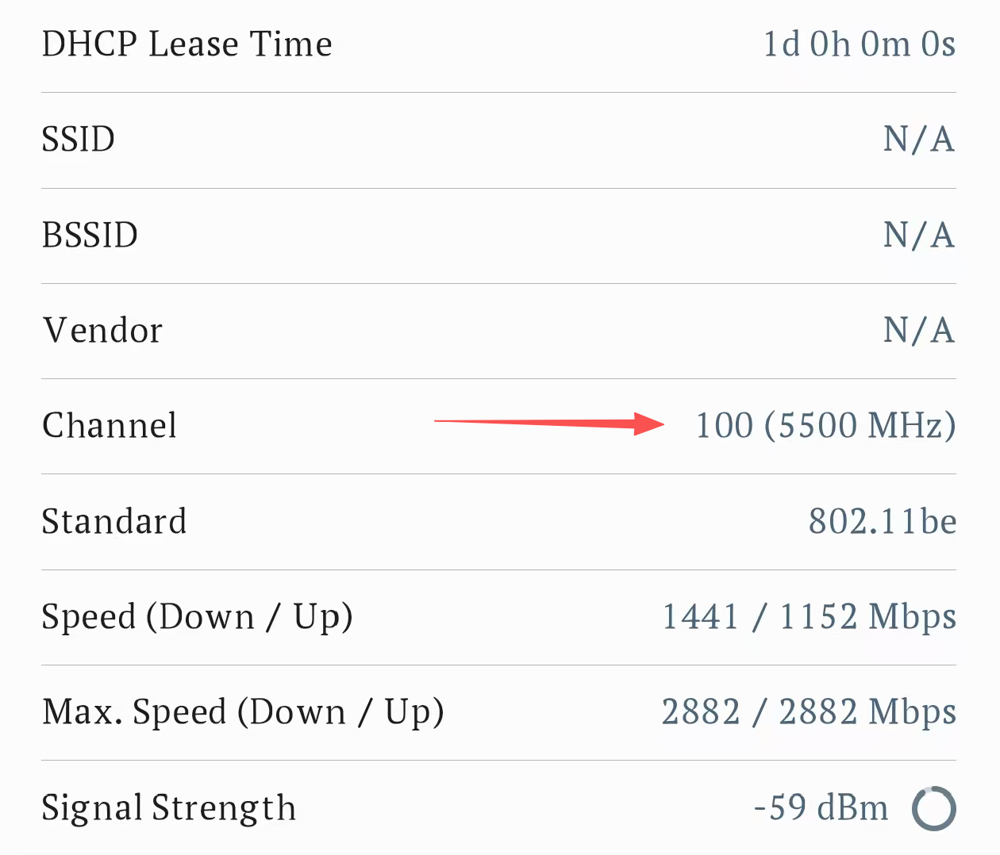
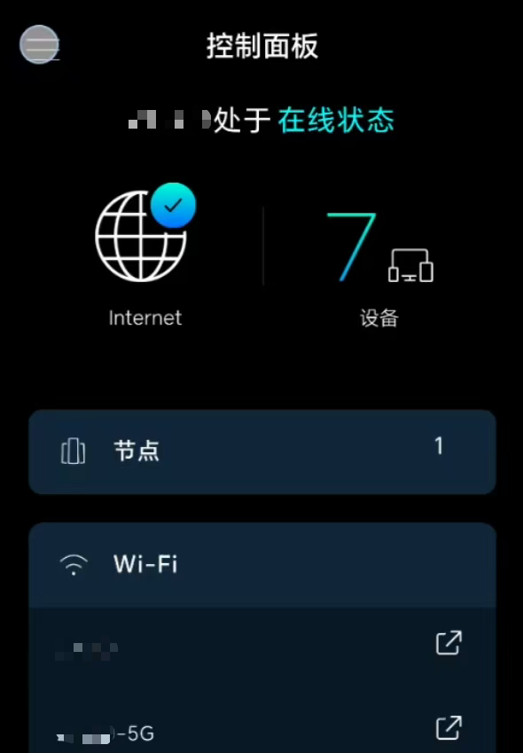
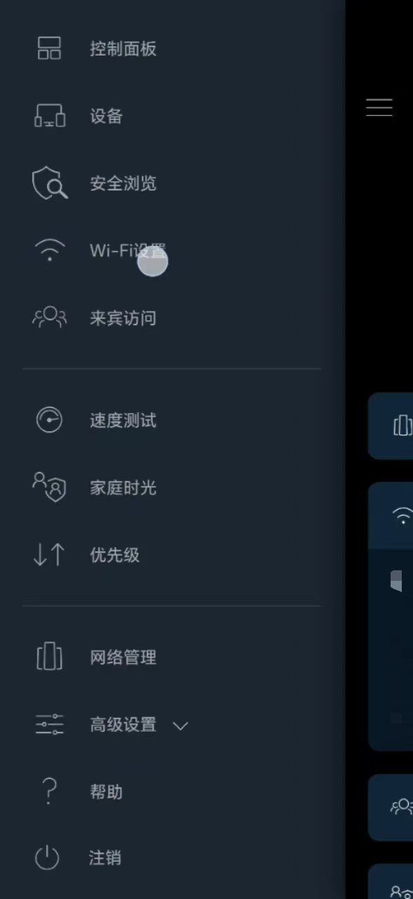
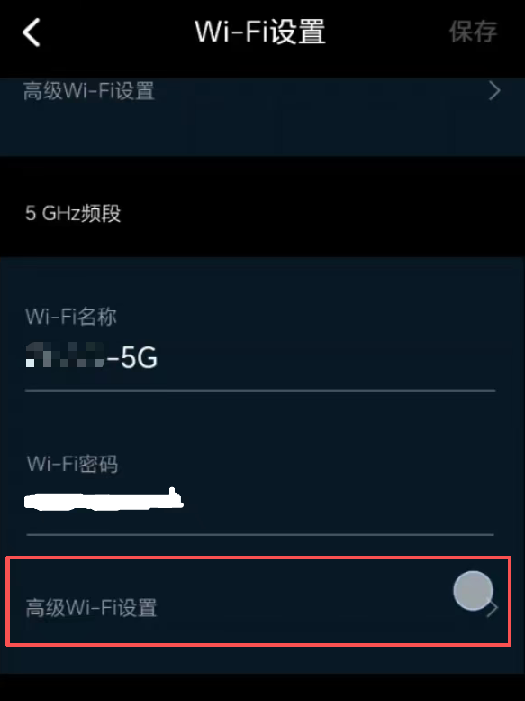
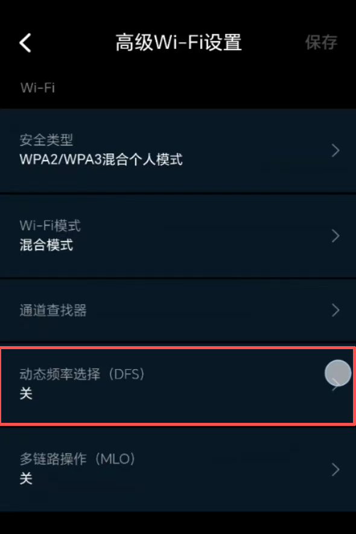
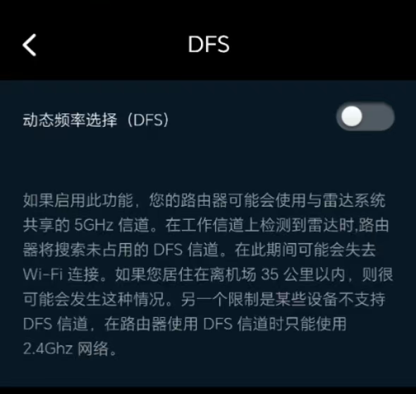
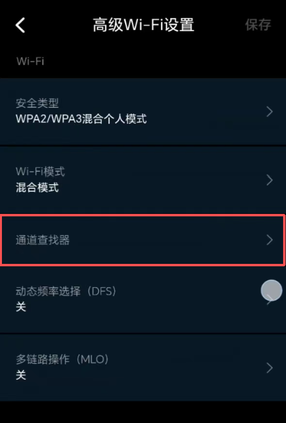

## Background

The WiFi in the flat I share with others in Hong Kong broadcasts both 2.4GHz and 5GHz (the router is a Linksys Velop Pro 7). While browsing social platforms (X, Weibo and the like), my phone would *now and then* get stuck loading images. It kept happening even after I set a rule in the router giving my phone priority, so I reverted that and started looking at changing something else instead.

## Symptoms

My phone connects to 5GHz by default, and while browsing social platforms (X, Weibo and so on) it would *intermittently* be slow to load images. Concretely:

- Video plays fine; only images are slow (thumbnails crawl / tapping a full-size image takes forever)
- Avatar images seem to be "not cached" — revisiting the same user reloads them every time

But as soon as I **switch bands by hand** (2.4G ↔ 5G), the problem disappears.

## Diagnosis

While connected to 5GHz, I worked through the layers with **Network Analyzer Lite**:

| Test                                                                       | Result                                                 |
| -------------------------------------------------------------------------- | ------------------------------------------------------ |
| ping gateway 192.168.1.1                                                   | 0 loss, 14–32 ms (jittery, a touch high)               |
| ping [www.weibo.com（36.51.224.123）](http://www.weibo.com（36.51.224.123）) | normal, 8–60 ms                                        |
| ping ww1.sinaimg.cn（139.177.246.196）                                      | normal, 8–51 ms                                        |
| ping [www.x.com（172.66.0.227）](http://www.x.com（172.66.0.227）)           | normal, 10–67 ms                                       |
| WiFi parameters                                                            | 802.11be, signal −58/−59 dBm, negotiated 1441/1152 Mbps |
| DNS                                                                        | 192.168.1.1 (router proxy), no public IPv6             |

Pinging the gateway is how I judged LAN and signal quality; pinging public IPs, then resolving and pinging the image CDN hostnames, is how I judged DNS, CDN routing and upstream reachability (which rules DNS out).

Having done all that, the network looked entirely healthy — nothing suspicious in DNS, link or CDN. But on the Info page I found the 5GHz band was sitting on channel 100 (5500 MHz), and looking it up showed that channel lives in the DFS band.

## Root cause

In this environment, channel 100 (5500 MHz) on the 5GHz band is a **DFS channel**, which brings radar avoidance into play.

Specifically, channels 52–140 in the 5GHz band form the DFS range. Regulations require an AP that detects a radar signal to go quiet and switch channels, and client traffic is suspended while that happens — hence the irregular, unpredictable stalls. Loading video and images means a barrage of small requests, and those are very sensitive to link jitter. Video can hide jitter behind its buffer; an image only starts loading when you tap it. That is exactly why I saw "video fine, images stuck". Switching bands forces a reconnect (2.4G is not a DFS band), which is why "flip the band once" fixes it.

## Fix: turn DFS off

This Velop model does not allow you to pin a **specific** channel by hand, so after looking around I decided to simply turn DFS off. The steps:

Linksys App → menu ☰

→ Wi-Fi Settings

→ under Advanced Wi-Fi Settings

→ turn DFS off

With DFS off, the router only uses non-DFS channels (36–48 / 149–165), which avoids the radar avoidance situation altogether.

Afterwards I ran Channel Finder once so it would pick the least congested channel within the non-DFS range:

It ended up on channel 161 (5805 MHz).

## Conclusion

In this environment the 5GHz band was using channel 100 (5500 MHz), which is a **DFS channel**; that triggered radar avoidance and made images load slowly.

::: important
This article was translated by Hermes Agent; the original text can be found at ../../../postMortem/tiny_tips/2026_09_08.md. The translation is for reference only.
Translation time: 2026-11-05
:::
