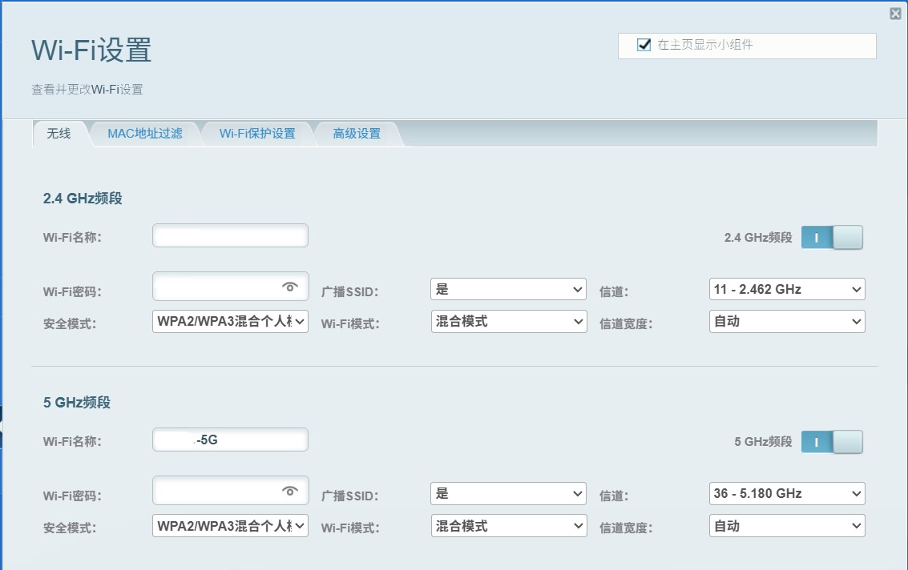

| Item | Notes |
|---|---|
| Document type | Troubleshooting Report |
| Date of the hunt | 2026-11-04 |
| Target | The whole Switch line (OLED included) can only see and join the 2.4GHz SSID; the 5GHz SSID is missing from the scan list entirely |
| Final state | Root cause located: the 5GHz channel falls outside the region firmware whitelist of the Switch. Nothing to do with the encryption mode or the protocol version. |

---

## 1. Background

Earlier post: [Images on social platforms loading slowly on the 5GHz WiFi band](./2026_09_08.md)

- Device: Nintendo Switch OLED
- Symptom: my Nintendo Switch OLED sees and joins the 2.4GHz band fine in its WiFi scan list, but the 5GHz band **does not show up at all** in the scan results.
- Signature: **invisible already at the scan stage**, and the console quietly gets online over 2.4GHz.

---

## 2. Environment

| Item | Details |
| --- | --- |
| Router | Linksys MBE7000 (Velop Pro 7 mesh) |
| Firmware version | 1.0.13.216765 |
| Band capability | tri-band 2.4GHz + 5GHz + 6GHz |

---

## 3. Root cause

### 3.1 The direct cause: the 5GHz channel sits outside the Switch whitelist

- The 5GHz wireless card in the whole Switch line (OLED included) is limited by a **region firmware whitelist** and only supports these 4 channels:

  | Supported channel | Frequency | UNII band |
  | --- | --- | --- |
  | 36 | 5180 MHz | UNII-1 |
  | 40 | 5200 MHz | UNII-1 |
  | 44 | 5220 MHz | UNII-1 |
  | 48 | 5240 MHz | UNII-1 |

- It **does not support** the UNII-3 band (149–165) or the DFS bands (52–64, 100–144).
- In this case the router's automatic channel selection landed on **channel 153** (80MHz width, actually spanning 149–161); that channel is not on the whitelist, so the Switch could not see the SSID at all and quietly fell back to 2.4GHz.

### 3.2 What was ruled out

While working through it with Marvis I measured that both bands use exactly the same security and protocol configuration:

- both are **WPA2 / WPA3 mixed mode** (not WPA3-only);
- neither has **ax-only** enabled (the 2.4G/5G compatibility fallback path is kept);
- the beacon frames carry the legacy rate element and the VHT element, so older devices stay compatible.

So it is fair to conclude: **encryption and protocol are not what is in the way; sort out the channel and there is a good chance the Switch will see 5GHz normally.**

---

## 4. The investigation path

| Step | Action | Goal |
| --- | --- | --- |
| 1 | `netsh wlan show interfaces` + `netsh wlan show networks mode=bssid` | confirm the channel and width the router is actually using |
| 2 | check the console's 5GHz channel whitelist | confirm the Switch only supports 36 / 40 / 44 / 48 |
| 3 | inspect the security and protocol config in the router's beacons | rule out compatibility problems such as WPA3-only and ax-only |
| 4 | find a way to change the router's channel | the Linksys App has no manual channel field, only the automatic Channel Finder → so go through the local Web UI `https://192.168.1.1` → click the hidden **CA** link at the bottom right of the footer to get into the full config tree |

::: note Example commands for step 1, "confirm the channel and width the router the device is currently on is actually using"

```powershell
netsh wlan show interfaces
netsh wlan show networks mode=bssid
```

When confirming the settings, the fields to look at in the output are `Channel` and `Band` — check whether 5G is currently sitting in the 149–165 range or the 36–48 range.

:::

::: tip Linksys' back door

On a Linksys router's local Web UI, once you log in there is no way to configure the channel by hand. But click the hidden **CA** link at the right of the footer and it jumps you into the full config tree. It really feels like a back door left in on purpose, one of those "secret techniques"...

:::

---

## 5. The fix

Once inside the full config tree through the CA link, find the page path `Wi-Fi Settings → Wireless` and pin the 5GHz channel to **36**, leaving the channel width on "auto" (it still negotiates 80MHz in practice)



::: tip Key prerequisite: turn off Auto Channel Finder

- The MBE7000 ships with **Auto Channel Finder** on: roughly every **5 days** it rescans the environment and picks a channel, and that selection **overrides the channel you set by hand**. If you leave it on, your pinned channel gets pushed back to another one, and the Switch may lose 5GHz again.
- The path to turn it off in the Linksys App is: `Wi-Fi Settings → find the "5 GHz band" block → Advanced Wi-Fi Settings → Channel Finder → Automatic Channel Finder` → **off**.

:::

---

## 6. Before and after

| Item | Before | After |
| --- | --- | --- |
| 5G channel | 153 (5765 MHz) | 36 (5180 MHz) |
| 5G width | 80 MHz, spanning 149–161 | 80 MHz, centred on 5210 MHz |
| 5G signal strength | 82% | 80% |
| 5G negotiated rate (rx/tx) | 649 / 324 Mbps | 649 / 480 Mbps |
| Can the Switch see 5G | no | yes, joins normally |

**Conclusion:**

- 5G now sits on channel 36 in the **W52 (UNII-1) band**, inside the Switch whitelist, so the console sees it and connects.
- After testing, Marvis found the uplink rate of the machine that is also on 5GHz went from 324 Mbps to 480 Mbps, which shows the 80MHz width negotiation was not affected.

::: info

While pinning the 5G channel through the CA page I also moved the 2.4G channel from "auto" to a fixed **11**. 1 / 6 / 11 are the three non-overlapping 2.4GHz channels, so picking 11 is a sensible bit of avoidance and will not overlap with a neighbour's 1 or 6.

:::

---

## 7. How the channel-environment analysis works

What I asked Marvis: "how do you know which channel the neighbour APs are clustered on?" Its answer:

### 7.1 Passive scanning of Beacon frames

First of all, the Windows WiFi list works by **passively receiving the Beacon frames the AP broadcasts**, which have these properties:

1. **no connection and no password needed** to get all the basic information about that AP;
2. a Beacon goes out about **10 times** a second (default Beacon Interval 100 TU ≈ 102.4 ms);
3. the beacon frame carries key information elements (IEs), described key by key below:
    - **SSID IE**: the network name;
    - **BSSID**: the AP's MAC address (that is, the sender address);
    - **DS Parameter Set IE**: the channel currently in use (this is where `Channel` in the `netsh` output comes from);
    - **RSN IE**: the encryption type (WPA2 / WPA3, AKM suites and so on);
    - **RSSI**: the received signal strength (Windows' `wlanSignalQuality` corresponds to it).

Which also explains why a network you "can see in the scan list but have never connected to" still comes with complete information — all of it comes from that beacon broadcast, not from anything negotiated after connecting.

### 7.2 The raw scan results

Here are some scan results; the names have been altered for privacy:

| SSID / identifier | Channel | Signal |
| --- | --- | --- |
| A | 5 | 92% |
| B | 6 | 72% |
| C | 7 | 67% |
| D | 11 | 87% |
| D-5G | 36 | 67% |
| (hidden) c6:68:d0:81:XX:28 | 40 | 29% |
| F-HKBN-5G-Guest (d6:68:d0:81:XX:28) | 40 | 26% |
| G (c4:68:d0:81:XX:28) | 40 | 26% |
| H | 157 | 83% |

::: info Reading specific rows

- **The three entries on channel 40 are really one device**: the OUI is the same (the `68:d0:81` prefix matches), and the last byte is `:28` for all of them, so "main SSID `G`, guest SSID `F-HKBN-5G-Guest`, hidden SSID `(hidden)`" are really several virtual interfaces on the same HKBN router, **not three separate devices**. So when counting channel occupancy, those SSIDs / identifiers should be merged into 1 interferer, otherwise you overstate how crowded channel 40 is.
- **`H` on channel 157 has a signal as high as 83%**: that channel is in the UNII-3 band, which is an invisible channel for the Switch. As said above, since the Switch cannot see it, the signal could be as strong as it likes and the Switch still could not use it.

:::

### 7.3 Converting RSSI

When trying to confirm the RSSI (Received Signal Strength Indicator, the wireless signal power the device receives), because Windows' `netsh` only exposes `wlanSignalQuality` (a percentage from 0–100) and does not give dBm directly, you can approximate the value with this formula:

```
RSSI(dBm) ≈ signal percentage ÷ 2 − 100
```

Example: signal 67% → 67 ÷ 2 − 100 = **−66.5 dBm**.

::: note

That conversion is an **approximation**; the actual mapping curve is up to the driver implementation. Use it only to compare the relative strength of different APs, not for precise link-budget calculations.

:::

---

## 8. Pits I fell into

Here are the pits you can run into while hunting this down. Note that:

| # | Pit | What you see | What to do |
| --- | --- | --- | --- |
| 1 | `netsh wlan show networks` reads the driver cache | the first round may return a single result, and you think the airwaves are clean | trigger a `WlanScan` first (or hit refresh in the system WiFi panel) and then read, waiting a few seconds and retrying if need be |
| 2 | digging into encryption / protocol first | burning ages going round WPA3, WPA2 mixed, ax-only | the **typical reason a Switch cannot see 5G is a channel outside the whitelist**; in this case check the channel first |
| 3 | changing the CA channel but forgetting to turn off Auto Channel Finder | a few days later the channel is back to 153 and the problem returns | turn Channel Finder off before changing the channel, and put "is auto channel selection off?" on the change checklist |
| 4 | the CA mode entry is very well hidden, or there is no such entry | you cannot find the channel setting in the normal Web UI | the entry is **at the very bottom right of the page, the small `CA` right next to the firmware version number**; whether other firmware versions keep it varies by model, so check for yourself, or find another way |

---

## 9. Fallbacks (if you cannot change the channel)

In order of preference:

1. **Wired connection (recommended)**
   The Switch OLED dock has a LAN port of its own; run an Ethernet cable from it to a LAN port on the main router and you are on wires.

2. **Make do with 2.4GHz**
   Online matches only really need a few Mbps, and latency and stability on 2.4GHz are usually good enough; **only game downloads / updates are noticeably slower** (measured downstream on 2.4GHz is far below 5GHz). It is the "works, but not fast" safety net.

---

## 10. Conclusion and key points

> **In one line: if the Switch cannot see 5G, check the channel whitelist first — pin the router's 5GHz channel to 36 or 44 and you are done; and once you change it you must turn off automatic channel selection, or it will bounce back.**

Key points:

1. The whole Switch line supports only **36 / 40 / 44 / 48** on 5GHz; UNII-3 (149–165) and DFS (52–64, 100–144) are invisible across the board.
2. The symptom is "the SSID is simply not in the scan list", not "it shows up but will not connect" — that is the classic fingerprint of a channel whitelist problem.
3. Encryption and protocol (WPA2/WPA3 mixed, not ax-only) were measured and ruled out in this case, so they should not be the first suspect.
4. The Linksys MBE7000 App has no manual channel field; you have to go through the **hidden CA entry** of the local Web UI (`https://192.168.1.1` → small CA text at the right of the footer → `Configuration → Wi-Fi → Basic Wireless Settings`).
5. **Auto Channel Finder must be turned off** — it is what makes the setting "change back by itself", rescanning and overriding every 5 days by default.
6. Measured after the change: 5G goes from channel 153 (5765 MHz) to channel 36 (5180 MHz), the 80MHz width is kept, and the Switch sees it and connects normally.
7. If you cannot change the channel, the fallback order is: wired first → make do with 2.4GHz.

::: note
*85% of this content was generated by Marvis calling an LLM; it has been proofread by hand, but is still for reference only*
:::

::: important
This article was translated by `Hermes Agent`; the original text can be found at [here](../../../postMortem/tiny_tips/2026_11_04.md). The translation is for reference only.
Translation time: 2026-11-05
:::
