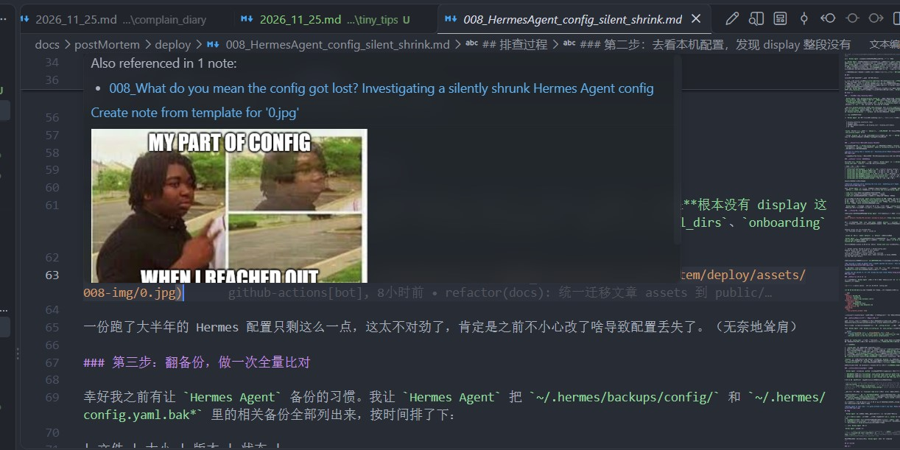

Admittedly, when my blog deploys to `GITHUB Pages`, assets like `images/GIFs` get merged into the same file after compilation because their file `SHA` is identical, so whichever language version references them, it is the same asset. But when I was setting up `Hermes Agent` to help with automatic translation earlier, I gave it a rule: "every time you translate, if the page has images, copy them over."

That looked like it made image references convenient for me, but the thought of having it copy a set on every translation was still too much hassle. So today I had `Hermes Agent` tidy up the blog's image files, putting them all under `.vuepress/public`, so the same path would reference the same file.

::: info VuePress path resolution

VuePress treats `.vuepress/public` as the static asset directory. Files under it are copied to the root of the generated site, so a path in the root like:

`docs/.vuepress/public/blog_assets/a/b/assets/img/001.png`

corresponds on the site to:

`/blog_assets/a/b/assets/img/001.png`

The official VuePress documentation states this explicitly:

- `.vuepress/public` is the default public static asset directory.
- Files inside it are copied to the root of the generated site.
- They can be referenced via a root-absolute path.

(The VuePress version I am on is `2.0.0-rc.31`; for the relevant config see [here](https://v2.vuepress.vuejs.org/zh/guide/assets.html))
:::

But `VSCode`'s built-in `Markdown` support resolves asset paths by different rules, so in `VSCode`'s `Markdown` editor, when I hover over an image link like ``, the `Hover` popup can no longer show the image the way it used to.

::: info VSCode path resolution

`VSCode`'s built-in `Markdown` support follows another set of rules for folder paths:

1. Paths starting with `/`: resolved relative to the current `Workspace` root.
2. Paths starting with `./` or with no prefix: resolved relative to the directory of the current `Markdown` file.

So when I write `/blog_assets/a/b/assets/img/001.png`, VSCode tries to look directly under the `Workspace` root for:

`/blog_assets/a/b/assets/img/005_002.png`

instead of the path described above:

`docs/.vuepress/public/blog_assets/a/b/assets/img/001.png`

so the paths never match...

See [here](https://code.visualstudio.com/docs/languages/markdown) for details.
:::

::: note  Hover window - hover preview for Markdown image and video paths

`VSCode`'s `Hover` preview for `Markdown` image and video paths was officially added in `VSCode` version `1.89`.

The official release note says:
> You can hover over an image or video path to see a small preview of it.

The official release notes are at [Visual Studio Code 1.89 — Hover to preview images and videos in MarkdownVS Code](https://code.visualstudio.com/updates/v1_89)

:::

I had been using that preview all along to cross-check whether my references were correct; losing it was a bit of a nuisance... so I decided to see how to get it back.

At first I was overthinking it — workspace definitions, plugins — and then it hit me: "can't I just add a symlink?"

So in the root directory I did "Run CMD as Administrator" and used this command:

```
mklink /D blog_assets docs\.vuepress\public\blog_assets
```

That created a symlink.

Finally I added this to `.gitignore`:

```
...
# VS Code Markdown Hover image preview
/blog_assets
...
```

And the hover feature worked normally again.



(The page in the screenshot is [here](../deploy/008_HermesAgent_config_silent_shrink.md))

::: warning When looking things up with an LLM, take the official docs as the source of truth; SNS posts are *for reference only*

I was fooled at first by [this "happy" Volcengine article](https://www.volcengine.com/article/2371862), which told me:

> You can adjust `VSCode`'s `Markdown` preview settings and directly set `{"markdown.preview.rootPath": "${workspaceFolder}/docs\.vuepress\public"}` to make the `docs\.vuepress\public` directory the preview root


In the end, the official docs have **no** such `"markdown.preview.rootPath"` setting at all — I searched high and low and it was nowhere... I figure domestic LLMs are rather fond of Volcengine, thinking we are all one family so they should give a brother a hand, probably... but the setting does not exist, the information is wrong, man...

::: important
This article was translated by `Hermes Agent`; the original text can be found at [here](../../../postMortem/tiny_tips/2026_11_25.md). The translation is for reference only.
Translation time: 2026-11-26
:::
