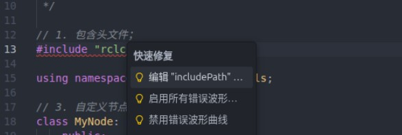
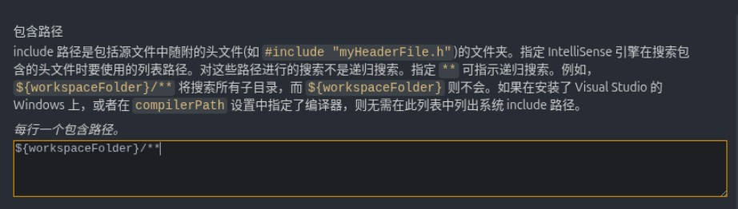

## 简述

这里是我有关ROS2的相关笔记，这些笔记内所使用的相关软硬件配置为：

- ROS2 Jazzy Jalisco LTS
- Ubuntu 24.04.3 LTS
- Raspberry Pi 5B (4GB)

这些笔记大部分参考以下网站和视频教程写成：

- ROS2-Jazzy官方支持文档: [ROS 2 Documentation — ROS 2 Documentation: Jazzy documentation](https://docs.ros.org/en/jazzy/)
- 清华大学出版社出版的《ROS机器人理论与实践》教材的主要作者赵虚左的ROS2网课: [猛狮集训营视频合集·ROS2理论与实践核心篇](https://space.bilibili.com/1101432368/channel/collectiondetail?sid=700208)

::: note 在书写 C++ 文件时发现头文件报错

可以通过 “编辑includePath...” 选项:



找到“包含路径”选项：



另起一行添加：

```txt
/opt/ros/jazzy/include/**
```

即可。

:::

::: note 在书写 C++ 文件时发现无补全提示

按 `Ctrl+Shift+P（Windows/Linux）` 或 `Cmd+Shift+P（Mac）`，输入 `C/C++: Edit Configurations (UI)` 并选择该命令。在弹出的配置界面中无需修改任何选项，直接点击右上角的保存按钮。VSCode 会自动在项目根目录的 `.vscode` 文件夹下生成 `c_cpp_properties.json` 文件。
可以通过 编辑`c_cpp_properties.json` 文件，在内部添加"compilerPath":

```json
{
    "configurations": [
        {
            "name": "Linux",
            "includePath": [
                "${workspaceFolder}/**",
                "/opt/ros/jazzy/include/**"
            ],
            "defines": [],
            "compilerPath": "/usr/bin/g++", // 👈 NEW!!
            "cStandard": "c17",
            "cppStandard": "gnu++17",
            "intelliSenseMode": "linux-gcc-x64"
        }
    ],
    "version": 4
}
```

之后保存重启 VSCode 即可。

:::

::: note 可以使用的代码片段
以下为一些可以使用的代码片段，包括 `node` 和 `launch`：

```json
// cpp.json
{
 "ros2_node_cpp":{
  "prefix": "ros2_node_cpp",
  "body": [
   " /*",
   "    需求：",
   "    步骤：",
   "        1. 包含头文件；",
   "        2. 初始化 ROS2 客户端",
   "        3. 自定义节点类：",
   "",
   "        4. 调用spin函数，并传入节点对象指针",
   "        5. 释放资源。",
   " */",
   "",
   "// 1. 包含头文件；",
   "#include \"rclcpp/rclcpp.hpp\"",
   "",
   "// 3. 自定义节点类：",
   "class MyNode: public rclcpp::Node{",
   "    public:" ,
   "        MyNode() : Node(\"mynode_node_cpp\"), count_(0)",
   "        {",
   "",
   "        }",
   "};",
   "",
   "int main(int argc, char *argv[])",
   "{",
   "    // 2. 初始化 ROS2 客户端",
   "    rclcpp::init(argc, argv);",
   "    // 4. 调用spin函数，并传入节点对象指针。",
   "    rclcpp::spin(std::make_shared<MyNode>());",
   "    // 5.释放资源;",
   "    rclcpp::shutdown();",
   "    return 0; ",
   "} "
  ],
  "description": "ros2 node 用户代码片段"
 },
}
```

```json
// python.json
{
    "ros2 node": {
        "prefix": "ros2_node_py",
        "body": [
            "\"\"\"  ",
            "    需求：",
            "    流程：",
            "        1.导包；",
            "        2.初始化ROS2客户端；",
            "        3.自定义节点类；",
            "                        ",          
            "        4.调用spain函数，并传入节点对象；",
            "        5.资源释放。 ",
            "",
            "",
            "\"\"\"",
            "# 1.导包；",
            "import rclpy",
            "from rclpy.node import Node",
            "",
            "# 3.自定义节点类；",
            "class MyNode(Node):",
            "    def __init__(self):",
            "        super().__init__(\"mynode_node_py\")",
            "",
            "def main():",
            "    # 2.初始化ROS2客户端；",
            "    rclpy.init()",
            "    # 4.调用spain函数，并传入节点对象；",
            "    rclpy.spin(MyNode())",
            "    # 5.资源释放。 ",
            "    rclpy.shutdown()",
            "",
            "if __name__ == '__main__':",
            "    main()",
        ],
        "description": "ros2 node"
    },
    "ros2 launch py": {
        "prefix": "ros2_launch_py",
        "body": [
            "from launch import LaunchDescription",
            "from launch_ros.actions import Node",
            "# 封装终端指令相关类--------------",
            "# from launch.actions import ExecuteProcess",
            "# from launch.substitutions import FindExecutable",
            "# 参数声明与获取-----------------",
            "# from launch.actions import DeclareLaunchArgument",
            "# from launch.substitutions import LaunchConfiguration",
            "# 文件包含相关-------------------",
            "# from launch.actions import IncludeLaunchDescription",
            "# from launch.launch_description_sources import PythonLaunchDescriptionSource",
            "# 分组相关----------------------",
            "# from launch_ros.actions import PushRosNamespace",
            "# from launch.actions import GroupAction",
            "# 事件相关----------------------",
            "# from launch.event_handlers import OnProcessStart, OnProcessExit",
            "# from launch.actions import ExecuteProcess, RegisterEventHandler,LogInfo",
            "# 获取功能包下share目录路径-------",
            "# from ament_index_python.packages import get_package_share_directory",
            "",
            "def generate_launch_description():",
            "    ",    
            "    return LaunchDescription([])"
        ],
        "description": "ros2 launch"
    }
}
```

:::
