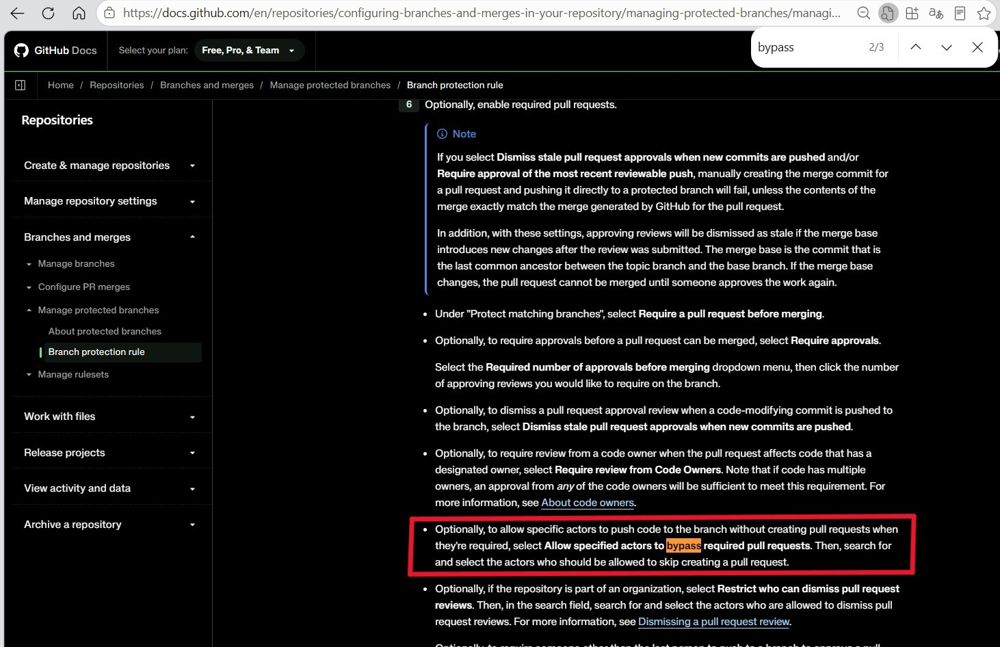

> 本文档是对 2026-10-14 至 2026-10-18 这段工作的完整复盘：把原来"每天手动合并 AI 日报归档 PR"的流程改造成全自动链路，并在落地过程中连续踩中三类结构性问题——**三点 diff 的 merge-base 不变量**、**master 上的双重分支保护**、**GitHub App 的 ruleset bypass**。
>
> ---
> 大部分内容由 Hermes Agent 基于会话整理，我只做事实性的的核查与修改，因此更建议使用 AGENT 读取反刍后再阅读。不保证本文中一定不存在逻辑前后不一的现象，还请注意（鞠躬）
>
> ---
> **参与会话概览**:
>
> | 会话 | 使用模型 | 会话时间 | 角色 |
> |------|----------|----------|------|
> | 会话A | deepseek-flash | 2026-10-14| 拓扑设计、GitHub 侧落地、skill / cron prompt 改造 |
> | 会话B（每日归档 run） | deepseek-flash | 每日 特定时间 | 归档执行与链路回执 |
> | 会话C（feishu） | kimi-for-coding | 2026-10-15 | 故障诊断、修复方案、线上验证 |
>
> **原始会话来源**: feishu
> **主题关键词**: AI Daily Briefing, 自动归档, merge-base, three-dot diff, GitHub Ruleset, Branch Protection, GH013, GH006, GitHub App bypass, Cron Job

## 目录

- [背景与问题定义](#背景与问题定义): 需求、目标拓扑与作业对象
- [第一阶段：拓扑落地](#第一阶段拓扑落地): 设计、用户侧落地，以及一次"假成功"
- [第二阶段：hop-1 预检整批拒绝](#第二阶段hop-1-预检整批拒绝): PR #40 被拒的真实原因
- [第三阶段：squash 只同步内容](#第三阶段squash-只同步内容): 祖先关系没变，两个守卫照旧脏
- [第四阶段：删库重建与两道闸](#第四阶段删库重建与两道闸): GH013 → GH006 → 删 classic 规则
- [第五阶段：端到端跑通](#第五阶段端到端跑通): hop-1 → hop-2 → deploy 全绿
- [第六阶段：线上内容核对](#第六阶段线上内容核对): 页面、结构对等、产物一致性
- [深度技术分析](#深度技术分析): merge-base、双层保护、失败判据
- [结论与后续建议](#结论与后续建议): 关键结论与可选加固

---

## 背景与问题定义

之前我在我的 `Hermes Agent` 中分别定义了两个 cron job 进行 AI 行业信息的收集与归档。在其中，一个 `AI Daily Briefing` 用于生成中英双语 AI 行业简报；另一个 `AI 简报归档` 用于把生成的简报清洗、翻译、校验后推送至本博客。

在未修改之前，`AI 简报归档` 流程的最后一公里是**人工**的。具体而言，在特定的时间节点，归档 job 会将上述简报文件整理后，向 `GitHub` 推送一个新开的、以 `briefing-archive-<日期>-<体裁>` 为固定命名格式的分支，并利用其上游 Actions 开一个 Merge PR，最后由我审核之后点击 `Squash & Merge` 进行合并。

在九月底十月初实现该 `AI 简报归档` 的 Job 时，我的最初构想就是能够使其自动的做相关的归档。但是我实际对其完全的自动化感到疑虑，担心完全的放任不管会在之后出现较大的问题。因此为了实现该想法（或者说是为了降低顾虑），我往后退了一步先尝试前序的操作，即测试该 job 在文件清洗上的稳定性，而将最后的 “点击合并” 留给自己，以做进一步的审核。在使其自动运行两个礼拜之后，我认定该 job **在目前的生产环境及配置下** 运行良好，因此决定进行下一步升级改造。

于是我向 Agent 提了一个要求，希望把这个 “点击合并” 的动作也自动化，而且不能放大攻击面。具体而言：

> 希望有且仅有本 job 提交的归档能自动合并进 master；一切由 Agent 做出的其他改动依旧保持 "需人工审阅 + 手动合并"。

### 目标拓扑

在整理与讨论之后，我与 Agent 划定整个方案，针对原有文件将进行如下修订：

1. 归档 job 保持原来的运行逻辑不变，依据原操作提交相关文件；
2. 修改 github workflow 的 docs.yml；
3. 新增 github workflow 的 daily-to-master.yml；
4. 通过修改相关 github actions 权限，使其能够自动合并分支。

执行逻辑如下：

```txt

归档 job 将文件推送至 `briefing-archive-<日期>-<体裁>`（SSH deploy key；push 事件正常触发）
  → 触发 docs.yml ：gh pr create（base 分支为 daily）
  → 白名单预检 PR 文件 → gh pr merge --squash 进 daily   ← hop-1
  → gh workflow run daily-to-master.yml --ref master
  → 触发 `merge-daily-into-master` action：守卫（三点 diff 白名单）→ `git merge --no-ff` → push 至 master 分支   ← hop-2
  → master push 触发 deploy-website → 网站更新
  → schedule 兜底：避免可能的时间戳错位问题
```

在该过程中，我们定义了几个"看着可以简化、其实不能动"的设计点：

| 设计点 | 为什么必须这样 |
|---|---|
| hop-2 用 `workflow_dispatch` Action 而不是 `on: push: [daily]` | hop-1 用 `GITHUB_TOKEN` 合并 PR，其 push 事件会被 GitHub 的递归防护吞掉，而导致 `on: push: [daily]` 不会触发 |
| dispatch 必须 `--ref master` | workflow 定义跟随 ref：push 触发的 run 跑的是被推分支上那份文件，把守卫脚本放在可被 PR 修改的分支上等于让它自证清白 |
| master 的合并凭据放 Environment secret（environment `master-merge`，deployment branch 限 `master`） | 放仓库 secret 的话，任意 ref 的 run 都能读到 |
| App 权限刻意不给 Workflows | daily 一旦含 `.github/workflows/**` 变更，推到 master 会被结构性拒绝，多一层兜底 |
| 守卫白名单只放 `docs/{en/}Scheduled_Automatic_AI_Industry_Analysis_Report/{daily,monthly}/*.md` | 放宽成 `docs/**` 等于允许改 `docs/.vuepress/**`，那就是能注入脚本 |

### 作业对象

| 属性 | 值 |
|---|---|
| 仓库 | `JeacsonSnake/JeacsonBlog`（public） |
| 分支 | `master`（默认，受保护）、`daily`（归档中转，无保护） |
| 规则集 | `PR_BEFORE_MERGE` |
| 环境 | `master-merge`（deployment branch 限 `master`） |
| 合并身份 | GitHub App `jeacsonblog-daily-merge`（bot 账号 `jeacsonblog-daily-merge[bot]`） |
| 本机工具身份 | `Hermes-cRl1` fine-grained PAT（**只读**：`permissions.push=false` |

---

## 第一阶段：拓扑落地

第一阶段，用户侧把 workout 定义与保护规则全部落地：

| 时间（CST） | 事件 |
|---|---|
| 10-14 11:13 | 会话开始，需求确定 |
| 10-14 20:28–21:42 | master 上落下自动化定义：PR **#39** 新增 `daily-to-master.yml`（13:22:59Z 合并）、直推 `ci: route briefing archive PRs to daily + auto-merge`（13:31:43Z）、`Change cron schedule to daily at 12:17 UTC`（13:42:00Z） |
| 10-14 21:14 / 21:21 | 规则集 `PR_BEFORE_MERGE` 创建 / 更新（含 App bypass） |
| 10-14 21:36 | hop-2 手动首跑（ **run1**，`workflow_dispatch` Action）→ `completed/success` |

### 一次"假成功"

虽然上文中所述的 **run 1** 的结论是 `success`，但拆到 step 级便会发现些问题：

```txt
JOB: Guard and merge daily into master | completed/success
steps: ... 4:Guard — only archive content may reach master=success;
        5:Merge daily into master=skipped; 6:Alert and fail on guard block=skipped
```

守卫当时算出 `daily 领先 master 0 个提交`，之后程序 `skip=1` 直接退出了。因此实际上 `push` 这条路径 **一次都没被执行过**。这个 success 让人以为"合并凭据 + ruleset bypass 都通了"，实际上它们只是没被触碰。

> **教训 1**：自动化链路的 `success` 必须拆到 step 级核对。守卫"无东西可合"的 skip 与"真的合进去了"在 run 结论里长得一模一样。

同时这一步埋下了第二个隐患：那三个 commit（含 `daily-to-master.yml`）是**直接落在 master 上**的，`daily` 分支自从最开始从前一个 `master` 分支的文件戳分离之后，便从未与 `master` 同步过。当时看起来无害，但是到了隔天问题就出现了。

---

## 第二阶段：hop-1 预检整批拒绝

### 现场

到了第二天，归档 cron 在本地正常执行：日报正文完整（9004 字符），`verify_pairs.py --kind daily` 通过（1 对，problems 0 / 告警 0）。但是作为分支 `briefing-archive-2026-10-15-daily` 单 commit 推上去时，发生了 hop-1 失败：

```txt
##[error]PR 含归档目录以外的文件，拒绝自动合并：.github/workflows/daily-to-master.yml + .github/workflows/docs.yml
```

使得下一步 `Dispatch daily→master merge` 被 skipped。PR **#40**（base=daily）停在 open，4 files / +374-1，6 分钟后复查仍是 open。

### 根因：PR 文件清单是三点 diff

通过查询文件清单，我们发现：

```json
// gh api repos/.../pulls/40/files
[
  ".github/workflows/docs.yml",
  ".github/workflows/daily-to-master.yml",
  "docs/Scheduled_Automatic_AI_Industry_Analysis_Report/daily/2026_10_15.md",
  "docs/en/Scheduled_Automatic_AI_Industry_Analysis_Report/daily/2026_10_15.md"
]
```

经过时候调查，我们意识到当时归档分支的基线是 **master tip**，而合并归档分支用的分支 `daily` 因为没有合并 `master` 后续的更改，其文件戳停在 10-14 的归档提交 `86150db5`。于是：

```txt
merge-base(daily, 归档分支) = 86150db5     ← 这个提交里没有那两个 workflow 文件
三点 diff = tree-diff(86150db5, 归档分支)  →  两个 workflow 文件 + 两个日报
```

而 `workflow` 里的预检脚本只做一件事——`gh pr view --json files` 。在这里面除归档白名单所对应的文件外，如果存在别的路径就整批拒，于是即使归档内容完全正确也**照样被拒**。而当期回执就是新加的第四种状态：

> ④ hop-1 预检拒绝 → PR 停在 OPEN、未并进 daily（由于 daily 缺 master 侧 `.github/workflows/**` 提交 而导致）

::: details 附：“工具调用链：如何三步定位‘PR 文件清单多出 workflow’的原因”

**调用 1**：`gh api repos/JeacsonSnake/JeacsonBlog/pulls/40/files --jq '.[].filename'`

```json
{ "state": "open", "mergeable": true, "mergeable_state": "unstable",
  "base": "daily", "head": "briefing-archive-2026-10-15-daily" }
.github/workflows/daily-to-master.yml
.github/workflows/docs.yml
docs/Scheduled_Automatic_AI_Industry_Analysis_Report/daily/2026_10_15.md
docs/en/Scheduled_Automatic_AI_Industry_Analysis_Report/daily/2026_10_15.md
```

**调用 2**：`git merge-base origin/master origin/daily` / `git merge-base origin/daily origin/briefing-archive-2026-10-15-daily`

```txt
86150db5...
86150db5...
```

**调用 3**：`git diff --name-status origin/daily...origin/briefing-archive-2026-10-15-daily`

```txt
A .github/workflows/daily-to-master.yml
M .github/workflows/docs.yml
A docs/Scheduled_Automatic_AI_Industry_Analysis_Report/daily/2026_10_15.md
A docs/en/Scheduled_Automatic_AI_Industry_Analysis_Report/daily/2026_10_15.md
```

两个 merge-base 都指向 `86150db5`，而那个提交里没有 workflow 文件 —— 四点 diff 的结论在调用 2 就已经注定了。

:::

---

## 第三阶段：squash 只同步内容

虽然前文所述，我们目前已经查明了出现该 BUG 的原因是由于归档分支的基线是 **master tip**，但是在当时并没有清晰认知，因此做了如下的修改。

### 用户的第一步：起 PR 把 master 推到 daily

> **User:** 我已经起了一个PR把master分支推到daily分支去了，这个PR已经merge成功了，你看一下后面大概怎么做？

PR **#41**（head=master, base=daily）于 13:34:54Z 合并。看起来很对。但是核查结果却是一条"对而无效"的修复：

| 检查 | 结果 | 含义 |
|---|---|---|
| `git log -1` daily tip `597f962a` 的 parents | 只有 `86150db5` **一个** | 这是 **squash merge**，master 的三个提交没进 daily 的祖先链 |
| 两个 workflow 文件的 blob SHA（master vs daily） | 完全相同（`89236d47…` / `09715a29…`） | **内容**确实同步了 |
| `compare/0615ddfa...daily` | diverged / behind_by=3 | 图上的祖先关系没变 |
| `merge-base(daily, 归档分支)` | 仍是 `86150db5` | PR 文件清单照旧 4 个 |
| `git diff --name-status origin/master...origin/daily` | `A daily-to-master.yml` / `M docs.yml` | hop-2 守卫一旦跑起来就会拦 + 开假 issue |

简单而言，由于 使用 “Create a merge commit” 创建 `Merge Commit` 与 使用 “Squash & Merge” 创建 `Merge Commit` 在文件提交历史上面存在一定区别，而 PR **#41** 所作的修复实际将文件提交历史覆盖了，因此修复并没有成功。

::: note 使用 “Create a merge commit” 创建 `Merge Commit` 与 使用 “Squash & Merge” 创建 `Merge Commit` 的区别是？

使用 “Create a merge commit” 创建 `Merge Commit` 会把文件 **完整的** 提交历史记录 **原封不动的** 拷贝过来提交。

使用 “Squash & Merge” 创建 `Merge Commit` 会把文件所有提交都 **合并成同一个提交**，然后才提交。

因此使用 “Squash & Merge” 会丢失文件 **完整的** 提交历史记录，使得该修改并没有解决任何问题。

```bash
git clone --filter=blob:none --no-checkout https://github.com/JeacsonSnake/JeacsonBlog.git
git merge-base origin/master origin/daily          # → 86150db5  ← 病灶
git diff --name-status origin/master...origin/daily # → 两个 workflow 文件
git diff --name-status origin/daily...origin/briefing-archive-2026-10-15-daily
# → 4 files（两个 workflow + 两个日报）
```

:::

只读 token 不能推分支，于是 Hermes Agent 在不碰远端的前提下尝试在本地把三种修复方案预演了一遍：

| 方案 | 做法 | hop-1 预检输入 | hop-2 守卫输入 | 结论 |
|---|---|---|---|---|
| A 真 merge commit | `git merge --no-ff origin/master` | 只剩 2 个日报 | tree-diff 为空 | ✅ 两端都干净 |
| B 删库重建 | 删 `daily` 后从 master 新建 | 只剩 2 个日报 | tree-diff 为空 | ✅ 同样有效（代价：以 daily 为 base 的 PR 会被自动关闭） |
| C 再 squat / rebase 一次 | 只搬内容 | 仍是 4 files | 仍列出 workflow | ❌ 与第一次同样无效 |

> **教训 2**：GitHub 的 PR 文件清单、以及两个守卫的 `git diff A...B`，用的都是 **merge-base**。merge-base 是**图**上的概念——内容相等不会让它移动。所以"把文件搬过去"只有两种命运：建立祖先关系，或者什么都没改。

---

## 第四阶段：删库重建与两道闸

我尝试了在原来的基础上再 merge 一次，但是由于前文所述的“修复实际将文件提交历史覆盖了”，因此该修复无意义。

### 用户的第二步：决定删 daily → 从 master 重建 → 手动开 PR 合进来

> **User:** 我做了以下操作：Branches 页 → 删掉 daily → New branch 从 master 新建名为 daily。手动使用 UI 从 briefing-archive-2026-10-15-daily 开 PR 到 daily 并 squash 合并。然后尝试再到 Actions 里手动 Run 一次 merge-daily-into-master 的时候失败了。你协助我看看。

这一步之后，文件拓扑修复成功：

```txt
daily tip = 1becffd7（PR #43 的 squash，父 = master tip 0615ddfa）
compare/master...daily      → ahead 1、files 只有那两个日报 md   ✅
git rev-list --count master..daily → 1                          ✅
```

`master` 在该修复后，仍停在 `0615ddfa`（push 被拒，未改动）的文件戳。也就是说：**只剩最后一步 push**。

于是之后我们手动执行了 `workflow_dispatch` 这个 Action，以验证路线可行性，但是————

### 失败一：GH013 —— ruleset 拒了 App 的 push

run **2**（`38747487734`，`workflow_dispatch`，ref=master，13:59:55Z）：

```txt
4:Guard — only archive content may reach master = success   ← 守卫放行了！
5:Merge daily into master = failure
```

日志里 merge 本身是成功的，但是 push 的时候出现了问题：

```txt
Merge made by the 'ort' strategy.
 .../daily/2026_10_15.md | 123 +++++++++++++++++++++
 .../daily/2026_10_15.md | 123 +++++++++++++++++++++
 2 files changed, 246 insertions(+)
remote: error: GH013: Repository rule violations found for refs/heads/master.
remote: - Changes must be made through a pull request.
 ! [remote rejected] master -> master (push declined due to repository rule violations)
```

尝试用"兜底"把原来的 ruleset enforcement 设成 Disabled（14:15:41Z），再跑 run **4**（`38749841799`，14:15:55Z），错误变了：

### 失败二：GH006 —— 关掉 ruleset 后撞上 classic branch protection

```txt
remote: error: GH006: Protected branch update failed for refs/heads/master.
remote: - Changes must be made through a pull request.
 ! [remote rejected] master -> master (protected branch hook declined)
```

### 这两个失败是如何产生的？

**这是两道不同的闸**：

| | 错误码 | 配置位置 | 本次的状态 |
|---|---|---|---|
| ruleset | `GH013 Repository rule violations` | Settings → Rules → Rulesets → `PR_BEFORE_MERGE` | 有 bypass 名单，但没生效 |
| classic branch protection | `GH006 Protected branch update failed` | Settings → Branches → 规则 → `master` | 还在，且没有 bypass 名单 |

### 转折：classic 规则的 bypass 名单只对组织仓库开放

之后 Hermes Agent 提示用户可以通过在项目仓库的设置中，寻找之前 `branch` 设置规则时所使用的 "Require a pull request before merging"，通过 `Allow specified actors to bypass required pull requests` 以实现 bypass。

但是实际上，我翻遍了 `Require a pull request before merging` 区块也没找到 `Allow specified actors to bypass required pull requests`，：

> **User:** 我在 "Require a pull request before merging" 区块里完全没有找到 "Allow specified actors to bypass required pull requests"。……即使其他的（选项，编者注）也勾选了，依然无法寻找到该选项。

而我从文档去找 `Allow specified actors to bypass required pull requests`，却发现其有些问题：

> Optionally, to allow specific actors to push code to the branch without creating pull requests when they're required, select **Allow specified actors to bypass required pull requests**. Then, search for and select the actors who should be allowed to skip creating a pull request.



[引用地址在这里](https://docs.github.com/en/repositories/configuring-branches-and-merges-in-your-repository/managing-protected-branches/managing-a-branch-protection-rule)

在 Hermes 寻找之后，其发现：文档里确实写了这个选项，但它下面还有一句容易被跳过的话：

> **Actors may only be added to bypass lists when the repository belongs to an organization.**
> —— GitHub Docs, *About protected branches* / *Managing a branch protection rule*

也就是说：**个人账户仓库针对 branch 的 classic 规则里根本没有 bypass 名单**，只有 Ruleset 的 bypass 是对个人仓库开放的。于是用户的正解是：删掉针对 branch 的 classic 规则，只留 Ruleset。

### 修复与"未验证的成功"

```txt
14:15:41Z  ruleset enforcement = disabled（兜底）
14:3x      删除 classic branch protection rule
14:38:35Z  run 5（38753214548，ref=master）= success
14:38:51Z  deploy-website run 198（push master，actor=jeacsonblog-daily-merge[bot]）= success
14:42:26Z  ruleset enforcement = active（恢复）
```

master 上出现了第一个真 merge commit：`0ae60d93`「chore: merge daily archive into master」，双亲 `[0615ddfa, 1becffd7]`。两份 10-15 日报的 blob（`233c54ef…` / `24c12178…`）与归档分支逐字节一致。

但这时的 success **含金量不足**：

- run 5 成功时 ruleset 还是 Disabled —— 也就是说"App 能不能绕过规则集"这件事 **仍然一次都没被真实测过**；
- 更早 run 2（ruleset 还是 active）同一个 App 的 push 被拒过 GH013，虽然那可能是"App 还没进 bypass 名单"时期的历史，但两种解释都无法排除。

> **教训 3**：把某道闸关掉之后跑通的 success，不能拿来证明那道闸已配置正确。verification 必须"一次只测一道闸"，而且必须有真实 push 发生——守卫 `AHEAD=0` 的 skip 不算。

---

## 第五阶段：端到端跑通

在第三天，归档 cron job 在到达预设的时间点后进行第二次自然跑：

| 环节 | 结果 |
|---|---|
| hop-1 分支推送 | run **199**（`38886767282`，push `briefing-archive-2026-10-16-daily`）= **success** |
| PR **#44** | base=daily，10:22:28Z **自动 squash 合并** |
| hop-2 | run **7**（`38886801034`，`workflow_dispatch`，actor `github-actions[bot]`）= **success**；step「Guard」与「Merge daily into master」**双 success** |
| master | `1a3c512f`「chore: merge daily archive into master」，双亲 `[0ae60d93, 10a3f6a4]` |
| deploy | run **200**（`38886824728`，push master）= **success** |
| ruleset | 全程 `active`（自 10-15 14:42Z 起未再改动） |

**这一轮同时得到了两个未知项的解答**：

1. **ruleset 的 App bypass 对直推有效**。全链路第一次在"规则集生效"的前提下跑完，push 被接受。
2. **schedule 兜底确实会触发**。run 6（10-15 17:08:25Z）与 run 8（10-16 16:45:22Z）都是 `schedule` 事件、都是 success —— 但都**迟到 4~5 小时**（cron 写的是 `17 12 * * *` UTC）。所以它只能当兜底，不能当"当天一定自愈"的保险。

---

## 第六阶段：线上内容核对

> **User:** 看起来我们的改动没有问题，已经成功跑通了。你可以再线上确认一下10月16号的内容

不查 run 结论，直接查"读者能看到的东西"：拉线上 HTML + master 上的原始 md，做三层比对。

| 检查 | 中文页 | 英文页 |
|---|---|---|
| HTTP 状态 | **200** | **200** |
| 页面 H1 | `AI 每日行业简报 \| 2026-10-16` | `AI Daily Industry Briefing \| 2026-10-16` |
| 正文标题命中 | md 里 9 个标题（7×h2 + 2×h3）**全部出现在页面上，0 缺失** | 同上，0 缺失 |
| 页脚 | `由 Hermes Agent 自动生成` | `Generated automatically by Hermes Agent` |
| sitemap | 已收录 | 已收录 |
| blob（master vs 归档分支） | `3c24a68b…` 一致 | `7a18379a…` 一致 |

**中英结构对等**（直接数 master 上的原始 md，不经渲染层）：

| 指标 | 中文 | 英文 | 判据 |
|---|---|---|---|
| `##` 数 | 7 | 7 | 相等 |
| `###` 数 | 2 | 2 | 相等 |
| 列表项 | 45 | 45 | 相等 |
| URL | 21 | 21 | 相等 |
| `@handle` | 37 | 37 | 相等 |
| 脚手架残留（`✅` / `使用本段` / `（最多` / `TRACKED` / `保留本段标题` / `API 连接失败`） | 0 | 0 | 硬禁 |

正文抽样也确认已经正常翻译。

## 第七阶段：最后的修改

如前文所述，之后我们查明了出现该 BUG 的原因是由于归档分支的基线是 **master tip**，因此做了如下的修改：

将归档分支基线由 `master` 切换至 `daily` ：

``` diff
- retry git fetch -q origin master
- git checkout -q master && git reset -q --hard origin/master
- git checkout -q -b "$BR" master

+ retry git fetch -q --depth 5 origin '+refs/heads/daily:refs/remotes/origin/daily' \
+                                        '+refs/heads/master:refs/remotes/origin/master'
+ git checkout -q --detach origin/daily && git reset -q --hard origin/daily
+ git checkout -q -b "$BR" origin/daily

```

这样以后无论通过本地在 master 上发多少博客，`AI 归档 job` 所提交的 PR 里都不会再出现那些文件。

---

## 深度技术分析

### 1. 为什么"内容同步"救不了三点 diff

三种 diff 的语义必须分清：

```txt
git diff A B      → tree-diff(A, B)               两棵树的差异
git diff A..B     → tree-diff(A, B)               （同上，两个点等价于空格）
git diff A...B    → tree-diff(merge-base(A,B), B)  ← 只有它依赖提交图的形状
```

GitHub 的 PR 文件清单（`pulls/N/files`、`gh pr view --json files`）、以及本项目两个守卫，吃的全是第三种。而 **merge-base 只由提交图决定**：

```txt
状态一（10-15 上午，squash 前）
  master: 0615ddfa ── 86150db5 ── ...
  daily : 86150db5                       merge-base = 86150db5（没有 workflow 文件）
  → 三点 diff 必然把两个 workflow 文件算进来

状态二（PR #41 squash 之后）
  master: 0615ddfa（含 workflow 提交）
  daily : 597f962a（单亲 86150db5，内容与 master 相同）
  merge-base(daily, 归档分支) 仍 = 86150db5   ← 内容变了，图没变
  → 三点 diff 仍然 4 个文件

状态三（删库重建 / 真 merge commit 之后）
  daily : 1becffd7（父 = 0615ddfa）
  merge-base(daily, 归档分支) = 1becffd7 = daily tip → 只剩日报文件
```

判据只有一条：**`git merge-base origin/master origin/daily` 是否等于 master tip**（daily 侧则等价于"daily 是否包含 master tip"）。用"两边 blob SHA 相同"来下结论会翻车——这次就是活生生的例子（SHA 全等，merge-base 未动）。

### 2. 三种同步方式的实际效果

| 方式 | 内容 | 祖先关系 | 之后的 hop-1 | 之后的 hop-2 |
|---|---|---|---|---|
| `gh pr merge --squash`（PR #41） | ✅ 同步 | ❌ 不建立 | 预检仍拒 | 守卫仍拦（并把 workflow 文件报成越界） |
| `git merge --no-ff` / PR 选 Create a merge commit | ✅（内容已相同） | ❌ 不建立（由于 `squash & merge` 令文件戳丢失，导致实际不同） | 即使只剩归档文件，预检仍拒 | master 上多一个空内容 merge commit， |
| 删分支按 master 重建 | 等价于"daily = master tip" | ✅ | 只剩归档文件 | tree-diff 为空 → `guard=ok` |

### 3. master 的双层保护与两种"bypass"

| 层 | 机制 | 错误码 | bypass 名单支持 | 个人仓库可用？ |
|---|---|---|---|---|
| 规则集 | `PR_BEFORE_MERGE`（require PR + 1 approval + code owner review） | `GH013` | GitHub App / 角色 / deploy key | ✅ |
| classic | branch protection rule | `GH006` | users / teams / **apps**——但**仅组织仓库** | ❌ 选项不出现 |

官方原文（两处文档都有这句 Note）：**"Actors may only be added to bypass lists when the repository belongs to an organization."**

所以对个人账户仓库，正确姿势是**只用 ruleset**：把 classic 规则删掉，用 ruleset 的 `pull_request` 规则 + App bypass 覆盖"自动化必须能直推"的需求，其余改动仍然要 PR + 审批。本次最终就落在这个状态：`branches/master` 显示 `protected: true` 而 `protection.enabled: false`（classic 层已空，只剩 ruleset 生效），属预期而非配置残缺。

### 4. 如何读懂一次 hop-2 失败（判据表）

| 现象 | 含义 | 处置 |
|---|---|---|
| `runner=(空)`、`steps=[]` | ref 选错：`environment: master-merge` 只允许 `master` | 手动 Run 时 `Use workflow from` 必须选 master |
| `Guard` = success、`Merge daily into master` = failure | 规则集/分支保护拒了 push（看错误码是 GH013 还是 GH006） | 修 bypass；**不要**重推分支、不要改归档 |
| `Guard` = blocked（并有 `⚠️ daily→master 守卫拦截` issue） | daily 里混进了归档目录以外的变更 | 查 `git diff --name-status origin/master...origin/daily` |
| 整条 success 但 `Merge daily into master` = **skipped** | 守卫 `AHEAD=0`，没东西可合 | 这不是"push 可用"的证据 |

### 5. 身份核对：到底是谁在 push

GitHub App 的 bot 账号形如 `<app-slug>[bot]`。这次定身份靠的是"push 触发的那条 deploy run 的 actor"：

```json
{"run_number": 198, "event": "push", "head_branch": "master",
 "actor": "jeacsonblog-daily-merge[bot]", "triggering_actor": "jeacsonblog-daily-merge[bot]",
 "status": "completed", "conclusion": "success"}
```

bypass 名单里配的 App 名必须与它一致；模式必须是 **Always** —— `For pull requests only` 只豁免"通过 PR 合并"，**不豁免直推**，这正是 GH013 最典型的成因。

另一个观测限制值得记住：本机只读 token 读 ruleset 时，REST 返回体里**根本没有 `bypass_actors` 字段**；GraphQL 能看到 `bypassActors` 的**条数**（这次是 2 条），但 `actor` 详情被遮成 `null`；classic 保护规则的 bypass 名单直接 403（需 admin）。所以**bypass 是否生效，只能靠一次真实 push 来验证**。

### 6. schedule 兜底的真实行为

`on.schedule` 在仓库上确实会触发，但 GitHub 的 cron 是 best-effort：

| 事件 | cron 声明 | 实际触发 | 结论 |
|---|---|---|---|
| 10-15 | `17 12 * * *` UTC | 17:08:25Z | 迟到 ~4h51m |
| 10-16 | `17 12 * * *` UTC | 16:45:22Z | 迟到 ~4h28m |

两次都是 `AHEAD=0` → skip → success。结论：兜底存在，但**不能指望它当天补位**；真正的可靠性来自 hop-1 里的显式 `workflow_dispatch`。

---

## 结论与后续建议

### 关键结论

1. **故障不在归档内容**。三期排查中归档文件、校验、翻译、blob 全部正确；所有失败都在拓扑与权限层。

2. **`merge-base` 是本次的核心不变量**。只要 `master` 上有"直推"的提交而 `daily` 没同步到**祖先关系**，hop-1 预检与 hop-2 守卫就会同时失效；而 squash / rebase 的"内容同步"不会移动 merge-base，属于**无效修复**。判据只能看 `git merge-base origin/master origin/daily`。

3. **master 上有两层保护，且个人仓库的 bypass 只有 ruleset 一层**。classic 规则的 bypass 名单仅对组织仓库开放（官方文档明写），所以个人仓库要么删掉 classic 规则、只用 ruleset，要么就必须每期人工合并。

4. **`success` 必须拆到 step 级**。本次出现过三种"看着成功、其实没验证"的情况：守卫 `AHEAD=0` 的 skip、把某道闸关掉之后的 push、以及"内容一致"被当成"链路一致"。

5. **修复后必须有一次真实 push**。10-16 的 run 7 是第一次"ruleset 处于 active 且 push 真的发生"的运行——从这一刻起，App bypass 才算被验证。

### 遗留建议（可选，未实施）

1. **清理**：`briefing-archive-*-daily` 分支在内容进 master 后可删，可以在 merge 成功后自动化清理，或者每个月手动清理。

2. **cron prompt 的验证口径**：改动 prompt 本身时，当晚自然跑即天然 verification；但本次的教训是——**"自然跑"必须跑到 push 那一步才算验证**，若宿主的规则/拓扑刚改过，要在回执里显式标注"本次是否发生了真实 push"。

---

## 附录：关键对象索引

| 类型 | 对象 | 说明 |
|---|---|---|
| PR | #39 | 新增 `daily-to-master.yml`（10-14 13:22:59Z） |
| PR | #40 | 10-15 归档 PR，hop-1 预检拒绝，后被 base 分支删除而关闭 |
| PR | #41 | master→daily 同步，**squash**（`597f962a` 单亲）→ 内容同步、祖先未同步 |
| PR | #42 | master→daily 同步，**Create a merge commit**（`79f73b99`，双亲 `[597f962a, 0615ddfa]`）→ 已足以修复不变量，随后因 `daily` 重建被丢弃 |
| PR | #43 | 重建 daily 后手动 squash 合入 10-15 归档 |
| PR | #44 | 10-16 归档 PR，**首次自动合并**（10:22:28Z） |
| run | 197 / `38719818330` | 10-15 hop-1 失败（预检） |
| run | 2 / `38747487734` | 手动 hop-2，GH013（ruleset） |
| run | 3 / `38748601942` | 手动 hop-2，ref=daily，起不了 runner |
| run | 4 / `38749841799` | 手动 hop-2，GH006（classic 保护） |
| run | 5 / `38753214548` | 10-15 手动 hop-2 成功（ruleset 当时 Disabled） |
| run | 199 / `38886767282` | 10-16 hop-1 成功 |
| run | 7 / `38886801034` | 10-16 hop-2 自动 dispatch 成功（bypass 验证点） |
| run | 198 / 200 | deploy-website，随两次 master push 成功 |
| commit | `86150db5` | 10-14 归档 squash，成为故障期的 merge-base |
| commit | `597f962a` | PR #41 的 squash（单亲）——"内容同步但祖先未同步"的物证 |
| commit | `1becffd7` | 重建后的 daily tip（父 = `0615ddfa`） |
| commit | `0ae60d93` | 10-15 合入 master 的 merge commit（双亲） |
| commit | `1a3c512f` | 10-16 合入 master 的 merge commit（双亲） |
| 规则集 | `PR_BEFORE_MERGE` / 25078746 | require PR + 1 approval；bypass 2 条（详情 token 无权读） |
| 环境 | `master-merge` | deployment branch 限 master |
| App | `jeacsonblog-daily-merge` | push 身份 `jeacsonblog-daily-merge[bot]` |
